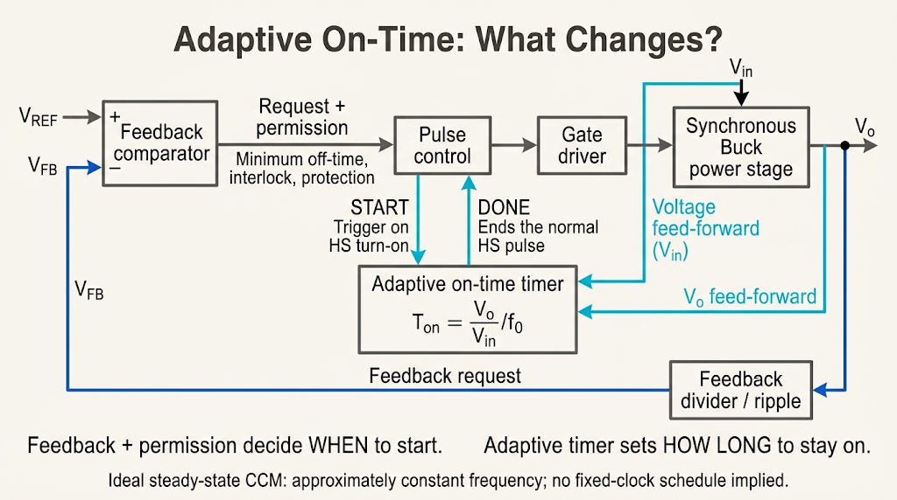
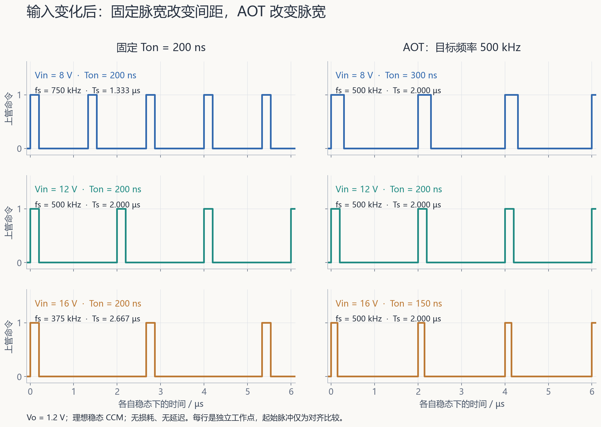
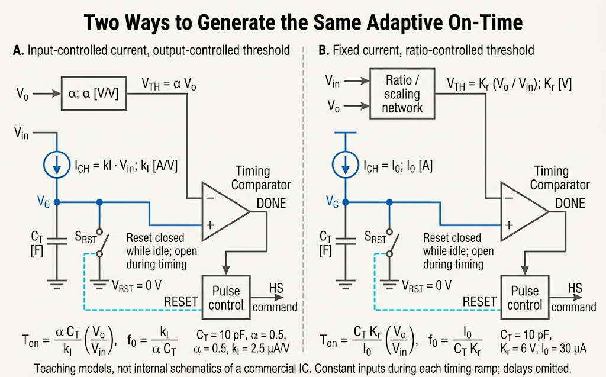
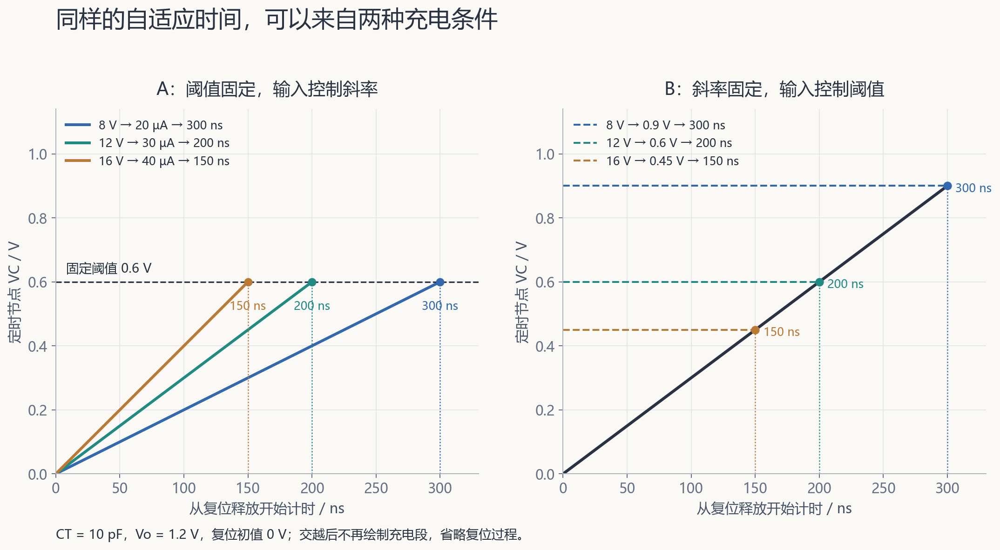
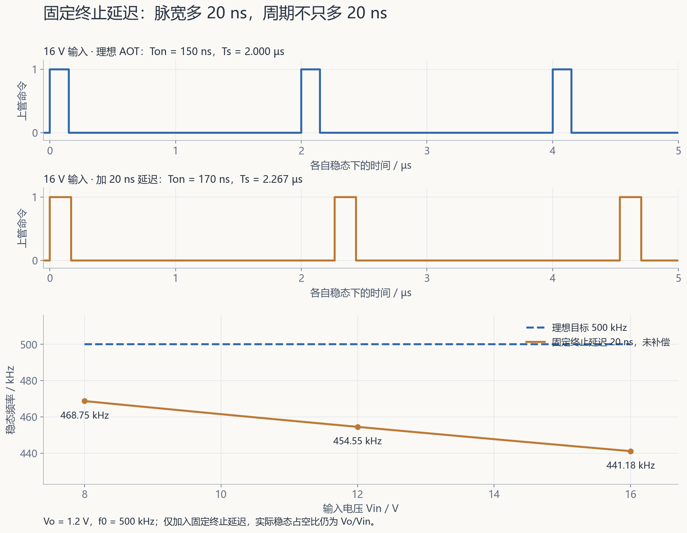

在 [COT 控制周期](/zh/notes/buck-cot-cycle/) 与 [Fixed On-Time Timer](/zh/notes/buck-on-time-timer/) 中，我们把每次导通时长 $T_{on}$ 当成写死的固定值。但一个很现实的问题马上浮出水面：

**如果输入电压 $V_{in}$ 从 $8\text{ V}$ 升到 $16\text{ V}$，而 $T_{on}$ 还死死卡在 $200\text{ ns}$ 不动，开关频率会掉到只剩原来的一半！**

**AOT（Adaptive On-Time，自适应导通时间）** 的解决办法极其漂亮：**保留“比较器请求开通”的快响应外壳，只把定时器的时间尺改成按工作点自动缩放——输入越高就缩得越短，输出越高就拉得越长。**

> **全篇核心公式**
> $$\boxed{T_{on,set} = \frac{1}{f_0}\frac{V_o}{V_{in}}.}$$
> 只要让电容定时器的充电时长正比于 $V_o / V_{in}$，无论电池电压怎么掉、输入适配器怎么换，稳态开关频率都能稳稳落在目标 $f_0$ 附近。

前置知识：[Buck 功率级](/zh/notes/buck-day-01/) · [COT 事件链](/zh/notes/buck-cot-cycle/) · [电容定时器](/zh/notes/buck-on-time-timer/)

---

## 1. 为什么固定 $T_{on}$ 会随输入电压“掉频”？

在连续导通模式（CCM）下，理想稳态要求占空比 $D = V_o / V_{in}$，而占空比又等于导通时间乘以开关频率：

$$D = T_{on} f_s \implies f_s = \frac{D}{T_{on}} = \frac{V_o}{V_{in} T_{on}}.$$

- **传统 COT（固定 $T_{on}$）**：物理上，输入 $V_{in}$ 越高，上管导通期电感充电斜率 $(V_{in}-V_o)/L$ 越陡，同样开 $200\text{ ns}$ 冲进电感的电流增量变大；为了把这多出来的电流用恒定的 $-V_o/L$ 斜坡放完，下管关断时间 $T_{off}$ 被迫拉长，于是周期翻倍、**频率按 $1/V_{in}$ 往下掉**。
- **AOT（自适应 $T_{on}$）**：既然目标就是保住频率 $f_s = f_0$，直接反解上式，令每次设定的导通时间跟踪电压比：
  $$T_{on,set} = \frac{1}{f_0}\frac{V_o}{V_{in}}.$$

| 变化条件（其余固定） | 理想 AOT 怎么改 $T_{on}$ | 背后物理原因 |
| --- | --- | --- |
| **输入 $V_{in}$ 升高** | **缩短** | 充流斜率变陡，缩短脉宽才能让总周期不变 |
| **输出 $V_o$ 升高** | **加长** | 所需占空比变大，同一周期内必须多导通一会儿 |
| **目标频率 $f_0$ 升高** | **缩短** | 占空比不变，把整个周期等比例压缩 |

---

## 2. 六行算例：对比固定 $T_{on}$ 与 AOT（$V_o=1.2\text{ V}$）

假设目标频率 $f_0 = 500\text{ kHz}$（周期 $2.0\,\mu\text{s}$），对比固定 $T_{on}=200\text{ ns}$ 与 AOT 在三种输入下的工作点：

| 控制方式 | $V_{in}$ | 所需占空比 $D$ | 实际 $T_{on}$ | 稳态频率 $f_s$ | 开关周期 $T_s$ |
| --- | --- | --- | --- | --- | --- |
| 固定 $T_{on}$ | $8\text{ V}$ | $15.0\%$ | $200\text{ ns}$ | **$750\text{ kHz}$** | $1.333\,\mu\text{s}$ |
| 固定 $T_{on}$ | $12\text{ V}$ | $10.0\%$ | $200\text{ ns}$ | **$500\text{ kHz}$** | $2.000\,\mu\text{s}$ |
| 固定 $T_{on}$ | $16\text{ V}$ | $7.5\%$ | $200\text{ ns}$ | **$375\text{ kHz}$** | $2.667\,\mu\text{s}$ |
| **AOT** | **$8\text{ V}$** | $15.0\%$ | **$300\text{ ns}$** | **$500\text{ kHz}$** | **$2.000\,\mu\text{s}$** |
| **AOT** | **$12\text{ V}$** | $10.0\%$ | **$200\text{ ns}$** | **$500\text{ kHz}$** | **$2.000\,\mu\text{s}$** |
| **AOT** | **$16\text{ V}$** | $7.5\%$ | **$150\text{ ns}$** | **$500\text{ kHz}$** | **$2.000\,\mu\text{s}$** |

> **一个常见误解**：频率稳住了，电感电流纹波就恒定了吗？**并没有！**
> 把 $T_{on,set}$ 代回纹波公式可得 $\Delta i_{L,AOT} = \dfrac{V_o}{L f_0}\left(1-\dfrac{V_o}{V_{in}}\right)$。当 $V_{in}$ 升高时，$(1-D)$ 变大，电感纹波峰峰值依然会略微增大。

---

## 3. 两种典型电路：如何把 $V_o/V_{in}$ 塞进电容定时器？

回到电容充电方程 $T_{charge} = \dfrac{C_T V_{TH}}{I_{CH}}$，我们要让它正好等于 $\dfrac{1}{f_0}\dfrac{V_o}{V_{in}}$，电路上有两条最经典的路子：

### 方式 A（最常用）：输入控电流，输出控阈值

令充电电流正比于输入、阈值电压正比于输出：

$$I_{CH} = k_I V_{in},\qquad V_{TH}=\alpha V_o \implies T_{charge}=\frac{\alpha C_T}{k_I}\frac{V_o}{V_{in}} \implies \boxed{f_0=\frac{k_I}{\alpha C_T}.}$$

代入本例数值：$C_T=10\text{ pF}$、$\alpha=0.5$、$k_I=2.5\,\mu\text{A/V}$。固定 $V_o=1.2\text{ V}$ 时阈值恒为 $0.6\text{ V}$；$V_{in}$ 为 $8, 12, 16\text{ V}$ 时充电电流自动变为 $20, 30, 40\,\mu\text{A}$，正好交越在 $300, 200, 150\text{ ns}$！

### 方式 B：固定电流，阈值直接取电压比

保持 $I_{CH}=I_0$ 固定，由模拟除法器或开关电容网络生成阈值 $V_{TH}=K_r \dfrac{V_o}{V_{in}}$：

$$T_{charge}=\frac{C_T K_r}{I_0}\frac{V_o}{V_{in}} \implies \boxed{f_0=\frac{I_0}{C_T K_r}.}$$

取 $C_T=10\text{ pF}$、$I_0=30\,\mu\text{A}$（固定斜率 $3\text{ mV/ns}$）、$K_r=6\text{ V}$，阈值分别落在 $0.9, 0.6, 0.45\text{ V}$，同样精确交越在 $300, 200, 150\text{ ns}$。方式 A 结构简单（只需电阻/跨导转电流），无需片内除法器，因此在芯片里最常见。

> **千万别把 $V_o$ 错接成固定参考 $V_{REF}$！**
> 外接电阻分压会把任何输出目标都分压成相同的 $V_{FB} \approx V_{REF}$。如果定时器只看固定不动的 $V_{REF}$ 而不感知真实 $V_o$（比如引脚 **VO1/VO2** 直接连到输出端，像 TI **TPS51125** 那样），就只能补偿 $V_{in}$ 变化，一旦改变输出电压设定，频率照样会跑偏。

---

## 4. 灵敏度口算：改一个元件，频率怎么偏？

对方式 A（$f_s = k_I / (\alpha C_T)$），各参数微小变化引起的频率偏移为：

$$\frac{\delta f_s}{f_s} \approx \frac{\delta k_I}{k_I} - \frac{\delta\alpha}{\alpha} - \frac{\delta C_T}{C_T}.$$

电容 $C_T$ 或阈值系数 $\alpha$ 偏大 $10\%$，频率降约 $9.1\%$；电压转电流系数 $k_I$ 偏大 $10\%$，频率跟着升 $10\%$。注意：AOT 抵消的是 $V_{in}, V_o$ 工作点漂移，器件自身的 PVT 容差仍然存在。

---

## 5. 为什么说 AOT 是“近似恒频”，而不是“绝对恒频”？

在实际芯片上，AOT 开关频率还会受到四个因素的轻微牵扯：

### 5.1 固定传播延迟在高压短脉宽下最显眼

只要关断路径存在固定延迟 $t_d$，实际导通变成 $T_{on,actual} = \dfrac{V_o}{V_{in}f_0} + t_d$。为了保住占空比 $D$，整个周期必须拉长到 $T_{on,actual}/D = \dfrac{1}{f_0} + \dfrac{t_d}{D}$，导致频率跌为：

$$\boxed{f_{s,actual} = \frac{f_0}{1 + t_d f_0 V_{in}/V_o}.}$$

输入越高、$T_{on}$ 越短，固定的 $20\text{ ns}$ 占比就越大，掉频越明显。工程上可以通过在阈值侧预先减去 $\frac{k_I V_{in}}{C_T} t_d$ 来提前终止充电、补偿掉标称延迟。

### 5.2 功率级压降（DCR 与 $R_{on}$）

随着负载 $I_o$ 增大，电感 DCR（$r_L$）和下管导通压降（$I_o R_L$）会使稳态所需占空比略微增大：

$$D_{loss}\approx\frac{V_o + I_o(R_L+r_L)}{V_{in} + I_o(R_L-R_H)}.$$

如果定时器只看着无损的 $V_o / V_{in}$ 给固定脉宽，频率也会随重载略微上飘（部分高端芯片会再引一条负载电流前馈来抵消它，见[定时器的负载修正](/zh/notes/buck-on-time-timer/)）。

### 5.3 瞬态与轻载

- **负载/输入阶跃瞬态**：AOT 没有固定时钟锁死相位，反馈比较器一喊需要补能就可以马上打脉冲，瞬态期间频率会暂时飙高追流；
- **轻载 DCM**：进入二极管仿真模式后，电容靠自己慢慢供电，开关频率按负载比例自动往下降以省电。

### 5.4 最短导通/关断时间边界

任何时候目标脉宽都必须落在电路物理极限内：$DT_0 \ge T_{on,min}$ 且 $(1-D)T_0 \ge T_{off,min}$。

---

## 6. 定时方式一句话对比

| 架构 | Timer 用什么信息 | 调什么量 | 优点与用途 |
| --- | --- | --- | --- |
| **固定 $T_{on}$ COT** | 固定电容/电流/阈值 | 只改下一次开通时刻 | 最简单，但 $f_s \propto 1/V_{in}$ |
| **电压前馈 AOT** | 额外接入 $V_{in}$、$V_o$ | $T_{on}\propto V_o/V_{in}$ | 稳态频率近似恒定，兼顾 COT 瞬态快响应 |
| **带负载修正 AOT** | 再加上电流信息 | 补偿功率级电阻压降 | 重载大电流下也能把频率稳住 |

---

## 7. 练习自测

**题目**：理想同步 Buck，$V_o=1.5\text{ V}$，输入分别取 $9\text{ V}$ 和 $15\text{ V}$。
1. 若采用固定 $T_{on}=250\text{ ns}$，求两档输入的占空比和频率；
   > **答**：$9\text{ V}$ 时 $D=16.67\%, f_s=666.7\text{ kHz}$；$15\text{ V}$ 时 $D=10.0\%, f_s=400\text{ kHz}$。
2. 若改用目标频率 $f_0=600\text{ kHz}$ 的 AOT，分别该设多长的 $T_{on}$？
   > **答**：$9\text{ V}$ 时 $T_{on}=277.8\text{ ns}$；$15\text{ V}$ 时 $T_{on}=166.7\text{ ns}$。
3. 若上管关断路径多出 $20\text{ ns}$ 未补偿延迟，求 $15\text{ V}$ 下的实际稳态频率（为什么周期不是简单加 20 ns）？
   > **答**：实际 $T_{on}=186.7\text{ ns}$。为了保持 $D=0.10$ 的伏秒平衡，关断时间也必须按比例拉长，故总周期 $T_s = 186.7\text{ ns} / 0.10 = 1.867\,\mu\text{s}$（实际比目标多出了 $200\text{ ns}$！），实际频率跌至 **$535.7\text{ kHz}$**。

---

## 参考资料

1. Microchip, [Adaptive Constant On-Time Control](https://developerhelp.microchip.com/xwiki/bin/view/applications/power/mastering-buck-converters/analog-control-methods/acot/) & [AN7167 §2.1](https://onlinedocs.microchip.com/oxy/GUID-91FBF307-A386-40BF-BE38-059BFCE54E51-en-US-1/GUID-783283B1-F97A-4C44-87A2-9776489F85E7.html)（AOT 定时原理）。
2. Texas Instruments, [TPS51125 Datasheet](https://www.ti.com/lit/ds/symlink/tps51125.pdf)（§7.3.1–7.3.2，输入输出电压前馈实现）。
