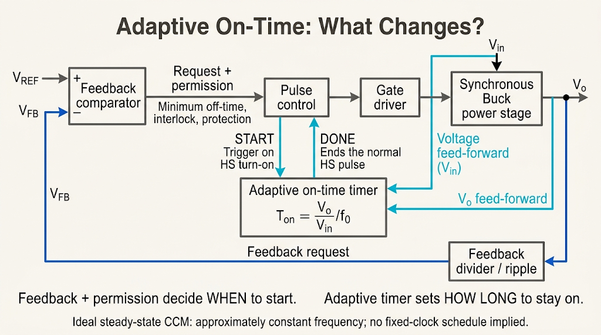
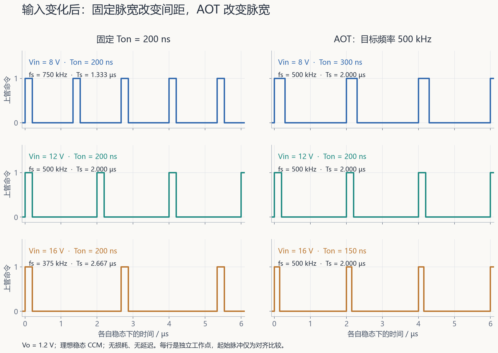
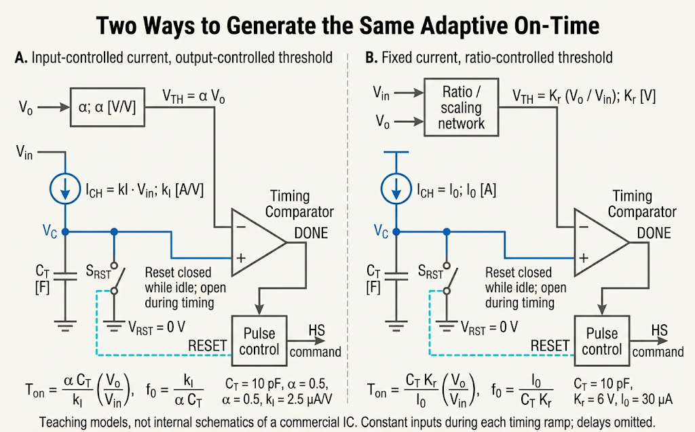
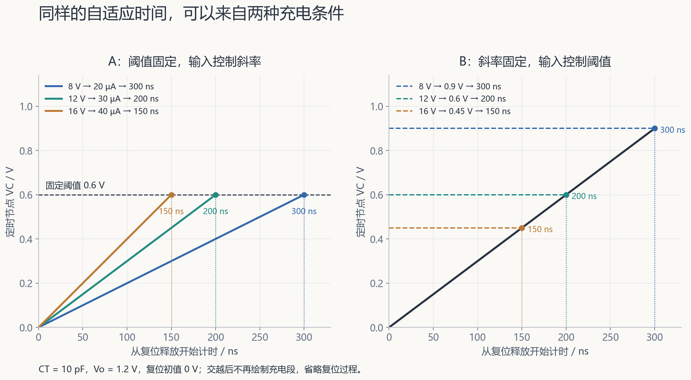

[电容定时器笔记](/zh/notes/buck-on-time-timer/)已经解释：恒流给电容充电，电压达到阈值，就能结束一次上管导通。接下来有一个自然的问题：**同样长的一次导通，在不同输入电压下，对电感产生的作用还一样吗？如果不一样，开关频率会怎样变化？**

输入电压升高时，上管导通期间的电感增流更快。如果仍保持相同脉宽，为维持相同输出，稳态中两次脉冲之间就需要更长的等待，频率随之下降。AOT（Adaptive On-Time，自适应导通时间）沿着这条因果链调整时间尺：输入较高时缩短导通，输出目标较高时延长导通，使稳态频率接近预定值。

本篇先建立这一直觉，再把电压比放进电容定时器。重点是输入、输出电压参与的定时关系；纹波网络传递函数与负载相关修正留给各自的专题。

[学习地图：AOT](/zh/learn/#aot) · [全部笔记](/zh/notes/) · [Buck 功率级](/zh/notes/buck-day-01/) · [COT 事件链](/zh/notes/buck-cot-cycle/) · [电容定时器](/zh/notes/buck-on-time-timer/)

| 要解决的问题 | 先抓住的意思 | 章节 |
| --- | --- | --- |
| 固定导通时间为什么会变频？ | 电压比约束占空比，固定脉宽把变化留给周期 | §1–2 |
| Adaptive 调整哪个时间？ | 调整每次正常导通的设定时长 | §1–2 |
| 电压比怎样变成时间？ | 改变充电斜率，或改变到阈值的电压路程 | §4–5 |
| 实际器件是不是这样接？ | 功能关系可对照，内部连接需看器件资料 | §6 |
| 为什么仍称近似恒频？ | 延迟、损耗、模式和瞬态都会影响周期 | §7 |

本文主模型是理想同步 Buck、稳态连续导通模式（CCM），忽略损耗、死区与传播延迟；在讨论具体误差时再单独加入该因素。$T_{on}$ 指上管有效导通时间，理想模型中它与定时器充电时间相同。每幅波形使用本节给定的模型与参数，不能单凭这些关系判断闭环稳定性。

## 1. 从已有控制链出发：这次只改变时间尺

### 1.1 开始导通与结束导通仍由不同路径负责

在[纹波反馈 COT 的完整周期](/zh/notes/buck-cot-cycle/)中，反馈比较器提出补能请求；请求满足最小关断时间、互锁与保护许可后，控制逻辑启动上管脉冲。正常导通由 one-shot 定时器到期结束。

AOT 保留这一事件分工，但定时器不再始终产生同一个脉宽，而是根据工作点更新导通时间。于是有两个不同层次的调节：

- 反馈与许可决定下一次什么时候开始，关断等待时间随运行情况变化。
- 自适应定时器决定本次正常导通持续多久；保护可以提前覆盖正常结束。

因此，“自适应”首先指 $T_{on}$ 的设定规律；它并不意味着独立设好 $T_{off}$，也不意味着每隔固定周期必须开通。电感电流在 CCM 中始终大于零，也不妨碍下一次脉冲产生；轻载零电流检测负责的动作见[原笔记的 ZCD 解释](/zh/notes/buck-cot-cycle/#6-轻载周期-zcd-结束续流-反馈决定下一次补能)。

### 1.2 从电感增流看输入升高为什么需要改变脉宽

上管导通时，电感两端电压近似为 $V_{in}-V_o$，所以一次导通造成的增流为：

$$
\Delta i_L=\frac{V_{in}-V_o}{L}T_{on}.
\tag{1}
$$

$L$ 是电感值。固定 $V_o$、$L$ 和 $T_{on}$ 时，提高 $V_{in}$ 会增加每次脉冲的增流量。关断时的减流斜率仍近似为 $-V_o/L$，因此需要更长的关断时间，才能把这次增加的电流降回来。

这解释了固定 $T_{on}$ 变频的原因。若希望在新的输入下仍保持原来的周期，就应缩短这次导通，而不是只等待更久。精确的比例需要从稳态约束推出来。

## 2. 用两条关系推导目标导通时间

### 2.1 电压比决定稳态需要的导通比例

定义周期 $T_s=T_{on}+T_{off}$，开关频率 $f_s=1/T_s$，占空比 $D=T_{on}/T_s$。理想两状态 CCM 中，一个周期结束后电感电流回到起点，因而有：

$$
(V_{in}-V_o)T_{on}-V_oT_{off}=0.
\tag{2}
$$

整理得到：

$$
V_{in}T_{on}=V_oT_s,
\qquad D=\frac{V_o}{V_{in}}.
\tag{3}
$$

这里比较的是不同电压工作点下各自建立的稳态，并没有要求输入跳变时的每一个周期都满足式 (3)。伏秒平衡与分段电流的基础见[Buck 功率级笔记](/zh/notes/buck-day-01/)。

### 2.2 固定 Ton，把输入变化变成频率变化

由占空比的定义：

$$
D=T_{on}f_s,
\qquad f_s=\frac{D}{T_{on}}=\frac{V_o}{V_{in}T_{on}}.
\tag{4}
$$

如果固定的是 **$T_{on}$ 和输出电压 $V_o$**，则 $f_s\propto1/V_{in}$。输入翻倍，所需占空比减半；脉宽不变，就只能把周期加倍，频率减半。

这不是说固定导通时间一定不能稳压。它仍可通过改变下一次开通时刻来调节输出，只是频率随工作点变化，给开关损耗、磁性元件与干扰频段的安排增加了约束。

### 2.3 改为固定目标频率，反求需要的 Ton

现在把保持不变的量换成目标频率 $f_0$。由式 (4) 反解：

$$
\boxed{T_{on,set}=\frac{1}{f_0}\frac{V_o}{V_{in}}.}
\tag{5}
$$

$T_{on,set}$ 是希望定时器给出的导通时间。比较时应分别说明固定了什么：

| 改变的量 | 固定的量 | 所需导通时间 | 物理含义 |
| --- | --- | --- | --- |
| 输入 $V_{in}$ 升高 | $V_o,f_0$ | 减小 | 增流斜率更大，缩短正向加压时间 |
| 输出 $V_o$ 升高 | $V_{in},f_0$ | 增大 | 所需稳态占空比更大，在同一周期内增加导通占比 |
| 目标频率 $f_0$ 升高 | $V_{in},V_o$ | 减小 | 占空比不变，把整个周期按比例缩短 |

式 (5) 是本文的电压前馈目标。它通过工作点预测所需脉宽；输出误差仍由反馈路径纠正。“Constant On-Time”在一些器件名称中指给定工作点下的定时脉冲，不代表输入输出改变以后脉宽仍完全相同。

## 3. 六行算例：同样稳压，脉宽与周期怎样分配

取 $V_o=1.2\,\mathrm V$，比较固定 $T_{on}=200\,\mathrm{ns}$ 与目标 $f_0=500\,\mathrm{kHz}$ 的 AOT。三个输入工作点都采用无损稳态 CCM，忽略传播延迟，故 $D=V_o/V_{in}$。

| 控制方式 | $V_{in}$ | $D$ | $T_{on}$ | $f_s$ | $T_s$ |
| --- | --- | --- | --- | --- | --- |
| 固定导通时间 | 8 V | 0.150（15%） | 200 ns | 750 kHz | 1.333 µs |
| 固定导通时间 | 12 V | 0.100（10%） | 200 ns | 500 kHz | 2.000 µs |
| 固定导通时间 | 16 V | 0.075（7.5%） | 200 ns | 375 kHz | 2.667 µs |
| AOT | 8 V | 0.150（15%） | 300 ns | 500 kHz | 2.000 µs |
| AOT | 12 V | 0.100（10%） | 200 ns | 500 kHz | 2.000 µs |
| AOT | 16 V | 0.075（7.5%） | 150 ns | 500 kHz | 2.000 µs |

例如 16 V 输入时，所需占空比为 $1.2/16=0.075$。固定 200 ns 得到 $0.075/(200\,\mathrm{ns})=375\,\mathrm{kHz}$；若希望周期为 2 µs，则导通时间应为 $0.075\times2\,\mathrm{\mu s}=150\,\mathrm{ns}$。

图中第一脉冲对齐，只为比较宽度与间距；AOT 的 2 µs 间距来自该理想稳态关系，并不表示控制器收到一个固定周期时钟。在同一个 16 V 工作点，固定 Ton 的关断时间约为 2.467 µs，AOT 则为 1.850 µs；两者的导通占比都是 7.5%。

输入、输出电压变化被 Ton 比例抵消，也不意味着所有其他量恒定。例如代入式 (1)：

$$
\Delta i_{L,AOT}=\frac{V_o}{Lf_0}\left(1-\frac{V_o}{V_{in}}\right).
\tag{6}
$$

即使 $V_o,L,f_0$ 固定，电感纹波仍随输入变化。**近似恒频解决的是周期安排，不能替代纹波、稳定性或输出精度分析。** 反馈信号与人工纹波的作用见[纹波反馈专题](/zh/notes/buck-cot-ripple/)。

## 4. 把电压比放进电容定时器

### 4.1 先明确起点与电压路程

[电容定时器](/zh/notes/buck-on-time-timer/)给出的关系为：

$$
T_{charge}=\frac{C_T(V_{TH}-V_{RST})}{I_{CH}}.
\tag{7}
$$

$C_T$ 是定时电容，$I_{CH}$ 是净充电电流，$V_{RST}$ 是复位释放后的初值，$V_{TH}$ 是结束计时的阈值。以下两种功能实现都取 $V_{RST}=0$，并把每次计时内的输入量近似为常数；比较器连续检测，斜坡起点与上管导通起点一致，暂不加延迟。

因此需要实现的是：

$$
\frac{C_TV_{TH}}{I_{CH}}=\frac{1}{f_0}\frac{V_o}{V_{in}}.
\tag{8}
$$

这个式子没有唯一的电路实现。可以让电流随输入变化、阈值随输出变化，也可以先生成电压比，再用它控制阈值。

### 4.2 方式 A：输入控制斜率，输出控制阈值

设受控电流源和阈值满足：

$$
I_{CH}=k_I V_{in},\qquad V_{TH}=\alpha V_o.
\tag{9}
$$

$k_I$ 是电压转电流的比例系数，单位 A/V；$\alpha$ 是无量纲电压比例。这里用 $k_I$ 表示整个功能模块的系数，不把它等同于某一只 MOS 的小信号跨导。

输入升高，充电电流增大，斜坡变陡，更早到达阈值；输出升高，阈值升高，需要走更长的电压路程，计时变长。代入式 (7)：

$$
T_{charge}=\frac{\alpha C_T}{k_I}\frac{V_o}{V_{in}},
\qquad \boxed{f_0=\frac{k_I}{\alpha C_T}.}
\tag{10}
$$

系数 $\alpha C_T/k_I$ 的单位是秒，因此它正是目标周期。取：

$$
C_T=10\,\mathrm{pF},\quad \alpha=0.5,\quad
k_I=2.5\,\mathrm{\mu A/V},
\tag{11}
$$

就得到 $\alpha C_T/k_I=2\,\mathrm{\mu s}$，对应 500 kHz。固定 $V_o=1.2$ V，阈值保持 0.6 V；输入为 8、12、16 V 时，充电电流分别为 20、30、40 µA，交越时间分别为 300、200、150 ns，恰好对应六行表。

### 4.3 方式 B：固定电流，把电压比变成阈值

另一种功能实现是保持 $I_{CH}=I_0$，让阈值满足：

$$
V_{TH}=K_r\frac{V_o}{V_{in}}.
\tag{12}
$$

$V_o/V_{in}$ 无量纲，故 $K_r$ 的单位必须是伏。于是：

$$
T_{charge}=\frac{C_TK_r}{I_0}\frac{V_o}{V_{in}},
\qquad \boxed{f_0=\frac{I_0}{C_TK_r}.}
\tag{13}
$$

取同样的 $C_T=10$ pF，再取 $I_0=30$ µA、$K_r=6$ V，也得到 2 µs 的比例系数。固定 $V_o=1.2$ V，输入为 8、12、16 V 时，阈值分别为 0.9、0.6、0.45 V；斜率始终为 $I_0/C_T=3$ mV/ns，因此仍得到 300、200、150 ns。

**$K_r=6$ V 是阈值比例系数；本算例的实际阈值只有 0.45–0.9 V。** 实际电路仍要检查整个工作范围内的阈值与比较器共模余量。这里的比值模块是功能要求，不代表随手连接几个 MOS 就实现了准确除法。

两种方式在理想代数关系上等效，实际代价却不同。方式 A 要保证电压转电流与阈值跟踪的线性和余量；方式 B 要准确生成比值，并保持阈值动态范围。两者都需要明确复位、更新时间、噪声与延迟，不能只比较公式。

### 4.4 为什么固定 VREF 不能随意替代 Vo

如果输出目标始终固定，让 $I_{CH}\propto V_{in}$、阈值固定，也能补偿输入变化。但若要在改变输出设定以后仍维持同一目标频率，定时器必须得到输出电压或等效设定比例的信息。

稳压时，反馈分压点往往始终接近固定参考。只看这个近似不变的 $V_{FB}$，通常不能知道外部分压电阻已经把输出从一个目标调到另一个目标。因此不能直接把式 (9) 中的 $V_o$ 写成任意固定 $V_{REF}$，然后仍宣称实现了输出电压前馈；需要说明分压比例、输出设定编码或额外感知路径怎样进入定时器。

## 5. 调整哪些参数，会把频率往哪边推

先固定输入输出电压，再看方式 A 的 $f_s=k_I/(\alpha C_T)$：

| 单独增大的参数 | 定时节点发生什么 | $T_{charge}$ | 稳态频率 |
| --- | --- | --- | --- |
| $C_T$ | 同样电流下升压更慢 | 增大 | 降低 |
| $k_I$ | 充电电流变大，斜坡更陡 | 减小 | 升高 |
| $\alpha$ | 阈值升高，要补的电荷更多 | 增大 | 降低 |

小变化可写成：

$$
\frac{\delta f_s}{f_s}\approx
\frac{\delta k_I}{k_I}-\frac{\delta\alpha}{\alpha}
-\frac{\delta C_T}{C_T}.
\tag{14}
$$

方式 B 对应 $\delta f_s/f_s\approx\delta I_0/I_0-\delta K_r/K_r-\delta C_T/C_T$。例如只把电容增大 10%，频率的精确结果是 $500/1.1\approx454.5$ kHz，降低约 9.1%；一阶估计才是降低 10%。

AOT 抵消的是所设计的输入输出电压比例，不会同时消除这些系数的工艺、温度、失配与非线性误差。复位残压、比较器失调和抖动的机制已在[定时器误差分析](/zh/notes/buck-on-time-timer/#8-把静态误差-pvt-与随机抖动分开)展开，这里不重复推导。

## 6. 对照资料：功能关系与实际器件分开读

[Microchip 的 ACOT 教程 Figure 1](https://developerhelp.microchip.com/xwiki/bin/view/applications/power/mastering-buck-converters/analog-control-methods/acot/)用输入相关电流和输出相关阈值说明自适应定时；[AN7167 §2.1、Figure 2-1](https://onlinedocs.microchip.com/oxy/GUID-91FBF307-A386-40BF-BE38-059BFCE54E51-en-US-1/GUID-783283B1-F97A-4C44-87A2-9776489F85E7.html)也给出相同方向的推导。阅读时先确认每个系数控制电流还是电压，保留单位比记忆符号更可靠。

[TPS51125 数据手册 Rev. H](https://www.ti.com/lit/ds/symlink/tps51125.pdf)中，§7.3.1 讲 PWM 事件，§7.3.2 才是 Adaptive On-Time Control and PWM Frequency。该节说明输入、输出电压前馈进入 one-shot，脉宽随输入反比、随输出正比，TONSEL 选择频率档位。

引脚名称也应区分：VFB1/2 是反馈分压输入，VO1/2 是输出连接，VREF 是参考输出。手册给出的上述功能关系，不能单独证明内部一定采用式 (9) 的电流源和阈值电路。读接口可结合 §5 与 §7.2 的框图；不能由“使用输出信息”跳到“阈值一定直接接 VFB 或 VREF”的结论。

本篇的 1.2 V、500 kHz 是独立教学参数；TPS51125 的规定输出范围为 2–5.5 V，不能据此把本算例当作该器件的设计方案。器件阅读的目的，是核对 AOT 的功能分工与比例方向。

## 7. 为什么这个关系只能保证近似恒频

### 7.1 固定终止延迟，对短脉冲影响更大

首先只加入一个误差：从 Timer 阈值交越到上管有效关断，额外增加固定 $t_d$；有效开通与斜坡仍同步，其他条件保持理想。这时：

$$
T_{on,actual}=\frac{V_o}{V_{in}f_0}+t_d.
\tag{15}
$$

重新建立无损 CCM 稳态后，占空比仍需等于 $D=V_o/V_{in}$，于是：

$$
\boxed{f_{s,actual}=\frac{D}{D/f_0+t_d}
=\frac{f_0}{1+t_df_0V_{in}/V_o}.}
\tag{16}
$$

这里不能直接把实际周期写成 $1/f_0+t_d$。脉宽延长以后，为保持原来的占空比，关断时间也需要改变，实际周期为：

$$
T_{s,actual}=\frac{T_{on,actual}}{D}
=\frac1{f_0}+\frac{t_d}{D}.
\tag{17}
$$

沿用 $V_o=1.2$ V、$f_0=500$ kHz，只加 $t_d=20$ ns：

| $V_{in}$ | 理想设定 $T_{on}$ | 实际 $T_{on}$ | 实际频率 | 相对目标偏差 |
| --- | --- | --- | --- | --- |
| 8 V | 300 ns | 320 ns | 468.75 kHz | −6.25% |
| 12 V | 200 ns | 220 ns | 454.55 kHz | −9.09% |
| 16 V | 150 ns | 170 ns | 441.18 kHz | −11.76% |

 扫描输入；同样 20 ns 延迟，在较短脉宽处占比更大。")

物理上重要的是延迟占理想脉宽的比例 $t_d/T_{on,set}$。实际 Timer 若采用不同的开始边沿、存在开通延迟或驱动边沿差，应按[原笔记的边沿定义](/zh/notes/buck-on-time-timer/#6-先定义量测边沿-再谈真实导通时间)重新计算，不能把所有延迟和死区一律相加。

### 7.2 延迟能否通过阈值预先补偿

在上述固定延迟模型中，希望实际导通仍为 $D/f_0$，可以把充电目标缩短为：

$$
T_{charge,set}=\frac{D}{f_0}-t_d>0.
\tag{18}
$$

方式 A 保持 $I_{CH}=k_IV_{in}$ 时，对应阈值为：

$$
V_{TH,comp}=\alpha V_o-\frac{k_IV_{in}}{C_T}t_d,
\qquad \frac{\alpha C_T}{k_I}=\frac1{f_0}.
\tag{19}
$$

这给出一个可推演的补偿方向：电流越大，同样提前量对应的阈值扣除越多。但它只补偿假定的固定延迟；实际延迟随斜率、共模与温度改变时，还会有残差。阈值也必须高于有效初值，且充电时间必须足够电路完成释放和判决。负的充电时间没有物理意义。

### 7.3 功率级损耗改变所需占空比

导通电阻与[电感 DCR](/zh/notes/buck-dcr/)使功率级产生额外压降。用 $R_H$、$R_L$ 分别表示上、下管导通电阻，用 $r_L$ 表示电感 DCR；在电流纹波较小、以平均电流 $I_o$ 估计导通压降，忽略死区及其他损耗时，伏秒平衡近似给出：

$$
D_{loss}\approx
\frac{V_o+I_o(R_L+r_L)}{V_{in}+I_o(R_L-R_H)}.
\tag{20}
$$

原因是上管阶段的电感电压约为 $V_{in}-V_o-I_o(R_H+r_L)$，下管阶段约为 $-V_o-I_o(R_L+r_L)$。在正常降压范围内，补偿这些电阻压降需要比无损模型更大的占空比。

如果定时器仍只按无损电压比给出 $T_{on}=V_o/(V_{in}f_0)$，则本模型中：

$$
\frac{f_{s,actual}}{f_0}\approx
\frac{D_{loss}}{V_o/V_{in}}.
\tag{21}
$$

所以电阻损耗可能引起随负载上升的频率漂移；具体趋势仍要结合实际定时和功率级判断。此处只建立原因，不展开负载修正电路。前一篇[定时器笔记](/zh/notes/buck-on-time-timer/#12-对照论文-fig-8-a-相同定时核心-不同自适应目的)已区分电压前馈 AOT 与负载相关 AOT，两者的自适应目标不同。

### 7.4 瞬态、轻载与最短时间限制

输入或负载变化期间，电感电流正在转移到新的工作点，不必逐周期满足零净变化。反馈可能提前或推迟下一次开通，因此式 (3) 的稳态推导不能直接预测该过程的每个周期。相关物理过程见[负载阶跃与电荷恢复](/zh/notes/buck-day-02/)。

轻载采用禁止反向电流的二极管仿真模式时，下管在过零处关断，随后出现零电流等待区间；这是第三种状态，$D=V_o/V_{in}$ 的两状态推导不再直接成立。跳脉冲或 PFM 策略可让平均开关频率下降，但不能把这种策略当成所有 DCM 控制器的必然行为；允许反向电流的强制连续模式又不同。模式与动作见[COT 轻载周期](/zh/notes/buck-cot-cycle/#6-轻载周期-zcd-结束续流-反馈决定下一次补能)。

最后，计算出来的脉宽必须做得出来。目标周期 $T_0=1/f_0$ 应满足：

$$
DT_0\ge T_{on,min},\qquad
(1-D)T_0\ge T_{off,min}.
\tag{22}
$$

这些只是必要时序条件；复位、驱动互锁和保护也要满足。高输入、低输出容易碰到最短导通限制，高占空比则容易碰到最短关断限制。AOT 的比例式不能越过实际电路的时间下限。

## 8. 把几种控制目标放在一起

| 定时方式 | 定时器使用的信息 | 调整的量 | 希望达到的效果 | 主要适用条件 |
| --- | --- | --- | --- | --- |
| 固定 $T_{on}$ | 固定的电容、电流与阈值 | 正常脉宽不随电压工作点调整；反馈改变下次开始时刻 | 产生可重复脉冲并调节输出 | 频率仍取决于电压比与运行模式 |
| 电压前馈 AOT | $V_{in}$、$V_o$ 或包含等效比例的信息 | $T_{on}\propto V_o/V_{in}$ | 降低电压变化引起的稳态频率漂移 | 稳态 CCM，比例准确，损耗与时序误差较小 |
| 负载相关修正 | 留给后续专题 | — | — | — |

表中“定时器使用的信息”只描述计时部分；固定 Ton 的控制器也需要输出反馈来稳压。电压前馈 AOT 的主要收获，是让时间尺适应电压工作点；下一次开通仍由反馈与许可决定。

## 9. 自测：先写前提，再写答案

以下题目只给问题，便于独立检查。涉及的器件参数均为教学题设。

1. 电容定时器由恒流源、电容、复位开关与阈值比较器组成。推导从复位释放到阈值交越的时间，并说明什么边沿定义与近似下，固定比较器及逻辑延迟可以直接加到导通时间上。
2. 对本文指定的电压纹波反馈 COT，分别说明上管脉冲的启动与终止路径。电感电流始终大于零时，能否产生下一脉冲？说明最小关断限制，以及窗口结束后怎样处理仍有效的请求。
3. 对理想稳态 CCM Buck，推导固定目标频率所需的 $T_{on}$，再分别对应到两种电容定时方法。哪些前提在瞬态或轻载模式下可能不再成立？
4. 理想同步 Buck 稳态 CCM，$V_o=1.5$ V，输入分别为 9 V、15 V，忽略损耗、迟滞与延迟。① 固定 $T_{on}=250$ ns，求两种输入下的占空比和频率。② 改用目标频率 600 kHz 的 AOT，求所需导通时间。③ 仅增加 20 ns 固定终止延迟，定时器仍按②设置且不补偿，求重新建立稳态后的实际频率。全部结果带单位，并说明实际周期为什么不能只增加 20 ns。

## 参考资料与延伸阅读

1. Microchip, [Adaptive Constant On-Time Control, Developer Help](https://developerhelp.microchip.com/xwiki/bin/view/applications/power/mastering-buck-converters/analog-control-methods/acot/)，重点看开头的定时推导与 Figure 1。
2. Microchip, [AN7167 §2.1: Advancements in TON Generator](https://onlinedocs.microchip.com/oxy/GUID-91FBF307-A386-40BF-BE38-059BFCE54E51-en-US-1/GUID-783283B1-F97A-4C44-87A2-9776489F85E7.html)，定位 Figure 2-1 与导通时间、周期的比例关系。
3. Texas Instruments, [TPS51125 Datasheet, Rev. H](https://www.ti.com/lit/ds/symlink/tps51125.pdf)，§7.3.1–7.3.2 为控制与 AOT 描述，§5、§7.2 用于辨认引脚与功能框图。
4. 站内前置知识：[Buck 功率级](/zh/notes/buck-day-01/)、[ESR 与反馈纹波](/zh/notes/buck-esr-ripple/)、[COT 周期](/zh/notes/buck-cot-cycle/)、[纹波注入](/zh/notes/buck-cot-ripple/)、[固定导通时间定时器](/zh/notes/buck-on-time-timer/)。
