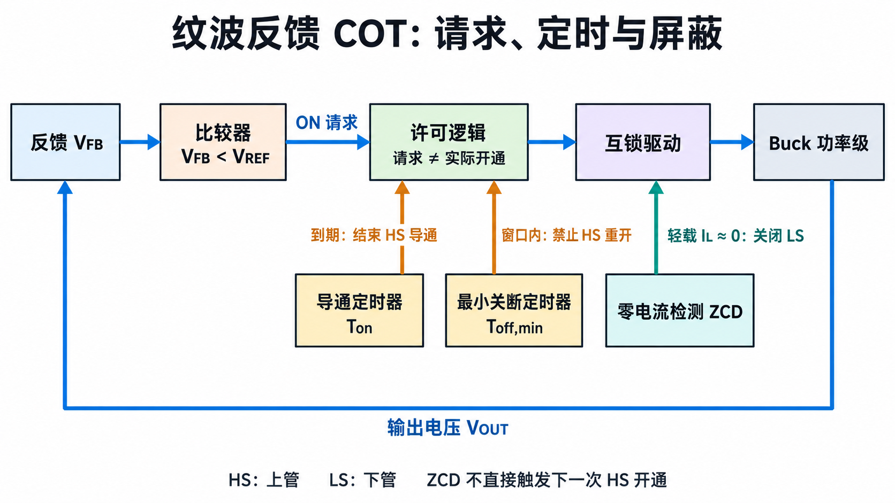
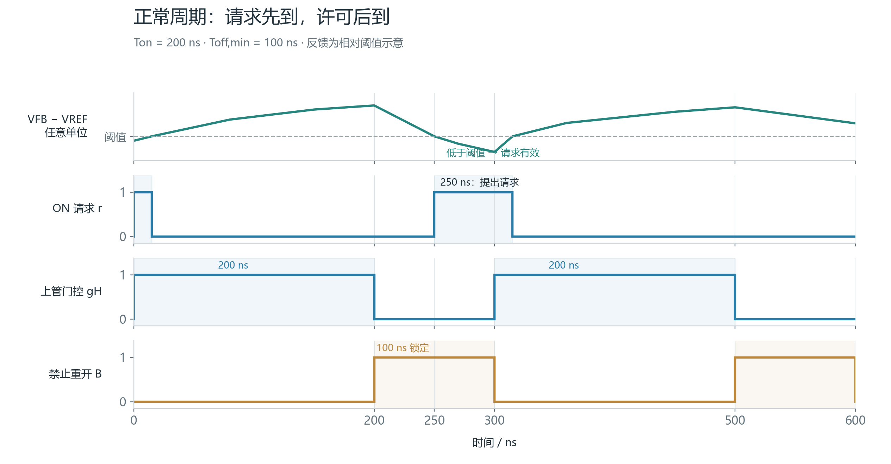
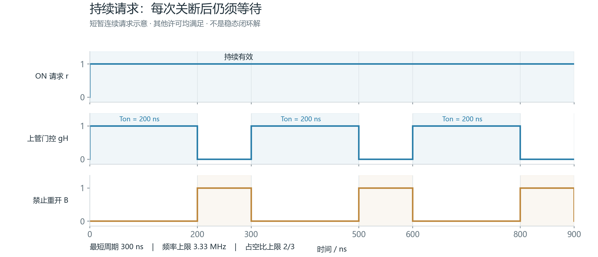
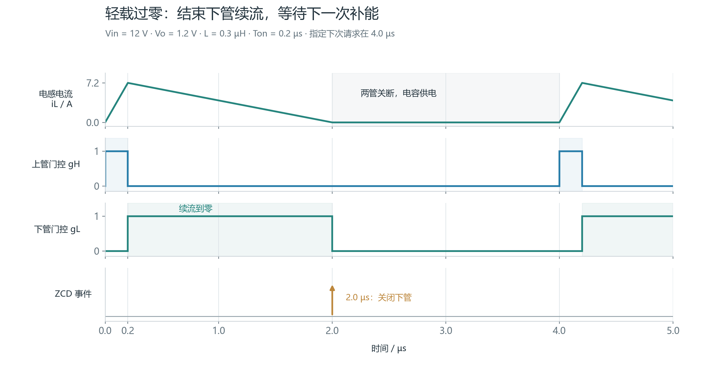
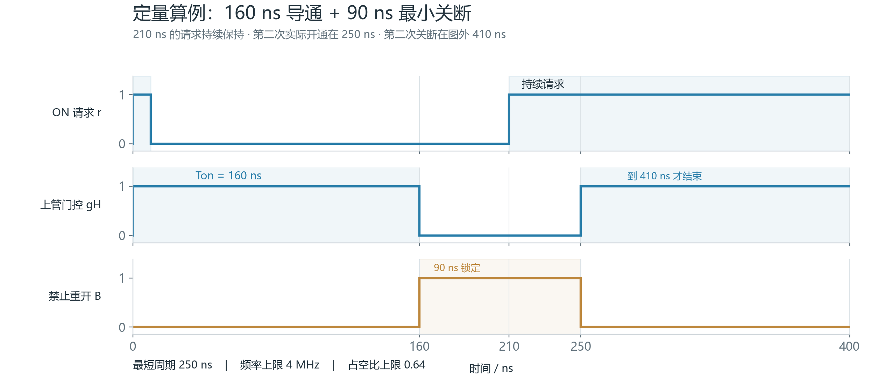

纹波反馈 COT（Constant On-Time，恒定导通时间）的关键是把三个动作分开：**反馈比较器提出上管开通请求，导通定时器结束本次导通，许可逻辑决定请求何时可以执行。** 轻载零电流检测还负责结束下管续流；它与上管触发承担不同任务。

[学习地图：COT](/zh/learn/#cot) · [全部个人笔记](/zh/notes/) · [Buck 功率级基础](/zh/notes/buck-day-01/) · [ESR、纹波与反馈](/zh/notes/buck-esr-ripple/) · [负载阶跃与电荷恢复](/zh/notes/buck-day-02/)

| 核心问题 | 结论 | 章节 |
| --- | --- | --- |
| 谁提出上管开通请求？ | 本文指定的电压纹波反馈比较器 | §1–3 |
| 谁结束正常导通？ | 从实际开通开始计时的 one-shot 定时器 | §2–3 |
| 锁定期间有请求，能否马上开通？ | 必须等最小关断窗口结束，并满足其余许可 | §4 |
| ZCD 是否启动下一次上管脉冲？ | 在本文轻载模式中，它关闭下管；下一脉冲仍由反馈与许可决定 | §6 |
| COT 的占空比也会变化吗？ | 会；固定导通时间下，周期变化同时改变频率和占空比 | §7 |
| TPS51125 是否就是固定 200 ns 的模型？ | 不是；它采用 AOT，定时由输入、输出电压决定 | §8 |

**模型范围：** 单相同步 Buck、电压纹波反馈、非重触发导通定时器。教学模型规定 $V_{FB}<V_{REF}$ 为有效请求，$T_{on}=200\,\mathrm{ns}$、$T_{off,min}=100\,\mathrm{ns}$；窗口结束后重新检查仍然有效的请求。忽略比较器、逻辑和驱动传播延迟。图中的反馈轨迹是解释事件关系的示意，不是闭环仿真或测量；轻载采用禁止反向电流的二极管仿真模式。实际器件的迟滞、保护、定时与请求保存方式须按其资料确定。

## 1. 从输出电压到开通请求

### 1.1 比较器看到的是完整反馈信号

输出电容采用 ESR 与理想电容串联模型，取 $i_C$ 流入电容支路为正：

$$
\begin{aligned}
i_C&=i_L-I_o,\\
\frac{dv_C}{dt}&=\frac{i_C}{C},\\
v_o&=v_C+R_{ESR}i_C.
\end{aligned}
\tag{1}
$$

电阻分压且忽略 FB 输入电流时，$V_{FB}=\beta v_o$，其中 $\beta=R_2/(R_1+R_2)$。反馈携带直流输出与纹波；比较器不会只看到一个孤立的交流波形。若存在注入、滤波或动态参考，须按实际信号路径修改这个模型。

在本文指定极性下：

$$
\boxed{\begin{aligned}
r(t)&=1\\
&\Longleftrightarrow V_{FB}(t)<V_{REF}
\end{aligned}}
\tag{2}
$$

$r$ 表示 **ON 请求**，不等于上管门控。负载增加时，电感电流不能突变，$i_C$ 先变负；ESR 压降和电容放电可能使反馈提前越过阈值，但实际开通仍受许可条件约束。相关推导见 [Buck 负载阶跃笔记](/zh/notes/buck-day-02/)。

### 1.2 比较器、定时器和驱动的分工

| 模块 | 接收或检测的量 | 负责的动作 |
| --- | --- | --- |
| 反馈比较器 | $V_{FB}$ 与阈值 | 提出开通请求 |
| 开通许可逻辑 | 请求、当前状态、使能、保护与锁定 | 接受或阻止请求 |
| 导通 one-shot | 实际开通事件与设定 $T_{on}$ | 定时结束正常上管导通 |
| 最小关断定时器 | 实际关断事件与 $T_{off,min}$ | 限制上管再次开通 |
| 互锁驱动 | 逻辑门控命令 | 防止上下管同时导通 |
| ZCD | 电感电流过零信息 | 二极管仿真模式下关闭下管 |

传统固定频率、后沿调制的电压模式 PWM 通常由时钟开始周期，比较器决定脉冲结束；本文 COT 由反馈与许可共同决定开始，one-shot 决定正常结束。保护可以覆盖正常时序；这一区分不等于所有控制器都采用相同内部逻辑。[Microchip 的 COT 控制说明](https://developerhelp.microchip.com/xwiki/bin/view/applications/power/mastering-buck-converters/analog-control-methods/cot/) 的细节段落采用了这一类定时描述。

## 2. 一个周期的五步事件链

1. **反馈变化：** $V_{FB}$ 下降并满足请求条件。
2. **提出请求：** 比较器令 $r=1$；此时尚未保证上管开通。
3. **执行开通：** 上管当前关断、最小关断窗口结束、使能和保护允许，且下管已安全关断；上管实际开通，同时启动导通定时器。
4. **定时结束：** $T_{on}$ 到期，上管关断。正常计时不会被新请求重启或无限延长；保护动作另按器件处理。
5. **关断与等待：** 开始 $T_{off,min}$ 锁定窗口。下管在互锁死区后续流；窗口结束且仍有有效请求，才能再次执行步骤 3。

若第 $k$ 次实际开通时刻为 $t_k$，理想教学模型有：

$$
\begin{aligned}
t_{H,off,k}&=t_k+T_{on},\\
t_{unlock,k}&=t_{H,off,k}+T_{off,min},\\
t_{k+1}&\ge t_{unlock,k}.
\end{aligned}
\tag{3}
$$

这里 $T_{off}$ 是上管本次关断到下一次开通的**总间隔**，包含锁定和可能更长的等待；它不等于下管的实际导通时长。轻载时还可能存在上下管都关断的空闲段。

## 3. 四行事件表与三个状态

| 事件 | 检测信号 | 允许条件或适用状态 | 产生的动作 | 限制或阻止什么 |
| --- | --- | --- | --- | --- |
| 上管开通请求 | $V_{FB}<V_{REF}$ | 上管关断、锁定已结束、使能与保护允许、驱动互锁满足 | 上管开通并启动 $T_{on}$ 计时 | 锁定、失能、保护或互锁可阻止开通 |
| $T_{on}$ 结束 | one-shot 到期 | 当前处于正常上管导通状态 | 上管关断并启动最小关断计时 | 结束本次正常导通；不会自动开始下一次导通 |
| 最小关断窗口结束 | 关断后已满 $T_{off,min}$ | 上管保持关断 | 恢复下一次开通的时间许可 | 窗口内禁止上管重开；到期本身不是请求 |
| 轻载零电流检测 | $i_L$ 接近零且下降 | 下管续流、二极管仿真模式 | 下管关断，进入两管关断的等待状态 | 防止下管继续导通而形成反向电流 |

逻辑可按三个状态阅读：**导通计时 → 最小关断锁定 → 可接受请求**。第三个状态可能很短，也可能长时间等待。ZCD 可以在关断阶段提前结束下管续流，但不会把上管锁定窗口提前取消。

**最小关断时间与死区不同。** 死区位于上下管交替导通的换流处，用于避免直通；最小关断时间约束上管两次脉冲之间的间隔，具体设计还可能承担电流检测、驱动与自举等时序要求。两者不能直接互换，也不必由同一个定时器实现。

## 4. 正常周期：250 ns 的请求为什么要等到 300 ns

取 $T_{on}=200\,\mathrm{ns}$、$T_{off,min}=100\,\mathrm{ns}$，从 $t=0$ 的实际开通开始；规定反馈在 250 ns 再次请求，并保持到窗口结束之后。

| 时刻或区间 | 上管状态与事件 | 对请求的处理 |
| --- | --- | --- |
| 0 ns | 上管实际开通，one-shot 开始计时 | 已有有效请求被接受 |
| 0–200 ns | 上管维持导通 | 请求恢复无效不会提前结束本次正常脉冲 |
| 200 ns | 定时到期，上管关断 | 启动最小关断窗口 |
| 200–300 ns | 上管被禁止重开 | 250 ns 的请求不能立即执行 |
| 300 ns | 锁定结束；请求仍有效，其他许可满足 | 上管再次开通并重新计时 |
| 500 ns | 第二次定时到期，上管关断 | 启动 500–600 ns 的新锁定窗口 |

**持续请求与短请求必须分开。** 本例采用到期重新判断有效电平，因此 250 ns 到来且持续的请求可在 300 ns 执行。若请求只在 250–270 ns 出现，则在本模型中，300 ns 已无有效请求，不开通。具有请求锁存的实际控制器可能采用不同规则；资料未说明时，不能凭图推断它会保存或丢弃短请求。

## 5. 持续欠压请求：连续脉冲仍有最小间隔

若反馈在一段暂态中持续偏低，$r=1$，且保护一直允许，控制器可以在每次锁定到期后立即开始新脉冲：

$$
\begin{aligned}
t_k&=k(T_{on}+T_{off,min}),\\
T_{s,min}&=T_{on}+T_{off,min}.
\end{aligned}
\tag{4}
$$

本例连续脉冲为 0–200 ns、300–500 ns、600–800 ns，理论上限：

$$
\begin{aligned}
f_{s,max}&=\frac{1}{300\,\mathrm{ns}}\approx3.33\,\mathrm{MHz},\\
D_{max}&=\frac{200}{200+100}=\frac23.
\end{aligned}
\tag{5}
$$

这只表示给定两个时间约束下的脉冲密度上限，不能推出控制器一定能稳定维持该频率，也不能推出该脉冲序列已经使输出恢复。限流、传播延迟、供电条件和输出动态都会影响实际结果。

## 6. 轻载周期：ZCD 结束续流，反馈决定下一次补能

### 6.1 同步下管可以承载反向电流

定义正 $i_L$ 从开关节点流向输出，忽略损耗和死区，并将 $V_o$ 在短时间内近似为常数。把上管、下管导通时的电流斜率分别记为 $s_H$、$s_L$：

$$
\begin{aligned}
s_H&\approx\frac{V_{in}-V_o}{L},\\
s_L&\approx-\frac{V_o}{L}.
\end{aligned}
\tag{6}
$$

上管关断后，下管提供续流路径，电流按负斜率下降。电流达到零后若仍保持下管导通，电流可以变负；强制连续导通模式可能有意允许它。二极管仿真模式则用 ZCD 在零点附近关闭下管，避免继续形成负电流。实际检测有偏置与延迟，不能默认精确在数学上的 $i_L=0$ 时动作。

### 6.2 一个明确给定参数的轻载示意

设 $V_{in}=12\,\mathrm V$、$V_o=1.2\,\mathrm V$、$L=0.3\,\mathrm{\mu H}$、$T_{on}=0.2\,\mathrm{\mu s}$，脉冲从零电流开始：

$$
\begin{aligned}
I_{pk}&=\frac{12-1.2}{0.3}\times0.2=7.2\,\mathrm A,\\
T_{decay}&=\frac{LI_{pk}}{V_o}=1.8\,\mathrm{\mu s}.
\end{aligned}
\tag{7}
$$

因此上管在 0.2 µs 关断，理想零电流点在 2.0 µs。图中**指定**下一次有效反馈请求在 4.0 µs：

| 阶段 | 开关状态 | 能量与电流 |
| --- | --- | --- |
| 0–0.2 µs | 上管开、下管关 | 电感电流由 0 上升到 7.2 A |
| 0.2–2.0 µs | 上管关、下管开 | 电感续流并降到零 |
| 2.0–4.0 µs | 两管关断 | 在忽略寄生振铃的模型中，$i_L=0$，电容供应负载 |
| 4.0 µs | 下一次请求获得许可 | 上管重新开通，开始下一次补能 |

这里上管关断总时长为 3.8 µs，下管导通时长仅 1.8 µs；两者明显不同。两管都关断也不表示开关节点被固定为零，真实节点可能由寄生网络产生振铃。

若额外要求这个指定的 4.0 µs 周期满足平均电荷平衡，在三角电流近似下：

$$I_o\approx\frac{I_{pk}(T_{on}+T_{decay})}{2T_s}=1.8\,\mathrm A.\tag{8}$$

式 (8) 是给定时序的平均一致性校核，不保证该反馈网络实际在 4.0 µs 触发。轻载进一步降低时，输出电容供电的等待段通常变长；是否采用跳脉冲、频率限制或其他策略，由具体模式决定。

## 7. 频率、占空比和输入输出电压的关系

### 7.1 固定导通时间仍会改变占空比

$$
\begin{aligned}
T_s&=T_{on}+T_{off},\\
f_s&=\frac{1}{T_s},\\
D&=\frac{T_{on}}{T_s}=T_{on}f_s.
\end{aligned}
\tag{9}
$$

因此 $T_{on}$ 固定而 $T_{off}$ 缩短时，频率升高、占空比也增大。准确描述是“通过选择下一次脉冲的开始时刻调节周期”；不能说“COT 不改变占空比”。这也不表示频率是由一个独立振荡器直接设定。

### 7.2 理想 CCM 稳态下，负载不会让频率无限上升

理想两状态 Buck 的伏秒平衡给出：

$$
\begin{aligned}
(V_{in}-V_o)T_{on}-V_oT_{off}&=0,\\
D&=\frac{V_o}{V_{in}},\\
f_s&\approx\frac{V_o}{V_{in}T_{on}}.
\end{aligned}
\tag{10}
$$

固定 $V_{in}$、$V_o$、$T_{on}$ 时，理想 CCM 的稳态频率由式 (10) 约束，不直接随负载任意增加。负载上跳期间可能出现更密集的补能脉冲；轻载 DCM 的脉冲频率也可能随负载增加而回升。这些暂态或模式变化，不等于重载 CCM 稳态频率必然持续升高。损耗、纹波、动态参考和传播延迟会使真实结果偏离该理想关系。

式 (10) 不适用于带两管关断空闲段的 DCM：其上管占空比一般不能直接写成 $V_o/V_{in}$。最小关断约束还给出：

$$D\le\frac{T_{on}}{T_{on}+T_{off,min}}.\tag{11}$$

若所需转换比超过此上限，该固定参数教学模型不能维持所需理想 CCM 工作点。实际芯片是否允许改变导通时间或进入其他模式，必须另行核对。

## 8. AOT 与 TPS51125：保留事件链，改变定时规律

### 8.1 AOT 的近似定时关系

由式 (10)，若希望理想 CCM 的周期接近 $1/f_0$，可令：

$$\boxed{T_{on}\approx\frac{V_o}{V_{in}f_0}}.\tag{12}$$

于是输入升高、输出不变时，导通时间缩短。AOT（Adaptive On-Time，自适应导通时间）可以在给定工作点上呈现基本一致的脉冲宽度，同时在工作点改变时重新调整定时；它不等于固定频率时钟控制，实际频率也不必严格恒定。

### 8.2 对照数据手册时看哪些信息

[TPS51125 数据手册 Rev. H，SLUS786H](https://www.ti.com/lit/ds/symlink/tps51125.pdf) 的相关信息应分开读取：

| 定位 | 与本文相关的器件事实 |
| --- | --- |
| §7.3.1，印刷第 17 页 | one-shot 结束上管导通；反馈回到内部 2 V 参考附近且电流许可满足时开始新周期 |
| §7.3.2，第 17 页 | 输入、输出电压前馈决定导通时间，形成近似恒频 AOT |
| §6.5，第 8 页 | 25 °C 下最小关断时间典型值为 300 ns |
| §7.3.4，第 18 页 | 内部参考侧加入斜坡以改善抖动，完整阈值并非永远静止 |
| §7.3.5，第 18–19 页 | Auto-Skip 用零电流信息关闭下管，轻载降低脉冲频率 |
| §7.3.6，第 19 页 | OOA 模式还有限制长时间空闲的强制补能策略 |

因此本文 200 ns／100 ns 和下节 160 ns／90 ns 都是自定义教学参数，不能标为 TPS51125 的规格；300 ns 也只是所列条件下的典型值，不是完整容差保证。公式 (12) 是理想关系推导，不是该器件全部运行模式的精确定时式。

在具体芯片上，“谁启动”还可能有模式特有的附加条件。本文的反馈触发链适用于已声明的模型，不能覆盖所有 OOA、保护或启动行为。

## 9. 160 ns／90 ns 算例：0–400 ns 的全部转换

取 $T_{on}=160\,\mathrm{ns}$、$T_{off,min}=90\,\mathrm{ns}$。第一次实际开通在 0 ns；210 ns 开始的新请求持续保持，逻辑仍采用窗口到期重新判断有效电平：

| 时刻 | 事件 | 上管门控 |
| --- | --- | --- |
| 0 ns | 首次请求获得许可，开始导通计时 | $0\to1$ |
| 160 ns | one-shot 到期，开始 90 ns 锁定 | $1\to0$ |
| 210 ns | 新请求有效，仍处于锁定窗口 | 保持 0 |
| 250 ns | 锁定结束，持续请求被接受 | $0\to1$ |
| 400 ns | 第二次导通已持续 150 ns，尚未到期 | 保持 1 |
| 410 ns，图外 | 第二次 one-shot 到期 | $1\to0$ |

门控波形可写为：

$$
g_H(t)=
\begin{cases}
1,&0\le t<160\,\mathrm{ns},\\
0,&160\le t<250\,\mathrm{ns},\\
1,&250\le t\le400\,\mathrm{ns}.
\end{cases}
\tag{13}
$$

仅由这两个时间约束得到：

$$
\begin{aligned}
T_{s,min}&=160+90=250\,\mathrm{ns},\\
f_{s,max}&=\frac{1}{250\,\mathrm{ns}}=4\,\mathrm{MHz},\\
D_{max}&=\frac{160}{250}=0.64.
\end{aligned}
\tag{14}
$$

第二脉冲的计时从 **250 ns 的实际开通**开始，而不是从 210 ns 的请求开始。若先从请求计时，会错误地把第二次关断写成 370 ns。

## 10. 纹波触发的适用边界

ESR 分量与电感电流近似同相，理想电容积分项则会改变反馈波形的曲率、极值和斜率。上管刚开通时，$i_L$ 已上升，但若仍有 $i_C<0$，理想电容仍在放电；不能要求所有架构的反馈都立刻上升。图 2 仅说明一种可辨识的事件序列。

对直接分压反馈，局部端口斜率为：

$$\frac{dv_o}{dt}=\frac{i_C}{C}+R_{ESR}\frac{di_C}{dt}.\tag{15}$$

触发抖动、连续脉冲、环路稳定性还取决于注入信号、迟滞、屏蔽、延迟和完整控制模型。定时器保证单次正常脉冲宽度，并不独自保证整个闭环稳定；最小关断时间给出时序约束，也不替代稳定性分析。相关幅度、相位与局部斜率的区别见 [ESR 笔记 §8](/zh/notes/buck-esr-ripple/#8-低-esr-如何影响反馈与-cot)。

阅读波形时按顺序定位：**请求何时有效 → 当时是否允许 → 实际何时开通 → 定时何时结束 → 何时再次允许**。轻载再补充 **下管何时过零关断**，即可把控制逻辑与功率级电流变化连成完整周期。

## 参考资料

1. Microchip, [Constant On-Time Control](https://developerhelp.microchip.com/xwiki/bin/view/applications/power/mastering-buck-converters/analog-control-methods/cot/)，重点参照 COT Control Details 的 one-shot 与反馈终止关断段说明。页面开头包含迟滞控制的概括性描述；本文正常关断采用明确的定时模型。
2. Texas Instruments, [TPS51125 Datasheet, Rev. H, SLUS786H](https://www.ti.com/lit/ds/symlink/tps51125.pdf)，§6.5、§7.3.1–7.3.6。页码为手册印刷页码；定时算例与波形由本文明确给定的教学条件推演。
