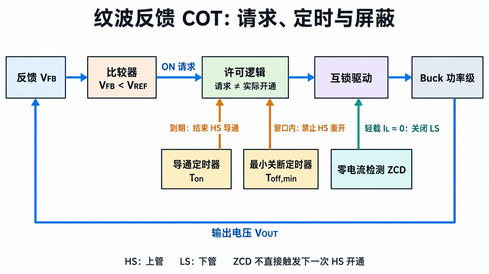
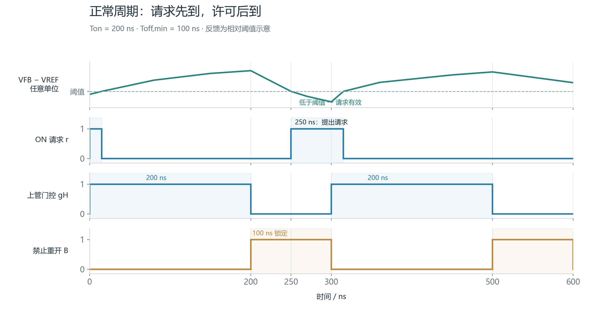
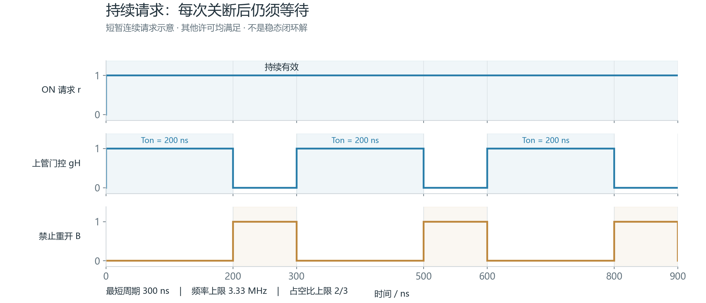
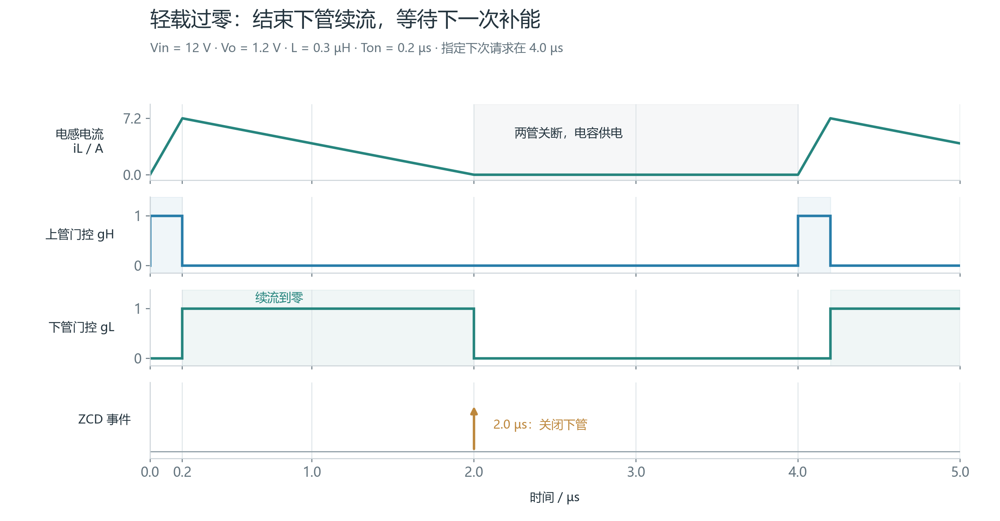
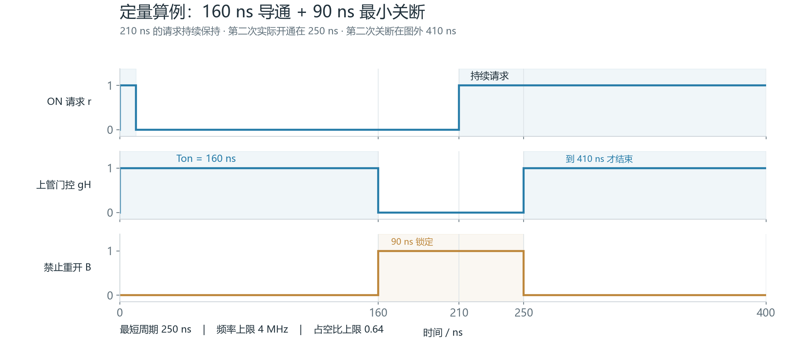

传统固定频率 PWM 是“闹钟响了（固定时钟）才开上管，由比较器决定何时关”；**COT（Constant On-Time，恒定导通时间）正好反过来**：每次上管开通后固定导通一个预设时长 $T_{on}$ 就关，而下一次什么时候再开，全由输出电压反馈说了算。

想要彻底看懂 COT 波形不绕晕，只需把“一次开通”拆成三个独立角色：
> 1. **反馈比较器**：负责提问——“输出电压偏低了，请求补一次能！”
> 2. **许可逻辑**：负责把关——“最小关断时间到了吗？没过流保护吧？下管彻底关了没？”
> 3. **导通定时器（One-shot）**：负责掐表——“上管实际开通满 $T_{on}$ 秒，立刻关掉！”

[学习地图：COT](/zh/learn/#cot) · [Buck 功率级](/zh/notes/buck-day-01/) · [ESR 与纹波](/zh/notes/buck-esr-ripple/) · [下一篇：低 ESR 与人工纹波注入](/zh/notes/buck-cot-ripple/)

---

## 1. 控制架构：三件套怎么接成闭环

输出端电阻分压得到 $V_{FB}=\beta v_o$（包含直流电压和周期纹波）。当输出电压跌破目标阈值时，比较器立刻发出开通请求 $r=1$：

$$r(t)=1 \iff V_{FB}(t)<V_{REF}.$$

| 模块 | 观察对象 | 核心动作 |
| --- | --- | --- |
| **反馈比较器** | $V_{FB}$ 与 $V_{REF}$ | 输出偏低时发出开通请求 $r=1$ |
| **开通许可逻辑** | $r$、最小关断锁定、使能、保护、互锁 | 所有条件放行后，才真正发出上管开通命令 |
| **导通 One-shot** | 上管实际开通边沿 | 计时满 $T_{on}$ 后结束本次导通（不可被新请求重触发） |
| **最小关断定时器** | 上管关断边沿 | 锁定一段 $T_{off,min}$，保证自举充电与检测建立 |
| **ZCD 过零检测** | 续流期电感电流 | 轻载电流降到 0 时及时关掉下管，防止倒流 |

---

## 2. 一个完整周期的五步事件链

把“需不需要补能”、“允不允许开通”、“这次开多久”分开后，每个开关边沿的原因一目了然：

1. **反馈跌破阈值**：$V_{FB} < V_{REF}$，比较器置起请求 $r=1$；
2. **通过许可检查**：确认上管当前关断、$T_{off,min}$ 窗口已满、无保护锁存且下管已安全退出；
3. **上管开通 + 计时启动**：上管导通，电感电流爬升，**同时启动 $T_{on}$ 定时器**；
4. **定时到期关断**：满 $T_{on}$ 后上管强制关断（哪怕此时 $V_{FB}$ 还没回到阈值以上也不能跳过，除非触发故障保护），同步进入 $T_{off,min}$ 锁定；
5. **下管续流并等待下次请求**：下管接管续流；锁定窗口结束后，只要再次看到 $V_{FB}<V_{REF}$ 就重复第 3 步。

| 状态流转 | 什么时候发生 | 常见误区 |
| --- | --- | --- |
| **导通计时中** | $t_k \to t_k+T_{on}$ | 新来的请求不会延长或重触发本次 $T_{on}$ |
| **最小关断锁定** | $t_k+T_{on} \to t_k+T_{on}+T_{off,min}$ | 锁定窗内就算 $V_{FB}$ 跌破阈值也得干等着，**窗满后才检查执行** |
| **自由等待期** | 锁定已满，等下一个请求 | 最小关断时间 $\ne$ 死区时间（死区防直通，最小关断保障自举/采样） |

---

## 3. 波形实战：为什么 250 ns 的请求等到 300 ns 才开？

设参数 $T_{on}=200\text{ ns}$、$T_{off,min}=100\text{ ns}$：

对照时间轴走一遍：
- **0–200 ns**：第一次脉冲导通，$T_{on}=200\text{ ns}$ 计时满后准时关断；
- **200–300 ns**：进入 $100\text{ ns}$ 最小关断锁定窗口。哪怕 **250 ns** 时 $V_{FB}$ 已经掉到阈值以下并置起请求，上管依然按兵不动；
- **300 ns**：锁定解除，且此时请求依然有效，上管立刻开通，**从 300 ns 重新数 $200\text{ ns}$**（到 500 ns 关断）。

> **如果请求是个“一闪而过的毛刺”呢？**
> 假设请求只在 250–270 ns 有效、300 ns 解锁时自己恢复了。对于不锁存短请求的电平敏感逻辑，300 ns 看到请求已经消失，便不会白白开通一次。

---

## 4. 负载大掉压：连续脉冲的最高频率和最大占空比

如果输出严重欠压、反馈一直低于阈值（$r\equiv 1$），控制器会在每一次最小关断窗口结束的瞬间立刻拉起下一脉冲：

这时脉冲密度被两个定时器死死卡住上限：

$$T_{s,min}=T_{on}+T_{off,min},\qquad f_{s,max}=\frac{1}{T_{on}+T_{off,min}},\qquad D_{max}=\frac{T_{on}}{T_{on}+T_{off,min}}.$$

代入 $T_{on}=200\text{ ns}, T_{off,min}=100\text{ ns}$，最大开关频率为 **$3.33\text{ MHz}$**，最大占空比为 **$2/3$**（约 $66.7\%$）。如果设计需要比这更高的占空比，必须靠芯片内部延长 $T_{on}$ 或缩短 $T_{off,min}$ 才能做到。

---

## 5. 轻载时序：ZCD 关掉下管，但“谁来重开上管”？

轻载时电感电流很快跌回零。在**二极管仿真模式**（DCM/省电模式）下，芯片会靠 **ZCD**（零电流检测）在电流跌破零瞬间果断关断下管，防止电容能量倒灌回电感白白转圈损耗。

读图 4 时牢记两个关键事实：
1. **上管关断总时间 $\ne$ 下管导通时间**：上管关了 $3.8\,\mu\text{s}$，但下管只在电感放完能的那 $1.8\,\mu\text{s}$ 导通，后面 $2.0\,\mu\text{s}$ 两管全关；
2. **ZCD 只管关下管，不管开上管**：两管全关后，输出电容独自慢慢给负载供电；负载越轻，电容跌到阈值的时间越长，**开关频率自动越降越低（PFM 省电效果）**——这正是 COT 天然拥有高轻载效率的秘密。

---

## 6. 容易混淆的命题：COT 改变占空比吗？频率随负载变吗？

很多笔记容易把“恒定导通时间”误读成“占空比不变”。从定义式一看便知：

$$T_s=T_{on}+T_{off},\qquad f_s=\frac{1}{T_s},\qquad D=\frac{T_{on}}{T_s}=T_{on}f_s.$$

- **COT 改变占空比吗？** **会！** 虽然 $T_{on}$ 不变，但控制器通过提前或推迟下一次开通改变 $T_{off}$，也就同时改变了周期 $T_s$、频率 $f_s$ 和占空比 $D$。
- **CCM 稳态下频率随负载升高而无限飙升吗？** **不会！** 在理想 CCM 稳态，电感伏秒平衡强制规定 $D = V_o/V_{in}$，因此稳态开关频率被电压比锁死在：
  $$f_s \approx \frac{V_o}{V_{in}T_{on}}.$$
  负载突增瞬间确实会打出几发密集脉冲来抬高电感电流，但**一旦重新稳住输出，频率就会回落到 $V_o/(V_{in}T_{on})$ 附近**（轻载 DCM 期间频率才会随着负载变大而线性上升）。

---

## 7. 从 COT 走向 AOT：为什么芯片还要前馈 $V_{in}$ 和 $V_o$？

从 $f_s \approx \dfrac{V_o}{V_{in}T_{on}}$ 可以一眼看出传统固定 $T_{on}$ 的痛点：**一旦输入电压 $V_{in}$ 翻倍，稳态频率就会腰斩**，给电感饱和与 EMI 滤波带来麻烦。

**AOT（Adaptive On-Time）** 保留了全套“请求—许可—定时”结构，只把原本写死的 $T_{on}$ 定时器改成了随工作点自适应的公式：

$$\boxed{T_{on}\approx\frac{V_o}{V_{in}f_0}.}$$

这样无论 $V_{in}$ 或 $V_o$ 怎么变，稳态开关频率都始终贴在目标 $f_0$ 附近（例如 TI 经典的 **TPS51125** D-CAP 模式，就是通过感知输入与输出电压做前馈自适应，再配合轻载 Auto-Skip 省电）。详细推导见 [AOT Buck 入门](/zh/notes/buck-aot-frequency/)。

---

## 8. 数值练习（$160\text{ ns} / 90\text{ ns}$）

设 $T_{on}=160\text{ ns}$、$T_{off,min}=90\text{ ns}$，首次开通在 $0\text{ ns}$，新请求在 $210\text{ ns}$ 出现并保持有效：

- **极限密度**：$T_{s,min}=160+90=250\text{ ns} \implies f_{s,max}=4\text{ MHz},\; D_{max}=64\%$；
- **防错重点**：第二次定时器的 160 ns 永远从**实际开通时刻 250 ns** 起算（到 410 ns 关断），千万不要从 210 ns 请求时刻起算。

---

## 下一步阅读

- 想知道低 ESR 陶瓷电容为什么会让 COT 变抖、怎么加人工纹波：[Buck COT 纹波反馈与人工注入](/zh/notes/buck-cot-ripple/)
- 想看芯片内部怎么用恒流源给电容充电做出这个 $T_{on}$ 定时器：[Fixed On-Time Timer 设计](/zh/notes/buck-on-time-timer/)
- 参考资料：[Microchip COT Control](https://developerhelp.microchip.com/xwiki/bin/view/applications/power/mastering-buck-converters/analog-control-methods/cot/) · [TI TPS51125 Datasheet](https://www.ti.com/lit/ds/symlink/tps51125.pdf)（§7.3）
