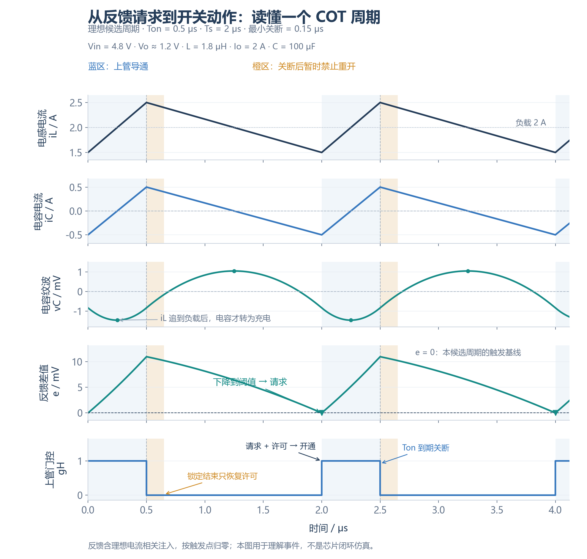

Buck 的任务是向负载供应所需电流，同时把输出电压维持在目标附近。负载突然增加时，电感电流不能瞬间跟上。当负载需求超过当时的电感供流，短缺部分只能先由输出电容提供。电容失去电荷，输出电压下降。**控制器必须改变开关动作，让电感电流逐渐跟上负载；电容只能暂时缓冲，不能长期补足电流。**

[COT（恒定导通时间控制）](/zh/notes/buck-cot-cycle/)用一次次上管导通来调整电感电流。它把每次正常导通的时间设为 $T_{on}$，主要决定下一次导通什么时候开始。本篇要讲的纹波，就是这条控制链上的判断信号：它会影响比较器何时提出请求，从而影响开关时刻、电感电流与输出电压。

先建立“为什么需要它”的直觉，再看波形、公式和实际限制。

| 这篇要回答的问题 | 先抓住的意思 | 章节 |
| --- | --- | --- |
| 导通时间固定，COT 还能调什么？ | 改变下一次开通时刻，暂时改变电感的增减流比例 | §1–2 |
| 上管开了，电容电压为什么还降？ | 电感电流正在增加，但可能仍不够负载用 | §3–4 |
| ESR 为什么会参与控制？ | 它把支路电流变化直接反映到反馈电压里 | §5 |
| 为什么不直接加大输出纹波？ | 输出想平滑，比较器想得到清晰动态；人工注入帮助协调两者 | §6–7 |
| 注入之后除了抖动，还会改变什么？ | 交越位置、平均调节点、噪声路径和负载响应 | §8–11 |
| 与前面的 Buck 笔记怎么接起来？ | 开关状态 → 电流差 → 纹波 → 比较器 → 下一次开关 | §12 |

## 1. 导通时间固定，为什么仍然能够调节输出

### 1.1 留下的调节自由度是等待时间

“导通时间固定”容易让人误以为控制器已经没有调节能力。实际上，可调的是两次导通之间的关断时间 $T_{off}$。把下一次脉冲提前，上管在一段时间内的导通比例就增加；输入对电感的正向驱动占比增加，电感电流便能够向上调整。

先用三个简单关系把这一点写清楚：

$$
\begin{aligned}
T_s&=T_{on}+T_{off},\\
f_s&=1/T_s,\\
D&=T_{on}/T_s=T_{on}f_s.
\end{aligned}
\tag{1}
$$

它们的用途是解释**动作**：$T_{on}$ 不变，$T_{off}$ 缩短，周期变短，频率和占空比同时增加。频率变化是脉冲开始时刻变化的结果；真正改变功率级的是上管与下管各自持续了多久。

### 1.2 用一个周期看清“提前开通”的效果

取理想两状态 Buck：$V_{in}=4.8\,\mathrm V$、$V_o\approx1.2\,\mathrm V$、$L=1.8\,\mathrm{\mu H}$、$T_{on}=0.5\,\mathrm{\mu s}$。短时间内把输出近似为常数，上管开通时电流斜率为 +2 A/µs，下管续流时为 −2/3 A/µs。

| 一个周期的安排 | 导通段增流 | 关断段减流 | 周期净变化 | 这有什么用 |
| --- | --- | --- | --- | --- |
| $T_{off}=1.5$ µs | +1 A | −1 A | 0 | 电流回到周期起点，满足稳态平衡 |
| 暂时缩短为 $T_{off}=1.0$ µs | +1 A | −0.6667 A | +0.3333 A | 下一周期从更高电流开始，帮助追赶增加的负载 |

第二行没有加长本次导通，而是减少了两次导通之间的减流量。这就是 COT 用开通时刻调节电流的直观机制。控制器通常不能随意指定这两个时间；比较器请求、最小关断与保护会约束实际执行。

这里讨论[连续导通模式（CCM）](/zh/notes/buck-day-01/#7-ccm-临界-dcm)：电感电流在整个周期内保持为正，没有先降到零再停流的区间。恢复稳态后，一个周期的增流与减流相等，电感电压的周期积分为零，这叫[伏秒平衡](/zh/notes/buck-day-01/#3-ccm-分段电流-平均值与峰谷值)。固定输入、输出及 $T_{on}$ 时，它重新约束频率：

$$f_s\approx\frac{V_o}{V_{in}T_{on}}.\tag{2}$$

本例为约 500 kHz。负载增加时可以先出现更密的脉冲以提升电流；恢复稳态后，电流均值提高，并不表示频率还会无限升高。固定导通时间也不等于每个脉冲传递固定能量，因为当时的电流和输入输出电压会影响能量交换。

## 2. 下一次什么时候开？这才是纹波进入控制的地方

### 2.1 比较器、许可逻辑和定时器各回答一个问题

定时器知道一次正常导通应该持续多久，却不知道输出什么时候又需要调整。这个问题交给反馈比较器：观察信号下降到阈值附近时提出开通请求；许可满足后，上管实际开通；之后由 $T_{on}$ 定时结束这一脉冲。

对本文指定的电压纹波反馈模型，定义比较器观察信号 $v_{sense}$、阈值 $v_{th}$ 和差值 $e$：

$$e(t)=v_{sense}(t)-v_{th}(t).\tag{3}$$

$e<0$ 表示补能请求有效。请求必须通过开通许可逻辑，才能变成上管实际开通；导通定时器从实际开通开始计时。固定 $T_{on}$ 时，下一次脉冲的开始时刻改变 $T_{off}$，也改变周期和占空比。

| 事件 | 控制作用 | 与纹波的关系 |
| --- | --- | --- |
| 反馈交越 | 提出上管开通请求 | 由两输入差值决定 |
| 开通许可满足 | 执行请求 | 检查最小关断时间、互锁、使能与保护 |
| $T_{on}$ 到期 | 结束本次正常上管导通 | 不依赖请求是否仍然有效 |
| 最小关断窗口结束 | 恢复下一次开通许可 | 到期本身不创造新请求 |
| 二极管仿真模式的 ZCD | 在零电流附近关闭下管 | 不直接启动下一次上管脉冲 |

最小关断时间限制的是实际执行，不能阻止比较器继续提出请求。理想时序满足 $T_{off}\ge T_{off,min}$；锁定期间的短请求是否保存取决于具体逻辑。完整事件波形见 [COT 周期笔记](/zh/notes/buck-cot-cycle/)。

### 2.2 比较器看到的是完整电压，不是单独的纹波

反馈中的平均电压分量体现输出整体偏高还是偏低；周期内的动态纹波则帮助确定本次接近阈值的时刻。比较器判断的是两者叠加后的瞬时值。正确的平均电压不能代替清晰的周期信号，有一条清晰的纹波也不能代替正确的平均电压调节。

下面把反馈与门极脉冲放在同一时间轴。图中的观察信号除了输出电压，还包含一条电流相关的周期纹波。先用它看清“反馈怎样安排脉冲”；这条纹波从哪里来、为什么需要它，后面再逐步解释。

先看上管门控，再向上寻找原因：

1. 反馈下降到阈值，提出开通请求；最小关断已结束，请求获得许可。
2. 上管开通，电感电流上升。电流相关纹波使反馈离开请求区，但理想电容还可能在放电。
3. 0.5 µs 定时结束，上管关断。关断来自定时器，不来自反馈再次交越。
4. 最小关断锁定先禁止立即重开；锁定结束后，仍要等待有效反馈请求。
5. 反馈再次下降到阈值，开始下一周期。本候选周期的开始间隔为 2 µs。

示例采用理想两状态、小输出纹波、恒定负载和参数，忽略迟滞、延迟、ESL、死区与保护。选定阈值使候选起点触发，是为了读清事件；平均输出与阈值的关系另在 §8 解释。一个周期自洽只说明它存在，稳定性还要看扰动后偏差会缩小还是放大。

## 3. 上管已经开通，电容电压为什么还可能下降

### 3.1 “正在增流”和“已经够用”是两件事

负载需要 2 A，开通开始时电感只提供 1.5 A。上管一开，电感电流立即向上爬升，但起初仍短缺 0.5 A，电容必须继续补足。只要 $i_L<I_o$，电容就在失去电荷，电压就继续下降；等到电感电流追上 2 A，电容才停止放电。

本例 +2 A/µs 的上坡需要 0.25 µs 才追到负载电流。因此理想电容电压的谷值在导通开始之后，不能把“上管开了”理解成“电容电压马上上升”。这正是讨论反馈时要解决的状态差异。

### 3.2 一个量反映当前电流，一个量反映累计电荷

[ESR 是电容的等效串联电阻](/zh/notes/buck-esr-ripple/#1-1-esr-c-与-esl-分别代表什么)。负载实际看到的端口电压 $v_o$，由理想电容上的电压 $v_C$ 与该电阻的压降共同组成。定义 $i_L$ 从电感流入输出节点，$I_o$ 流向负载，$i_C$ 流入电容支路。先忽略等效串联电感（ESL）：

$$
\begin{aligned}
i_C&=i_L-I_o,\\
\frac{dv_C}{dt}&=\frac{i_C}{C},\\
v_o&=v_C+R_{ESR}i_C.
\end{aligned}
\tag{4}
$$

直接分压的反馈为 $v_{FB}=\beta v_o$，其中[分压系数 $\beta$](/zh/notes/buck-esr-ripple/#8-1-电阻分压传递的是整个端口纹波)是分压后电压与输出电压的比值，$0<\beta<1$。以下周期稳态的平均电容电流为零，交流纹波记为 $\widetilde v$：

$$\widetilde v_{FB}=\beta(\widetilde v_C+R_{ESR}i_C).\tag{5}$$

三角电流的积分是**分段抛物线**。$i_C<0$ 时 $v_C$ 下降，$i_C>0$ 时 $v_C$ 上升；电压极值在电流过零处。

若 $\Delta I_L$ 表示电感电流峰峰值、$f_s$ 表示当前稳态频率，则在这一模型内：

$$
\begin{aligned}
\Delta v_{ESR,pp}&=R_{ESR}\Delta I_L,\\
\Delta v_{C,pp}&=\frac{\Delta I_L}{8f_sC}.
\end{aligned}
\tag{6}
$$

积分项回答“之前累计缺了多少电荷”，ESR 项回答“此刻支路电流产生了多少压降”。所以两项极值通常错位，逐点相加后再求最大与最小值，才能得到总纹波；峰峰值直接相加只能作为上界。幅度与极值推导见 [ESR 笔记](/zh/notes/buck-esr-ripple/)。

## 4. 为什么要分开画 ESR 项与电容积分项

画两组波形是为了观察同一个电流变化在两种反馈组成中会怎样被看见，而不仅是比较输出纹波大小。取自定义参数 $f_s=500\,\mathrm{kHz}$、$D=0.25$、$\Delta I_L=1\,\mathrm A$、$I_o=2\,\mathrm A$、$C=100\,\mathrm{\mu F}$、$\beta=0.5$；只比较 $R_{ESR}=20\,\mathrm{m\Omega}$ 与 $2\,\mathrm{m\Omega}$。

| 比较量 | 20 mΩ | 2 mΩ |
| --- | --- | --- |
| 输出 ESR 纹波峰峰值 | 20 mV | 2 mV |
| 电容积分纹波峰峰值 | 2.5 mV | 2.5 mV |
| 分压后 ESR 项峰峰值 | 10 mV | 1 mV |
| 分压后积分项峰峰值 | 1.25 mV | 1.25 mV |

以开通时刻 $t=0$ 为电流谷值，在三角电流近似下，$i_C$ 在 $T_{on}/2=0.25\,\mathrm{\mu s}$ 与 $T_{on}+T_{off}/2=1.25\,\mathrm{\mu s}$ 过零。$v_C$ 的最小与最大值分别在这两个时刻，ESR 项的谷值与峰值则在 0 与 0.5 µs。

左列端口波形更接近电流纹波；右列曲率和极值错位更明显。图中的电流是给定波形，不能据此推出实际闭环仍会保持同样周期。反馈阈值的直流位置、参考斜坡和许可逻辑还会决定真正的交越时刻。

读图时还有两个容易混淆的地方：

- 当电容电流连续，ESR 项也连续。正常换流会改变斜率，却不会使该项凭空跳变；负载阶跃造成电容电流突变时，才可能出现 ESR 电压阶跃。高频尖峰还可能来自 ESL、寄生耦合与测量回路。
- “积分相差 90°”适用于单个正弦分量，不能把整个分段抛物线描述成三角波简单平移了 90°。这里应直接用电流正负和积分关系找电压极值。

## 5. 低 ESR 明明改善滤波，为什么还可能让控制困难

### 5.1 先看希望得到的效果

低 ESR 可以减小电阻纹波、负载阶跃的初始电阻压降，以及给定 RMS 电流下的电阻损耗。困难出现在某些传统纹波反馈架构：比较器依赖输出天然纹波安排开通时刻，ESR 变小也削弱了反馈里的电流相关信息。

上管刚开通，电感开始增流，但电容还在放电。ESR 项较强时，电流回升会使电阻电压上升，反馈能较快离开请求区；ESR 很小时，积分项可能暂时主导，反馈反而继续下降。反馈向上离开阈值后，原来的开通请求撤销；关断阶段再次向下交越，才形成下一次请求。因此要检查每次导通能否让请求撤销，以及下一次请求在什么时候出现。

### 5.2 用局部斜率验证刚才的直觉

对恒定参考、直接分压模型，比较器差值斜率为：

$$\frac{de}{dt}=\beta\left(\frac{i_C}{C}+R_{ESR}\frac{di_C}{dt}\right).\tag{7}$$

ESR 项提供与电流变化直接相关的斜率。关断续流期间，$di_C/dt\approx-V_o/L$；在电感电流谷值附近，$i_C<0$，两项共同使反馈下降。开通之后，电流开始上升，但只要 $i_C$ 仍为负，电容仍在放电。

开通刚发生时，取 $i_C\approx-\Delta I_L/2$、$di_C/dt\approx\Delta I_L/T_{on}$，得到：

$$
\left.\frac{dv_o}{dt}\right|_{0^+}
\approx\Delta I_L\left(\frac{R_{ESR}}{T_{on}}-\frac{1}{2C}\right).
\tag{8}
$$

式子中的电阻项表示“电流正在增加”带来的上升，积分项则表示“电流还不够”带来的下降。因此 $R_{ESR}C>T_{on}/2$ 能使该**指定谷值开通模型**的起始端口斜率为正；ESR 太小则可能使反馈开通后继续下降，影响请求复位与后续周期。这一不等式是局部波形判断，不能当作任意 COT 的充分稳定性条件。

低 ESR 的影响有两层：电阻纹波的幅度缩小，以及叠加波形的曲率、极值和交越斜率改变。交越处可能变平，也可能移到不同位置；“ESR 小十倍，任何交越斜率都小十倍”并不成立。**天然纹波仍存在，困难在于控制器需要的电流相关反馈成分可能不足。**

带内部纹波生成、不同参考斜坡或其他补偿机制的控制器，可能专门支持多层陶瓷电容（MLCC）。是否适用必须按具体架构和电容条件判断。

### 5.3 继续下降，不等于已经证明双脉冲

本例 $R_{ESR}=2$ mΩ、$C=100$ µF、$T_{on}=0.5$ µs，自然反馈起始斜率为 −0.50 mV/µs，确实短暂向下。但在以候选开通点为阈值的三角电流模型中，它约在 0.10 µs 回到阈值，0.5 µs 关断时已高出约 1 mV。因此不能仅凭最初负斜率，把这张给定波形叫作持续请求或双脉冲。

真正要检查的是请求有没有撤销、最小关断结束时是否仍有效，以及后续周期偏差会不会放大。低 ESR 可能导致双脉冲或更大抖动，但结果取决于完整控制条件；单次请求撤销也不能反过来证明闭环稳定。

这就引出下一步：**想保留低 ESR 的滤波好处，又想让比较器获得清晰动态信息，能否分别照顾这两个需求？**

## 6. 为什么想到人工注入：分别设计滤波与触发信号

### 6.1 先确定目的，再引入方法

功率输出希望平滑，比较器却需要清晰的周期信号来确定开通时刻。若只靠增大输出电容 ESR 获取信号，输出纹波、瞬态电阻跳变和损耗也会增加。人工注入的思路是在**控制信号路径**里生成所需纹波，让输出电容继续承担滤波。

它补的是动态观察信息，不会直接给输出电容充电。真正改变功率级的，仍是这个信号影响的开关时刻。

将比较器输入写成：

$$v_{sense}=\beta v_o+v_{inj}.\tag{9}$$

其中 $v_{inj}$ 是人为生成的动态信号。设计重点是在交越附近获得合适的方向、斜率与幅度，同时控制直流偏置和开关噪声耦合。输出端仍可采用低 ESR 电容，比较器输入则获得额外的电流相关信息。

| 信号阶段 | 需要获得什么 | 需要避免什么 |
| --- | --- | --- |
| 取信号 | 与功率级开关状态或电感电压相关的变化 | 把 SW 尖峰直接送入 FB |
| RC 取样与滤波 | 合适的动态斜率或等效电流信息 | 时间常数过小导致边沿穿透，过大导致有效纹波不足 |
| 去直流与耦合 | 所需交流成分及受控增益 | 直流偏置、分压器加载和附加极点失配 |
| 叠加与比较 | 合适的差分交越波形 | 极性错误使斜率抵消或增加多次交越 |

人工注入也会改变脉冲时刻和输出动态，因此并非输出与注入完全互不影响；它只是让触发信号的生成不再完全依赖输出电容的 ESR。

### 6.2 希望得到什么效果，又付出什么代价

合适的正极性注入在导通段上升、关断段下降，增强电流相关的反馈分量，使交越附近的方向和斜率更清晰。它改变比较器何时提出请求，也就会影响周期安排与输出调节。

注入不足，原有困难可能仍在；注入较大，交越位置和平均调节点可能偏移；取样过快，SW 尖峰与振铃还可能进入比较器。选幅度与时间常数，是同时照顾触发可靠性、输出精度、噪声和负载响应。

## 7. 为什么 RC 能生成所需的纹波

电感电压决定电流的变化率。对与开关状态相关的电压适当积分或滤波，就能近似生成与电流纹波相关的斜坡。这里用 RC，是为了获得合适的斜率，同时限制尖峰穿透。为说明滤波如何产生斜坡，先定义一个**独立、无负载的一阶低通信号模型**：输入为 $v_{SW}$，滤波输出为 $v_x$，时间常数为 $\tau_r=R_rC_r$：

$$\tau_r\frac{dv_x}{dt}+v_x=v_{SW}.\tag{10}$$

若 $\tau_r\gg T_s$，在单个周期内 $v_x$ 的纹波较小；理想 CCM 稳态中 $\overline v_x\approx D V_{in}\approx V_o$，从而：

$$
\frac{dv_x}{dt}\approx
\begin{cases}
(V_{in}-V_o)/\tau_r,&\text{上管导通},\\
-V_o/\tau_r,&\text{下管续流}.
\end{cases}
\tag{11}
$$

这两段斜率与电感电流的分段斜率成比例。理想去直流并耦合增益为 $k>0$ 时，令 $v_{inj}=k(v_x-\overline v_x)$，可近似写为：

$$
\begin{aligned}
v_{inj}&\approx R_{virt}\widetilde i_L,\\
R_{virt}&=\frac{kL}{\tau_r}.
\end{aligned}
\tag{12}
$$

$R_{virt}$ 是折算到比较器输入的等效纹波增益，单位为 Ω，并不表示输出串入了一个耗能电阻。真实跨电感取样网络、耦合电容和分压器会改变传递函数；本节的简化 RC 关系不能直接替代某个芯片的元件选值公式。

### 7.1 注入前后的逐点叠加

沿用图 3 的低 ESR 条件，在比较器输入加入 $v_{inj}=10\,\mathrm{m\Omega}\cdot i_C$ 的自定义零均值三角信号：

§2 的图 2 也使用这组参数：$I_o=2$ A、$C=100$ µF、$R_{ESR}=2$ mΩ、$\beta=0.5$。该稳态中 $i_C=\widetilde i_L$，所以它等效于 $R_{virt}=10$ mΩ 的电流纹波注入。现在可以回看图 2：上管开通后，电容仍短暂放电，但注入使比较器信号立即向上离开请求区。

在指定观察时刻 $t_*=1.8\,\mathrm{\mu s}$，$i_C\approx-0.3667\,\mathrm A$，$di_C/dt\approx-0.6667\,\mathrm{A/\mu s}$。由自然反馈斜率与叠加关系：

$$
\begin{aligned}
S_{before}&\approx-2.50\,\mathrm{mV/\mu s},\\
S_{inj}&\approx-6.67\,\mathrm{mV/\mu s},\\
S_{after}&\approx-9.17\,\mathrm{mV/\mu s}.
\end{aligned}
\tag{13}
$$

### 7.2 最下面的斜率图为什么会跳变

最后一行画的是前三行电压的**导数**，并非第四条电压波形。开通段 $di_C/dt=2\,\mathrm{A/\mu s}$，关断段 $di_C/dt=-2/3\,\mathrm{A/\mu s}$；这两个斜率在换流时切换。自然反馈的积分项贡献 $\beta i_C/C$，随电流缓慢变化；ESR 与人工注入项则贡献与 $di_C/dt$ 成比例的分段常数。

| 时刻 | 电容电流 | 自然反馈斜率 | 注入斜率 | 叠加后斜率 |
| --- | --- | --- | --- | --- |
| 0 µs 开通后 | −0.5 A | −0.50 mV/µs | +20.00 mV/µs | +19.50 mV/µs |
| 0.5 µs 关断前 | +0.5 A | +4.50 mV/µs | +20.00 mV/µs | +24.50 mV/µs |
| 0.5 µs 关断后 | +0.5 A | +1.83 mV/µs | −6.67 mV/µs | −4.83 mV/µs |
| 1.8 µs 观察点 | −0.3667 A | −2.50 mV/µs | −6.67 mV/µs | −9.17 mV/µs |
| 2.0 µs 下次开通前 | −0.5 A | −3.17 mV/µs | −6.67 mV/µs | −9.83 mV/µs |

因此，第三行电压在 0.5 µs 处有折角，第四行导数出现跳变，两者相互一致。理想换流的单个时刻没有唯一导数，竖点线只是标注左右极限，真实有限换流会把这一变化展开到短时间内。开通刚发生时蓝色自然反馈仍有负斜率，这正是低 ESR 下电容尚在放电的表现；人工注入后绿色曲线已经转为正斜率。

这张图展示的效果是：开通起点自然反馈还在向下，加入指定纹波后比较器信号已向上；电容仍在放电，增加的是观察信号中的电流信息。观察点处三条斜率在同一节点、同一时刻比较，注入后绝对斜率约为原来的 3.67 倍。即使该观察点的斜率改善，也不能认为真实交越会固定在此处，更不能把整条波形替换成一条线性斜坡。下一步再看这样的斜率有什么实际用途。

## 8. 为什么零均值注入仍可能改变平均输出

“注入只包含交流，平均值为零”，容易让人推断输出直流值不会改变。但比较器固定的是某个开关相位的瞬时电平，不是整周期平均电压。

把输出写成平均值加纹波，在固定参考、理想交越时刻 $t_k$：

$$
\begin{aligned}
v_o&=\overline V_o+\widetilde v_o,\\
\beta\overline V_o&=V_{ref}-\beta\widetilde v_o(t_k)\\
&\quad-v_{inj}(t_k).
\end{aligned}
\tag{14}
$$

这条式子解释的是调节点：如果交越处注入为负，平均反馈就需要更高，才能使该瞬时点仍碰到同一个参考。

在相同候选输出纹波和触发相位下，只比较加入注入项带来的增量。若 $\beta=0.5$，触发处 $v_{inj}=-5$ mV，则：

$$\Delta\overline V_o\approx-\frac{-5\,\mathrm{mV}}{0.5}=+10\,\mathrm{mV}.\tag{15}$$

注入的周期平均值仍可为零，但它在触发点不是零。这解释了为什么加大注入不能只看抖动，还要看输出精度。[TI SLVA453 的直流精度计算](https://www.ti.com/lit/an/slva453/slva453.pdf)讨论了这种关联；带动态参考、直流误差修正或不同注入节点的实际控制器，应按自身模型判断。

前面若将不同曲线归零到各自候选开通点，实际上调整了比较基线，只适合比较形状；不能同时宣称参考、平均输出和触发时刻三者完全不变。

## 9. 为什么交越斜率影响开关时刻的可靠性

比较器判断会安排下一次开通。阈值附近的电压噪声会使判断提前或推迟；许可已满足时，这会直接表现为脉冲时刻变化。缓慢经过阈值的信号更容易被同样噪声推远，较陡的交越则较不敏感。

为计算这个时间偏移，设无扰动交越时刻为 $t_0$，$e(t_0)=0$，局部斜率 $S_e=e'(t_0)\ne0$；比较器输入等效差分扰动为 $\delta v$。线性展开：

$$
\begin{aligned}
0&\approx S_e\delta t+\delta v,\\
\delta t&\approx-\frac{\delta v}{S_e},\\
|\delta t|&\approx\frac{|\delta v|}{|S_e|}.
\end{aligned}
\tag{16}
$$

对固定参考，$S_e=dv_{sense}/dt$；对变化参考：

$$S_e=\frac{dv_{sense}}{dt}-\frac{dv_{th}}{dt}.\tag{17}$$

所以反馈侧注入与参考侧斜坡必须连同极性一起分析。电压噪声与斜率都要折算到同一个比较器差分节点；不能直接拿输出端噪声除以 FB 端斜率。

先取一个与前文同用 mV/µs 的独立局部例子：输入扰动界限为 ±0.5 mV，斜率绝对值分别为 2 与 10 mV/µs。这是计算时间敏感度的示例，不代表某个具体芯片的噪声指标。

| 条件 | 输入扰动峰值 | 交越斜率绝对值 | 最大偏移幅度 | 两侧时间窗口宽度 |
| --- | --- | --- | --- | --- |
| 浅斜率 | 0.5 mV | 2 mV/µs | 250 ns | 500 ns |
| 陡斜率 | 0.5 mV | 10 mV/µs | 50 ns | 100 ns |

斜率增加到 5 倍，在同样扰动下，最大偏移幅度缩小到 1/5。这就是改善交越斜率的用途。这里的 250 ns 与 50 ns 是局部模型的最大**单侧偏移幅度**，不能标成峰峰抖动或 RMS 抖动。若噪声足够小、交越唯一、可线性化，RMS 量可近似写为 $\sigma_t\approx\sigma_v/|S_e|$，但峰值题设不能直接代入 RMS 公式。

再练习一次单位换算：原讲义取 5 mV 扰动、1 与 5 mV/ns 斜率，最大单侧偏移分别为 5 ns 与 1 ns。其斜率单位与上图相差一千倍，因此不能把这组结果直接当成图 5 所示纹波的抖动。

该估算还忽略迟滞、传播延迟变化、锁定与请求锁存。若比较器在锁定期间交越，实际开通可能被窗口结束所限制，局部交越公式就不能直接代表门极脉冲的时刻误差；斜率接近零或噪声造成多次交越时，也需重新建模。

## 10. 用一次负载增加把整条闭环连起来

假设负载在某个关断段突然增加，且新的负载电流超过当时的电感电流。先不猜门极波形，按因果顺序分析：

| 过程 | 为什么发生 | 控制或功率级的作用 |
| --- | --- | --- |
| 电容先供应电流缺口 | 电感电流不能立即跳变 | $i_C=i_L-I_o$ 下降，此时小于零 |
| 输出和反馈向下偏移 | ESR 压降与电荷缺口共同作用 | 反馈更早接近开通阈值 |
| 请求提前 | 比较器看到当前信号已需要补能 | 锁定未结束仍必须等待 |
| 允许时安排下一脉冲 | 请求与许可共同满足 | $T_{off}$ 可能暂时缩短，$T_{on}$ 按既定定时结束 |
| 电感电流逐渐抬高 | 暂态增流量超过减流量 | 新负载的电流缺口缩小 |
| 电容得到电荷回补 | 需要一段净超额供流 | 输出才可能回到目标附近 |
| 脉冲间隔重新调整 | 反馈恢复，接近新的稳态 | 理想 CCM 仍受伏秒平衡约束 |

每一环都有明确用途：纹波与注入参与**请求判断**，定时和许可约束**动作时刻**，电感电压决定**追流速度**，电容积分决定**电压偏差与电荷恢复**。比较器信号清晰意味着控制可以更可靠地安排动作；它不会消除有限电感斜率、最小关断和限流等约束。

所以不能用“有人工纹波”推出“负载响应一定更快”。怎样追流、是否饱和、恢复时会不会振铃，取决于完整控制器和功率级。定量的初始 ESR 跳变、端口极值与回补电荷，继续看 [负载阶跃笔记](/zh/notes/buck-day-02/)。

## 11. 怎样判断这次注入有没有帮到控制

| 情况 | 交越信号可能怎样变化 | 同时需要检查 |
| --- | --- | --- |
| 注入不足 | 自然积分项仍主导，所需同相纹波不足 | 抖动、双脉冲和控制器的纹波要求 |
| 注入极性不合适 | 交越处的斜率可能被抵消 | 比较器两输入、开通与关断阶段的斜率方向 |
| 注入幅度较大 | 交越位置和动态等效增益发生变化 | 平均输出偏移、负载阶跃和周期变化 |
| 带宽过宽 | SW 振铃与边沿可能进入差分输入 | 布局、滤波、噪声与多次交越 |
| 耦合网络过慢 | 瞬态信号与直流恢复可能受影响 | 负载响应、启动和模式转换 |

目标不是制造最大斜坡，而是可靠地安排开通，同时维持所需输出精度和动态响应。“斜率更陡”只在同一扰动、有效单次交越和局部线性模型下减小时间偏移。不能据此无限加大注入；噪声本身可能同时变大，耦合网络也可能改变闭环与平均调节点。

先看幅度与形状，确认是否生成所需信号；再看交越斜率与噪声，估算判断时刻的可靠性；最后检查完整闭环，判断扰动在后续周期会衰减还是放大。分清这三层，才能知道改善了什么，也知道哪些问题仍未解决。

## 12. 把这篇放回 Buck 的学习体系

### 12.1 每篇笔记解决控制链上的哪个问题

| 前后关联 | 要理解的问题 | 与本篇的连接 |
| --- | --- | --- |
| [Buck 功率级](/zh/notes/buck-day-01/) | 上下管怎样让电流增减？ | 等待时间变化为什么能调节电流 |
| [负载阶跃](/zh/notes/buck-day-02/) | 电流跟不上时为什么先靠电容？ | 反馈下移与必须回补电荷 |
| [COT 控制周期](/zh/notes/buck-cot-cycle/) | 谁请求、谁许可、谁结束导通？ | 把比较器波形落实到开关事件 |
| [ESR 与纹波](/zh/notes/buck-esr-ripple/) | 两个电压分量怎样叠加？ | 同一电流变化怎样变成不同反馈形状 |
| 本篇 | 为什么需要合适的控制纹波？ | 连接信号、开通时刻、调节点与动态代价 |
| [DCR 检测](/zh/notes/buck-dcr/) | 怎样从绕组端口获得电流信息？ | 电流重建与人工注入不同的目的 |

这条知识链可以来回追问：**开关状态改变电流 → 电流差改变电容电荷与端口电压 → 反馈产生请求 → 许可与定时安排开关状态。** 学纹波时要把它放回这条闭环，而不是停在峰峰值计算。

### 12.2 读实际器件时，再核对它用哪一种实现

[TPS51125 数据手册 Rev. H](https://www.ti.com/lit/ds/symlink/tps51125.pdf) 的 §7.3.1–7.3.4 描述 AOT、输出电容条件及参考侧 ramp。该器件既有内部参考斜坡，也仍要求适合其 D-CAP 模式的输出电容；看到 ramp 一词不能直接认定它支持任意全陶瓷输出组合。

[TI SLVA453](https://www.ti.com/lit/an/slva453/slva453.pdf) 展示单通道 D-CAP 控制器的外部取样与交流耦合实例，并明确提出双通道控制器的通道间干扰顾虑。它适合用来理解注入机制，不能直接照搬到 TPS51125 双通道设计。本文注入框图与定量波形是自定义模型，与上述实际器件实例分开。

[TI SNVA874](https://www.ti.com/lit/an/snva874/snva874.pdf) 从频域分析 Type-3 注入网络，说明应将注入形成的动态与功率级、定时延迟共同考虑。稳定性检查需要包含 $L$、有效 $C$、ESR、$T_{on}$、最小关断约束、传播延迟、反馈网络、负载与工作模式；参数不足时无法定量判断。

反馈比较器主要影响下一次脉冲的开始请求；导通定时器中的比较器则影响本次脉冲的结束。两处都可以用局部斜率理解时间扰动，具体电路和误差来源不同。后续可阅读 [COT/AOT 中的 Fixed On-Time Timer 设计](/zh/notes/buck-on-time-timer/)，把纹波触发接到恒流充电、复位和自适应定时。

## 参考资料

1. Texas Instruments, [TPS51125 Datasheet, Rev. H, SLUS786H](https://www.ti.com/lit/ds/symlink/tps51125.pdf)，§7.3.1–7.3.4，印刷第 17–18 页。
2. Texas Instruments, [D-CAP Mode With All-Ceramic Output Capacitor Application, SLVA453](https://www.ti.com/lit/an/slva453/slva453.pdf)，§1–3，区分单通道应用实例、取样与交流耦合网络及适用条件。
3. Texas Instruments, [Stability Analysis and Design of COT Type-3 Ripple Circuit, SNVA874](https://www.ti.com/lit/an/snva874/snva874.pdf)，§2–3，注入网络与频域稳定性分析。
4. Microchip, [Constant On-Time Control](https://developerhelp.microchip.com/xwiki/bin/view/applications/power/mastering-buck-converters/analog-control-methods/cot/)，COT Control Details 的反馈触发与定时说明。
