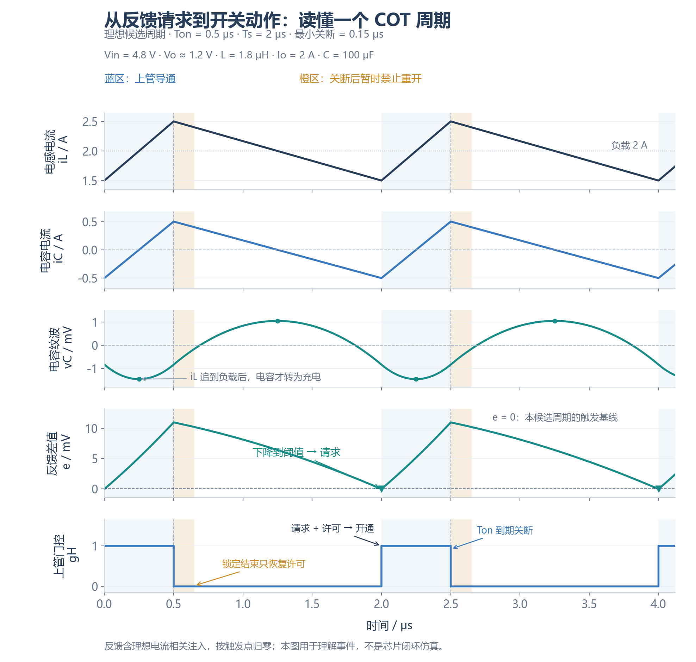
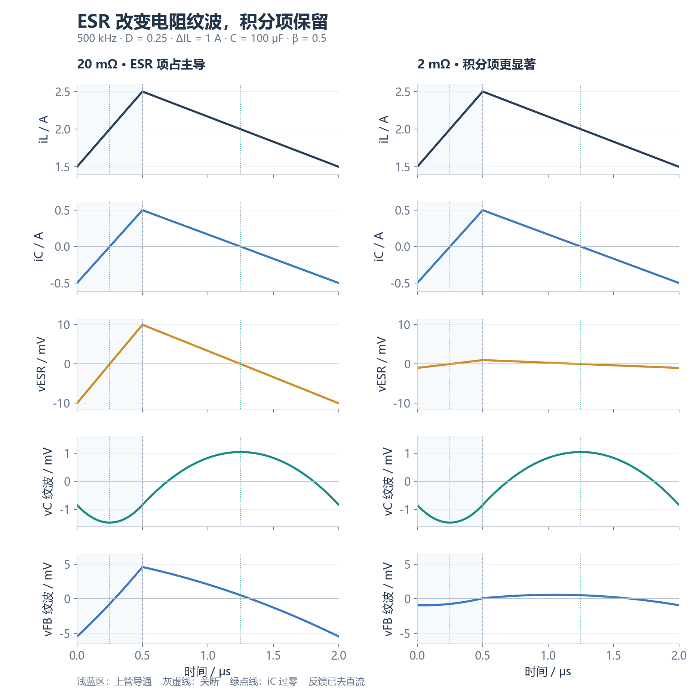
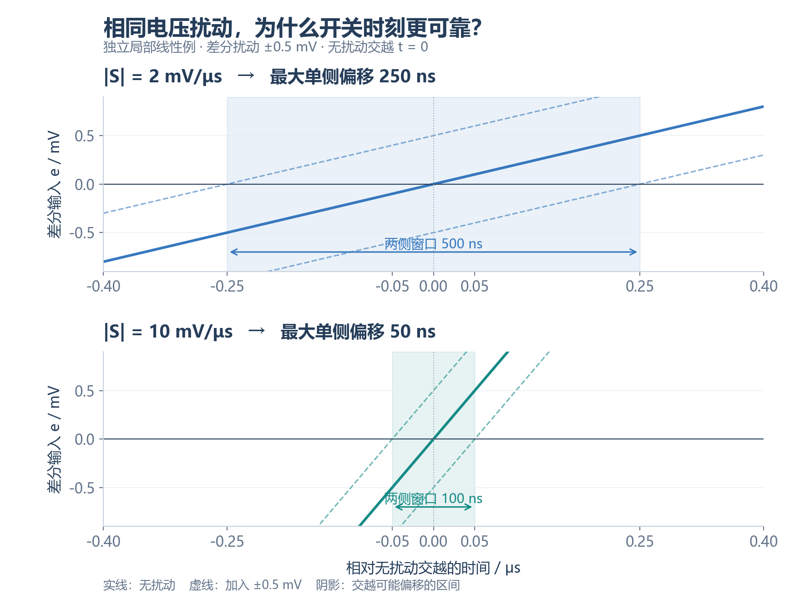
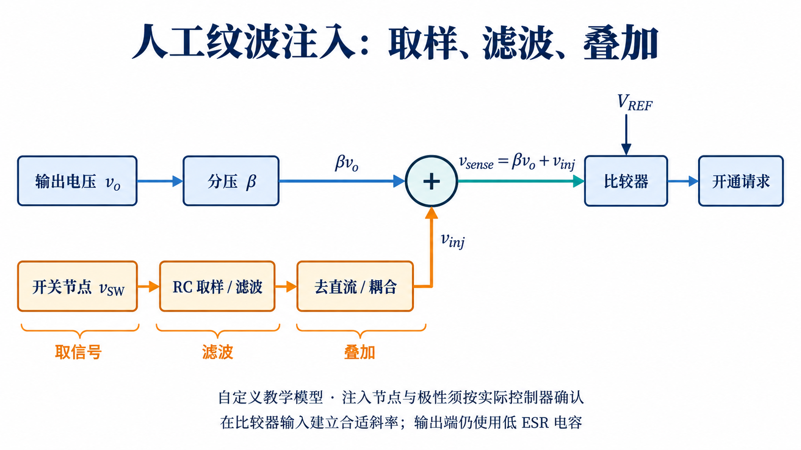
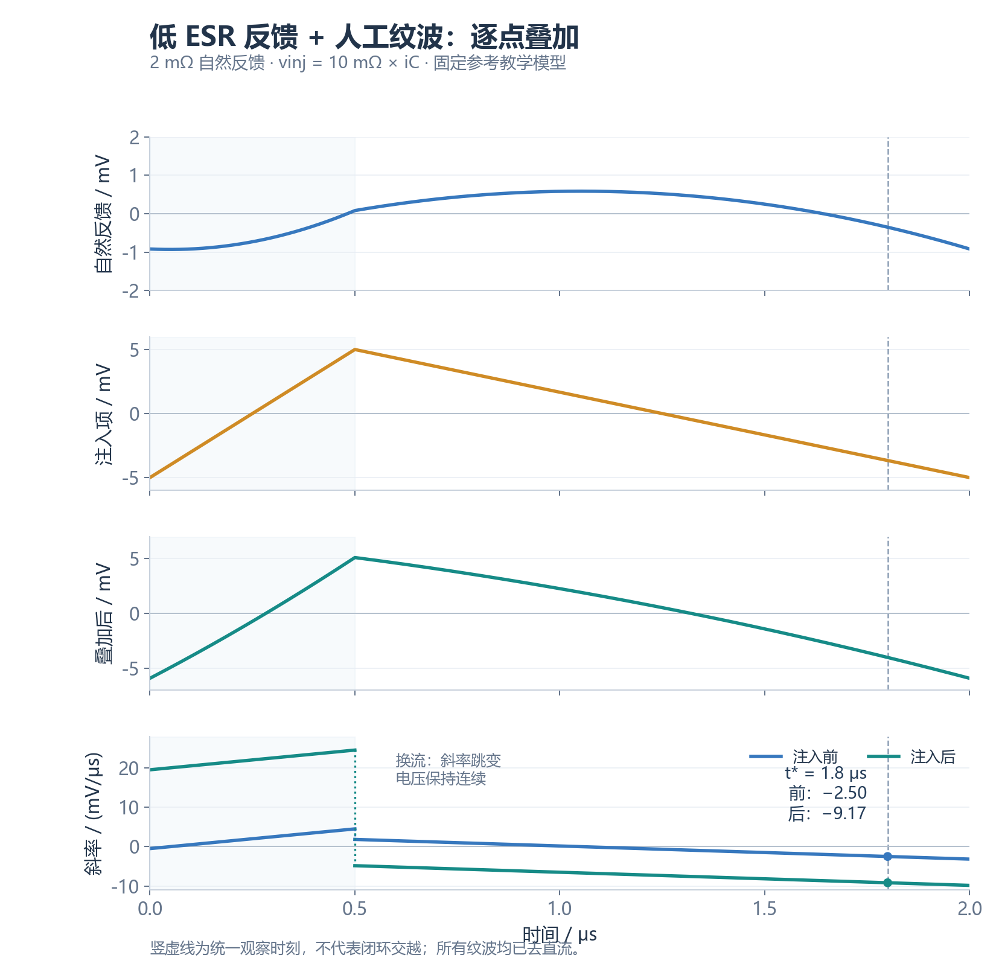

在 [COT 完整控制周期](/zh/notes/buck-cot-cycle/) 中我们知道：反馈比较器通过观察输出电压何时跌破阈值，决定下一次什么时候开通上管。

但把输出电容换成低 ESR 的多层陶瓷电容（MLCC）时，奇怪的事发生了：**输出电压明明更平更干净了，控制器却变得容易抖动甚至连发双脉冲。**

> **全篇核心矛盾与解法**
> - **功率输出端想要低 ESR**：纹波小、损耗低、瞬态跳变小；
> - **COT 比较器想要足够大的同相纹波**：只有纹波跟着电感电流同步上升/下降，且斜率够陡，才好精准卡出开通时刻；
> - **解法（人工纹波注入）**：不要去祸害输出电容，而是在**小信号反馈支路**上用几颗小 RC 元件人工合成虚拟电流纹波叠加给比较器。

前置知识：[Buck 功率级](/zh/notes/buck-day-01/) · [输出电容 ESR](/zh/notes/buck-esr-ripple/) · [COT 完整周期](/zh/notes/buck-cot-cycle/)

---

## 1. COT 怎么调输出？先看懂“提前开通”的物理作用

虽然 COT 每次导通时间 $T_{on}$ 固定，但它把**关断等待时间 $T_{off}$** 留作自由度：

$$T_s=T_{on}+T_{off},\qquad f_s=\frac{1}{T_s},\qquad D=\frac{T_{on}}{T_s}.$$

当负载突然加大时，比较器发现电压下降、提前提出开通请求，$T_{off}$ 缩短。虽然单次导通增加的电流 $\Delta i_L$ 没变，但**两次脉冲之间留给电感下降的时间变短了**，于是每周期净增流大于零，电感平均电流迅速爬高追赶新负载。

---

## 2. 为什么低 ESR 会破坏 COT 触发？两个致命问题

把输出电容拆成理想电容 $C$ 串联电阻 $R_{ESR}$，分压反馈 $\widetilde v_{FB} = \beta(\widetilde v_C + R_{ESR}i_C)$。两者对反馈的贡献截然不同：
- **ESR 项 $R_{ESR} i_C$**：和电感电流**完全同相**，上管一开就立刻往上掉头；
- **电容积分项 $\widetilde v_C$**：反映累计电荷，**上管刚开通时电容还在放电（$i_C < 0$），所以它还在继续往下掉**，要等半个上坡之后才慢半拍抬头！

从图 3 右列就能直接看见低 ESR 带来的两个大麻烦：

### 麻烦 1：上管开了，反馈却还在往下掉（引发双脉冲）

上管刚开通瞬间（$i_C \approx -\Delta I_L/2$，$di_C/dt \approx \Delta I_L / T_{on}$），输出端电压的变化斜率为：

$$\left.\frac{dv_o}{dt}\right|_{0^+} \approx \Delta I_L\left(\frac{R_{ESR}}{T_{on}}-\frac{1}{2C}\right).$$

想要上管一开、反馈立刻抬头脱离请求阈值，就必须满足：

$$\boxed{R_{ESR} C > \frac{T_{on}}{2}.}$$

当使用全 MLCC 电容时，ESR 降到 $1\text{–}2\text{ m}\Omega$，$R_{ESR}C$ 远小于 $T_{on}/2$。上管开通后反馈继续往下掉、迟迟不退出比较器请求区；最小关断时间一到，比较器以为还欠压，紧接着又发出第二个导通脉冲，形成**大纹波双脉冲/次谐波振荡**。

### 麻烦 2：阈值交越处太“平”，噪声一碰就狂抖

设比较器输入端叠加了差分电压噪声 $\delta v$，交越点局部斜率为 $S_e = dv_{sense}/dt$，引起的时间抖动直接由几何斜率决定：

$$\boxed{|\delta t| \approx \frac{|\delta v|}{|S_e|}.}$$

低 ESR 让反馈曲线在阈值附近变平变圆，同样大小的开关毛刺就能把开通时刻推远好几倍，开关频率和输出纹波都会肉眼可见地乱跳。

---

## 3. 解决方案：把“输出滤波”和“控制斜坡”彻底分开

既然输出端不敢加大 ESR，那就**借开关节点 SW 的方波，在反馈端用小信号 RC 网络自己造一条同相三角纹波 $v_{inj}$**，送进比较器：

$$v_{sense} = \beta v_o + v_{inj}.$$

为什么对 SW 方波做个一阶 RC 低通就能变成三角波？设时间常数 $\tau_r = R_r C_r \gg T_s$，电容上直流均值接近 $V_o$，因此两端压差刚好分别等于 $(V_{in}-V_o)$ 和 $-V_o$，积分斜率**跟电感电流斜率一模一样**：

$$\frac{dv_x}{dt}\approx \begin{cases}(V_{in}-V_o)/\tau_r, & \text{上管导通},\\ -V_o/\tau_r, & \text{下管续流}.\end{cases}$$

经过隔直电容耦合（等效虚拟电阻增益 $R_{virt} = kL/\tau_r$）叠加上去之后，效果立竿见影：

| 时刻 | 原低 ESR 自然反馈斜率 | 叠加 10 mVpp 注入后斜率 | 改善效果 |
| --- | --- | --- | --- |
| **0 µs 刚开通** | $-0.50\text{ mV}/\mu\text{s}$（还在跌！） | **$+19.50\text{ mV}/\mu\text{s}$** | 立即抬头撤销开通请求，杜绝双脉冲 |
| **1.8 µs 临近触发** | $-2.50\text{ mV}/\mu\text{s}$ | **$-9.17\text{ mV}/\mu\text{s}$** | 交越斜率增大 **3.67 倍**，抗噪抖动大幅下降 |

---

## 4. 注入的代价：为什么交流注入也会抬高直流输出电压？

很多人以为“注入的是隔直后的纯交流三角波，平均值为零，所以不会影响直流输出电压精度”。**这个直觉是错的！**

因为 COT 比较器卡住的不是“全周期平均值”，而是**谷底那一瞬间的触发电平**：

$$\beta\overline V_o = V_{ref} - \beta\widetilde v_o(t_k) - v_{inj}(t_k).$$

在触发下一次开通的谷底时刻 $t_k$，人工注入三角波刚好处于自己的**负谷底**（例如 $v_{inj}(t_k) = -5\text{ mV}$）。为了把总和顶回参考 $V_{ref}$，环路会被迫把输出平均电压往上抬：

$$\Delta\overline V_o \approx -\frac{v_{inj}(t_k)}{\beta} = -\frac{-5\text{ mV}}{0.5} = \mathbf{+10\text{ mV}}.$$

这就是为什么注入幅度不是越大越好——要在**触发抗噪能力**与**直流输出精度**之间找平衡（常见芯片如 TI D-CAP2/3 或内部斜坡架构会用额外积分误差放大器把这段直流偏移修回来）。

---

## 5. 把负载阶跃串回整条闭环

遇到突发重载阶跃时，整条控制链按顺序联动：
1. **电容顶上缺口** $\implies$ $i_C = i_L - I_o < 0$，$V_o$ 下跌；
2. **反馈触发提前** $\implies$ 比较器提早置起开通请求（过最小关断窗即执行）；
3. **缩短 $T_{off}$ 密集脉冲** $\implies$ 每周期净增流为正，电感快速爬升追赶负载；
4. **电荷回补收尾** $\implies$ 追上电流后再多补一点面积把电容电压拉回阈值，恢复稳态 $f_s \approx V_o/(V_{in}T_{on})$。

---

## 6. 注入设计快速排查表

| 常见问题 | 原因判断 | 调整方向 |
| --- | --- | --- |
| **换 MLCC 后依然双脉冲/抖动** | 注入太小或极性接反 | 加大等效虚拟增益 $R_{virt}$，核对开关同相极性 |
| **直流输出电压偏高几个 mV** | 谷底触发引起的固有直流偏移 | 减小注入幅度到刚够稳住抖动，或启用误差积分校准 |
| **负载阶跃变慢或振铃** | 注入网络自身隔直电容/RC 极点太慢 | 按 TI SNVA874 Type-III 频域条件校核注入极零点 |
| **高频毛刺误触发开通** | 注入支路高频衰减不够，SW 振铃漏进 FB | 核查注入网络高频滤波与 FB 走线屏蔽 |

---

## 参考资料

1. Texas Instruments, [TPS51125 Datasheet](https://www.ti.com/lit/ds/symlink/tps51125.pdf)（§7.3.1–7.3.4，D-CAP 与内部斜坡机制）。
2. Texas Instruments, [SLVA453: D-CAP Mode With All-Ceramic Output Capacitor](https://www.ti.com/lit/an/slva453/slva453.pdf)（全陶瓷电容外部纹波注入与直流精度计算）。
3. Texas Instruments, [SNVA874: Stability Analysis and Design of COT Type-3 Ripple Circuit](https://www.ti.com/lit/an/snva874/snva874.pdf)（Type-III 注入网络频域稳定性）。
