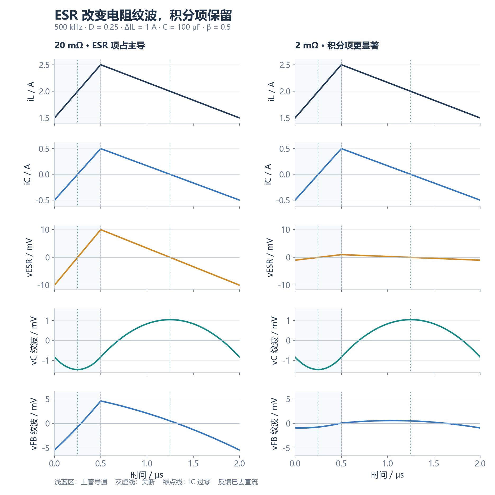
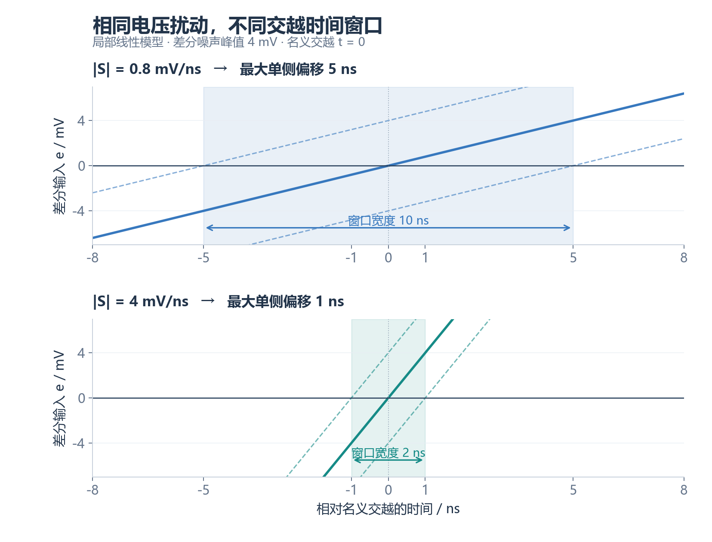
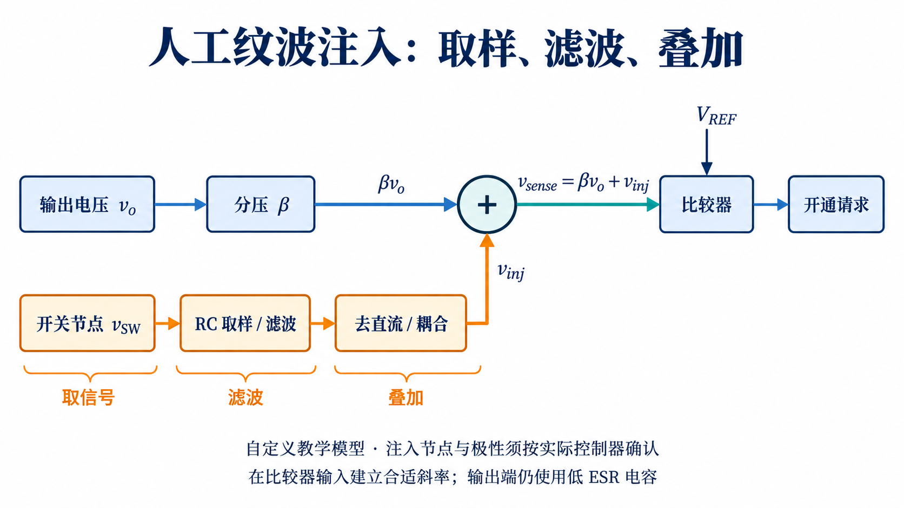
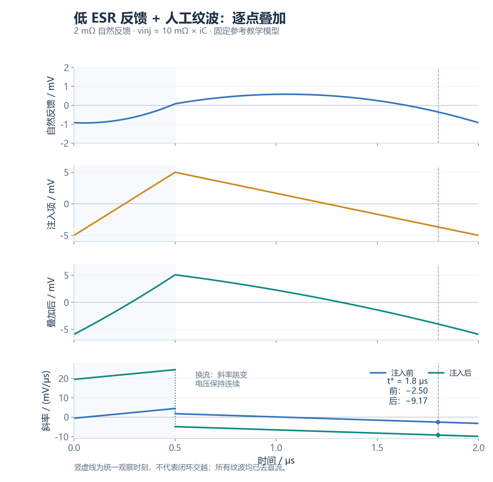

纹波反馈 COT 通过比较器输入与阈值的交越来决定下一次补能请求。**低 ESR 会减小与电容电流同相的电阻纹波；人工纹波注入则在比较器输入建立合适的动态斜率，使输出滤波与触发信号的设计获得更多自由度。** 判断控制是否可靠，需要同时观察波形形状、交越斜率和完整闭环动态。

[学习地图：COT](/zh/learn/#cot) · [全部个人笔记](/zh/notes/) · [COT 完整控制周期](/zh/notes/buck-cot-cycle/) · [ESR、纹波与反馈](/zh/notes/buck-esr-ripple/) · [电感 DCR 与取样](/zh/notes/buck-dcr/)

| 核心问题 | 结论 | 章节 |
| --- | --- | --- |
| 电容电流与电容电压是什么形状？ | 三角电流积分得到分段抛物线；ESR 电压才与电流同形 | §2–3 |
| 低 ESR 会让天然纹波消失吗？ | ESR 项减小，积分项和高频寄生效应仍存在 | §4 |
| 哪个斜率决定局部触发误差？ | 比较器两输入差值在交越时刻的斜率 | §5 |
| 人工纹波补在哪里？ | 按控制器设计，叠加到反馈侧或等效参考侧 | §6–7 |
| 注入越强越好吗？ | 要兼顾噪声、调节偏移、时序和负载瞬态 | §8 |
| 抖动小能否证明稳定？ | 局部交越误差不能替代闭环稳定性分析 | §9 |

**模型范围：** 单相同步 Buck，CCM 周期稳态，负载电流在一个周期内近似恒定。波形采用小纹波、常数 $L$、$C$、$R_{ESR}$ 模型，忽略 ESL、DCR、死区和开关尖峰；取样分压器不显著加载输出。后文人工注入是明确给定的自定义信号模型，波形用于解释机制，不代表具体芯片的仿真或实测结果。轻载 DCM、跳脉冲和保护行为需单独分析。

## 1. 先把开通事件与反馈信号分开

对本文指定的电压纹波反馈模型，定义比较器观察信号 $v_{sense}$、阈值 $v_{th}$ 和差值 $e$：

$$e(t)=v_{sense}(t)-v_{th}(t).\tag{1}$$

$e<0$ 表示补能请求有效。请求必须通过开通许可逻辑，才能变成上管实际开通；导通定时器从实际开通开始计时。固定 $T_{on}$ 时，下一次脉冲的开始时刻改变 $T_{off}$，也改变周期和占空比。

| 事件 | 控制作用 | 与纹波的关系 |
| --- | --- | --- |
| 反馈交越 | 提出上管开通请求 | 由两输入差值决定 |
| 开通许可满足 | 执行请求 | 检查最小关断时间、互锁、使能与保护 |
| $T_{on}$ 到期 | 结束本次正常上管导通 | 不依赖请求是否仍然有效 |
| 最小关断窗口结束 | 恢复下一次开通许可 | 到期本身不创造新请求 |
| 二极管仿真模式的 ZCD | 在零电流附近关闭下管 | 不直接启动下一次上管脉冲 |

最小关断时间限制的是实际执行，不能阻止比较器继续提出请求。理想时序满足 $T_{off}\ge T_{off,min}$；锁定期间的短请求是否保存取决于具体逻辑。完整事件波形见 [COT 周期笔记](/zh/notes/buck-cot-cycle/)。

## 2. 输出纹波：瞬时电阻项与电流积分项

定义 $i_L$ 从电感流入输出节点，$I_o$ 流向负载，$i_C$ 流入电容支路。忽略 ESL 时：

$$
\begin{aligned}
i_C&=i_L-I_o,\\
\frac{dv_C}{dt}&=\frac{i_C}{C},\\
v_o&=v_C+R_{ESR}i_C.
\end{aligned}
\tag{2}
$$

直接分压的反馈为 $v_{FB}=\beta v_o$，其中 $0<\beta<1$。交流纹波记为 $\widetilde v$：

$$\widetilde v_{FB}=\beta(\widetilde v_C+R_{ESR}i_C).\tag{3}$$

当 $i_C$ 是连续三角波时，$R_{ESR}i_C$ 同样是连续三角波；上管换流使它的斜率改变，正常稳态开关边沿并不使该项凭空跳变。负载阶跃使 $i_C$ 突变时才可能出现 ESR 电压阶跃。高频尖峰还可能来自 ESL、寄生耦合与测量回路。

三角电流的积分是**分段抛物线**。$i_C<0$ 时 $v_C$ 下降，$i_C>0$ 时 $v_C$ 上升；电压极值在电流过零处。不能把整个非正弦波形简单描述成固定移动了 90°；“积分相差 90°”适用于单个正弦分量。

若 $\Delta I_L$ 表示电感电流峰峰值、$f_s$ 表示当前稳态频率，则在这一模型内：

$$
\begin{aligned}
\Delta v_{ESR,pp}&=R_{ESR}\Delta I_L,\\
\Delta v_{C,pp}&=\frac{\Delta I_L}{8f_sC}.
\end{aligned}
\tag{4}
$$

两项极值通常错位，逐点相加后再求最大与最小值，才能得到总纹波；峰峰值直接相加只能作为上界。幅度与极值推导见 [ESR 笔记](/zh/notes/buck-esr-ripple/)。

## 3. 对齐波形：ESR 项占主导与积分项占主导

取自定义参数 $f_s=500\,\mathrm{kHz}$、$D=0.25$、$\Delta I_L=1\,\mathrm A$、$I_o=2\,\mathrm A$、$C=100\,\mathrm{\mu F}$、$\beta=0.5$；只比较 $R_{ESR}=20\,\mathrm{m\Omega}$ 与 $2\,\mathrm{m\Omega}$。

| 比较量 | 20 mΩ | 2 mΩ |
| --- | --- | --- |
| 输出 ESR 纹波峰峰值 | 20 mV | 2 mV |
| 电容积分纹波峰峰值 | 2.5 mV | 2.5 mV |
| 分压后 ESR 项峰峰值 | 10 mV | 1 mV |
| 分压后积分项峰峰值 | 1.25 mV | 1.25 mV |

以开通时刻 $t=0$ 为电流谷值，在三角电流近似下，$i_C$ 在 $T_{on}/2=0.25\,\mathrm{\mu s}$ 与 $T_{on}+T_{off}/2=1.25\,\mathrm{\mu s}$ 过零。$v_C$ 的最小与最大值分别在这两个时刻，ESR 项的谷值与峰值则在 0 与 0.5 µs。

左列端口波形更接近电流纹波；右列曲率和极值错位更明显。图中的电流是给定波形，不能据此推出实际闭环仍会保持同样周期。反馈阈值的直流位置、参考斜坡和许可逻辑还会决定真正的交越时刻。

## 4. 低 ESR 为什么可能使传统纹波反馈控制困难

对恒定参考、直接分压模型，比较器差值斜率为：

$$\frac{de}{dt}=\beta\left(\frac{i_C}{C}+R_{ESR}\frac{di_C}{dt}\right).\tag{5}$$

ESR 项提供与电流变化直接相关的斜率。关断续流期间，$di_C/dt\approx-V_o/L$；在电感电流谷值附近，$i_C<0$，两项共同使反馈下降。开通之后，电流开始上升，但只要 $i_C$ 仍为负，电容仍在放电。

开通刚发生时，取 $i_C\approx-\Delta I_L/2$、$di_C/dt\approx\Delta I_L/T_{on}$，得到：

$$
\left.\frac{dv_o}{dt}\right|_{0^+}
\approx\Delta I_L\left(\frac{R_{ESR}}{T_{on}}-\frac{1}{2C}\right).
\tag{6}
$$

因此 $R_{ESR}C>T_{on}/2$ 能使该**指定谷值开通模型**的起始端口斜率为正；ESR 太小则可能使反馈开通后继续下降，影响请求复位与后续周期。式 (6) 是局部波形判断，不能当作任意 COT 的充分稳定性条件。

低 ESR 的影响有两层：电阻纹波的幅度缩小，以及叠加波形的曲率、极值和交越斜率改变。交越处可能变平，也可能移到不同位置；“ESR 小十倍，任何交越斜率都小十倍”并不成立。**天然纹波仍存在，困难在于控制器需要的电流相关反馈成分可能不足。**

带内部纹波生成、不同参考斜坡或其他补偿机制的控制器，可能专门支持 MLCC。是否适用必须按具体架构和电容条件判断。

## 5. 触发误差：电压扰动如何变成时间偏移

设无扰动交越时刻为 $t_0$，$e(t_0)=0$，局部斜率 $S_e=e'(t_0)\ne0$；比较器输入等效差分扰动为 $\delta v$。线性展开：

$$
\begin{aligned}
0&\approx S_e\delta t+\delta v,\\
\delta t&\approx-\frac{\delta v}{S_e},\\
|\delta t|&\approx\frac{|\delta v|}{|S_e|}.
\end{aligned}
\tag{7}
$$

对固定参考，$S_e=dv_{sense}/dt$；对变化参考：

$$S_e=\frac{dv_{sense}}{dt}-\frac{dv_{th}}{dt}.\tag{8}$$

所以反馈侧注入与参考侧斜坡必须连同极性一起分析。电压噪声与斜率都要折算到同一个比较器差分节点；不能直接拿输出端噪声除以 FB 端斜率。

| 条件 | 输入扰动峰值 | 交越斜率绝对值 | 最大偏移幅度 | 两侧时间窗口宽度 |
| --- | --- | --- | --- | --- |
| 讲义例 1 | 5 mV | 1 mV/ns | 5 ns | 10 ns |
| 讲义例 2 | 5 mV | 5 mV/ns | 1 ns | 2 ns |
| 对照算例 A | 4 mV | 0.8 mV/ns | 5 ns | 10 ns |
| 对照算例 B | 4 mV | 4 mV/ns | 1 ns | 2 ns |

两组偏移幅度之比均为 5。这里的 5 ns 与 1 ns 是局部模型的最大**单侧偏移幅度**，不能标成峰峰抖动或 RMS 抖动。若噪声足够小、交越唯一、可线性化，RMS 量可近似写为 $\sigma_t\approx\sigma_v/|S_e|$，但峰值题设不能直接代入 RMS 公式。

该估算还忽略迟滞、传播延迟变化、锁定与请求锁存。若比较器在锁定期间交越，实际开通可能被窗口结束所限制，式 (7) 就不能直接代表门极脉冲的时刻误差；斜率接近零或噪声造成多次交越时，也需重新建模。

## 6. 人工纹波注入：取信号、滤波、叠加

将比较器输入写成：

$$v_{sense}=\beta v_o+v_{inj}.\tag{9}$$

其中 $v_{inj}$ 是人为生成的动态信号。设计重点是在交越附近获得合适的方向、斜率与幅度，同时控制直流偏置和开关噪声耦合。输出端仍可采用低 ESR 电容，比较器输入则获得额外的电流相关信息。

| 信号阶段 | 需要获得什么 | 需要避免什么 |
| --- | --- | --- |
| 取信号 | 与功率级开关状态或电感电压相关的变化 | 把 SW 尖峰直接送入 FB |
| RC 取样与滤波 | 合适的动态斜率或等效电流信息 | 时间常数过小导致边沿穿透，过大导致有效纹波不足 |
| 去直流与耦合 | 所需交流成分及受控增益 | 直流偏置、分压器加载和附加极点失配 |
| 叠加与比较 | 合适的差分交越波形 | 极性错误使斜率抵消或增加多次交越 |

人工注入也会改变脉冲时刻和输出动态，因此并非输出与注入完全互不影响；它只是让触发信号的生成不再完全依赖输出电容的 ESR。

## 7. 一个可推导的 RC 教学模型

为说明滤波如何产生斜坡，先定义一个**独立、无负载的一阶低通信号模型**：输入为 $v_{SW}$，滤波输出为 $v_x$，时间常数为 $\tau_r=R_rC_r$：

$$\tau_r\frac{dv_x}{dt}+v_x=v_{SW}.\tag{10}$$

若 $\tau_r\gg T_s$，在单个周期内 $v_x$ 的纹波较小；理想 CCM 稳态中 $\overline v_x\approx D V_{in}\approx V_o$，从而：

$$
\frac{dv_x}{dt}\approx
\begin{cases}
(V_{in}-V_o)/\tau_r,&\text{上管导通},\\
-V_o/\tau_r,&\text{下管续流}.
\end{cases}
\tag{11}
$$

这两段斜率与电感电流的分段斜率成比例。理想去直流并耦合增益为 $k>0$ 时，令 $v_{inj}=k(v_x-\overline v_x)$，可近似写为：

$$
\begin{aligned}
v_{inj}&\approx R_{virt}\widetilde i_L,\\
R_{virt}&=\frac{kL}{\tau_r}.
\end{aligned}
\tag{12}
$$

$R_{virt}$ 是折算到比较器输入的等效纹波增益，单位为 Ω，并不表示输出串入了一个耗能电阻。真实跨电感取样网络、耦合电容和分压器会改变传递函数；式 (10)–(12) 不能直接替代某个芯片的元件选值公式。

### 7.1 注入前后的逐点叠加

沿用图 1 的低 ESR 条件，在比较器输入加入 $v_{inj}=10\,\mathrm{m\Omega}\cdot i_C$ 的自定义零均值三角信号：

在指定观察时刻 $t_*=1.8\,\mathrm{\mu s}$，$i_C\approx-0.3667\,\mathrm A$，$di_C/dt\approx-0.6667\,\mathrm{A/\mu s}$。由式 (5)、(9)：

$$
\begin{aligned}
S_{before}&\approx-2.50\,\mathrm{mV/\mu s},\\
S_{inj}&\approx-6.67\,\mathrm{mV/\mu s},\\
S_{after}&\approx-9.17\,\mathrm{mV/\mu s}.
\end{aligned}
\tag{13}
$$

### 7.2 最下面的斜率图为什么会跳变

最后一行画的是前三行电压的**导数**，并非第四条电压波形。开通段 $di_C/dt=2\,\mathrm{A/\mu s}$，关断段 $di_C/dt=-2/3\,\mathrm{A/\mu s}$；这两个斜率在换流时切换。自然反馈的积分项贡献 $\beta i_C/C$，随电流缓慢变化；ESR 与人工注入项则贡献与 $di_C/dt$ 成比例的分段常数。

| 时刻 | 电容电流 | 自然反馈斜率 | 注入斜率 | 叠加后斜率 |
| --- | --- | --- | --- | --- |
| 0 µs 开通后 | −0.5 A | −0.50 mV/µs | +20.00 mV/µs | +19.50 mV/µs |
| 0.5 µs 关断前 | +0.5 A | +4.50 mV/µs | +20.00 mV/µs | +24.50 mV/µs |
| 0.5 µs 关断后 | +0.5 A | +1.83 mV/µs | −6.67 mV/µs | −4.83 mV/µs |
| 1.8 µs 观察点 | −0.3667 A | −2.50 mV/µs | −6.67 mV/µs | −9.17 mV/µs |
| 2.0 µs 下次开通前 | −0.5 A | −3.17 mV/µs | −6.67 mV/µs | −9.83 mV/µs |

因此，第三行电压在 0.5 µs 处有折角，第四行导数出现跳变，两者相互一致。理想换流的单个时刻没有唯一导数，竖点线只是标注左右极限，真实有限换流会把这一变化展开到短时间内。开通刚发生时蓝色自然反馈仍有负斜率，这正是低 ESR 下电容尚在放电的表现；人工注入后绿色曲线已经转为正斜率。

观察点处三条斜率在同一节点、同一时刻比较，注入后绝对斜率约为原来的 3.67 倍。这里的单位是 **mV/µs**，与 §5 为便于计算而设定的 mV/ns 题目相差一千倍。即使该观察点的斜率改善，也不能认为真实交越会固定在此处，更不能把整条波形替换成一条线性斜坡。

## 8. 幅度、相位与动态的权衡

| 情况 | 交越信号可能怎样变化 | 同时需要检查 |
| --- | --- | --- |
| 注入不足 | 自然积分项仍主导，所需同相纹波不足 | 抖动、双脉冲和控制器的纹波要求 |
| 注入极性不合适 | 交越处的斜率可能被抵消 | 比较器两输入、开通与关断阶段的斜率方向 |
| 注入幅度较大 | 交越位置和动态等效增益发生变化 | 平均输出偏移、负载阶跃和周期变化 |
| 带宽过宽 | SW 振铃与边沿可能进入差分输入 | 布局、滤波、噪声与多次交越 |
| 耦合网络过慢 | 瞬态信号与直流恢复可能受影响 | 负载响应、启动和模式转换 |

| 对照项目 | 自然 ESR 纹波 | 人工注入纹波 |
| --- | --- | --- |
| 来源 | $R_{ESR}i_C$ | 外部或内部动态信号网络 |
| 与电流的关系 | 本文常数 ESR 模型中直接同相 | 由网络及极性设计决定 |
| 设计参数 | 电容、频率与电流纹波 | 增益、时间常数、耦合与节点选择 |
| 输出滤波关系 | 电容 ESR 同时影响端口纹波与损耗 | 可减少对输出 ESR 的依赖，仍改变闭环动态 |
| 噪声风险 | 输出与布局噪声都需检查 | 还需检查取样路径引入的开关噪声 |

“斜率更陡”只在同一扰动、有效单次交越和局部线性模型下减小时间偏移。不能据此无限加大注入；噪声本身可能同时变大，耦合网络也可能改变闭环与平均调节点。

## 9. TPS51125 与外部注入实例要分别读

[TPS51125 数据手册 Rev. H](https://www.ti.com/lit/ds/symlink/tps51125.pdf) 的 §7.3.1–7.3.4 描述 AOT、输出电容条件及参考侧 ramp。该器件既有内部参考斜坡，也仍要求适合其 D-CAP 模式的输出电容；看到 ramp 一词不能直接认定它支持任意全陶瓷输出组合。

[TI SLVA453](https://www.ti.com/lit/an/slva453/slva453.pdf) 展示单通道 D-CAP 控制器的外部取样与交流耦合实例，并明确提出双通道控制器的通道间干扰顾虑。它适合用来理解注入机制，不能直接照搬到 TPS51125 双通道设计。图 3–4 是自定义模型，与上述实际器件实例分开。

[TI SNVA874](https://www.ti.com/lit/an/snva874/snva874.pdf) 从频域分析 Type-3 注入网络，说明应将注入形成的动态与功率级、定时延迟共同考虑。稳定性检查需要包含 $L$、有效 $C$、ESR、$T_{on}$、最小关断约束、传播延迟、反馈网络、负载与工作模式；参数不足时无法定量判断。

## 10. 把三类判断连起来

分析一张 COT 纹波图，可以沿着下面的顺序读取：

1. 确认比较器真正观察的差分信号，包含分压、注入与动态参考。
2. 对齐 $i_L$、$i_C$、$v_C$ 和 $v_{ESR}$，逐点构造端口与反馈波形。
3. 在实际交越位置求斜率，再按同一节点的噪声估算局部时间偏移。
4. 检查交越时是否允许开通，再区分请求时刻与实际门极时刻。
5. 用完整控制模型检查周期、平均调节、负载响应和稳定性。

**幅度回答“有多少纹波”，斜率回答“交越对噪声有多敏感”，闭环分析回答“扰动能否衰减”。** 三者相互关联，却不能互相替代。

## 参考资料

1. Texas Instruments, [TPS51125 Datasheet, Rev. H, SLUS786H](https://www.ti.com/lit/ds/symlink/tps51125.pdf)，§7.3.1–7.3.4，印刷第 17–18 页。
2. Texas Instruments, [D-CAP Mode With All-Ceramic Output Capacitor Application, SLVA453](https://www.ti.com/lit/an/slva453/slva453.pdf)，§1–3，区分单通道应用实例、取样与交流耦合网络及适用条件。
3. Texas Instruments, [Stability Analysis and Design of COT Type-3 Ripple Circuit, SNVA874](https://www.ti.com/lit/an/snva874/snva874.pdf)，§2–3，注入网络与频域稳定性分析。
4. Microchip, [Constant On-Time Control](https://developerhelp.microchip.com/xwiki/bin/view/applications/power/mastering-buck-converters/analog-control-methods/cot/)，COT Control Details 的反馈触发与定时说明。
