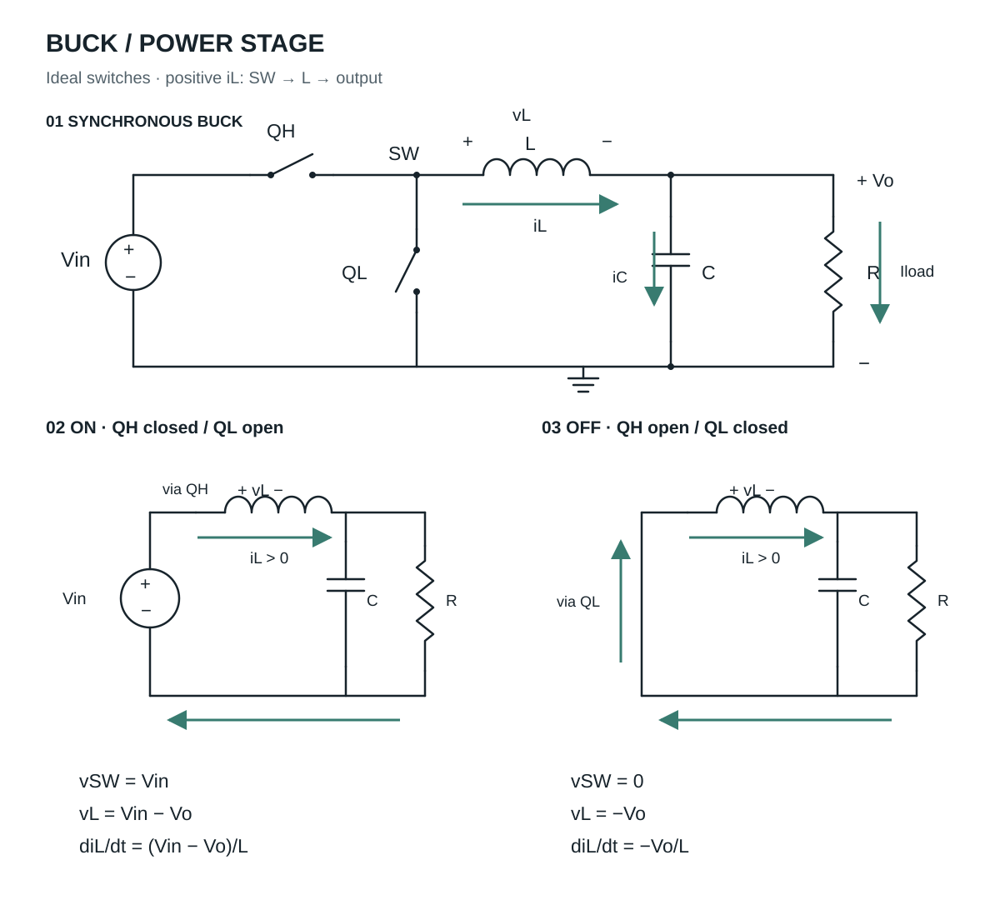
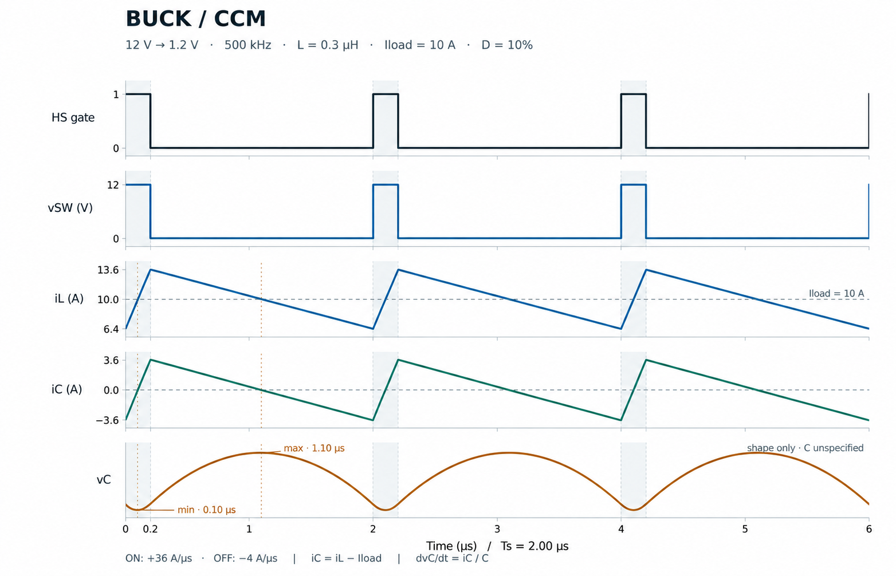
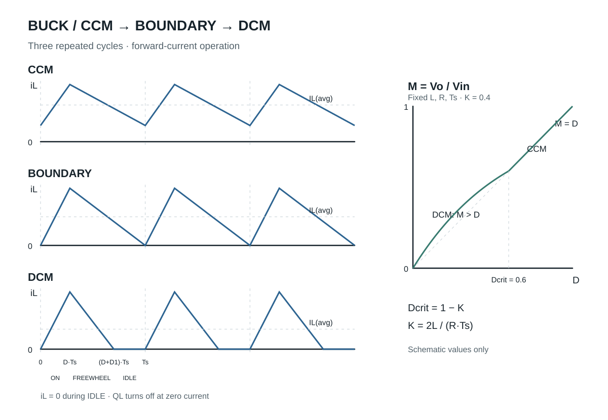

Buck 降压变换器的任务很纯粹：**把较高的直流输入 $V_{in}$ 斩成方波，再通过 LC 滤波器变成平稳的低压输出 $V_o$**。

只要抓住一条铁律——**电感电流不能瞬间突变**——就能推出上管关断后为什么必须有下管续流、占空比为什么等于 $V_o/V_{in}$、输出纹波有多大，以及轻载时为什么会冒出“电流断流”的 DCM 模式。

[返回学习地图](/zh/learn/#power) · [全部个人笔记](/zh/notes/) · [下一篇：负载阶跃与大电流瞬态](/zh/notes/buck-day-02/)

## 1. 符号与方向约定

| 符号 | 含义 | 约定 |
| --- | --- | --- |
| $V_{in}$、$V_o$ | 输入、输出直流电压 | $0 < V_o < V_{in}$ |
| $v_{SW}(t)$ | 开关节点 SW 对地电压 | 在 $V_{in}$ 与 $0$ 之间切换 |
| $Q_H$、$Q_L$ | 上管、同步下管 | 交替导通，留死区防直通 |
| $L$、$C$、$R$ | 输出电感、电容、负载电阻 | 负载电流 $I_{load}=V_o/R$ |
| $i_L(t)$、$I_L$ | 瞬时电感电流、周期平均电流 | 正方向从 SW 流向输出；稳态 $I_L=I_{load}$ |
| $\Delta i_L$ | 电感电流峰峰值 | $\Delta i_L = I_{L,max}-I_{L,min}$ |
| $i_C(t)$ | 流入电容正端的电流 | $i_C=i_L-I_{load}$（正值充电，负值放电） |
| $f_s$、$T_s$ | 开关频率、周期 | $T_s=1/f_s$ |
| $D$、$D'$ | 上管占空比及其补数 | $D'=1-D$；CCM 下 $T_{on}=DT_s$ |
| $R_C$、$R_L$ | 电容 ESR、电感 DCR | 分别为电容支路和电感绕组的串联电阻 |

---

## 2. 为什么需要两只管子？看懂 ON / OFF 两状态

1. **ON 状态（上管 $Q_H$ 开、下管 $Q_L$ 关）**：
   $v_{SW}=V_{in}$，电感左端高于右端，电流线性上升：
   $$v_L = V_{in}-V_o > 0,\qquad \frac{di_L}{dt}=\frac{V_{in}-V_o}{L}.$$
2. **OFF 状态（上管 $Q_H$ 关、下管 $Q_L$ 开）**：
   电感电流不能突然归零，所以必须由下管 $Q_L$（或非同步 Buck 中的续流二极管）从地接通一条通路让电流继续流向输出。此时 $v_{SW}=0$，电感左低右高，电流**方向不变、大小线性下降**：
   $$v_L = -V_o < 0,\qquad \frac{di_L}{dt}=-\frac{V_o}{L}.$$

| 开关状态 | $v_{SW}$ | 电感电压 $v_L$ | 电流斜率 $di_L/dt$ | 电容电流 $i_C = i_L - I_{load}$ |
| --- | --- | --- | --- | --- |
| ON（$Q_H$ 导通） | $V_{in}$ | $V_{in}-V_o$ | $+(V_{in}-V_o)/L$ | 前半段为负（放电），追过 $I_{load}$ 后转正 |
| OFF（$Q_L$ 导通） | $0$ | $-V_o$ | $-V_o/L$ | 前半段仍正（充电），跌破 $I_{load}$ 后转负 |

> **关键直觉**：电容在充电还是放电，**只看 $i_L$ 是否大于 $I_{load}$**，而不看上管是不是开着。上管刚开通时，只要 $i_L$ 还没追上负载，电容依然在放电；上管刚关断时，只要 $i_L$ 还高于负载，电容依然在充电。

---

## 3. CCM 稳态：伏秒平衡、占空比与纹波电流

当电感电流在整个开关周期内都保持大于零、从未断流时，称为**连续导通模式（CCM）**。

稳态意味着一个周期结束后，电感电流必须回到起点（增流量等于减流量）：

$$(V_{in}-V_o)DT_s = V_o(1-D)T_s.$$

两边消去 $T_s$，立即得到 Buck 最核心的理想变换比（即**电感伏秒平衡**）：

$$\boxed{D=\frac{V_o}{V_{in}}.}$$

电感电流峰峰值纹波 $\Delta i_L$ 可以用上升段或下降段任意一段算出：

$$\Delta i_L = \frac{V_{in}-V_o}{L}DT_s = \frac{V_o(1-D)T_s}{L}.$$

在三角波对称近似下，平均电流、峰值与谷值为：

$$I_L = I_{load} = \frac{V_o}{R},\qquad I_{L,max}=I_L+\frac{\Delta i_L}{2},\qquad I_{L,min}=I_L-\frac{\Delta i_L}{2}.$$

---

## 4. 经典算例与三周期波形

设同步 Buck 参数：$V_{in}=12\text{ V}$、$V_o=1.2\text{ V}$、$f_s=500\text{ kHz}$、$L=0.3\,\mu\text{H}$、$I_{load}=10\text{ A}$。

| 待求量 | 公式 | 计算与结果 |
| --- | --- | --- |
| 占空比 $D$ | $V_o/V_{in}$ | $1.2 / 12 = \mathbf{0.10}$（10%） |
| 周期 $T_s$ | $1/f_s$ | $1/(500\text{ kHz}) = \mathbf{2.0\,\mu\text{s}}$ |
| 导通 / 关断时长 | $DT_s$、$(1-D)T_s$ | $T_{on}=\mathbf{0.20\,\mu\text{s}}$，$T_{off}=\mathbf{1.80\,\mu\text{s}}$ |
| 上升 / 下降斜率 | $(V_{in}-V_o)/L$、$-V_o/L$ | $\mathbf{+36\text{ A}/\mu\text{s}}$ / $\mathbf{-4\text{ A}/\mu\text{s}}$ |
| 电流纹波 $\Delta i_L$ | $36\times 0.20$ 或 $4\times 1.80$ | $\mathbf{7.2\text{ A}_{pp}}$ |
| 谷值 / 峰值电流 | $10 \mp 7.2/2$ | $I_{L,min}=\mathbf{6.4\text{ A}} > 0$（确为 CCM），$I_{L,max}=\mathbf{13.6\text{ A}}$ |

把一周期（$2.0\,\mu\text{s}$）的五个关键时刻串起来看：
- **$0\,\mu\text{s}$**：上管开通，$i_L=6.4\text{ A}$，$i_C=-3.6\text{ A}$，电容正在放电；
- **$0.10\,\mu\text{s}$**：$i_L$ 上升穿过 $10\text{ A}$，$i_C$ 由负变正，$v_C$ 到达**最低谷**；
- **$0.20\,\mu\text{s}$**：上管关、下管开，$i_L$ 达峰值 $13.6\text{ A}$，$i_C=+3.6\text{ A}$，电容仍在继续充电；
- **$1.10\,\mu\text{s}$**：$i_L$ 下降穿过 $10\text{ A}$，$i_C$ 由正变负，$v_C$ 到达**最高峰**；
- **$2.00\,\mu\text{s}$**：$i_L$ 回到 $6.4\text{ A}$，进入下一周期。

---

## 5. 输出电压纹波怎么算？看清 $C$ 和 $ESR$ 两部分

输出电容帮电感吸收了电流纹波 $i_C$，代价是在输出端留下电压纹波，由两部分叠加：

1. **理想电容充放电分量（分段抛物线）**：
   正电流区间恰好覆盖半个上升斜坡与半个下降斜坡，总充电量就是三角波在横轴上方的三角形面积：
   $$\Delta Q = \frac{1}{2}\cdot\frac{\Delta i_L}{2}\cdot\frac{T_s}{2}=\frac{\Delta i_L T_s}{8} \implies \boxed{\Delta v_{C,pp}=\frac{\Delta i_L}{8f_s C}=\frac{V_o(1-D)T_s^2}{8LC}.}$$
2. **电容串联电阻 ESR 分量（三角波）**：
   $$\Delta v_{ESR,pp}=\Delta i_L R_C.$$

因为两项的波峰和波谷不在同一时刻，总峰峰值通常满足估算上界 $\Delta v_{o,pp}\lesssim \Delta v_{C,pp}+\Delta v_{ESR,pp}$；只有当某一项远大于另一项时（如电解电容 ESR 主导），总纹波才直接近似等于较大那一项。精确极值推导见 [Buck 输出电容 ESR](/zh/notes/buck-esr-ripple/)。

---

## 6. 轻载断流了怎么办？CCM、临界与 DCM

在异步 Buck 或带过零关断（ZCD）的同步 Buck 中，如果负载一路减小，电感电流谷值撞到零之后不能倒流，就会趴在零上直到下个周期开始——这就是**断续导通模式（DCM）**。

### 6.1 什么时候进入 DCM？

临界条件就是**谷值刚好等于零**，即平均电流等于半个纹波：

$$I_{L,crit}=\frac{\Delta i_{L,CCM}}{2}=\frac{V_o(1-D)T_s}{2L}.$$

换成电阻负载或电感临界值，只要满足下面任一条件就进入 DCM（前提是下管禁止反向电流）：

$$R > R_{crit}=\frac{2L}{(1-D)T_s}\qquad \text{或} \qquad L < L_{crit}=\frac{(1-D)RT_s}{2}.$$

### 6.2 DCM 下占空比和输出电压怎么算？

DCM 一个周期分成三段：**导通 $DT_s$ → 续流 $D_1 T_s$ → 零电流空闲 $D_0 T_s$**（注意 $D_1 < 1-D$）。

1. **伏秒平衡**（零电流段电感电压为 0）：
   $$(V_{in}-V_o)D = V_o D_1 \implies M=\frac{V_o}{V_{in}}=\frac{D}{D+D_1}.$$
2. **平均电流等于负载电流**：
   $$I_L = \frac{1}{2}I_{L,max}(D+D_1) = \frac{V_o}{R},\qquad I_{L,max}=\frac{V_{in}-V_o}{L}DT_s.$$
3. **联立消去 $I_{L,max}$，解得 $D_1$ 与输出电压**：
   令无量纲参数 $K=\dfrac{2L}{RT_s}$，可得 $D_1(D+D_1)=K$，解出：
   $$D_1=\frac{-D+\sqrt{D^2+4K}}{2},\qquad \boxed{V_o = \frac{2D}{D+\sqrt{D^2+\frac{8L}{RT_s}}}V_{in}.}$$

> **记住 DCM 的最大变化**：由于 $D+D_1<1$，同样占空比下 DCM 的输出电压会**高于** $D V_{in}$，且变换比同时跟负载 $R$、电感 $L$ 和开关周期 $T_s$ 绑定在一起。

---

## 7. 频域视角：无损 LC 滤波器

把电感、电容和负载看成一个从 SW 节点到输出的二阶低通滤波器，其传递函数为：

$$F(s)=\frac{V_o(s)}{V_{SW}(s)}=\frac{1}{1+\dfrac{sL}{R}+s^2LC}=\frac{1}{1+\dfrac{s}{Q\omega_0}+\dfrac{s^2}{\omega_0^2}},$$

其中固有角频率与品质因数为：

$$\omega_0=\frac{1}{\sqrt{LC}},\qquad f_0=\frac{1}{2\pi\sqrt{LC}},\qquad Q=R\sqrt{\frac{C}{L}}.$$

电感和电容决定了滤波转折频率 $f_0$（需要远低于 $f_s$ 才能有效滤除开关纹波），而负载越重（$R$ 越小），系统阻尼越强（$Q$ 越小）。

---

## 8. 练习算例（巩固自测）

已知同步 Buck：$V_{in}=9\text{ V}$、$V_o=1.5\text{ V}$、$f_s=600\text{ kHz}$、$L=0.5\,\mu\text{H}$、$I_{load}=5\text{ A}$。

1. 先按 CCM 求解：$D = 1.5/9 = 1/6$，$T_s = 1.6667\,\mu\text{s}$，$T_{on} = 0.2778\,\mu\text{s}$，$T_{off}=1.3889\,\mu\text{s}$；
2. 电流斜率：$+15\text{ A}/\mu\text{s}$ / $-3\text{ A}/\mu\text{s}$，峰峰值纹波 $\Delta i_L = 4.1667\text{ A}$；
3. 模式校验：临界电流 $I_{crit} = 4.1667/2 = 2.0833\text{ A}$。当前负载 $5\text{ A} > 2.0833\text{ A}$，谷值 $2.9167\text{ A} > 0$，确实工作在 CCM。

---

## 参考资料

- [TI SLVA057 · Understanding Buck Power Stages in Switchmode Power Supplies](https://www.ti.com/lit/an/slva057/slva057.pdf)（§2.1–2.3、§4.1：两状态、CCM 与 DCM 推导）
- [TI SLVA630A · Output Ripple Voltage for Buck Switching Regulator](https://www.ti.com/lit/an/slva630a/slva630a.pdf)（电容与 ESR 纹波波形拆解）
