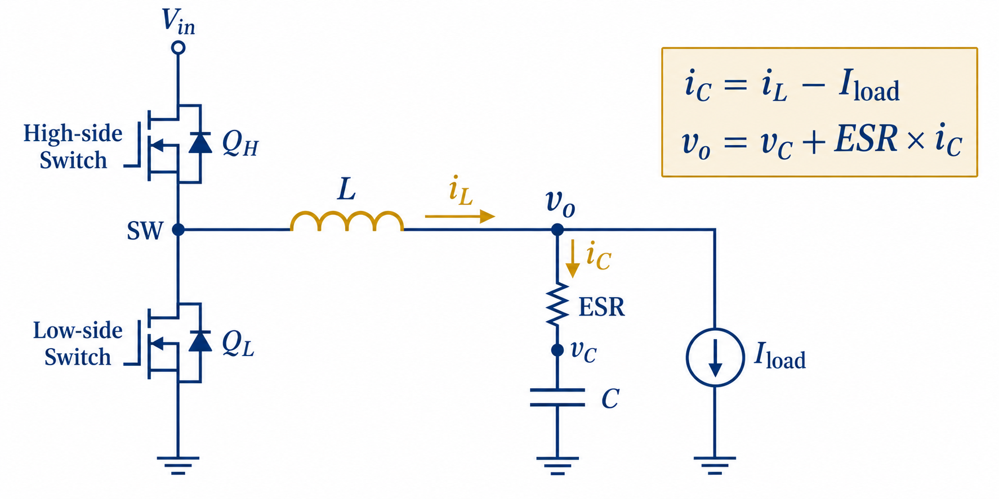
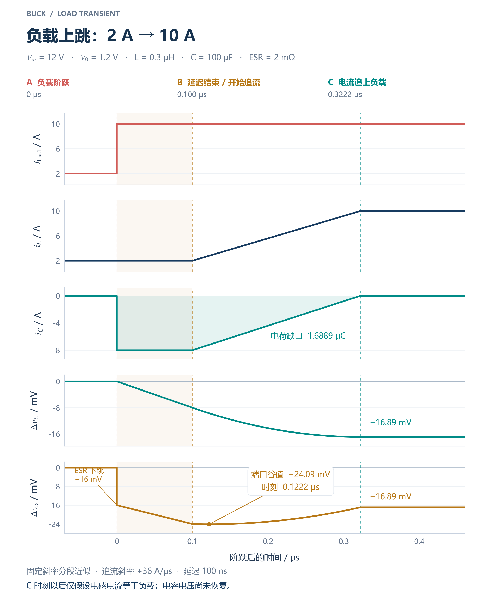
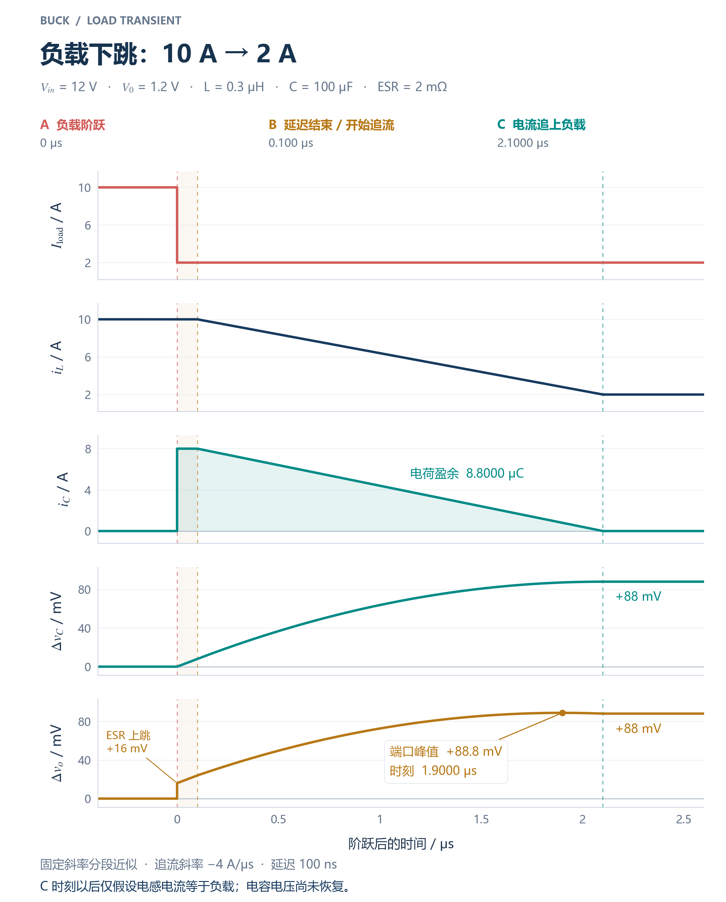
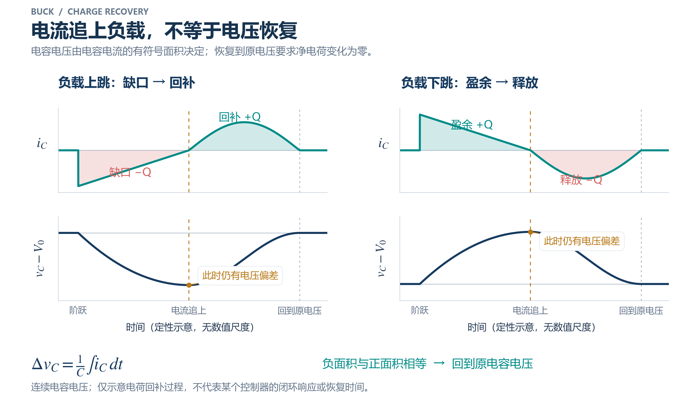
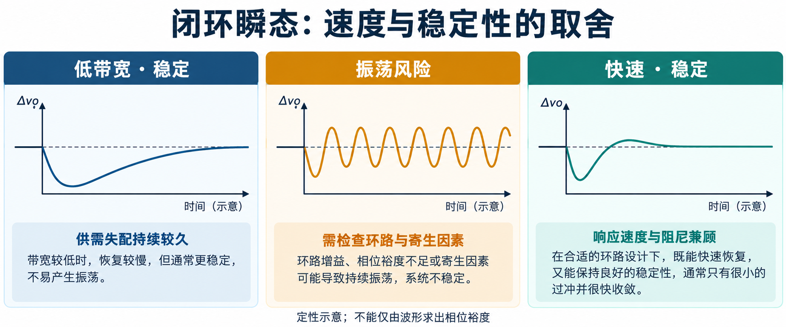

稳态下纹波很漂亮，不代表负载突变时输出不会跌穿容差带。当负载电流突然从 $2\text{ A}$ 跳到 $10\text{ A}$ 时，**电感电流不能跳变，缺口只能全由输出电容先扛下来**；等电感好不容易追上 $10\text{ A}$，电容之前掉下去的电压还没回来，必须再多充一段电把电荷补平。

> **全篇核心拆解**
> 看懂任何负载瞬态，只需要盯住三个量：
> 1. **ESR 压降 $R_{ESR} i_C$** 决定 $t_0^+$ 那一瞬间的垂直跳变；
> 2. **电容电流的积分面积 $\int i_C\,dt$** 决定理想电容电压跌了多少（或冲高了多少）；
> 3. **控制器带宽与电感可用压差 $v_L/L$** 决定追流多快、电荷多久补回来。

[学习地图：负载阶跃与大电流瞬态](/zh/learn/#buck-load-transients) · [上一篇：Buck 功率级基础](/zh/notes/buck-day-01/) · [全部个人笔记](/zh/notes/)

---

## 1. 统一参考方向与三个核心方程

整篇固定使用“**流入电容为正**”的参考方向（部分资料把电容对外放电设为正，公式符号会相反，物理结果完全一致）：

$$\boxed{i_C = i_L - I_{load}} \tag{1}$$

$$C\frac{dv_C}{dt} = i_C \implies \Delta v_C = \frac{1}{C}\int i_C\,dt \tag{2}$$

$$\boxed{V_o = v_C + R_{ESR}\,i_C} \tag{3}$$

记住三条物理约束：
- 电感两端电压有限 $\implies$ **$i_L$ 不能突变**；
- 电容电流有限 $\implies$ **理想电容电压 $v_C$ 不能突变**；
- 串联电阻直接随电流变化 $\implies$ **$i_C$ 突变时，端口电压 $V_o$ 会跟着产生 $R_{ESR}\Delta i_C$ 的瞬间阶跃**。

---

## 2. 负载上跳 vs 下跳：四阶段对比与“五行波形”

把一次阶跃拆成四个阶段：$t_0^-$（原稳态）$\to t_0^+$（阶跃瞬间）$\to$ 等待与追流（$i_L$ 追赶新负载）$\to$ 电荷回补（把失去或多余的电荷补回来）。

### 2.1 三时刻对照表（以 $2\text{ A}\leftrightarrow 10\text{ A}$、$R_{ESR}=2\text{ m}\Omega$ 为例）

| 时刻 | 负载上跳（$2\to 10\text{ A}$） | 负载下跳（$10\to 2\text{ A}$） |
| --- | --- | --- |
| **$t_0^-$** | $i_L=2\text{ A},\; i_C=0,\; V_o=v_C=1.2\text{ V}$ | $i_L=10\text{ A},\; i_C=0,\; V_o=v_C=1.2\text{ V}$ |
| **$t_0^+$** | $i_L$ 仍为 $2\text{ A}$，**$i_C$ 跳到 $-8\text{ A}$**；$v_C$ 连续，$V_o$ **瞬间下跳 $16\text{ mV}$** | $i_L$ 仍为 $10\text{ A}$，**$i_C$ 跳到 $+8\text{ A}$**；$v_C$ 连续，$V_o$ **瞬间上跳 $16\text{ mV}$** |
| **追流期** | 电容持续失血（$v_C$ 下降），直到 $i_L$ 爬到 $10\text{ A}$ | 多余电感电流持续灌入电容（$v_C$ 过冲），直到 $i_L$ 跌到 $2\text{ A}$ |

### 2.2 教科书式五行波形：`Iload → iL → iC → vC → Vo`

读波形按自上而下的顺序看：先看电流差 $i_C$ 有多大、持续多久，再看阴影面积对应的电压损失，最后叠上 ESR。

> **为什么加载和卸载完全不对称？**
> 在 $V_{in}=12\text{ V}, V_o=1.2\text{ V}, L=0.3\,\mu\text{H}$ 下：
> - **加载时**：上管全开，电感获得 $12-1.2=10.8\text{ V}$ 正压差，斜率高达 **$+36\text{ A}/\mu\text{s}$**，只需 $0.222\,\mu\text{s}$ 就追完 $8\text{ A}$；
> - **卸载时**：下管续流，电感两端只剩 $-1.2\text{ V}$ 压差，斜率只有 **$-4\text{ A}/\mu\text{s}$**，整整拖了 **$2.0\,\mu\text{s}$**——差了 9 倍！因此**低占空比大电流 Buck 的最难关往往是卸载过冲，而不是加载下冲**。

---

## 3. 完整手算算例：$12\text{ V}\to 1.2\text{ V}$，$2\text{ A}\leftrightarrow 10\text{ A}$

给定功率级与等效电容参数：$V_{in}=12\text{ V}$、$V_0=1.2\text{ V}$、$L=0.3\,\mu\text{H}$、$C=100\,\mu\text{F}$、$R_{ESR}=2\text{ m}\Omega$，假设控制器响应延迟 $t_d=100\text{ ns}$（延迟期间近似认为电感电流保持初值）。

### 3.1 加载（$2\to 10\text{ A}$）逐项算

1. **初始电容电流与 ESR 阶跃**：
   $$i_C(t_0^+)=2-10=-8\text{ A},\qquad \Delta V_{o,ESR}=(-8\text{ A})(2\text{ m}\Omega)=\mathbf{-16\text{ mV}}.$$
2. **电容初始放电斜率与 100 ns 延迟损失**：
   $$\frac{dv_C}{dt}=\frac{-8\text{ A}}{100\,\mu\text{F}}=\mathbf{-80\text{ mV}/\mu\text{s}} \implies \Delta v_{C}(100\text{ ns})=\mathbf{-8\text{ mV}}.$$
   （此时 $v_C=1.192\text{ V}$，$V_o=1.192-0.016=1.176\text{ V}$。）
3. **上管持续导通追流**：
   $$m_{on}=\frac{12-1.2}{0.3\,\mu\text{H}}=36\text{ A}/\mu\text{s} \implies t_{rise}=\frac{8\text{ A}}{36\text{ A}/\mu\text{s}}=\mathbf{222.2\text{ ns}}.$$
4. **追流三角形面积造成的额外电容压降**：
   $$\Delta v_{C,rise}=-\frac{1}{2}\cdot\frac{8\text{ A}\times 222.2\text{ ns}}{100\,\mu\text{F}}=\mathbf{-8.89\text{ mV}}.$$
   追上负载时，电容总共跌了 $-8 - 8.89 = \mathbf{-16.89\text{ mV}}$（缺口电荷 $1.689\,\mu\text{C}$）。

### 3.2 通用电荷预算公式

把延迟期的“矩形面积”和追流期的“三角形面积”合起来，任何大阶跃幅值 $A=|\Delta I_{load}|$ 引起的电容电压最大偏差都可以直接用这把尺子估：

$$\boxed{Q = A t_d + \frac{A t_r}{2} = A t_d + \frac{A^2}{2m},\qquad |\Delta v_C| = \frac{Q}{C}.}$$

其中 $m$ 是电感电流追赶斜率，$t_r=A/m$。注意公式里出现了 **$A^2$**——负载阶跃翻倍，追流阶段引起的电容压降会翻 **4 倍**！

### 3.3 卸载（$10\to 2\text{ A}$）对比

下坡斜率 $m = V_o/L = 4\text{ A}/\mu\text{s}$，其余参数完全相同：
- 延迟 $100\text{ ns}$ 充高 $+8\text{ mV}$；
- 下坡耗时 $t_r = 8/4 = \mathbf{2.0\,\mu\text{s}}$，三角形面积额外充高 $+80\text{ mV}$；
- 追上负载时，电容共过冲了 **$+88\text{ mV}$**（多余电荷 $8.8\,\mu\text{C}$），是加载压降的 5 倍多！

### 3.4 陷阱纠正：为什么不能直接把“ESR 跳变”加到“最终电容压降”上？

很多初学者会把 $-16\text{ mV}$（ESR 跳变）和 $-16.89\text{ mV}$（电容总压降）直接加在一起算出 $-32.89\text{ mV}$。**这是错的**——因为当电感追上负载、$v_C$ 跌到谷底时，$i_C=0$，ESR 压降刚好归零；而当 ESR 压降最大时，$v_C$ 还没跌完！

真正找端口 $V_o$ 极值的办法是对 $V_o=v_C+R_{ESR}i_C$ 求导并令其为零：

$$\frac{dV_o}{dt}=\frac{i_C}{C}+R_{ESR}\frac{di_L}{dt}=0 \implies u_* = t_r - C R_{ESR}.$$

把本例 $C R_{ESR}=100\,\mu\text{F}\times 2\text{ m}\Omega=0.2\,\mu\text{s}$ 代入上式：
- **加载**：$u_* = 0.2222 - 0.2 = 0.0222\,\mu\text{s}$（即起坡后 22.2 ns、阶跃后 **122.2 ns** 处），此时 $i_C=-7.2\text{ A}$，实际端口谷值为 **$-24.09\text{ mV}$**（其中 $v_C$ 跌了 $9.69\text{ mV}$，ESR 占 $14.4\text{ mV}$），明显小于误加得到的 $-32.89\text{ mV}$；
- **卸载**：$u_* = 2.0 - 0.2 = 1.8\,\mu\text{s}$（阶跃后 **1.9 µs** 处），此时 $i_C=+0.8\text{ A}$，实际端口峰值为 **$+88.8\text{ mV}$**。

---

## 4. 追上电流之后还没完：必须安排“电荷回补”

> **复习铁律**
> $i_L = I_{load}$ 只代表 $dv_C/dt = 0$（电容不再继续跌了），**不代表电压恢复了**。
> - 加载时失去的 $1.689\,\mu\text{C}$ 电荷，必须靠后续让 $i_L$ **短暂冲高超过 $10\text{ A}$** 才能补回来；
> - 卸载时多出的 $8.8\,\mu\text{C}$ 电荷，必须靠让 $i_L$ **短暂跌破 $2\text{ A}$**（甚至在强制 PWM 下拉成负电流帮忙吸走）才能放掉。

---

## 5. 控制架构与环路带宽怎么影响恢复曲线？

| 现象 / 架构 | 物理原因与特点 |
| --- | --- |
| **带宽过低** | 电感追流后缓慢补回电荷，恢复时间长 |
| **相位裕度不足** | 回补电荷时“冲过头”又反向回调，出现明显振铃 |
| **峰值电流模式** | 受固定时钟节拍限制，若阶跃恰好发生在上管刚关断后，必须等下一个时钟沿 |
| **谷值电流 / COT / AOT** | 下管导通期间只要反馈跌破阈值（且过最小关断时间），就能立即提前开通补能（详见 [COT 纹波闭环](/zh/notes/buck-cot-ripple/)） |

### 实测波形一眼排查表

| 示波器看到的现象 | 优先检查方向 |
| --- | --- |
| 阶跃沿上极其尖锐的窄脉冲 | **ESL**（封装/PCB 走线电感 $L_{ESL}\,di_C/dt$）与探头接地环路，不是单纯 ESR |
| 立即垂直下跳 + 弧形下陷 | 垂直下跳是 **ESR**，弧形下陷是 **延迟 + 电容容值不足** |
| 卸载后过冲久久不落 | 低压下坡太慢、轻载进入二极管仿真模式禁止了负电流 |

---

## 6. 容易忽略的另外三种瞬态与设计预算

### 6.1 区分三种不同性质的阶跃

- **输入电压阶跃（line transient）**：例如 $V_{in}: 16\text{ V}\to 8\text{ V}$。输入突变不会直接导致负载电流突变，也就**不会出现 $-R_{ESR}\Delta I_{load}$ 的瞬间跳变**；它改变的是上管斜率 $(V_{in}-V_o)/L$，靠环路及时调宽占空比稳住输出。
- **负载电阻阶跃（$R_1\to R_2$）**：电阻变大（如 $1\,\Omega\to 2\,\Omega$）等价于负载电流减小（卸载），会产生上跳；若直接跳到很轻负载（如 $1\,\Omega\to 8\,\Omega$），还可能同时触发轻载模式切换（DCM / PFM）。
- **多相并联加速**：$N$ 相同时切入全开时，极限总追流斜率可放大到单相的 $N$ 倍（近似 $N(V_{in}-V_o)/L$），这也是服务器/CPU 大电流供电普遍采用多相 Buck 的重要原因。

### 6.2 工程分配输出电容的思路

把总允许压降 $\Delta V_{allow}$ 拆成两笔预算来选电容：
1. **用 ESR 压住瞬跳**：$R_{ESR} \lesssim \dfrac{\Delta V_{jump,allow}}{A}$；
2. **用容值 $C$ 压住延迟与追流缺口**：$C \gtrsim \dfrac{A t_d + A^2/(2m)}{\Delta V_{C,allow}}$。

（注意如果负载是有限上升时间 $t_e$ 的斜坡而非理想阶跃，ESL 尖峰大约为 $L_{ESL} A / t_e$，选电容时还要算上直流偏压降额和并联反谐振。）

---

## 7. 快速自测

**题目**：$12\text{ V}\to 1.2\text{ V}$ 同步 Buck，负载从 $4\text{ A}$ 突增到 $10\text{ A}$，$C=150\,\mu\text{F}$、$R_{ESR}=1.5\text{ m}\Omega$，前 $120\text{ ns}$ 控制器尚未响应（$i_L$ 暂保持 $4\text{ A}$）。求瞬时跳变与 $120\text{ ns}$ 末端的端口压降。

- $i_C(t_0^+) = 4 - 10 = \mathbf{-6\text{ A}}$；
- **ESR 瞬时跳变**：$(-6\text{ A})(1.5\text{ m}\Omega) = \mathbf{-9\text{ mV}}$；
- **电容压降斜率**：$-6\text{ A}/150\,\mu\text{F} = \mathbf{-0.04\text{ V}/\mu\text{s}}$；
- **$120\text{ ns}$ 电容积分压降**：$-0.04\text{ V}/\mu\text{s} \times 0.12\,\mu\text{s} = \mathbf{-4.8\text{ mV}}$；
- **总压降**：$9 + 4.8 = \mathbf{13.8\text{ mV}}$（$9\text{ mV}$ 来自电阻，$4.8\text{ mV}$ 来自电荷流失）。

---

## 参考资料

- [TI SLVA057 · Understanding Buck Power Stages](https://www.ti.com/lit/an/slva057/slva057.pdf)（§2.1、§4.1、§5.1）
- [ADI AN149 · Modeling and Loop Compensation Design of SMPS](https://www.analog.com/media/en/technical-documentation/application-notes/an-149.pdf)（Fig. 3 瞬态响应、Peak vs. Valley 电流模比较）
- [TI SLVA882B · Multiphase Buck Design From Start to Finish](https://www.ti.com/lit/an/slva882b/slva882b.pdf)（§5.3 多相输出电容与负载线）
- 《脉宽调制 DC–DC 功率变换——电路、动态特性与控制设计》（图 3.27、3.29、3.30：线电压与负载电阻阶跃）
