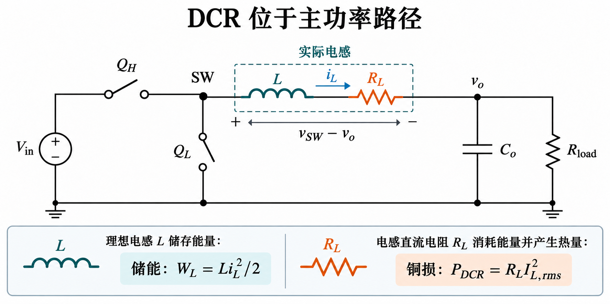
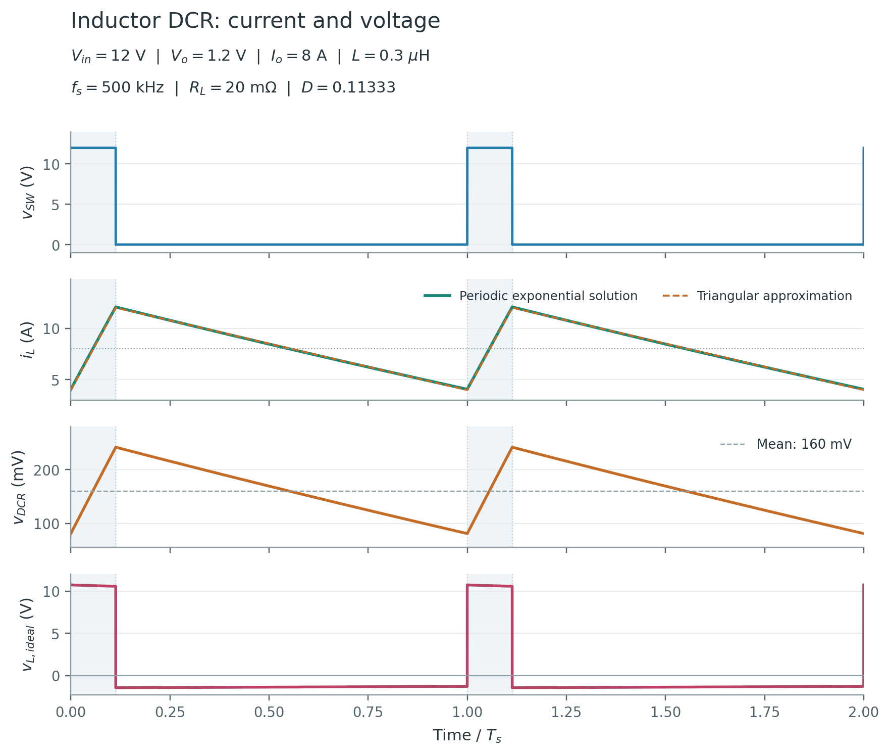
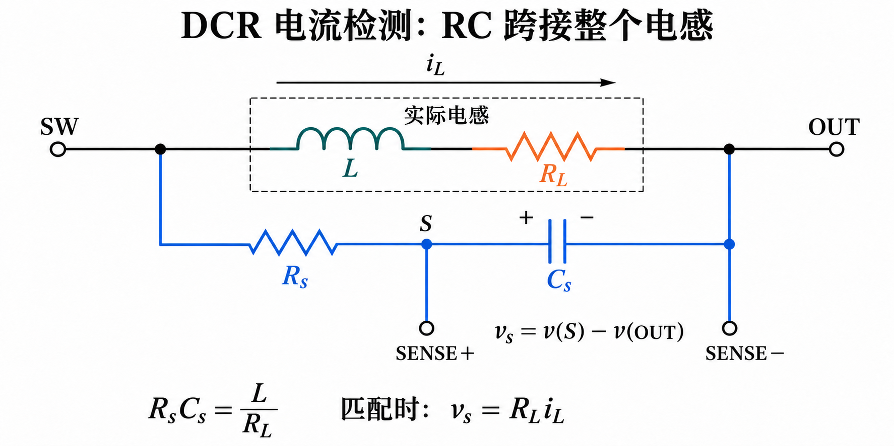
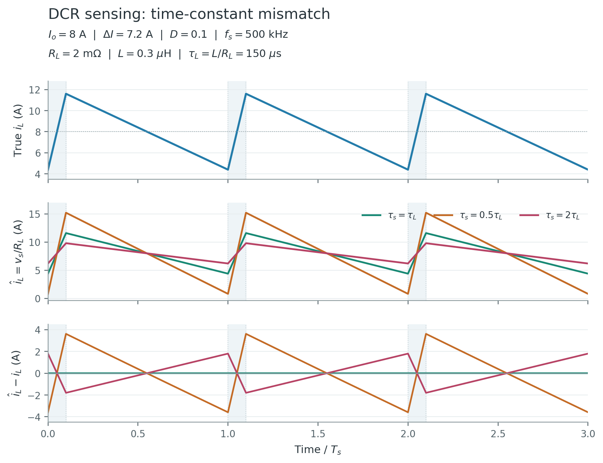

把理想电感换成真实电感后，绕组铜线本身的直流电阻（DCR）会立刻带来一正一反两件事：
- **坏消息**：它串联在主功率通道里，不仅吃掉一部分直流电压、产生占效率大头的铜损，还会在发热后阻值大涨；
- **好消息**：既然流过电感的电流天然就在 DCR 上产生压降，控制器只要跨在电感两端接一小串 RC 电阻电容，就能**不串额外分流电阻、零主路径损耗地把电感电流测出来**。

> **全篇核心公式**
> 外部能测到的电感端电压永远是“感应电压 + 电阻压降”混合体：
> $$v_w = L\frac{di_L}{dt} + R_L i_L.$$
> 只要把并联 RC 的时间常数配成 **$R_s C_s = L/R_L$**，电容电压就能把前面的 $L\,di_L/dt$ 恰好滤平，直接还原出 $v_s = R_L i_L$。

前置知识：[Buck 功率级基础](/zh/notes/buck-day-01/) · [输出电容 ESR](/zh/notes/buck-esr-ripple/) · [全部个人笔记](/zh/notes/)

---

## 1. DCR 模型与能量去向

定义 $i_L$ 从 SW 流向输出，绕组端口电压 $v_w=v_{SW}-v_o$ 为两项之和：

$$
\begin{aligned}
v_w&=v_{SW}-v_o,\\
v_w&=L\frac{di_L}{dt}+R_L i_L,\\
v_{L,ideal}&=L\frac{di_L}{dt},\\
v_{DCR}&=R_L i_L.
\end{aligned}
\tag{1}
$$

将端口瞬时功率写成储能变化加耗散：

$$
\begin{aligned}
W_L&=\frac{1}{2}L i_L^2,\\
p_w&=v_w i_L=\frac{dW_L}{dt}+R_L i_L^2.
\end{aligned}
\tag{2}
$$

理想电感在一个周期内吞吐能量、净耗散为零；而 **$R_L i_L^2 \ge 0$ 无论上管开还是关都在持续发热**。

---

## 2. 一眼分清：电感 DCR 与电容 ESR 差在哪？

同样是 $2\text{ m}\Omega$ 寄生电阻，发热可能差十几倍，根本原因在它们所处的电流路径不同：

| 比较维度 | 电感 DCR（$R_L$） | 输出电容 ESR（$R_{ESR}$） |
| --- | --- | --- |
| **所在位置** | 串联在 SW 到输出的主干道 | 串联在旁路电容支路内 |
| **流过的电流** | 完整电感电流 $i_L$（含全部直流 $I_o$） | 仅电容纹波电流 $i_C \approx i_L - I_o$ |
| **平均直流压降** | **$R_L I_o$**（真实压降损失） | **0**（周期平均电流为零） |
| **发热主项** | $I_o^2 R_L$（大电流下极重） | $\frac{\Delta I^2}{12} R_{ESR}$（仅纹波部分） |
| **对输出纹波** | 不直接出现在输出电容端口公式中 | 直接产生 $\Delta I R_{ESR}$ 端口纹波 |

> **常见错题点**：千万别把电感 DCR 乘以 $\Delta I$ 直接加到输出电压纹波里！电感后面还隔着输出电容分流，DCR 的纹波压降落在电感自身两端，而不直接落到负载上。

---

## 3. DCR 怎么吃掉直流电压？

因为稳态下理想电感的平均电压为零（$\langle v_{L,ideal}\rangle=0$），所以伏秒平衡必须写成“SW 平均电压减去 DCR 直流压降”：

$$
\begin{aligned}
DV_{in}&=V_o+R_L I_o,\\
\boxed{V_o}&=\boxed{DV_{in}-R_L I_o}.
\end{aligned}
\tag{3}
$$

为了在闭环稳压中维持同样的 $V_o$，控制器必须把占空比多抬高一点去补偿这段压降：

$$
\begin{aligned}
D_{req}&=\frac{V_o+I_o R_L}{V_{in}},\\
\Delta D&=\frac{I_o R_L}{V_{in}}.
\end{aligned}
\tag{4}
$$

**算例（$12\text{ V}\to 1.2\text{ V},\; I_o=8\text{ A}$）**：

| DCR | 直流压降 $I_o R_L$ | 若固定 $D=0.1$ 的输出 | 闭环维持 $1.2\text{ V}$ 所需 $D_{req}$ |
| --- | --- | --- | --- |
| $0\text{ m}\Omega$ | $0$ | $1.200\text{ V}$ | $0.1000$ |
| $2\text{ m}\Omega$ | $16\text{ mV}$ | $1.184\text{ V}$ | $0.1013$ |
| $20\text{ m}\Omega$ | $160\text{ mV}$ | $1.040\text{ V}$ | $0.1133$ |

闭环调高占空比只是让输入多送能量进来稳住 $V_o$，**并没有把 DCR 发热省掉**。

---

## 4. 有 DCR 后，电感电流变成了什么形状？

计入 $R_L i_L$ 压降后，两段斜率会随着瞬时电流变大而略微变缓/变陡：

$$
\begin{aligned}
\left.\frac{di_L}{dt}\right|_{on}&=\frac{V_{in}-V_o-R_L i_L}{L},\\
\left.\frac{di_L}{dt}\right|_{off}&=\frac{-V_o-R_L i_L}{L}.
\end{aligned}
\tag{5}
$$

解一阶常微分方程可知，精确波形是两段**指数曲线**（令 $\tau_L=L/R_L$、$I_a=(V_{in}-V_o)/R_L$、$I_b=-V_o/R_L$、$p=e^{-DT_s/\tau_L}$、$q=e^{-(1-D)T_s/\tau_L}$）：

$$
\begin{aligned}
i_0&=\frac{q I_a(1-p)+I_b(1-q)}{1-pq},\\
i_1&=I_a+(i_0-I_a)p.
\end{aligned}
\tag{6}
$$

实际开关周期通常远小于 $\tau_L$（如 $2\,\mu\text{s} \ll 150\,\mu\text{s}$），指数弯曲非常轻微，工程手算直接用“以 $R_L I_o$ 扣减驱动电压”的三角近似即可：

$$
\begin{aligned}
\Delta I&\approx\frac{(V_{in}-V_o-R_L I_o)D}{Lf_s}\\
&\approx\frac{(V_o+R_L I_o)(1-D)}{Lf_s}.
\end{aligned}
\tag{7}
$$

---

## 5. 铜损估算与“无损检测”的对比

电感电流既有直流 $I_o$ 又有交流纹波 $\Delta I$，计算总铜损时必须把纹波均方值加上去：

$$\boxed{P_{DCR}\approx R_L\left(I_o^2+\frac{\Delta I^2}{12}\right).}\tag{8}$$

沿用 $I_o=8\text{ A}$、$\Delta I=7.2\text{ A}$ 算一下两者的差别（$I_{L,rms}^2 = 64 + 4.32 = 68.32\text{ A}^2$）：

| 电阻位置（同样 $2\text{ m}\Omega$） | 直流损耗 | 纹波损耗 | 总发热 |
| --- | --- | --- | --- |
| **电感 DCR** | $128.00\text{ mW}$ | $8.64\text{ mW}$ | **$136.64\text{ mW}$** |
| **输出电容 ESR** | $0\text{ mW}$ | $8.64\text{ mW}$ | **$8.64\text{ mW}$** |

可见电感 DCR 若放大到 $20\text{ m}\Omega$，仅这一颗电感的铜损就高达 **$1.366\text{ W}$**（对 $9.6\text{ W}$ 输出而言光 DCR 就吃掉了 12% 以上效率）。另外注意，高频下还会有趋肤/邻近效应交流损耗与磁芯损耗。

---

## 6. 频域看阻尼：DCR 对功率级做了什么？

将电阻负载 $R$、理想电容 $C_o$ 与含 DCR 电感组成平均小信号模型：

$$G_{vd}(s)=\frac{V_{in}}{a_0+a_1 s+a_2 s^2},\tag{9}$$

其中 $a_0=1+R_L/R$、$a_1=L/R+R_L C_o$、$a_2=L C_o$。DCR 略微增加了分母阻尼（压低谐振峰），但**没有在分子产生零点**——它不像电容 ESR 那样能免费提供高频相位超前。

---

## 7. RC 并联检测网络：怎样从电感两端“无损”读出电流？

绕组内部没有给你留一个纯 DCR 抽头，但只要把 $R_s, C_s$ 串联跨接在 SW 与 OUT 两端，电容两端电压 $v_s$ 与电感电流的传递函数恰好是两个一阶环节相乘：

$$
\begin{aligned}
V_w(s)&=(R_L+sL)I_L(s),\\
\frac{V_s(s)}{V_w(s)}&=\frac{1}{1+s\tau_s},\\
\frac{V_s(s)}{I_L(s)}&=R_L\frac{1+s\tau_L}{1+s\tau_s}.
\end{aligned}
\tag{10}
$$

只要让检测网络的时间常数**精确等于电感的时间常数**：

$$\boxed{R_s C_s = \frac{L}{R_L},}\tag{11}$$

零点 $(1+s\tau_L)$ 与极点 $(1+s\tau_s)$ 就彻底抵消，电容电压直接复现瞬时电感电流：$v_s(t) = R_L i_L(t)$。即使上电瞬间电容上有初始误差 $e(0)$，也会以 $\tau_s$ 的指数速率自行衰减归零：

$$\tau_s\frac{de}{dt}+e=(L-\tau_s R_L)\frac{di_L}{dt}.\tag{12}$$

### 7.1 选值算例与带分压的衰减网络

取 $L=0.3\,\mu\text{H}$、$R_L=2\text{ m}\Omega \implies \tau_L = 150\,\mu\text{s}$。若取电容 $C_s = 100\text{ nF}$，则电阻选 **$R_s = 1.5\text{ k}\Omega$**。当 $I_o=8\text{ A}, \Delta I=7.2\text{ A}$ 时，电容上刚好能测到均值 $16\text{ mV}$、纹波 $14.4\text{ mV}_{pp}$ 的干净电流信号。

如果控制器限流比较器门限更低、需要再把信号分压缩小（在 $C_s$ 两端再并一颗电阻 $R_2$，SW 到检测点接 $R_1$），记得**匹配时间常数必须用并联阻值**：

$$
\begin{aligned}
k&=\frac{R_2}{R_1+R_2},\\
\tau_s&=(R_1\parallel R_2)C_s,\\
\frac{V_s}{I_L}&=kR_L\frac{1+s\tau_L}{1+s\tau_s}.
\end{aligned}
\tag{13}
$$

---

## 8. 时间常数没配准会怎样？直流对了，纹波照样错

当 $\tau_s \ne \tau_L$ 时，直流增益（$s\to 0$）依然是 1，所以**平均电流永远读得准**；但高频开关纹波的幅度会按 $\tau_L/\tau_s$ 倍歪掉！

| 时间常数关系 | 直流均值读数 | 瞬时纹波幅度 | 工程后果 |
| --- | --- | --- | --- |
| $\tau_s = \tau_L$ | 准确（$8.00\text{ A}$） | 准确（$7.20\text{ A}_{pp}$） | 均值和峰值均准确 |
| $\tau_s = 0.5\tau_L$ | 准确（$8.00\text{ A}$） | **放大 2 倍**（$14.4\text{ A}_{pp}$） | 峰值虚高，重载容易提前误触发限流 |
| $\tau_s = 2.0\tau_L$ | 准确（$8.00\text{ A}$） | **缩小一半**（$3.60\text{ A}_{pp}$） | 纹波失真，保护变迟钝或影响电流模式斜坡 |

---

## 9. 铜线一发热，限流点为什么往下掉？

铜的电阻正温度系数高达 $\alpha\approx 0.00393\text{ K}^{-1}$：

$$R_L(T)\approx R_L(T_0)[1+\alpha(T-T_0)].\tag{14}$$

室温 $25^\circ\text{C}$ 标定为 $2\text{ m}\Omega$ 的电感，满载升温到 $100^\circ\text{C}$ 时，**DCR 会悄悄涨到 $2.59\text{ m}\Omega$（暴涨近 30%）**！这会同时引发两重连锁反应：

$$\frac{\widehat I_L(s)}{I_L(s)}=\frac{R_L(T)}{R_{cal}}\frac{1+sL/R_L(T)}{1+s\tau_s}.\tag{15}$$

1. **电流读数虚高 29.5%**、电感自身时间常数 $\tau_L$ 缩短至 $115.8\,\mu\text{s}$；
2. **峰值限流点大幅缩水**：

$$I_{peak,lim}\approx\frac{V_{th}}{k R_L(T)}.\tag{16}$$

假设室温下预设 $V_{th}=24\text{ mV}$ 对应 $12\text{ A}$ 限流，电感跑到 $100^\circ\text{C}$ 时，只需 **$9.27\text{ A}$** 就会触发过流保护！因此大电流电源做 DCR 检测时，通常需要用紧贴电感的 NTC 热敏电阻做温度补偿。

---

## 10. “无损检测”真的零损耗吗？

DCR 检测省掉的是主功率路径串联分流电阻的 $I_{rms}^2 R_{sense}$ 损耗，但外部并联的检测电阻 $R_s$ 一直在承受开关节点的方波压差：

$$P_{R_s}=\left\langle\frac{(v_w-v_s)^2}{R_s}\right\rangle,\tag{17}$$

在 $\tau_s \gg T_s$ 时，大约相当于：

$$P_{R_s}\approx\frac{V_{in}^2 D(1-D)}{R_s}.\tag{18}$$

代入 $V_{in}=12\text{ V}$、$D=0.1$、$R_s=1.5\text{ k}\Omega$，检测支路损耗约为 **$8.64\text{ mW}$**——在重载几十瓦时微不足道，但在微安/毫瓦级轻载待机下不能忽视。

| 三种电流检测方案 | 主路径额外损耗 | 精度与温漂 | 适用场景 |
| --- | --- | --- | --- |
| **电感 DCR 检测** | 无主路径串联损耗 | 受铜温漂（+39%/100°C）和 $L$ 饱和影响大 | 大电流多相 Buck、重载效率优先 |
| **精密分流电阻** | 存在 $I_{rms}^2 R_{sense}$ 损耗 | 精度极高、低温漂 | 需要精确电流计量或高可靠性限流 |
| **MOSFET $R_{DS(on)}$** | 无额外器件 | 随温度与 $V_{GS}$ 剧变，仅导通窗有效 | 低成本、高集成度片内保护与快速 PWM |

---

## 11. 实测与选型备忘

- **怎么测 DCR？** 毫欧级电阻必须用**四线开尔文（Kelvin）夹具**测，且要记录当前电感温度；
- **怎么测检测信号 $v_s$？** 必须用**差分探头**直接测 $C_s$ 两端，千万不能把普通单端探头的地夹直接夹到带高压方波的 SW 或 OUT 上；
- **极小 DCR 怎么办？** 当电感压降小到只有几毫伏时，继续看 [小 DCR 电流检测与快慢互补架构](/zh/notes/buck-small-dcr-shared-amplifier/)。

---

## 参考资料

1. Texas Instruments, [TPS40130 Data Sheet, SLUS602B](https://www.ti.com/lit/gpn/tps40130)（DCR RC 匹配与铜温漂）。
2. Analog Devices, [LTC3859A Data Sheet, Rev. B](https://www.analog.com/media/en/technical-documentation/data-sheets/ltc3859a.pdf)（带分压衰减的 DCR 网络与 Kelvin 布局）。
3. Coilcraft, [Selecting the Best Inductor, Doc 469](https://www.coilcraft.com/getmedia/d4009ece-69be-49a6-9185-9cbacb65e3aa/doc469_selecting_inductors.pdf) & [Current Ratings FAQ](https://cps.coilcraft.com/en-us/faq/)。
