[Buck 功率级笔记](/zh/notes/buck-day-01/)已经说明：上管导通时电感从输入取能，下管导通时电感继续向输出送电。在理想两状态模型中，开关可以瞬间交接；真实功率管却有栅电荷和传播延迟，开关节点也有寄生电容。**如果只是把两路逻辑设为互补，电流能否安全交接？没有直通以后，怎样进一步减少开通损耗？**

贯穿全文的物理图景是：原来导通的功率管先退出导通，电感电流接着改变 SW 节点电容上的电荷，下一只功率管在合适的漏源电压下接管电流。死区控制决定何时交接，软开关描述交接时的电压与电流条件，gate driver 提供栅极充放电电流，level shifter 把命令送到正确的电压域，gate supply 为驱动器提供能量。

[学习地图：死区、ZVS 与栅极驱动](/zh/learn/#buck-gate-drive-and-dead-time) · [全部笔记](/zh/notes/) · [Buck 功率级](/zh/notes/buck-day-01/) · [COT 完整周期](/zh/notes/buck-cot-cycle/) · [AOT 定时与频率](/zh/notes/buck-aot-frequency/)

| 要解决的问题 | 先抓住的物理含义 | 章节 |
| --- | --- | --- |
| 为什么必须留死区，又不能随意加长？ | 既要先断后通，也要给节点电容换流留出时间 | §1–2 |
| 三类死区控制究竟检测什么？ | 预设延迟、对管关断状态、实际换流结果是不同依据 | §3 |
| 上下管都能自然实现 ZVS 吗？ | 两次交接要求不同的电流方向和节点电压 | §4 |
| 高侧逻辑 0 为什么可能高于地？ | 高侧驱动以局部低电源轨为参考，浮动域随 SW 移动 | §5–7 |
| 为什么用一串逐级增大的反相器？ | 用级数换取较小的单级负载，并在速度、尺寸和能量间折中 | §8 |
| 怎么把这些内容连回完整控制链？ | 从请求、跨域、栅极动作到节点换流逐段看时序 | §9–12 |

**教材与配图来源：**本篇精读 Bernhard Wicht 的 [《Design of Power Management Integrated Circuits》](https://onlinelibrary.wiley.com/doi/book/10.1002/9781119123095)（Wiley，2024）§2.8–2.9.2、§5.1–5.2、§5.8–5.8.1。书目依据出版社目录中的章节名称与页码核对。正文的 15 幅配图均为**引用该教材的截图裁图**，图注保留原图号或表号；相关权利归原作者及出版方。教材结论标为“教材要点”，自行连接概念的分析标为“补充推导 / 工程理解”，原文的简化和取整问题在对应位置说明。

## 1. 统一电路与符号：先明确电压相对谁测量

以下主要以**上下管均为 NMOS 的同步 Buck**讨论死区及 ZVS；PMOS 高侧会在驱动配置部分单独讨论。

```text
              Vin = Vbat
                  │
                 MHS
                  │
                  ● SW ── L ── Vout
                  │       iL →
                 MLS
                  │
                 GND
```

定义 $i_L>0$ 为从 SW 经电感流向输出。该定义直接决定死区期间 SW 上升还是下降。

| 符号 | 含义 | 读图时的重点 |
|---|---|---|
| $V_{bat}$ / $V_{in}$ | 输入母线电压 | 两种写法在本文代表同一节点 |
| $V_{sw}$ | 开关节点对地电压 | 不等于高侧 NMOS 的 $V_{DS}$ |
| $V_{DS,LS}$ | 低侧 NMOS 漏源电压 | 理想接地时等于 $V_{sw}$ |
| $V_{DS,HS}$ | 高侧 NMOS 漏源电压 | 等于 $V_{in}-V_{sw}$ |
| $V_{GS,LS}$ | 低侧栅源电压 | 理想接地时等于低侧栅极对地电压 |
| $V_{GS,HS}$ | 高侧栅源电压 | $V_{G,HS}-V_{sw}$，必须做差分观察 |
| $V_{DDL}$ | 控制逻辑供电 | 可能低于驱动器所需电压 |
| $V_{drv}$ | 驱动电源轨之间的压差 | 对 NMOS，决定导通时的栅源驱动幅度 |
| $V_{SSH}$ | 高侧驱动器的低电源轨 / 参考地 | 浮动驱动中为 $V_{sw}$ |
| $V_{high}$ | 高侧驱动器的高电源轨 | 浮动驱动中约为 $V_{sw}+V_{drv,HS}$ |
| $Q_g$ / $C_{gate}$ | 栅极电荷 / 等效栅电容 | 后者是驱动链推导中的简化模型 |
| $t_{dead}$ | 功率管交接之间的死区 | 应落实到实际功率管关断、开通时刻 |

> **教材中的 gate overdrive 与模拟电路常用的 $V_{OV}$ 不完全同义**
> 本章以 $V_{drv}$ 描述栅极驱动幅度，称为 gate overdrive。模拟电路中常把 $V_{OV}=V_{GS}-V_{TH}$ 称为过驱动电压。为避免混淆，本笔记使用“驱动幅度 $V_{drv}$”；例如导通时 $V_{GS}=5\,\mathrm V$，并不等于 $V_{GS}-V_{TH}=5\,\mathrm V$。

## 2. Dead Time：为什么必须留间隔，又为什么不能随意加长

### 2.1 死区首先解决上下管直通

**教材要点｜§2.8、Fig. 2.19**

半桥上下管不能同时导通，否则输入母线会经上下管直接向地放电。直通会增加损耗，也可能使器件超出安全工作区（SOA）并损坏。死区的基本要求是：原导通管先关断，另一只管再开通。

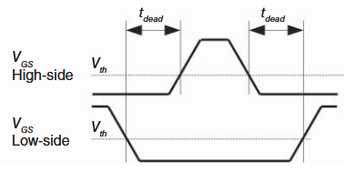


**工程理解：**不能只看 PWM 或驱动链最前端是否互补。功率管实际动作还包含 level shifter 延迟、驱动链传播延迟和栅电荷释放时间。

若原导通管在 $t=0$ 收到关断命令，下一只管在 $t=t_{cmd}$ 收到开通命令，定义：

- $t_{off,old}$：从关断命令到原管实际退出导通的时间；
- $t_{on,new}$：从开通命令到新管实际进入导通的时间。

则按同一导通判据定义的实际间隔为：

$$
\boxed{t_{dead,actual}=t_{cmd}+t_{on,new}-t_{off,old}}
$$

因此，逻辑上留有正间隔，仍可能因两条路径延迟不同而出现实际重叠。图中 $V_{TH}$ 交叉点适合说明原理；工程中还要结合通道电流、Miller 耦合与源极弹跳判断是否真正退出导通。

### 2.2 死区过长：电感电流会寻找体二极管路径

先讨论 $i_L>0$、高侧关断后准备开通低侧的过程：

1. 高侧停止导通，但电感电流不能瞬间中断。
2. 在两只沟道都关断的间隔内，电感电流先改变 SW 节点电容的电荷，使 $V_{sw}$ 下降。
3. 若 SW 已下降到接近零而低侧仍未开通，电流会经低侧体二极管续流。
4. 此时 $V_{sw}$ 大致被钳位在 $-V_F$，体二极管产生正向导通损耗。
5. 此后二极管若被强制反偏，还可能产生反向恢复损耗。

低侧体二极管的续流方向是：

```text
GND → 低侧体二极管 → SW → L → 输出
```

低侧沟道开通后，正电感电流也可以经低侧沟道从源极流向漏极。因此 $V_{sw}$ 可能约为 $-i_LR_{DS(on),LS}$，而非严格的零。

**补充估算：**若一个周期中体二极管实际导通总时长为 $t_{bd,\Sigma}$，且该期间电流变化较小：

$$
P_{bd}\approx f_{sw}V_F|i_L|t_{bd,\Sigma}
$$

这里要代入**二极管实际导通时长**，而非把所有死区时间直接相加：用于 SW 电容换流的时间不一定有二极管导通。

反向恢复还受器件、结温、电流与导通历史影响，不能把“死区越长，损耗越大”进一步简化为所有器件都严格线性的关系。

### 2.3 死区过短有两种不同问题

| 情况 | 物理状态 | 后果 |
|---|---|---|
| 原管尚未充分关断，新管已开通 | 两只沟道存在导通重叠 | 直通 / cross-conduction |
| 原管已经关断，但 SW 尚未换流到位 | 新管在非零 $V_{DS}$ 下开通 | 硬开通、残余电容放电与电压电流重叠损耗 |

**所以“没有直通”只说明满足了一项要求，还不能证明已经获得最优死区或 ZVS。**

### 2.4 最优死区为什么随工况变化

**教材要点：**最优值主要取决于 $V_{bat}$、负载电流和 SW 节点寄生电容；寄生来自功率管、IC 互连及 PCB 等。

**补充推导：**两管沟道都关断、输入母线近似刚性，且由电感电流主导 SW 换流时：

$$
C_{eq}(V_{sw})\frac{dV_{sw}}{dt}\approx-i_L
$$

其中可近似写为：

$$
C_{eq}(v)\approx C_{oss,LS}(v)+C_{oss,HS}(V_{in}-v)+C_{par}(v)
$$

若换流期间 $i_L$ 近似不变，从 $V_{in}$ 降到零所需时间为：

$$
t_{comm}\approx\frac{1}{|i_L|}\int_0^{V_{in}}C_{eq}(v)\,dv
=\frac{Q_{node}}{|i_L|}
$$

若再把电容视为常数：

$$
\boxed{t_{comm}\approx\frac{C_{eq}V_{in}}{|i_L|}}
$$

例如取 $V_{in}=12\,\mathrm V$、等效节点电容 $C_{eq}=200\,\mathrm{pF}$，忽略换流期间的电流变化，则需要搬运 $Q_{node}=2.4\,\mathrm{nC}$。若 $|i_L|=1\,\mathrm A$，估计换流时间为 $2.4\,\mathrm{ns}$；电流减到 $0.2\,\mathrm A$ 时变为 $12\,\mathrm{ns}$。这只是恒定电容模型的补充算例，用于说明固定等待时间为什么难以覆盖负载变化。

物理含义：电流更大时搬运节点电荷更快；电容更大时更慢；输入电压通过电压摆幅和非线性电容一起影响时间。轻载接近零电流时，这个恒流模型会失效，不能据此安排无限长的死区。

> **教材中的典型时间只是背景数据**
> 原文举例：最高约 1 MHz 的开关电源常见约 10 ns 死区；最高约 20 kHz PWM 的电机驱动常见约 1 μs，并有缩短趋势。这些是原文场景下的量级描述，不是可直接套用的 Buck 设计指标。

## 3. 三种死区产生方法：分别在观察什么

### 3.1 Fixed Dead Time：提前留好固定等待时间

**教材要点｜§2.8.1、Fig. 2.20**

通过数字反相器延迟链及逻辑组合，在输出转换时插入固定延迟。方法简单，但延迟受工艺、电源、温度及负载影响，必须为最差情况保留余量，因此典型情况下通常不够短。

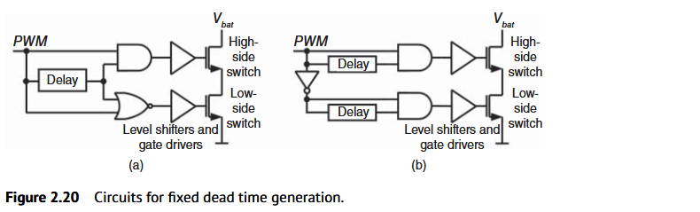


用 Fig. 2.20(a) 的逻辑说明，设 $P$ 为 PWM，$P_d$ 为其延迟版本：

$$
H=P\land P_d,\qquad L=\overline{P\lor P_d}
$$

- $P:0\to1$：低侧请求立即撤销；等待 $P_d$ 也变为 1 后才发出高侧开通请求。
- $P:1\to0$：高侧请求立即撤销；等待 $P_d$ 也变为 0 后才发出低侧开通请求。

其作用是对“开通”增加等待，使每次交接都先断后通。真实功率管是否满足该时序，还要加上后续路径的延迟。

原文给出的改进是用多路选择器选择延迟链抽头，进行 trimming，缩小需要保留的延迟余量。它仍属于固定或可编程死区，并未自动检测每次 SW 的实际换流。

死区还会侵占最短可用导通时间，进而影响高频运行和极端占空比。

### 3.2 Adaptive Dead Time：确认对管关断，再允许本管开通

**教材要点｜§2.8.2、Fig. 2.21**

与 break-before-make 相似：检测对侧功率管的 off-state，只有收到有效关断状态后，才允许本侧导通。

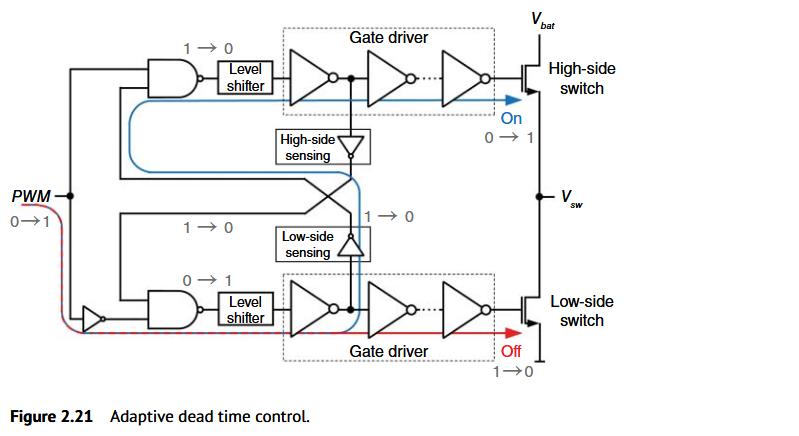


以上升 PWM、从低侧向高侧切换为例：

1. 低侧先收到关断命令。
2. 低侧驱动链的检测节点出现相应变化。
3. 反馈信号到达高侧互锁逻辑。
4. 高侧开通路径得到许可。
5. 高侧命令继续经过 level shifter、驱动链，最终作用于功率管。

**核心折中：检测点越靠近实际栅极，状态越直接；检测点越靠前，反馈越快，但越依赖后续驱动延迟的可预测性。**

| 检测点 | 优点 | 代价 |
|---|---|---|
| 功率管实际 gate-source | 更直接反映栅极状态 | 反馈路径及后续本侧驱动仍带来等待 |
| 级联驱动器前几级 | 更早得到反馈、可缩短间隔 | 检测完成时最终功率管可能还没关断 |

这解释了原文强调的**最大可驱动栅电容**：若内部早期节点已报告关断，而外部大栅电荷仍未释放完，对侧可能提前开通。外置功率 MOS 尤其不能仅凭互锁逻辑就假设任意栅负载都安全。

低侧状态可用简单反相器感知；高侧关断状态位于高电位域，需要 level-down shifter 把信息送回地参考控制域。前向控制的 level-up 与反馈检测的 level-down 是两个不同方向的信号传递问题。

**概念边界：**本节的 adaptive 主要跟踪“对管是否已关断”。它并不天然知道 SW 是否已降到零，故不自动等于 ZVS 控制。

### 3.3 Predictive Dead Time：根据本周期换流结果，调整下一周期

**教材要点｜§2.8.3、Fig. 2.22**

由控制环调整可变延迟，通常在低侧开通时感测 $V_{sw}$，再逐周期改变死区。

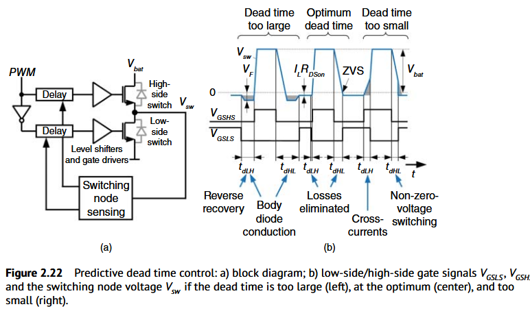


| 观测到的换流结果 | 说明 | 下一周期的调整方向 |
|---|---|---|
| 低侧开通前已出现明显体二极管导通 | 等待超过必要换流时间 | 缩短相关死区 |
| 低侧开通时 SW 仍明显高于零 | 等待不足，仍有残余 $V_{DS,LS}$ | 增大相关死区 |
| SW 恰好接近零时低侧接管 | 接近低侧 ZVS，二极管导通较短 | 在目标附近维持 / 微调 |

原文提到两类检测依据：体二极管导通检测，或 SW 零交越检测。节选没有给出具体检测器、更新步长、稳定性分析，不能从框图进一步认定其控制算法。

相比仅检测关断状态，预测控制能让受控结果补偿驱动传播延迟，并可补偿部分检测延迟的影响。由于调整应用到后续周期，检测及计算不一定都必须在本次死区内完成。

**工程理解：**它仍需要处理启动、负载突变、可变延迟边界及检测误差；一个周期的最优值不保证在突变后的下一周期仍然合适。

Fig. 2.22 同时画了两个交接方向。过短间隔既可能产生直通，也可能使下一只管非零电压开通；不可把右图的全部问题只解释为“低侧开通时 SW 没降到零”。

### 3.4 三种方法对照

| 方法 | 直接依据 | 主要能力 | 主要限制 |
|---|---|---|---|
| Fixed | 预设延迟 | 简单地留出间隔 | 最差情况余量、PVT 与负载依赖 |
| Adaptive | 对侧关断状态 / 代理节点 | 随实际关断路径变化而互锁 | 检测点、反馈延迟、栅负载上限 |
| Predictive | 本周期 SW / 二极管换流结果 | 逐周期逼近目标时刻 | 检测及闭环复杂度、突变响应 |

这些分类按本教材命名整理。以后阅读论文时，应先看反馈量和更新时序，再理解作者所用的 adaptive / predictive 名称。

## 4. Soft Switching：把电压变化与通道接管电流错开

### 4.1 Hard Switching、ZVS、ZCS

**教材要点｜§2.9**

硬开关中，功率管开通时电流已经上升，漏源电压却尚未降到零；关断时也会出现电压与电流的重叠。瞬时器件功耗为：

$$
p(t)=v_{DS}(t)i_D(t),\qquad E_{sw}=\int p(t)\,dt
$$

在简化的线性重叠模型下，常用“三角形面积”理解单次转换能量：

$$
E_{overlap}\sim\frac12V_{DS}I_Dt_{overlap}
$$

这里是帮助理解的近似，不应把体二极管恢复、非线性 $C_{oss}$ 及所有寄生损耗都并入这一个公式。

- **ZVS（Zero-Voltage Switching）**：开通前，让目标功率管的 $V_{DS}$ 先接近零，再让沟道接管电流。
- **ZCS（Zero-Current Switching）**：在相关开关动作发生时，使目标器件的电流接近零。
- **Soft switching**：软开关总称，ZVS、ZCS 属于其中的不同条件。

> **ZVS 的零电压是目标器件的漏源电压**
> 低侧 NMOS：$V_{DS,LS}=V_{sw}\approx0$。
>
> 高侧 NMOS：$V_{DS,HS}=V_{in}-V_{sw}\approx0$，故要求 $V_{sw}\approx V_{in}$。
>
> 高侧 ZVS 时 SW 接近输入母线，而非接近地。

原文强调理想软开关可以避免传统开关过程中的 Miller 阶段。更严谨的阅读方式是：若主要 $V_{DS}$ 变化已在沟道接管之前完成，常规“栅驱动同时承担漏极电压转换”的平台特征会显著减弱或被避开；这不表示器件的 $C_{gd}$ 消失，也不保证任意部分 ZVS 的真实波形都无平台。

### 4.2 路线一：增加谐振网络

**教材要点｜§2.9.1、Fig. 2.23**

在功率开关与主电感负载之间增加 $L_r$、$C_r$ 构成的谐振网络，通过谐振使开关的漏源电压自行回到零。

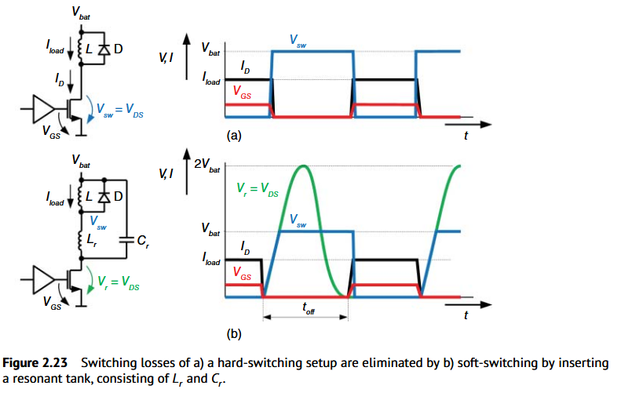


按原文理想化波形理解：

1. 开关导通时，主电感与谐振电感承载负载电流，$C_r$ 充至约 $V_{bat}$。
2. 开关关断后，$L_r$ 中的电流推动 $C_r$ 电压变化，启动谐振。
3. 绿色 $V_r=V_{DS}$ 先升高，图示峰值约为 $2V_{bat}$，随后回落到零。
4. 在 $V_r$ 回到零的窗口重新开通，实现理想 ZVS。
5. 图示关断动作中，电流下降时 $V_r$ 仍接近零，也可降低关断重叠损耗。

主电感 $L$ 被假设足够大，使该短时过程中的负载电流纹波可忽略；$L_r$ 则应明显小于主电感。

理想谐振角频率与周期为：

$$
\omega_r=\frac1{\sqrt{L_rC_r}},\qquad T_r=2\pi\sqrt{L_rC_r}
$$

原文给出图示等待时间的近似：

$$
t_{off}\approx2\pi\sqrt{L_rC_r}
$$

实际零电压窗口受初始状态、负载、输入电压与元件容差影响。图中的 $2V_{bat}$ 峰值也只对应所示拓扑及理想条件，不是所有谐振软开关的共同峰值。

**取舍：**获得更有利的开关条件，需要增加无源器件，并承担额外电压应力和时序约束。原文还提到可以检测开通前 $V_{DS}$ 来调整时序，或用可切换的二进制加权电容阵列改变 $C_r$。

> **阅读辨析：原文 on-time / off-time 用词不一致**
> 该段先称 on-time 受限，却紧接着给出 $t_{off}$，随后又说明 on-time 可自由选择。结合图中标出的 $t_{off}$，这里应重点理解为“关断后等待适合的谐振零电压时刻”。节选不足以把原文有关 on-time 的每句话直接当成通用定时规则。

### 4.3 路线二：利用死区与现有节点电容换流

**教材要点｜§2.9.2**

同步半桥中，电感电流可以在死区里为 SW 节点的电容充放电。如果接管时刻合适，就能同时减少二极管导通与实现相应器件的 ZVS，无需按 Fig. 2.23 再增加同样的谐振支路。

#### A. 高侧关断 → 低侧开通：正电流有利于低侧 ZVS

在 $i_L>0$ 时：

```text
高侧沟道关断
    ↓
正电感电流继续从 SW 流向输出
    ↓
SW 节点电荷重分布，Vsw 从 Vin 下降
    ↓
Vsw ≈ 0，即 VDS,LS ≈ 0
    ↓
低侧沟道及时接管电流
```

太早接管会有残余漏源电压；太晚接管会延长体二极管续流。最优时刻接近节点换流完成，而非抽象地把死区压到零。

#### B. 低侧关断 → 高侧开通：高侧 ZVS 需要合适的反向电流

在相同的无辅助换流半桥里，如果仍是 $i_L>0$，电感电流会把 SW 向低电位拉，无法自行把它从零抬升至 $V_{in}$。

原文提出：低侧关断前，让少量电流流入 SW，即在本文符号下 $i_L<0$。低侧关断后，该电流给 SW 节点充电，使：

$$
V_{sw}\uparrow V_{in},\qquad V_{DS,HS}\downarrow0
$$

此时高侧再开通，才具备高侧 ZVS 条件。反向电流的持续时间和大小还要足以搬运所需节点电荷；仅有“负号”并不保证换流完成。

> **两个方向不能用一套直觉代替**
> 对本文定义的电流方向，正电流有利于 SW 下降及低侧 ZVS；负电流有利于 SW 上升及高侧 ZVS。因此普通正电流 CCM 下“低侧实现 ZVS”，并不能推出“上下两管都实现 ZVS”。

**工程理解：**刻意制造反向电流会增加电流 RMS 及相应导通损耗。双边 ZVS 是否划算，需要比较减少的开关损耗与增加的循环电流损耗。

### 4.4 理想 ZVS 后，为什么驱动损耗还在

**教材要点｜Table 2.5、Example 2.8**

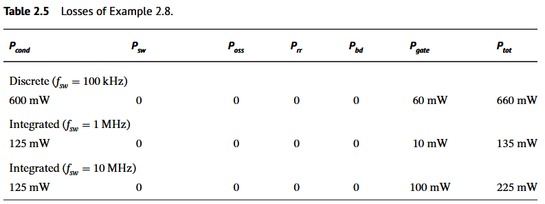

| 原文示例 | $P_{cond}$ | $P_{sw}$ | $P_{oss}$ | $P_{rr}$ | $P_{bd}$ | $P_{gate}$ | $P_{tot}$ |
|---|---:|---:|---:|---:|---:|---:|---:|
| Discrete，100 kHz | 600 mW | 0 | 0 | 0 | 0 | 60 mW | 660 mW |
| Integrated，1 MHz | 125 mW | 0 | 0 | 0 | 0 | 10 mW | 135 mW |
| Integrated，10 MHz | 125 mW | 0 | 0 | 0 | 0 | 100 mW | 225 mW |

该表是在原例题参数及**理想 ZVS 的损耗核算假设**下得到的；不能理解为现实中任何 ZVS 电路的所有这些损耗都严格为零。

常规非能量回收栅驱动仍需每周期为栅极充放电。补充估算：

$$
P_{gate}\approx f_{sw}\sum_k Q_{g,k}V_{drv,k}
$$

若把栅极简化为线性电容，则 $Q_g\approx C_gV_{drv}$，从而：

$$
P_{gate}\approx f_{sw}\sum_k C_{g,k}V_{drv,k}^2
$$

这还没有完整包含全部中间驱动级、控制逻辑及 level shifter 的损耗。ZVS 改善的是开关换流条件，并不取消栅极充放电。

原文例题称相对前一硬开关例题有约 80% 的损耗下降潜力，并提到实际集成功率级约 20%–30% 的损耗下降；这些是**损耗的相对降幅**，不是效率提高 20–30 个百分点，也不是不同电路的普遍保证。节选未包含 Example 2.7 的全部参数，此处不重新推算其基准。

## 5. Gate Driver：把弱逻辑命令变成栅极充放电电流

### 5.1 CMOS 反相器为什么可以驱动功率管

**教材要点｜§5.1、Fig. 5.1**

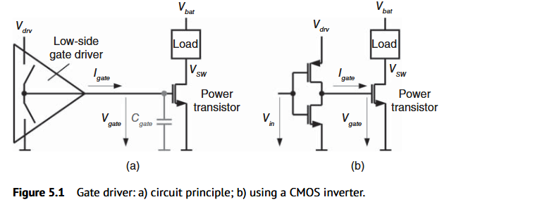


对于接地源极的低侧 NMOS：

- 开通：将栅极拉向 $V_{drv}$。
- 关断：将栅极拉回其源极电位，即理想地电位。

驱动能力可用瞬态栅电流和等效输出电阻 $R_{drv}$ 描述。栅极不是只需要一个正确的高低电平，还需要在有限时间内完成电荷转移。

**补充估算：**

$$
I_{gate,avg}\approx\frac{\Delta Q_g}{\Delta t}
$$

例如某次转换需搬运 $10\,\mathrm{nC}$、目标时间为 $5\,\mathrm{ns}$，相应时间段的平均电流量级约为 $2\,\mathrm A$。这是用于理解驱动电流的算例；峰值与波形还取决于驱动器及栅电荷分布。

简单线性模型下，栅极速度与 $R_{drv}C_{gate}$ 有关；实际开关过程还受非线性 $C_{gs}$、$C_{gd}$ 和漏极波形影响。选择驱动器时，应同时看拉高与拉低能力，而非只看一个平均数。

### 5.2 完整 gate driver 包括哪些模块

**教材要点｜Fig. 5.2**

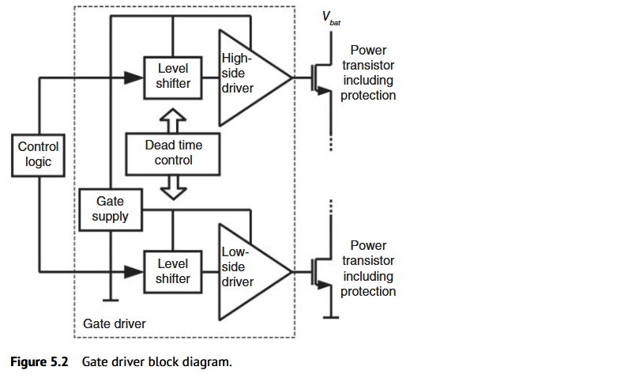

| 模块 | 负责的问题 | 不应混同的概念 |
|---|---|---|
| 控制逻辑 | 产生 PWM、开通 / 关断请求 | 逻辑请求尚不是功率管实际状态 |
| Dead-time control | 安排上下管交接、避免直通 | 互锁不天然保证 ZVS |
| Level shifter | 把命令转换到目标电压域 | 传信号不等于提供高侧驱动电源 |
| Gate supply | 提供驱动电压与能量 | 可来自稳压器、自举、电荷泵或升压电路 |
| Gate driver 输出级 | 给栅极提供较大瞬态电流 | 强驱动不能替代电平域转换 |
| 功率管及保护 | 承担功率电流，并应对过压 / 过流 / 过温 | 功率器件耐压与栅氧耐压是不同约束 |

原文说明：若为 NMOS 高侧，需要高于 SW 的驱动高轨；在 SW 接近输入母线时，该轨的绝对电位可能高于 $V_{bat}$。自举、charge pump、boost converter 都是供电实现方向，本次节选没有展开它们的完整电路。

## 6. 四种驱动配置：区分器件极性与驱动参考地

**教材要点｜§5.2、Fig. 5.3**

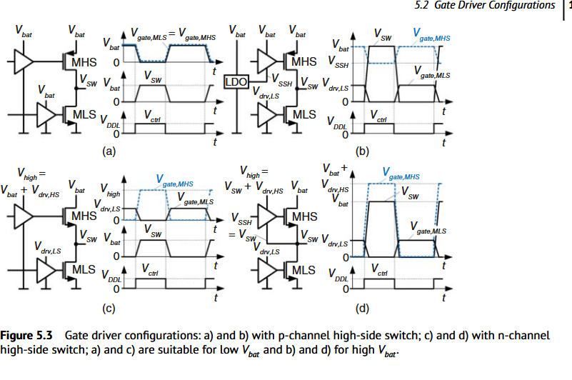


| 图 | 高侧功率管 | 高侧驱动器低轨 | 高侧驱动器高轨 | 关键特征 |
|---|---|---|---|---|
| (a) | PMOS | $0$ | $V_{bat}$ | 简单，驱动摆幅跟随输入母线 |
| (b) | PMOS | $V_{SSH}=V_{bat}-V_{drv,HS}$ | $V_{bat}$ | 限制高侧栅源驱动幅度 |
| (c) | NMOS | $0$ | $V_{high}=V_{bat}+V_{drv,HS}$ | 高侧使用较大对地摆幅 |
| (d) | NMOS | $V_{SSH}=V_{sw}$ | $V_{high}=V_{sw}+V_{drv,HS}$ | 驱动域随 SW 浮动，局部摆幅受控 |

### 6.1 配置 (a)：低压 PMOS 高侧 + NMOS 低侧

功率级相当于 CMOS 反相器，上下管栅极可用同样的电压逻辑驱动：

- 栅极低：PMOS 的源极在 $V_{bat}$，故 $V_{GS,HS}<0$，高侧开通；低侧 NMOS 关断。
- 栅极高：PMOS 关断，低侧 NMOS 开通。

简单结构的代价是栅源摆幅与输入母线绑定，因此只适用于栅氧允许的低输入电压范围。图中“共用逻辑”不能据此推断真实硬件在转换沿自动无直通，死区仍需考虑。

### 6.2 配置 (b)：PMOS 高侧，但缩小局部驱动摆幅

高侧 PMOS 源极固定在 $V_{bat}$，栅极在以下两点之间变化：

$$
V_{G,HS}=V_{bat}\quad\Rightarrow\quad V_{GS,HS}=0\quad\text{关断}
$$

$$
V_{G,HS}=V_{bat}-V_{drv,HS}\quad\Rightarrow\quad
V_{GS,HS}=-V_{drv,HS}\quad\text{开通}
$$

原图用 LDO 提供高侧驱动低轨。这样可以在较高输入电压下，把 PMOS 的 $|V_{GS}|$ 限制在目标幅度，而不让栅极直接拉到零。

### 6.3 配置 (c)：NMOS 高侧，固定对地参考

NMOS 高侧源极是 SW。SW 升到 $V_{bat}$ 时，若栅极最高也只能到 $V_{bat}$，则 $V_{GS,HS}\to0$，无法维持目标驱动。

因此导通高电平需要：

$$
V_{G,HS}\approx V_{bat}+V_{drv,HS}
$$

配置 (c) 的驱动低轨仍是地，高侧驱动输出具有较大的绝对电压摆幅；原文将它列为低输入电压配置。

### 6.4 配置 (d)：NMOS 高侧，驱动域随 SW 一起移动

浮动驱动器的两条电源轨是：

$$
V_{SSH}=V_{sw},\qquad V_{high}=V_{sw}+V_{drv,HS}
$$

故：

$$
\begin{aligned}
\text{关断：}&\quad V_{G,HS}=V_{sw},&V_{GS,HS}=0\\
\text{开通：}&\quad V_{G,HS}=V_{sw}+V_{drv,HS},&V_{GS,HS}=V_{drv,HS}
\end{aligned}
$$

**重点是局部电源轨压差固定，整组电位随 SW 移动。**例如 $V_{sw}=12\,\mathrm V$、局部驱动幅度为 $5\,\mathrm V$，高侧栅极可处于 $17\,\mathrm V$，但栅源电压仍为 $5\,\mathrm V$。

原文认为 (a) 与 (d) 最常见；NMOS 高侧通常更适合较高电流，(d) 也是外置 n 型功率 MOS 的常见配置。原文提到的 5 V 分界仅是配置介绍中的常用场景，不是跨工艺通用的栅氧极限。

## 7. Level Shifter：逐步读懂两种实现

### 7.1 低侧交叉耦合 level-up shifter

**教材要点｜Fig. 5.4**

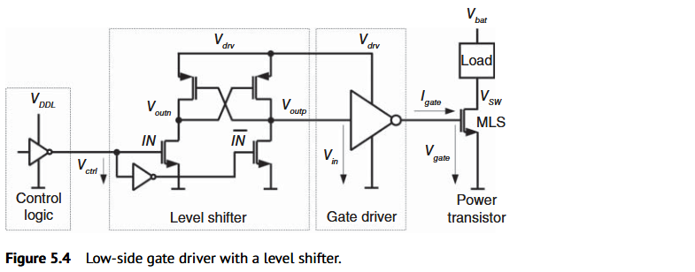


电路分成四部分：

1. 低压控制域以 $V_{DDL}$ 供电，产生 $IN$ 与 $\overline{IN}$。
2. 两只底部 NMOS 分别下拉左右内部节点。
3. 顶部两只 PMOS 交叉耦合，通过正反馈把另一节点拉到 $V_{drv}$。
4. 后级较强的反相器以 $V_{drv}$ 供电，驱动大功率管栅极。

用 $V_{outn}$ 表示左节点，$V_{outp}$ 表示右节点。图中右节点 $V_{outp}$ 连到后级 $V_{in}$。

**逐步分析 $V_{ctrl}\to0$，低侧开通：**

1. $IN\to0$，左下 NMOS 关断；$\overline{IN}\to1$，右下 NMOS 导通。
2. 右节点 $V_{outp}$ 被拉低。
3. 右节点变低，打开栅极接到右节点的左上 PMOS，将 $V_{outn}$ 拉高。
4. 左节点变高，关断右上 PMOS，帮助右节点进一步下降。
5. $V_{outp}=V_{in}\to0$，后级反相器输出上升到 $V_{drv}$。
6. 低侧功率 NMOS 开通。

反向时则左右角色互换：$V_{outp}$ 被拉高，后级输出降低，低侧关断。

| $V_{ctrl}$ / $IN$ | 左节点 $V_{outn}$ | 右节点 $V_{outp}=V_{in}$ | 功率管 gate | MLS |
|---|---|---|---|---|
| 0 | $V_{drv}$ | 0 | $V_{drv}$ | 开通 |
| 1 | 0 | $V_{drv}$ | 0 | 关断 |

**工程理解：**交叉耦合结构在翻转初期存在新下拉支路与原有上拉支路的竞争。低压输入驱动的 NMOS 必须有能力推动状态翻转；扩大驱动电压差并不保证速度不受影响。电平转换级先完成电压域转换，再由后续级提供大栅电流，避免直接用敏感再生节点承受功率管的大栅负载。

### 7.2 高侧电阻式 level shifter + 浮动反相器

**教材要点｜Fig. 5.5**

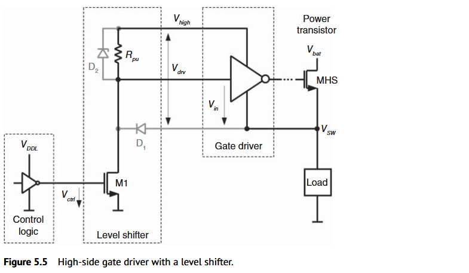


关键节点与器件：

- M1 的栅极由地参考低压逻辑控制，通过漏极向地抽取电流。
- $R_{pu}$ 从 $V_{high}$ 上拉后级输入节点。
- 后级驱动器的低轨接 SW，高轨为 $V_{high}$。
- 图中 $D_1$、$D_2$ 为相对浮动电源轨的钳位路径。

先定义高侧的**局部输入电压**：

$$
v_{in,local}=V_{in,node}-V_{sw}
$$

此处 $V_{in,node}$ 指 level shifter 输出节点的绝对电位，避免与 Buck 输入母线 $V_{in}$ 混淆。

**当 $V_{ctrl}=0$：**

1. M1 关断。
2. $R_{pu}$ 把输入节点拉向 $V_{high}$。
3. 局部输入约为 $V_{drv}$，即高侧逻辑 1。
4. 后级反相器输出接近其低轨 SW。
5. 高侧功率管 $V_{GS,HS}\approx0$，关断。

**当 $V_{ctrl}=1$：**

1. M1 导通，下拉输入节点。
2. 输入相对 SW 降到局部逻辑低区间。
3. 浮动反相器输出拉到 $V_{high}$。
4. $V_{GS,HS}=V_{high}-V_{sw}\approx V_{drv}$，高侧开通。

> **原文“$V_{in}\to0$”必须按浮动域解释**
> 它表示后级驱动器输入相对 SW 的逻辑 0，不能直接理解为输入节点的绝对电位恒等于地。如果 SW 已在高电位，后级输入通常也处于相应的高共模电位附近。

**依据图示连接的补充分析：**$D_1$ 在输入节点低于 SW 过多时导通，$D_2$ 在输入节点高于 $V_{high}$ 过多时导通。用二极管正向压降作一阶表示，输入受到约以下范围的钳位：

$$
V_{sw}-V_F\lesssim V_{in,node}\lesssim V_{high}+V_F
$$

这是钳位机理说明，不是器件可承受过压的正式规格，也不意味着钳位到该值就自动满足所有栅氧约束。

**这类实现的主要取舍：**

- 上拉由 $R_{pu}$ 给输入寄生电容充电，形成 RC 延迟。
- 较小 $R_{pu}$ 可加快上拉，但会增大 M1 导通时的支路电流。
- M1 要承受高侧节点的绝对电压；在 SW 抬高且下拉保持时，还需关注钳位路径电流和 M1 功耗。
- SW 快速变化时，寄生耦合产生 $i=C_{par}\,dV/dt$ 电流，可能扰动后级局部输入。

以上为电路连接导出的工程理解。完整的高速动态位移器、脉冲锁存与抗扰结构并不在本次节选范围内。

### 7.3 Level shifter 与 bootstrap 的区别

```text
Level shifter：把“开 / 关命令”送入高侧局部逻辑域
Gate supply：为高侧局部电源轨提供电压与电荷
Gate driver：消耗该供电，对功率 MOS 栅极充放电
```

这三项必须同时存在。只搭一个 level shifter，并不会自动生成 $V_{sw}+V_{drv}$ 的电源；只提供 bootstrap 电源，也不会自动把地参考 PWM 转换成浮动控制信号。

## 8. Cascaded Gate Drivers：为什么逐级放大能显著提速

### 8.1 从大电容负载出发

**教材要点｜§5.8、Fig. 5.18**

最小尺寸逻辑反相器如果直接驱动大功率管栅极，会承受极大的电容负载。解决方法是多级反相器串接，并逐级增大晶体管宽度。

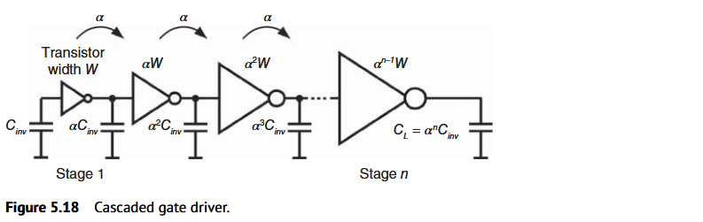

第 $i$ 级采用：

$$
W_i=\alpha^{i-1}W_1,\qquad C_{in,i}\approx\alpha^{i-1}C_{inv}
$$

长度在所用器件允许条件下保持一致。PMOS、NMOS 可各自从初始宽度开始按相同倍率缩放；并不要求两者宽度相等。

图中共有 $n$ 个反相器，**第 1 级最小反相器已计入 $n$**。负载 $C_{gate}$ 不是第 $n+1$ 级驱动器。

### 8.2 直接驱动的延迟

定义电容比：

$$
F=\frac{C_{gate}}{C_{inv}}
$$

按原文简化模型，最小反相器直接驱动该负载的延迟为：

$$
t_{direct}=\frac{Q_{gate}}{I_{inv}}
=t_{apd}\frac{Q_{gate}}{Q_{inv}}
\approx t_{apd}\frac{C_{gate}}{C_{inv}}
=t_{apd}F
\qquad\text{(原式 5.46)}
$$

这里的电荷比转成电容比依赖同一简化电压摆幅模型。$t_{apd}$ 是原文采用的最小反相器平均传播延迟基准，不等同于任意工况下功率管的上升 / 下降时间。

**Example 5.10：**

$$
t_{apd}=67.5\,\mathrm{ps},\quad C_{inv}=10\,\mathrm{fF},\quad C_{gate}=250\,\mathrm{pF}
$$

$$
F=25000,\qquad
t_{direct}=67.5\,\mathrm{ps}\times25000
=1.6875\,\mathrm{\mu s}\approx1.69\,\mathrm{\mu s}
$$

如此大的延迟说明小逻辑门不能直接承担该栅负载。

### 8.3 为什么每一级可有近似相同的延迟

若每级输入电容为前级的 $\alpha$ 倍，则前级驱动能力也随宽度放大，得到：

$$
t_{stage}\approx t_{apd}
\frac{\alpha^iC_{inv}}{\alpha^{i-1}C_{inv}}
=\alpha t_{apd}
\qquad\text{(原式 5.48)}
$$

因此总延迟为：

$$
\boxed{t_{cascade}\approx n\alpha t_{apd}}
\qquad\text{(原式 5.49)}
$$

同时，最后一级驱动负载也应具有相同扇出，故：

$$
\boxed{\alpha^n=F},\qquad
\boxed{\alpha=F^{1/n}},\qquad
\boxed{n=\frac{\ln F}{\ln\alpha}}
\qquad\text{(原式 5.50–5.52)}
$$

物理上，这条链把“一个非常弱的门直接拖动巨大电容”拆成“多个门各自承担适中的电容比”。增加级数会增加传播环节，但可大幅降低单级过载。

### 8.4 教材仿真图说明了什么

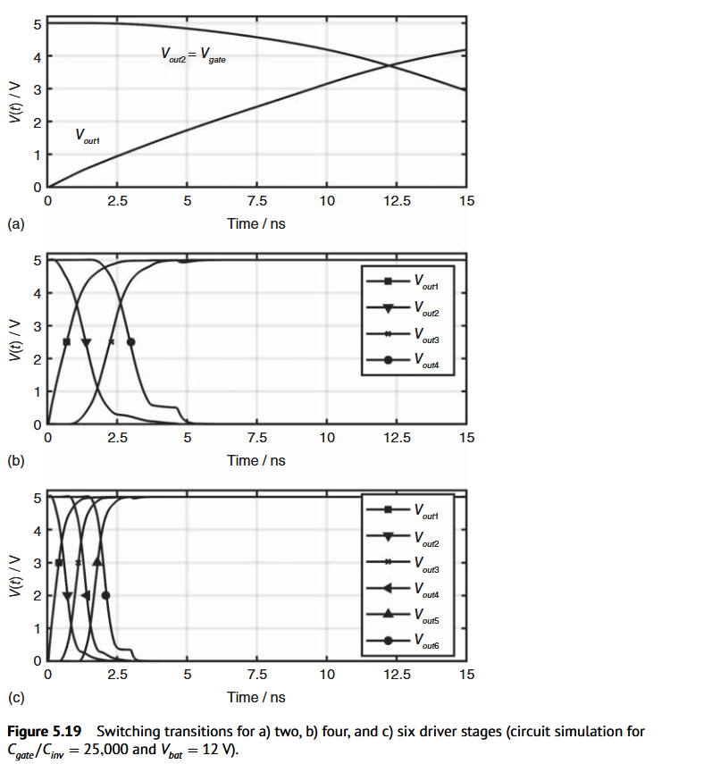


- 2 级链：在图示 15 ns 时间内，最终 gate 尚未完成转换。
- 4 级链：显著加快，最终波形仍可看到 Miller 相关特征。
- 6 级链：图示约 3 ns 已完成关断。

这里的“6 级优于 2 级”针对该负载比及仿真条件，不能推广为级数越多越快；最优值需要下面的折中分析。

### 8.5 理想最优倍率为什么是 $e$

将 $n=\ln F/\ln\alpha$ 代入：

$$
t_{cascade}=t_{apd}\ln F\cdot\frac{\alpha}{\ln\alpha}
$$

对于固定 $F$，最小化的是：

$$
g(\alpha)=\frac{\alpha}{\ln\alpha}
$$

其导数为：

$$
g'(\alpha)=\frac{\ln\alpha-1}{(\ln\alpha)^2}
$$

取 $g'(\alpha)=0$：

$$
\boxed{\alpha_{opt}=e\approx2.718},\quad
\boxed{n_{opt}=\ln F},\quad
\boxed{t_{cascade,min}=e\,t_{apd}\ln F}
$$

最后两个表达式先把 $n$ 作为连续变量。真实反相器级数必须为整数，而且可能有反相极性要求。

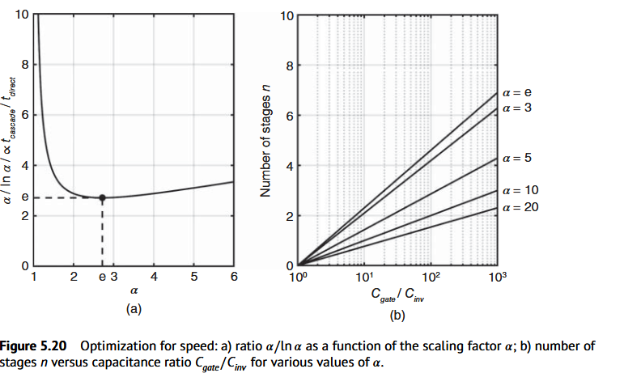


原文指出简化模型忽略了反相器输出电容等因素，实际最优倍率常落在 **3–6**。因此 $e$ 是这个理想模型的结论，而非跨工艺、跨负载恒定的最优尺寸比。

相对直接驱动的延迟为：

$$
\frac{t_{cascade}}{t_{direct}}
=\frac{n\alpha}{F}
=\frac{\ln F}{F}\frac{\alpha}{\ln\alpha}
\qquad\text{(原式 5.53–5.54)}
$$

### 8.6 Example 5.11：照录原文结果，再区分取整近似

**原文计算结果：**

| 方案 | 级数 | 原文总延迟 | 说明 |
|---|---:|---:|---|
| 最小反相器直接驱动 | 1 | 约 1.69 μs | 直接面对 $F=25000$ |
| 接近理想最优倍率 | 约 10 | 约 1.88 ns | 原文以约 187.7 ps 的单级延迟计算 |
| 取 $\alpha=6$ | 约 6 | 2.43 ns | $6\times6\times67.5\,\mathrm{ps}$ |

原文想说明：把级数从约 10 降到约 6，可以只付出约 0.6 ns 的延迟代价，从而减少驱动链的面积和能量开销。

> **阅读辨析：原文例题不是严格同时满足全部等式的精确解**
> 第一组例题的单级计算用了 2.78，而前文理论最优值为 $e\approx2.718$。第二组把 $n=5.65$ 取整为 6 后又保持 $\alpha=6$，于是 $\alpha^n=46656$，不再恰等于给定的 $F=25000$。这些数值适合读出量级与取舍，不能同时作为严格的等扇出匹配关系使用。

**补充复算：若固定真实负载 $F=25000$，先选整数级数，再令所有级扇出相等：**

| 级数 $n$ | 精确匹配倍率 $\alpha=25000^{1/n}$ | 简化模型延迟 $n\alpha\times67.5$ ps |
|---|---:|---:|
| 10 | 2.7529 | 1.858 ns |
| 6 | 5.4074 | 2.190 ns |

这不是新的晶体管仿真结果，只是对教材简化模型的数值复算。

**面向实际尺寸的顺序：**先由理论估计候选 $n$，再比较相邻整数级数、重新计算 $\alpha$，确认反相极性，最后以实际寄生与功率管栅负载检查延迟及能量。

### 8.7 Example 5.12：各级宽度如何展开

原文在 5 V 示例中给出初始尺寸：

$$
W_{N,1}=1.0\,\mathrm{\mu m},\quad
W_{P,1}=2.4\,\mathrm{\mu m},\quad
L_N=L_P=0.6\,\mathrm{\mu m}
$$

按原文选定的 $\alpha=6,n=6$，每一级宽度乘 6：

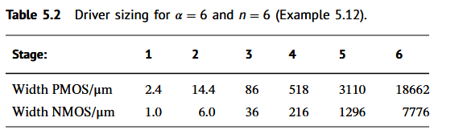

| 级数 | NMOS 宽度 / μm | PMOS 宽度 / μm |
|---:|---:|---:|
| 1 | 1 | 2.4 |
| 2 | 6 | 14.4 |
| 3 | 36 | 86.4 |
| 4 | 216 | 518.4 |
| 5 | 1296 | 3110.4 |
| 6 | 7776 | 18662.4 |

表中保留按倍率算出的数值；原文对部分 PMOS 宽度进行了取整。

**工程理解：**上述很大的宽度应理解为总有效宽度，在版图中通常需要多指、并联单元及足够的互连。不能直接把它当作一根连续、寄生可忽略的栅线。具体器件、最小长度、PMOS/NMOS 比例与允许供电必须由所用工艺决定。

### 8.8 速度、面积、能量为什么有折中

在几何缩放模型下，各级总宽度：

$$
W_{sum}=W_1\sum_{k=0}^{n-1}\alpha^k
=W_1\frac{\alpha^n-1}{\alpha-1}
$$

若保持同一负载匹配条件 $\alpha^n=F$，则：

$$
W_{sum}=W_1\frac{F-1}{\alpha-1}
$$

适当增大倍率可减少中间级的累计尺寸和被反复充放电的节点电容，同时延迟在最优点附近的变化较平缓。这给面积、能量与速度提供折中空间。

但功率 MOS 自身的栅负载并没有因为中间级减少而消失；真实能量还包括短路电流、互连寄生、各级波形及电平转换支路，不能只靠上述宽度和断言最终功耗。

## 9. 把四类知识连成一条完整换流路径

以上下 NMOS 半桥为例，从控制逻辑到功率节点的因果链为：

```text
控制逻辑产生换流请求
        ↓
死区 / 互锁逻辑撤销原管导通，安排新管许可
        ↓
需要跨域的命令经过 level shifter
        ↓
级联驱动器逐级放大，输出级释放原管栅电荷
        ↓
原管沟道退出导通
        ↓
死区内电感电流改变 SW 节点电荷
        ↓
SW 到达新管所需的低 VDS 条件
        ↓
新管驱动器建立 VGS，沟道接管电流
        ↓
状态 / SW 检测反馈到互锁或逐周期延迟控制
```

由此可以理解三类相互影响：

1. **改驱动尺寸会改死区。**放大末级会改变驱动速度，也会增加前级负载；若互锁只观察内部早期节点，最终栅极时刻可能发生不同变化。
2. **改 level shifter 会改两条路径的匹配。**低侧和高侧的传播路径不相同，仅让 PWM 波形互补不能保证功率管动作对称。
3. **改负载会改 ZVS 所需等待。**控制命令与驱动器延迟即使不变，节点电容换流时间仍会因电感电流改变。

所以死区需要分别考虑 HS→LS、LS→HS 两次交接；不能用一个对称延迟替代全部物理过程。

## 10. 以后看原理图与波形时的检查顺序

### 10.1 先认清电压域

1. 标出控制域、低侧域、高侧浮动域的高低电源轨。
2. 对每个信号注明参考地，尤其区分高侧 gate 对地电压与 $V_{GS,HS}$。
3. 将信号路径、供电路径分别追踪，避免把 bootstrap 与 level shifter 混为一项功能。

### 10.2 再认清电流与交接方向

1. 明确电感电流的正方向及当前符号。
2. 两管关断时，判断该电流会拉高还是拉低 SW。
3. 标出目标管的 $V_{DS}$，检查节点是否真的到达其 ZVS 条件。
4. 如果 SW 出现负向钳位平台，判断是否有低侧体二极管导通，以及持续多久。

### 10.3 最后看驱动与检测的真实时序

| 应观察的波形 | 用途 |
|---|---|
| 原始 PWM 与互锁输出 | 分离控制要求与实际执行 |
| $V_{GS,HS}$、$V_{GS,LS}$ | 检查实际栅源驱动及重叠 |
| $V_{sw}$ 与两管 $V_{DS}$ | 检查节点换流与残余开通电压 |
| $i_L$ 与功率管通道 / 二极管电流 | 判断换流方向、直通和二极管续流 |
| 检测点及最终 gate | 判断内部检测是否过早报告关断 |
| $V_{high}-V_{sw}$ | 确认浮动供电压差是否维持 |

只看输入电源电流的尖峰，不能唯一断定直通，因为节点电容充放电与反向恢复也会产生尖峰。需要结合上下管电流和栅源电压共同分析。

## 11. 常见误解与对应修正

| 容易形成的理解 | 更准确的表述 |
|---|---|
| 死区越短效率越高 | 应缩短不必要的等待，同时满足关断和节点换流条件 |
| 没有直通就已经最优 | 仍可能有残余 $V_{DS}$ 硬开通或体二极管导通 |
| 栅极拉到地就能关断高侧 NMOS | 关断看 gate 相对 source；浮动驱动通常拉回 SW |
| ZVS 就是 SW 为零 | 低侧要求 SW 近零，高侧要求 SW 近输入电压 |
| 优化一次死区就能上下管都 ZVS | 两次换流需要匹配各自的电流方向和电荷条件 |
| adaptive 就是在找 SW 零点 | 本教材 adaptive 检测对侧关断；predictive 才根据换流结果调延迟 |
| level shifter 会提供高侧高压电源 | 它传递命令，高侧供电由 gate supply 提供 |
| ZVS 后不再需要栅极驱动能量 | 栅极及中间级仍需充放电 |
| 级联越多越快 | 单级负载减小与传播级数增加之间存在最优点 |
| 最优倍率永远是 2.718 | 这是简化模型的连续最优解，实际还受寄生、整数级数和工艺影响 |
| $n$、$\alpha$ 与负载可以独立选 | 等扇出模型里需要满足 $\alpha^n=F$ |
| 教材表中的大宽度可直接照抄到新工艺 | 这些是特定示例，需重新匹配器件能力、负载、供电与版图寄生 |

## 12. 公式速查与适用边界

| 公式 | 用途 | 前提 / 边界 |
|---|---|---|
| $t_{dead,actual}=t_{cmd}+t_{on,new}-t_{off,old}$ | 区分命令间隔与实际间隔 | 各时刻使用一致的导通判据 |
| $C_{eq}\,dV_{sw}/dt\approx-i_L$ | 判断 SW 换流方向 | 两管沟道关断，主要由电感电流换流 |
| $t_{comm}\approx Q_{node}/|i_L|$ | 估算电容换流时间 | 换流期间电流近似不变 |
| $P_{bd}\approx f_{sw}V_F|i_L|t_{bd,\Sigma}$ | 二极管导通损耗估算 | 电流、压降近似恒定 |
| $P_{gate}\approx f_{sw}\sum Q_gV_{drv}$ | 常规栅驱动功耗估算 | 不采用理想能量回收，不含全部辅助损耗 |
| $T_r=2\pi\sqrt{L_rC_r}$ | 理想谐振周期 | 无损集中参数 LC 模型 |
| $t_{direct}=t_{apd}F$ | 单级直接驱动延迟 | 教材线性负载与驱动模型 |
| $\alpha^n=F$ | 等扇出级联匹配 | 输入电容及驱动能力随宽度缩放 |
| $t_{cascade}=n\alpha t_{apd}$ | 级联总延迟 | 忽略额外寄生延迟等影响 |
| $\alpha_{opt}=e$ | 理想最优倍率 | 连续优化、同一简化模型 |
| $W_i=W_1\alpha^{i-1}$ | 逐级尺寸展开 | 同器件类型、长度不变的近似 |

## 13. 与已有知识连接

从[Buck 功率级](/zh/notes/buck-day-01/)的两状态电路出发，本篇补上两状态之间的真实换流过程。[COT 完整周期](/zh/notes/buck-cot-cycle/)中的补能请求，需要经过互锁、电平转换和栅极驱动才能成为实际开通；[AOT 定时器](/zh/notes/buck-aot-frequency/)给出的逻辑脉宽，也会受到实际开通、关断路径延迟的影响。控制定时与功率管时刻的区别，因此会直接影响最短导通时间和高频运行。

- [高速动态 Level Shifter 论文笔记](/zh/reading/tcas-2021-dynamic-level-shifter/)：继续阅读本篇简单电阻式结构以外的高速实现。
- [Dithering、功率管宽度与死区控制论文笔记](/zh/reading/jssc-2007-skip-width-dead-time/)：进一步理解负载变化下，导通损耗、栅极驱动和死区损耗如何共同影响效率。
- [ESR 纹波与反馈](/zh/notes/buck-esr-ripple/)与[COT 纹波反馈](/zh/notes/buck-cot-ripple/)：把功率级的真实 SW 波形与输出纹波、反馈判决联系起来。

## 14. 参考资料与截图定位

1. Bernhard Wicht, *Design of Power Management Integrated Circuits*, Wiley, 2024. DOI: [10.1002/9781119123095](https://doi.org/10.1002/9781119123095)。[出版社书目与目录](https://www.wiley.com/en-fr/design-of-power-management-integrated-circuits-p-9781119123088)。
2. Chapter 2, [The Power Stage](https://onlinelibrary.wiley.com/doi/10.1002/9781119123095.ch2)：§2.8 Dead Time Generation、§2.9 Soft-Switching；本文引用 Figs. 2.19–2.23、Table 2.5 与 Example 2.8。
3. Chapter 5, [Gate Drivers and Level Shifters](https://onlinelibrary.wiley.com/doi/10.1002/9781119123095.ch5)：§5.1–5.2、§5.8–5.8.1；本文引用 Figs. 5.1–5.5、5.18–5.20、Table 5.2 与 Examples 5.10–5.12。

本文只讨论上述节选。后续自举电源、完整 level shifter 设计与共模瞬态抗扰度，应结合教材相应章节继续学习。
