在理想 Buck 里，上管关断的瞬间下管同时开通。但在真实芯片里，功率管的栅极是个大电容，需要纳秒级充放电；同时开关节点 `SW` 上也挂着寄生电容。

把控制器发出的逻辑电平变成高效、安全的大电流功率开关动作，必须依次解决四个问题：
1. **防直通与降损耗（死区控制）**：先关旧管再开新管，间隔既不能太短（直通/硬开关），也不能太长（体二极管白白发热）；
2. **省掉重叠损耗（ZVS 软开关）**：趁着死区让电感电流先把目标管的 $V_{DS}$ 放回零，再合闸；
3. **跨电压域发号施令（Level Shifter）**：高侧 NMOS 的源极随 `SW` 在 $0$ 和 $V_{in}$ 之间剧烈跳动，必须靠浮动驱动与电平位移把命令送上去；
4. **小逻辑推大功率管（级联驱动链）**：用一串按固定倍率 $\alpha$ 逐级放大的反相器，把微秒级的直接驱动延迟压到一两纳秒。

> **全篇物理主线**
> **原管关断 $\to$ 电感电流在死区搬运 `SW` 电容电荷 $\to$ `SW` 到位后新管在低 $V_{DS}$ 下开通**。死区控制管“何时交接”，软开关看“交接时 $V_{DS}$ 降到多少”，驱动与电平转换管“命令能不能准时推到栅极”。

[学习地图：死区与栅极驱动](/zh/learn/#buck-gate-drive-and-dead-time) · [Buck 功率级](/zh/notes/buck-day-01/) · [COT 周期](/zh/notes/buck-cot-cycle/)

---

## 1. 统一参考节点：高侧电压千万别对地量！

以最常用的**双 NMOS 同步 Buck** 为例，规定正电感电流 $i_L > 0$ 从 `SW` 流向输出：

```text
  Vin = Vbat
      │
     MHS  (高侧 NMOS：VGS,HS = VG,HS - Vsw,  VDS,HS = Vin - Vsw)
      │
      ●─── SW ── L ── Vout  (iL →)
      │
     MLS  (低侧 NMOS：VGS,LS = VG,LS,        VDS,LS = Vsw)
      │
     GND
```

| 符号 | 含义 | 读图防错重点 |
| --- | --- | --- |
| $V_{sw}$ | 开关节点对地电压 | 等于低侧 $V_{DS,LS}$，但**不等于**高侧 $V_{DS,HS}$ |
| $V_{GS,HS}$ | 高侧栅源电压 | **$V_{G,HS} - V_{sw}$**（开高侧时栅极必须比 $V_{in}$ 更高！） |
| $V_{drv}$ | 栅极驱动摆幅 | 驱动器高低轨压差（如 $5\text{ V}$），不是模拟小信号过驱动 $V_{OV}$ |
| $V_{SSH}$ / $V_{high}$ | 高侧驱动的浮动地 / 浮动电源 | 通常取 $V_{SSH}=V_{sw}$、$V_{high}=V_{sw}+V_{drv,HS}$ |

---

## 2. 死区时间（Dead Time）：为什么不能太短，也不能太长？

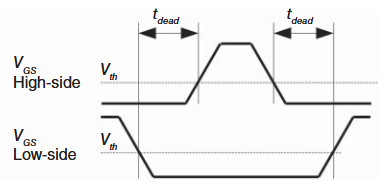

若原管收到关断命令后经 $t_{off,old}$ 才关断，新管收到命令经 $t_{on,new}$ 才开通，命令间隔为 $t_{cmd}$，则实际物理死区是：

$$t_{dead,actual} = t_{cmd} + t_{on,new} - t_{off,old}.$$

死区像走钢丝，**过短**和**过长**都会狠狠吃掉效率：

- **死区过短（两种惨案）**：
  1. **直通（Shoot-through）**：上下两管同时导通，输入 $V_{in}$ 直接通过两只大管向地短路，轻则发热、重则烧片；
  2. **硬开通**：就算旧管彻底关了，如果 `SW` 节点电压还没来得及换流到位，新管直接在高压 $V_{DS}$ 上合闸，瞬间放光节点电容能量 $\frac{1}{2}C_{oss}V_{DS}^2$ 并产生很大开关损耗。
- **死区过长（体二极管白白发热）**：
  以 $i_L > 0$、高侧关断切向低侧为例：高侧一关，电感电流会把 `SW` 节点寄生电容一路抽电拉向地；如果 `SW` 已经跌破 $0\text{ V}$ 但低侧还没开，电感电流只能硬挤进低侧的**寄生体二极管**续流（把 `SW` 钳位在约 $-0.7\text{ V}$ 的 $-V_F$ 上）。每周期不仅多出二极管导通损耗 $P_{bd}\approx f_{sw}V_F|i_L|t_{bd,\Sigma}$，还会攒出后续严重的**反向恢复损耗 $Q_{rr}$**。

### 为什么最优死区会随负载电流变化？

死区里真正帮 `SW` 换流的是电感电流 $i_L$，需要把节点等效电容 $C_{eq}$ 上的电荷 $Q_{node}$ 搬完：

$$t_{comm}\approx \frac{C_{eq} V_{in}}{|i_L|}.$$

例如 $V_{in}=12\text{ V}$、$C_{eq}=200\text{ pF}$（$Q_{node}=2.4\text{ nC}$）：当 $|i_L|=1\text{ A}$ 时仅需 **$2.4\text{ ns}$** 就换流完毕；电流掉到 $0.2\text{ A}$ 时却要足足 **$12\text{ ns}$**！这正是固定死区很难全工况最优的物理原因。

---

## 3. 三种死区控制方法对比

| 方案 | 看什么信号决定开通？ | 优点 | 缺点 |
| --- | --- | --- | --- |
| **1. 固定死区（Fixed）** | 预设反相器延迟链（$H=P\land P_d,\; L=\overline{P\lor P_d}$） | 电路极简 | 为扛住最坏 PVT 必须留大余量，典型工况往往死区偏长 |
| **2. 自适应死区（Adaptive）** | 交叉检测**对管栅压/驱动链状态**，确认对管关断再发令 | 自动跟随 PVT 与驱动变化，稳防直通 | 检测点太靠前可能误判外部大管没关完；且不管 `SW` 是否已到位 |
| **3. 预测死区（Predictive）** | 检测**本周期 `SW` 换流结果**（体二极管导通否），动态微调下周期延迟 | 连同外部延迟与负载变化一并闭环逼近最优 | 电路较复杂，负载突变瞬态需要重新收敛几拍 |

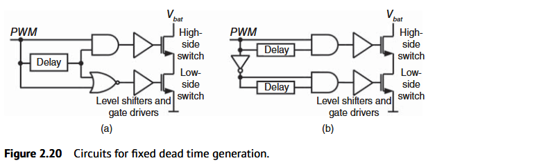

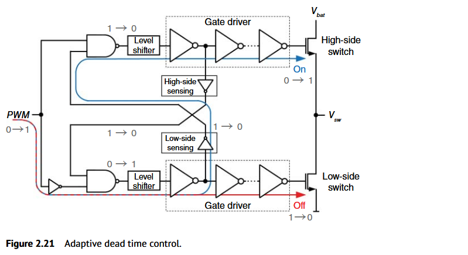

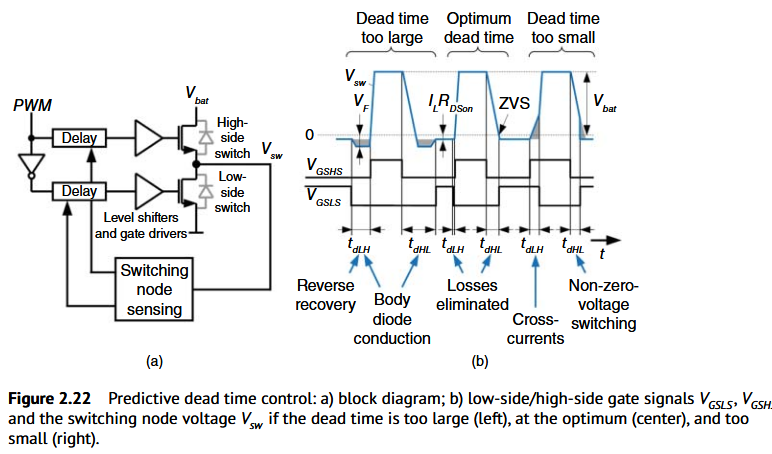

> **记住预测死区的调法**：发现低侧开前体二极管已经导通了 $\implies$ 下周期缩短死区；发现低侧开通时 `SW` 还没降到零 $\implies$ 下周期加长死区。

---

## 4. 软开关（ZVS）：把“电压跌零”和“沟道合闸”排好顺序

硬开关之所以损耗大，是因为开通/关断瞬间漏源电压 $v_{DS}$ 和漏极电流 $i_D$ **同时不为零**（$E_{sw}=\int v_{DS}i_D\,dt$）。**ZVS**（零电压开关）就是想办法在管子合闸之前，先把它的 $V_{DS}$ 降到几乎为零（顺便消除电容放电损耗与密勒平台拖累）。

实现 ZVS 有两条主要路线：

### 路线一：外加 $L_r C_r$ 谐振支路（多用于特定高压或谐振拓扑）

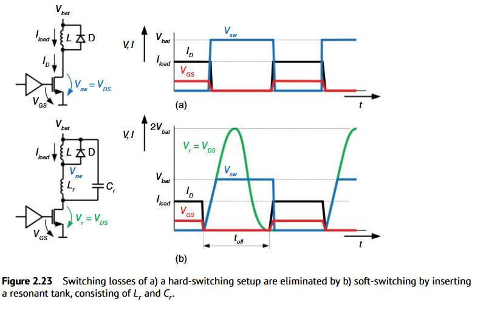

### 路线二：同步 Buck 自带“免费”节点电容换流（最常用）

同步 Buck 不用外加谐振电感，直接拿主电感电流在死区里给 `SW` 节点充放电就行，但**上下管的难度完全不对等**：

1. **高侧关 $\to$ 低侧开（天然容易实现低侧 ZVS）**：
   正常供电时 $i_L > 0$，高侧一关断，正电感电流**自动把 `SW` 从 $V_{in}$ 抽到 $0\text{ V}$**（此时 $V_{DS,LS}\approx 0$）。只要死区卡得准，低侧管立刻合闸就是纯正的低侧 ZVS！
2. **低侧关 $\to$ 高侧开（高侧很难自然 ZVS）**：
   如果依然是正电感电流 $i_L > 0$，低侧关断后电感只会把 `SW` 往负压扯，永远升不到 $V_{in}$；高侧一开通只能承受全母线压差硬开关。
   想要高侧也 ZVS，必须让下管在关断前允许**电感电流短暂倒流变负（$i_L < 0$）**——下管关断瞬间，这股负电流正好把 `SW` 从地充上 $V_{in}$（使 $V_{DS,HS}=V_{in}-V_{sw}\to 0$），再开高侧。工程上要权衡“省下的开关损耗”和“循环负电流多出的导通损耗”哪个更划算。

> **两个常见误区**
> 1. **ZVS 的零电压指目标管的 $V_{DS} \approx 0$**：低侧 ZVS 时 `SW` $\approx 0$；高侧 ZVS 时 **`SW` $\approx V_{in}$**！
> 2. **ZVS 不会省掉栅极驱动损耗**：见图 6（Table 2.5），哪怕 ZVS 把开关重叠损耗、$C_{oss}$ 损耗和二极管损耗全压到了 0，**栅极每周期充放电损耗 $P_{gate}\approx f_{sw}\sum Q_g V_{drv}$ 依然照常存在**，在 $10\text{ MHz}$ 高频下甚至成为最主要的损耗项！

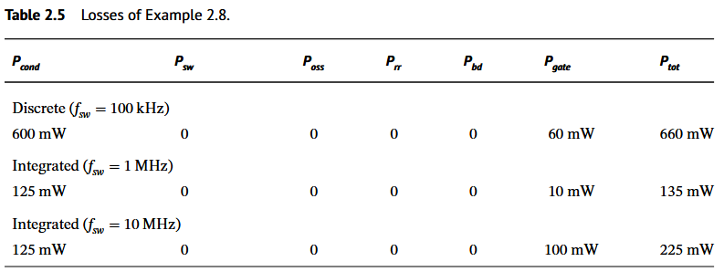

---

## 5. Gate Driver 驱动链与四种高侧配置

栅极驱动器本质是一颗能瞬间输出几安培电流的推挽开关（$I_{gate,avg}\approx \Delta Q_g/\Delta t$，比如 $5\text{ ns}$ 充 $10\text{ nC}$ 需要 $2\text{ A}$ 峰值电流）。完整的驱动系统由下图的几个角色协同完成：

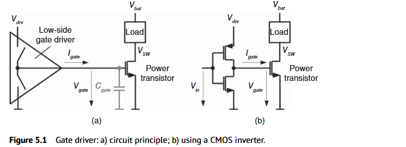

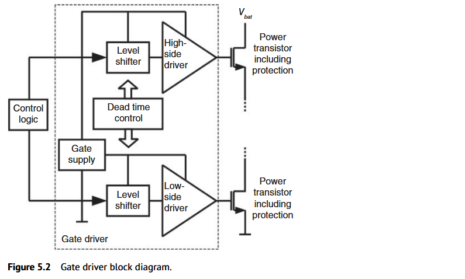

根据高侧用 PMOS 还是 NMOS、以及驱动参考地接哪里，芯片里共有四种经典配置：

 低压 CMOS 反相式与 (d) 高侧浮动自举式最常见。")

| 配置 | 高侧管 | 高侧驱动电源轨（低轨 ~ 高轨） | 特点与适用场景 |
| --- | --- | --- | --- |
| **(a)** | PMOS | $0 \sim V_{bat}$ | 结构最简，适合低输入电压（如 $\le 5\text{ V}$ 不超栅氧耐压） |
| **(b)** | PMOS | $(V_{bat}-V_{drv}) \sim V_{bat}$ | 用 LDO 限住下拉低轨，保护高压下的 PMOS 栅氧 |
| **(c)** | NMOS | $0 \sim (V_{bat}+V_{drv})$ | 地参考驱动但输出高压摆幅大，较少用 |
| **(d)** | NMOS | **$V_{sw} \sim (V_{sw}+V_{drv})$** | **大电流高压 Buck 标准方案**：整颗驱动器踩在 `SW` 上随波逐流，局部摆幅永远只有 $V_{drv}$ |

---

## 6. 两种经典电平转换（Level Shifter）电路

### 6.1 低侧交叉耦合 Level-Up Shifter（低压逻辑 $\to$ 驱动电压域）

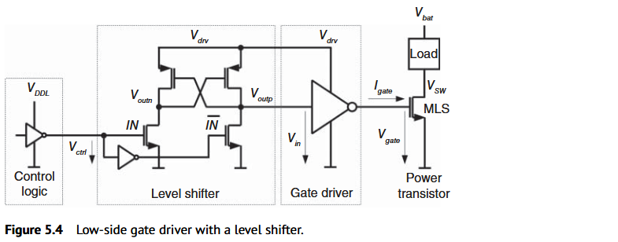

动作一目了然（以 $IN=0 \implies$ 低侧开通为例）：
1. $IN=0$ 关断左下 NMOS，$\overline{IN}=1$ 打开右下 NMOS，把右节点 $V_{outp}$ 拉到地；
2. $V_{outp}$ 变低 $\to$ 打开左上 PMOS $\to$ 把左节点 $V_{outn}$ 拉到 $V_{drv}$ $\to$ 关断右上 PMOS（正反馈锁死，静态零功耗！）；
3. 右节点 $V_{outp}=0$ 送进后级 $V_{drv}$ 反相器，输出 $V_{drv}$ 开通低侧功率管。

*设计重点*：翻转瞬间新打开的下拉 NMOS 必须足够强，才能打赢原有 PMOS 的上拉锁存，否则会翻不过来或延迟暴增。

### 6.2 高侧电阻式 Level Shifter + 浮动反相器（地参考 $\to$ `SW` 浮动域）

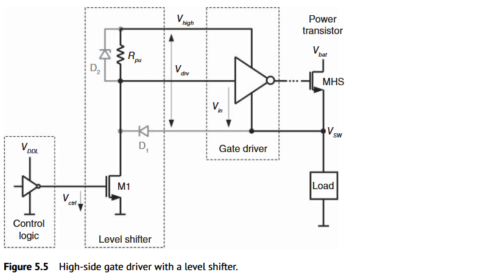

理解这张图的唯一钥匙是：**别看绝对对地电压，只看高侧输入端相对 `SW` 的局部电压 $v_{in,local} = V_{in,node} - V_{sw}$！**
- **$V_{ctrl}=0$（高侧关断）**：M1 关断，$R_{pu}$ 把节点拉向 $V_{high}$，于是局部输入为逻辑 `1`（$V_{drv}$）$\to$ 浮动反相器输出拉向它的低轨 **$V_{sw}$** $\to$ $V_{GS,HS}=0$，高侧安全关断！
- **$V_{ctrl}=1$（高侧开通）**：M1 导通抽电流，在 $R_{pu}$ 上拉出压降，局部输入跌回逻辑 `0`（二极管 $D_1, D_2$ 把节点电压钳在 $V_{sw}-V_F \sim V_{high}+V_F$ 之间防击穿）$\to$ 浮动反相器输出拉向 $V_{high}$ $\to$ $V_{GS,HS}=V_{drv}$，高侧开通！

> **别把 Level Shifter 和 Bootstrap 搞混了！**
> - **Level Shifter** 只负责**传开关命令**；
> - **Bootstrap 自举电路 / 电荷泵** 负责提供 **`SW` 上方那颗 $V_{high}=V_{sw}+V_{drv}$ 的电源**；
> - **Gate Driver** 消耗这颗电源的电荷去推大功率管。三者缺一不可。

---

## 7. 级联栅极驱动链（Cascaded Drivers）：怎么算级数和倍率？

如果让最小尺寸逻辑反相器（输入电容 $C_{inv}=10\text{ fF}$，单级基准延迟 $t_{apd}=67.5\text{ ps}$）直接去推一颗 $C_{gate}=250\text{ pF}$ 的功率管，扇出比 $F = C_{gate}/C_{inv} = 25000$，直接驱动延迟高达：

$$t_{direct} = t_{apd} F = 67.5\text{ ps} \times 25000 \approx \mathbf{1.69\,\mu\text{s}}$$

这在几兆赫兹的开关电源里完全不可接受！解决之道是串一排尺寸按公比 $\alpha$ 逐级长大的反相器：

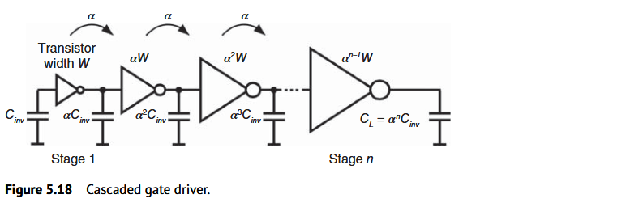

### 7.1 最优公比为什么偏偏是自然常数 $e$？

设共 $n$ 级反相器，每级相对前一级放大 $\alpha$ 倍（满足 $\alpha^n = F \implies n = \ln F / \ln \alpha$），每级延迟均等于 $\alpha t_{apd}$，故总延迟为：

$$t_{cascade} = n \alpha t_{apd} = t_{apd} \ln F \cdot \frac{\alpha}{\ln \alpha}.$$

对 $\alpha / \ln\alpha$ 求导置零，立刻得到理想最小延迟解：

$$\boxed{\alpha_{opt} = e \approx 2.718,\qquad n_{opt} = \ln F,\qquad t_{cascade,\min} = e\, t_{apd} \ln F.}$$

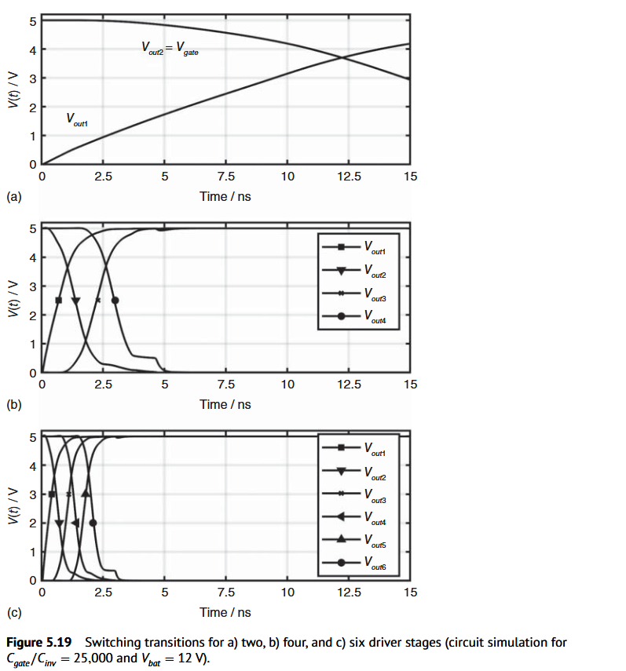

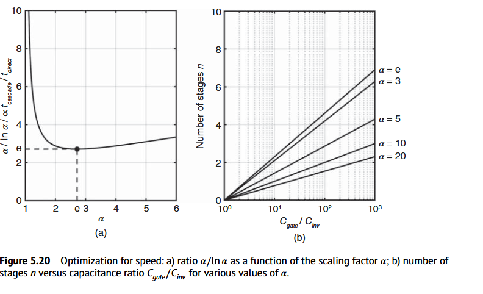

### 7.2 为什么工程上常常选 $\alpha \approx 4\text{–}6$，而不选 $e$？

看图 14 的平坦谷底就明白了：在 $F=25000$ 的例子里：
- 理论最优 $\alpha \approx 2.75$（10 级）：总延迟约 **$1.86\text{ ns}$**；
- 工程常用 $\alpha \approx 5.4$（6 级）：总延迟仅微微增加到 **$2.19\text{ ns}$**（只慢了 $0.3\text{ ns}$！），却一口气省掉了 4 级晶体管，中间级寄生总宽 $W_{sum}=W_1\frac{F-1}{\alpha-1}$ 随之大幅缩小，既省芯片面积又省动态功耗。

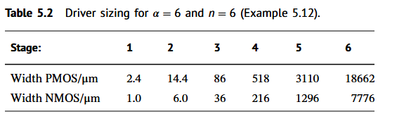

---

## 8. 复习与排错速查

| 常见误区 | 正确结论 |
| --- | --- |
| “死区只要不直通，越短越好” | 过短仍会引起残余 $V_{DS}$ 硬开通；最优死区是刚好让 `SW` 电容换流到位 |
| “栅极拉到地就能关高侧 NMOS” | 要把高侧栅极拉回它的源极 **`SW`** 才算关断 |
| “实现 ZVS 就没有开关驱动损耗了” | ZVS 只消除了通道交叉与 $C_{oss}$ 损耗，栅极充放电 $f_{sw}Q_g V_{drv}$ 照算 |
| “级联反相器级数越多越快” | 理论最小延迟在 $\alpha = e$（$n=\ln F$），超过后反而因自身级数变多变慢 |

---

## 参考资料

- Bernhard Wicht, *Design of Power Management Integrated Circuits*, Wiley, 2024, [DOI: 10.1002/9781119123095](https://doi.org/10.1002/9781119123095)（§2.8 Dead Time Generation、§2.9 Soft-Switching、§5.1–5.2 Gate Drivers & Level Shifters、§5.8 Cascaded Drivers）。
- 站内延伸：[高速动态 Level Shifter 论文笔记](/zh/reading/tcas-2021-dynamic-level-shifter/) · [功率管宽度与死区优化论文笔记](/zh/reading/jssc-2007-skip-width-dead-time/)
