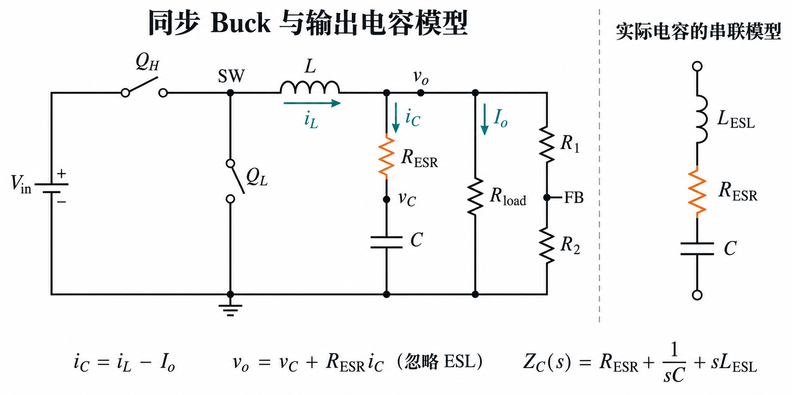
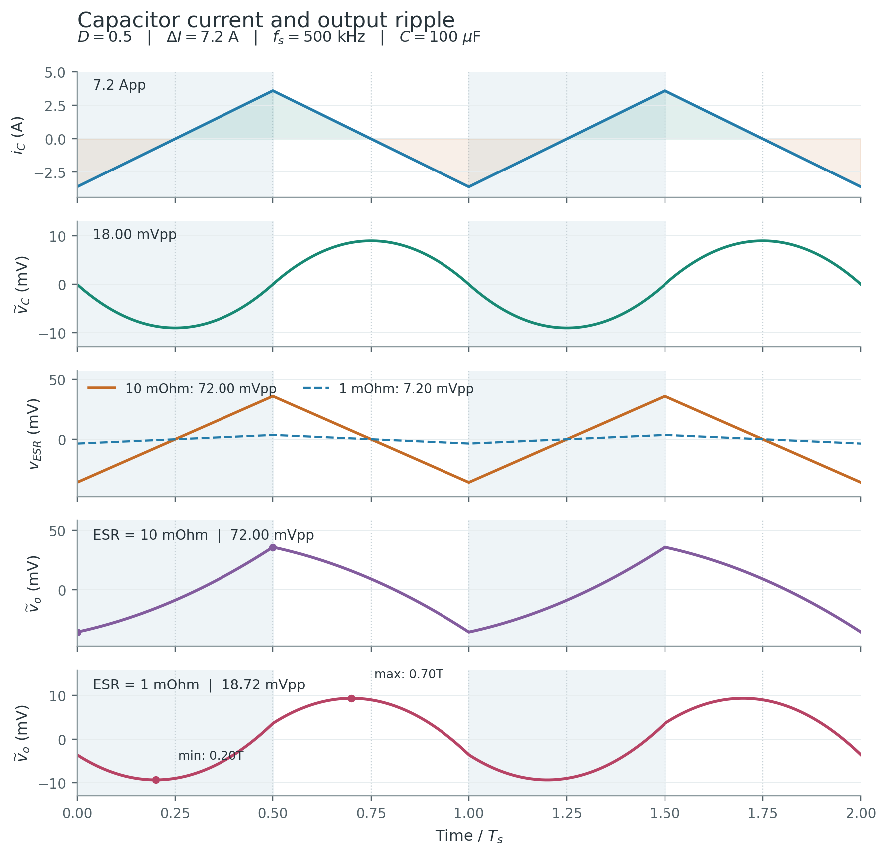
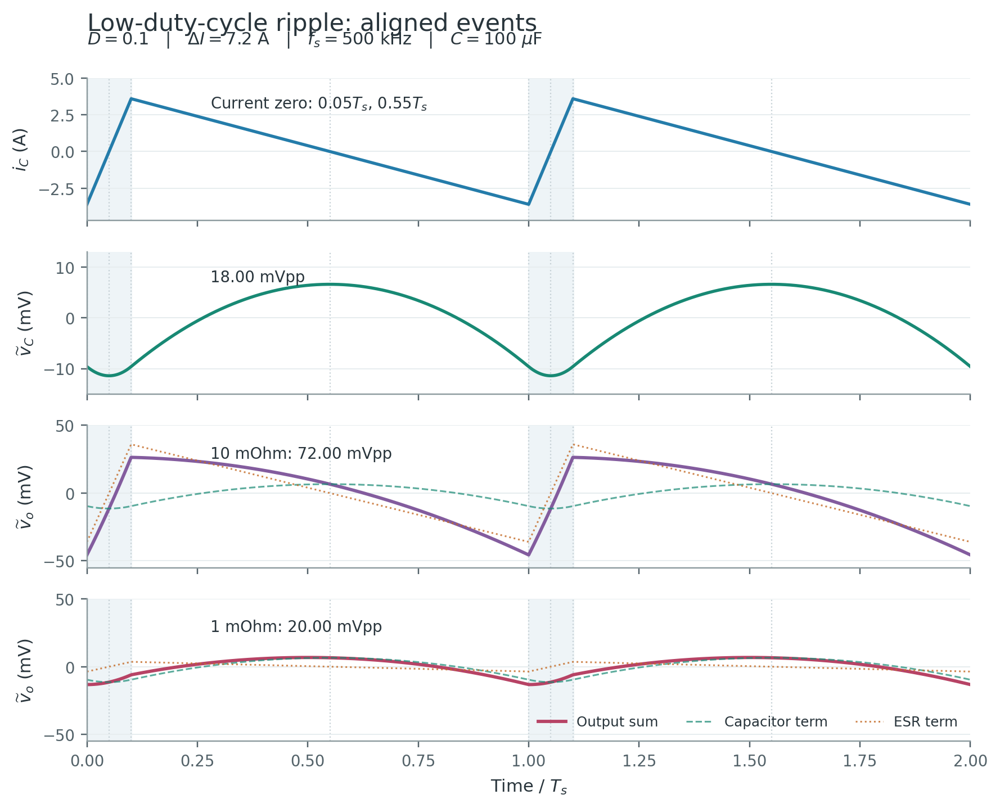
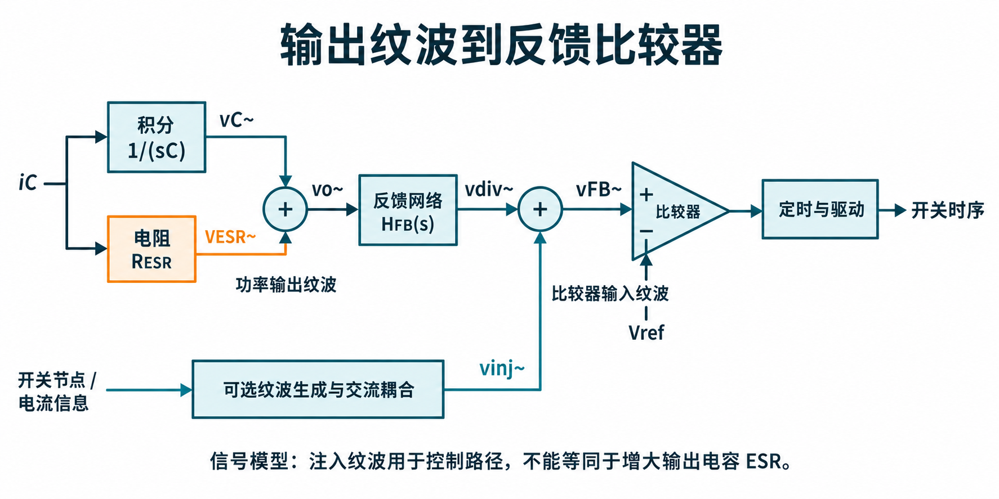

挑输出电容时，光看容量 $\mu\text{F}$ 远远不够。电容内部串联的等效电阻（ESR）既会放大稳态纹波和负载突变压降、还会发热；但奇怪的是，在部分 COT 控制芯片里把 ESR 降得太低，反而会让开关控制变抖甚至不稳定。

> **全篇核心拆解**
> 输出电容端口的交流纹波，永远由两股完全不同脾气的电压叠加而成：
> 1. **理想电容项 $\widetilde v_C$**：来自电容电流的**累计积分**，形状是**分段抛物线**；
> 2. **ESR 项 $R_{ESR} i_C$**：正比于**瞬时电流**，形状是与电感纹波同相的**三角波**。

前置知识：[Buck 功率级基础](/zh/notes/buck-day-01/) · [负载阶跃与电荷恢复](/zh/notes/buck-day-02/) · [全部个人笔记](/zh/notes/)

| 要解决的问题 | 核心结论 | 章节 |
| --- | --- | --- |
| 电容电流是三角波，电压也是三角波吗？ | 只有 ESR 项是三角波；理想电容项是分段抛物线 | §3–4 |
| 两项峰峰值能直接相加吗？ | 极值错位，直接相加只是保守上界；精确值要找 $dv_o/dt=0$ | §5 |
| 降低 ESR 一定让 COT 不稳定吗？ | 会削弱与电流同相的反馈斜率，解决思路是用人工纹波注入替代 | §8 |
| 开关频率翻倍后，纹波和损耗怎么变？ | 电容纹波按 $f_s^{-2}$ 猛降，ESR 纹波按 $f_s^{-1}$ 下降，开关/驱动损耗上升 | §9 |

---

## 1. 电容串联模型与参考方向

| 参数 | 本构关系 | 在 Buck 中的角色 |
| --- | --- | --- |
| **理想电容 $C$** | $i_C=C\,dv_C/dt$ | 蓄水池：电压由累计进出电荷决定 |
| **串联电阻 $R_{ESR}$** | $v_{ESR}=R_{ESR} i_C$ | 阻尼与压降：随瞬时电流立即变化，并产生发热 |
| **串联电感 $L_{ESL}$** | $v_{ESL}=L_{ESL}\,di_C/dt$ | 高频寄生：只在电流极陡的换流瞬间制造尖峰 |

固定参考方向：**流入电容为正**（$i_C=i_L-I_o$）。忽略高频 ESL 时，输出端口电压为：

$$\boxed{i_C=i_L-I_o}\tag{1}$$

$$
\begin{aligned}
C\frac{dv_C}{dt}&=i_C,\\
v_C(t)-v_C(t_0)&=\frac{1}{C}\int_{t_0}^{t}i_C(\tau)\,d\tau
\end{aligned}
\tag{2}
$$

$$\boxed{v_o=v_C+R_{ESR}i_C}\tag{3}$$

> **先纠正一个常见误区**：周期稳态下，流入电容的平均电流 $\langle i_C\rangle = 0$，因此 **ESR 上不会产生直流压降**（不像电感 DCR 会把 $I_o R_L$ 扣在输出电压里）。ESR 只影响交流纹波、瞬态跳变与纹波发热。

---

## 2. 增大或减小 ESR 会直接改变什么？

| 特性 | 降低 ESR 的直接收益 | 需要注意的连锁反应 |
| --- | --- | --- |
| **稳态纹波** | 同相三角纹波成比例缩小 | 端口波谷/波峰时刻往电容过零点偏移 |
| **负载阶跃** | $t_0^+$ 瞬间垂直跳变 $-R_{ESR}\Delta I_o$ 减小 | 后续电容积分斜率 $-I/C$ 不变，仍靠容值扛 |
| **自身发热** | 纹波耗散 $I_{C,rms}^2 R_{ESR}$ 线性下降 | 并联多颗 MLCC 需留意反谐振 |
| **频率响应** | ESR 零点 $f_{z,ESR}$ 被推向很高频 | 电压环少了一个免费相位提升零点 |
| **纹波型 COT** | 开关噪声/抖动可能敏感，甚至触发不稳 | 需配合人工纹波注入（见 §8） |

---

## 3. 从功率级导出三角电容电流

理想两状态 CCM 下，$D=V_o/V_{in}$、$T_s=1/f_s$，电感电流峰峰值纹波为：

$$\Delta I=\frac{(V_{in}-V_o)D}{Lf_s}=\frac{V_o(1-D)}{Lf_s}.\tag{4}$$

稳态下电感平均电流等于负载 $I_o$，所以 $i_C = i_L - I_o$ 就是去掉直流偏置后的零均值三角波，在 $-\Delta I/2$ 到 $+\Delta I/2$ 之间摆动：

| 周期关键时刻 | $i_C$ 状态 | 对理想电容 $v_C$ 的含义 |
| --- | --- | --- |
| $0$（上管刚开） | $-\Delta I/2$（负峰） | 电容正在以最大速率放电 |
| $DT_s/2$ | 负 $\to$ 正过零 | **$v_C$ 到达谷值** |
| $DT_s$（上管刚关） | $+\Delta I/2$（正峰） | 电容正在以最大速率充电 |
| $(1+D)T_s/2$ | 正 $\to$ 负过零 | **$v_C$ 到达峰值** |

---

## 4. 两个分量的波形与峰峰值公式

### 4.1 理想电容积分项：为什么系数是 8？

从 $v_C$ 谷值到峰值的整个正电流区间，正好包含上坡后半段和下坡前半段——合起来就是一个底边长 $T_s/2$、高为 $\Delta I/2$ 的三角形。面积就是充进去的总电荷 $\Delta Q$：

$$\Delta Q = \frac{1}{2}\cdot\frac{\Delta I}{2}\cdot\frac{T_s}{2}=\frac{\Delta I T_s}{8} \implies \boxed{\Delta V_{C,pp}=\frac{\Delta I}{8f_s C}.}\tag{5}$$

注意**系数 8 对任意 CCM 占空比 $D$ 都成立**（不需要 $D=0.5$）。线性三角电流积分后变成二次抛物线，所以 $\widetilde v_C$ 是光滑连续的**分段抛物线**。

### 4.2 ESR 项：直接随电流走

$$\widetilde v_{ESR}(t)=R_{ESR}i_C(t),\qquad \boxed{\Delta V_{ESR,pp}=\Delta I R_{ESR}.}\tag{6}$$

ESR 项与电感电流纹波完全同相，是一个纯三角波。

### 4.3 把两条曲线叠在一起看

> **为什么常说积分项“滞后 90°”？**
> 这句话严格来说只针对每一个正弦谐波分量；真实的三角波积分后波形变成了抛物线，**整体不能简单平移 $T_s/4$ 来画**，而应按“$i_C$ 过零处对应 $v_C$ 极值”来定位。

---

## 5. 为什么总纹波不能直接写成 $A + B$？

记 $A = \Delta V_{C,pp}$、$B = \Delta V_{ESR,pp}$。从图 2 就能一眼看出：$v_C$ 的谷值在 $DT_s/2$，而 ESR 项的谷值在 $0$ 时刻——**两个波谷和波峰不在同一时间**，所以实际总纹波总是小于或等于两者直接相加（$\Delta V_{o,pp}\le A+B$）。

要算精确值，只需找端口斜率为零的点（并检查开关切换边界 $u=0, D, 1$）：

$$\boxed{\frac{dv_o}{dt}=\frac{i_C}{C}+R_{ESR}\frac{di_C}{dt}=0.}\tag{7}$$

### 5.1 任意占空比的通用写法

令归一化时间 $u=t/T_s\in[0,1]$、$K=\Delta I T_s/C=8A$，理想电容纹波可写成：

$$\widetilde v_C(u)=K\,[F(u)-\overline F],\qquad \overline F=\frac{1-2D}{12},\tag{8}$$

其中上坡 $F_{on}(u)=-\frac{u}{2}+\frac{u^2}{2D}$、下坡 $F_{off}(u)=\frac{u-D}{2}-\frac{(u-D)^2}{2(1-D)}$。令无量纲比 $r = R_{ESR}C / T_s$，由式 (7) 解出两个极值候选位置：

$$u_{min}=\frac{D}{2}-r,\qquad u_{max}=\frac{1+D}{2}-r.\tag{9}$$

只要 $u_{min}$ 落在 $[0,D]$ 内、$u_{max}$ 落在 $[D,1]$ 内，就是分段内部的真正极值；如果算出来跑出了区间（比如 ESR 较大使 $r > D/2$），极值就已经贴到了开关切换边界 $u=0$ 或 $u=D$ 上。

### 5.2 $D=0.5$ 的对称闭式公式（最常用于直觉判断）

在 $D=0.5$ 时，上坡段端口纹波化简为：

$$\widetilde v_o(u)=8A\left(u^2-\frac{u}{2}\right)+B\left(2u-\frac{1}{2}\right),\tag{10}$$

极值只取决于 $B$ 与 $2A$ 的大小关系：

$$\boxed{\Delta V_{o,pp}=\begin{cases}A+\dfrac{B^2}{4A}, & B<2A,\\ B, & B\ge 2A.\end{cases}}\tag{11}$$

> **极值规律**：当 $B \ge 2A$（ESR 足够大）时，端口纹波彻底被拉成三角波，峰峰值就等于 $B$；只要 $B < 2A$，电容积分曲线仍会把总纹波稍微顶高一点到 $A + B^2/(4A)$。

---

## 6. 两组定量算例与电容发热

### 6.1 算例一：$\Delta I=7.2\text{ A}$、$f_s=500\text{ kHz}$、$C=100\,\mu\text{F}$

先算电容积分纹波：$A = \dfrac{7.2}{8\times 500\text{ kHz}\times 100\,\mu\text{F}} = \mathbf{18.00\text{ mV}_{pp}}$。

| ESR | ESR 纹波 $B$ | 积分纹波 $A$ | $D=0.5$ 总纹波 | 谷／峰时刻（$D=0.5$） | $A+B$ 保守上界 |
| --- | --- | --- | --- | --- | --- |
| **10 mΩ** | $72.00\text{ mV}$ | $18.00\text{ mV}$ | **$72.00\text{ mV}_{pp}$**（$B\ge 2A$） | $0\,/\,0.50T_s$ | $90.00\text{ mV}$ |
| **1 mΩ** | $7.20\text{ mV}$ | $18.00\text{ mV}$ | **$18.72\text{ mV}_{pp}$** | $0.20T_s\,/\,0.70T_s$ | $25.20\text{ mV}$ |

电容只吃零均值三角纹波电流，其 RMS 电流与 ESR 发热功率为：

$$I_{C,rms}^2=\frac{\Delta I^2}{12},\qquad I_{C,rms}=\frac{\Delta I}{2\sqrt{3}},\qquad P_{ESR}=\frac{\Delta I^2}{12}R_{ESR}.\tag{12}$$

代入 $\Delta I=7.2\text{ A}$ 得 $I_{C,rms}=2.078\text{ A}$：$10\text{ m}\Omega$ 发热 **$43.20\text{ mW}$**，$1\text{ m}\Omega$ 仅 **$4.32\text{ mW}$**。

### 6.2 低占空比 ($D=0.1$) 会怎样改变总纹波？

保持完全相同的 $\Delta I=7.2\text{ A}$、$f_s=500\text{ kHz}$、$C=100\,\mu\text{F}$，把占空比降到 $D=0.1$（对应 $12\text{ V}\to 1.2\text{ V}, L=0.3\,\mu\text{H}$）：

在 $1\text{ m}\Omega$ 下，由于 $r=R_{ESR}C/T_s=0.05$ 与 $D/2=0.05$ 相抵，波谷恰好撞到 $u=0$，总纹波从 $D=0.5$ 时的 $18.72\text{ mV}$ 变成 **$20.00\text{ mV}_{pp}$**。这再次说明：**只有极值贴到边界或主导项极大时，才能省去占空比做粗估。**

### 6.3 算例二：$\Delta I=4.8\text{ A}$、$f_s=600\text{ kHz}$、$C=47\,\mu\text{F}$

同理得 $A \approx 21.277\text{ mV}$：
- $R_{ESR}=8\text{ m}\Omega$ 时 $B=38.40\text{ mV}$，因为 $38.40 < 2\times 21.277$（仍满足 $B<2A$），$D=0.5$ 下总纹波为 **$38.603\text{ mV}_{pp}$**；
- $R_{ESR}=0.8\text{ m}\Omega$ 时 $B=3.84\text{ mV}$，$D=0.5$ 下总纹波为 **$21.450\text{ mV}_{pp}$**。

---

## 7. 频域视角：ESR 零点与功率级阻尼

写进电容阻抗之后，会立刻看见一个左半平面零点：

$$Z_C(s)=\frac{1+sR_{ESR}C}{sC},\qquad f_{z,ESR}=\frac{1}{2\pi R_{ESR}C}.\tag{13}$$

对于 $C=100\,\mu\text{F}$：
- $10\text{ m}\Omega$（电解/钽电容量级）对应 **$f_{z,ESR}=159.15\text{ kHz}$**；
- $1\text{ m}\Omega$（MLCC 陶瓷电容量级）直接被推到 **$1.59\text{ MHz}$**（远高于常规环路带宽）。

把这个电容和电阻负载 $R$ 并联后接到理想电感 $L$ 后端，得到占空比到输出的小信号传递函数：

$$G_{vd}(s)=V_{in}\frac{1+sR_{ESR}C}{1+a_1 s+a_2 s^2},\tag{14}$$

其中 $a_1 = L/R + R_{ESR}C$、$a_2 = LC(1+R_{ESR}/R)$。可见 **ESR 越低，不仅左半平面零点远离环路交越频段（失去了免费的相位超前补偿），阻尼项 $R_{ESR}C$ 也同时变小**，因此使用全陶瓷低 ESR 电容时，电压环通常需要更强的补偿零点（如 Type-III 补偿）。

---

## 8. 为什么低 ESR 会让传统 COT 犯难？

在电压纹波型 COT 控制里，比较器靠观察输出纹波的**谷底**决定何时开通上管。

### 8.1 上管刚开通，反馈却还在往下掉

上管导通瞬间，电感电流虽然开始上升，但还没追上负载（$i_C \approx -\Delta I/2 < 0$），电容还在继续放电。此时端口电压斜率为：

$$\frac{dv_o}{dt}=\underbrace{\frac{i_C}{C}}_{\text{负（电容还在掉）}}+\underbrace{R_{ESR}\frac{di_C}{dt}}_{\text{正（电流在回升）}}.$$

要让上管一开、电压就立刻掉头向上脱离请求阈值，必须满足：

$$\left.\frac{dv_o}{dt}\right|_{0^+}>0 \quad \Longleftrightarrow \quad R_{ESR}C > \frac{T_{on}}{2}.\tag{15}$$

一旦换成低 ESR 陶瓷电容（$R_{ESR}C \ll T_{on}/2$），上管刚开时反馈继续往下跌，比较器迟迟不撤销请求，就容易诱发**双脉冲**或严重**触发抖动**。

### 8.2 鱼和熊掌兼得的解法：人工纹波注入

既然功率输出想要低 ESR（低纹波、低损耗），而比较器想要同相三角斜坡，那就**不要在主功率电容上硬加电阻，而是在控制反馈支路上用小信号 RC 网络合成虚拟电流纹波 $v_{inj}$ 叠加给比较器**。这样既保住了 $1\text{ m}\Omega$ 级的干净输出，又能让比较器稳定工作（详细推导与抖动改善见 [COT 纹波反馈与人工注入](/zh/notes/buck-cot-ripple/)）。

---

## 9. 功率级损耗账目与频率取舍

做整机效率核算时，用互不重复的条目把功耗拆开：三角波电感电流均方值为：

$$I_{L,rms}^2 = I_o^2 + \frac{\Delta I^2}{12}.\tag{16}$$

忽略死区时的上下管导通损耗与栅极驱动损耗为：

$$P_{HS,cond}\approx D I_{L,rms}^2 R_{HS},\qquad P_{LS,cond}\approx (1-D) I_{L,rms}^2 R_{LS},\tag{17}$$

$$P_{drive}\approx (Q_{g,H}+Q_{g,L})V_{drv}f_s.\tag{18}$$

当仅提高开关频率 $f_s$（其余 $L, C, R_{ESR}$ 不变，CCM 下 $\Delta I \propto f_s^{-1}$）时，各项的变化规律非常清晰：
- **电容积分纹波** $\propto f_s^{-2}$（下降极快）；
- **ESR 纹波** $\propto f_s^{-1}$；
- **电容 ESR 发热损耗** $\propto f_s^{-2}$；
- **开关重叠损耗与栅极驱动损耗** $\propto f_s$（线性上升）。

这也是高频 Buck 能用小得多的电容，但必须把开关管 $Q_g$ 和死区控制做好的根本原因。

---

## 10. 工程检查清单

1. **看容量先看降额**：MLCC 在直流偏压和温度下有效容量可能只剩标称值一半，算 $\Delta V_{C,pp}$ 要代有效容值；
2. **示波器测纹波别把高频尖峰当 ESR**：真实 PCB 上的窄尖峰多半来自 **ESL** 和长接地弹簧环路耦合，不是低频电阻纹波；
3. **检查 COT 稳定性**：用全陶瓷输出时，核对芯片是否内置斜坡补偿/虚拟纹波，还是需要外部 Type-III 注入网络。

---

## 参考资料

1. Everett Rogers, [Understanding Buck Power Stages in Switchmode Power Supplies, SLVA057](https://www.ti.com/lit/an/slva057/slva057.pdf), Texas Instruments（功率级与输出电容约束）。
2. Texas Instruments, [Stability Analysis and Design of COT Type-3 Ripple Circuit, SNVA874](https://www.ti.com/lit/an/snva874/snva874.pdf)（低 ESR 下 Type-III 注入与稳定性分析）。
3. Texas Instruments, [Understanding and Managing Buck Regulator Output Ripple, SSZT293](https://www.ti.com/document-viewer/lit/html/SSZT293)（输出纹波分量与实测方法）。
