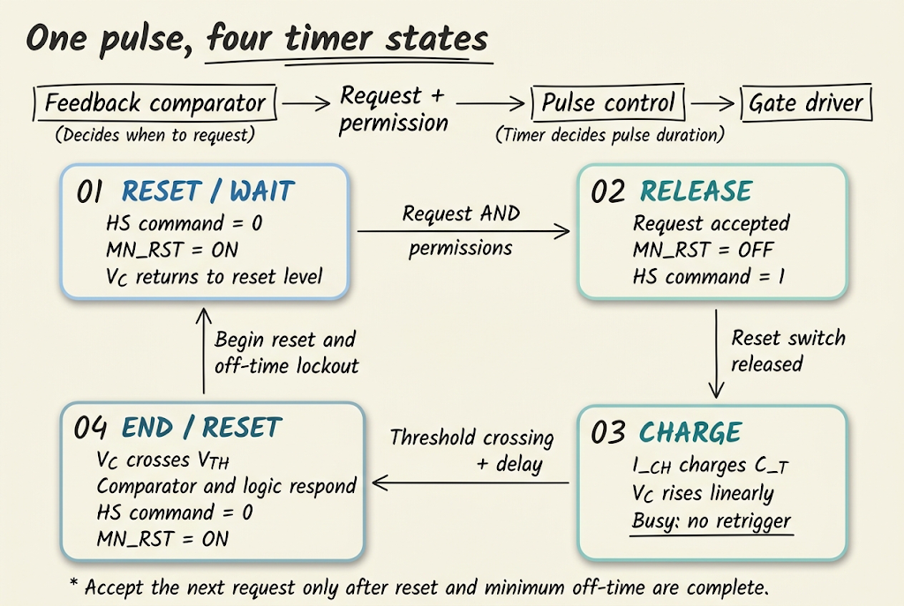
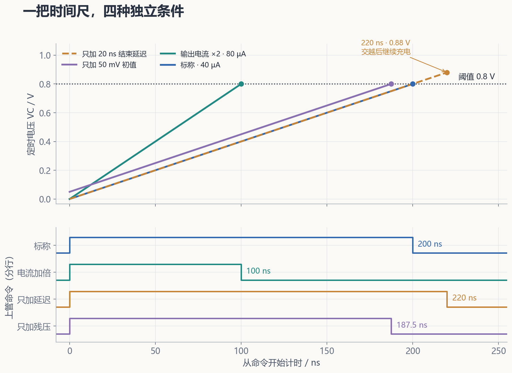
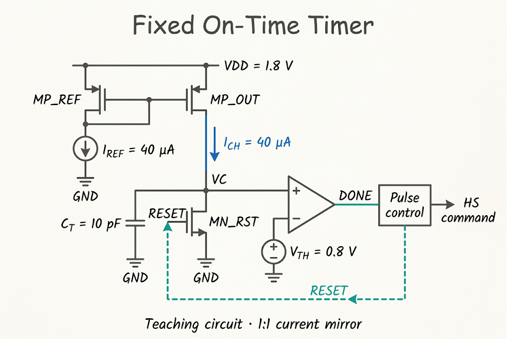
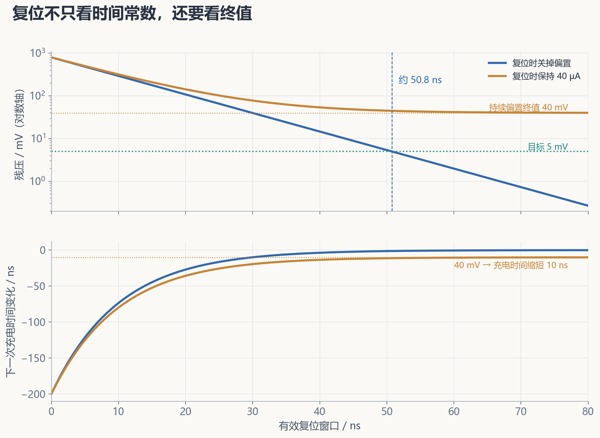
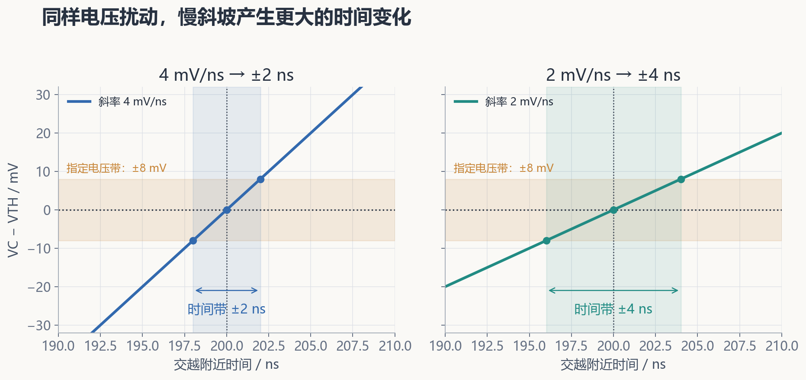

在前面的 [COT 周期与事件链](/zh/notes/buck-cot-cycle/)中，我们把控制器拆成三个问题：输出需要补能吗、现在允许开通吗、本次开通持续多久。[纹波反馈笔记](/zh/notes/buck-cot-ripple/)解释了第一个问题：比较器从反馈信号中提出开通请求。但请求被接受后，上管不能一直开着；控制器还需要一个可以反复使用的“时间尺”，在规定时刻结束这次正常导通。

本篇沿着这把时间尺往里看：**给电容送入电流，电压逐渐上升；达到阈值后，比较器通知逻辑结束脉冲；下一次开始前，再把电容复位。** 看起来只有几块电路，却把电流源、电容积分、比较器动态、开关复位和控制时序连到了一起。

[学习地图：COT](/zh/learn/#cot) · [全部笔记](/zh/notes/) · [Buck 功率级](/zh/notes/buck-day-01/) · [COT 事件链](/zh/notes/buck-cot-cycle/) · [纹波与注入](/zh/notes/buck-cot-ripple/)

| 要解决的问题 | 先建立的直觉 | 章节 |
| --- | --- | --- |
| 为什么电容能产生一个时间？ | 要补的电荷 ÷ 补入电荷的速度 | §1–3 |
| 恒流从哪里来？ | 电流镜复制参考电流，但需要电压余量 | §4 |
| 到达阈值，为什么上管还没关？ | 比较、逻辑、驱动都有传播过程 | §5–6 |
| 上一周期为什么会影响下一周期？ | 电容起点由复位决定，残压会缩短充电路程 | §7 |
| 固定时间为什么还会漂移和抖动？ | 电路量改变平均值，噪声改变逐次时刻 | §8–9 |
| 如何从 Fixed On-Time 走到 AOT？ | 让定时规律随工作点变化 | §10–12 |

本文先使用**自定义恒流定时模型**，再对照论文的接口。除专门讨论的误差外，假定电容线性、比较器连续检测、充电电流恒定；波形是指定条件下的解析示意，便于核对因果关系。正文中的 1.8 V 电流镜及 200 ns 算例均为教学参数。

## 1. Timer 在 Buck 控制链里负责什么

### 1.1 把开始和结束交给不同的模块

一次上管导通会使电感电流上升。在理想两状态 Buck 中，短时间内把输出电压 $V_o$ 近似为常数，有：

$$
\Delta i_L\approx\frac{V_{in}-V_o}{L}T_{on}.
\tag{1}
$$

这里 $V_{in}$ 是输入电压，$L$ 是电感，$T_{on}$ 是本次导通时长。式 (1) 告诉我们为什么需要定时：**脉冲越长，本次增流越多。** 结束时刻偏晚或偏早，会直接改变电感电流；后续反馈虽会再作调整，但定时误差已经进入功率级。

在本文的电压纹波型 COT 中，反馈比较器提出请求，许可逻辑检查最小关断时间、保护与互锁，随后启动脉冲。Timer 在忙碌期间计时，正常到期后结束脉冲。保护动作可以提前覆盖正常计时。

| 比较对象 | 典型后沿 PWM | 本文的纹波型 COT |
| --- | --- | --- |
| 正常脉冲从哪里开始 | 周期时钟安排开始 | 有效请求满足许可后开始 |
| 正常脉冲如何结束 | 调节信号与载波比较决定结束 | 导通 Timer 到期决定结束 |
| 主要调节方式 | 固定周期内改变脉宽 | 固定工作点的脉宽下改变下一次开始时刻 |

这一比较只针对所列模型。AOT 会进一步改变设定脉宽，仍保留“请求决定开始、定时决定正常结束”的事件分工。

### 1.2 一次脉冲需要完整的复位过程

如果只充电而不复位，第二次的电容电压已经很高，就无法重复测量同一段时间。因此，Timer 必须同时管理初值、充电与结束，通常用非重触发 one-shot（单稳态脉冲发生器）的方式组织。

| 状态与进入事件 | 复位管 MN_RST | 电容电压与支路电流 | 脉冲控制动作 |
| --- | --- | --- | --- |
| 复位／等待：上次脉冲结束 | 导通 | 电容先放电，随后接近复位终值；持续偏置电流可经复位管流向地 | 上管命令保持关断，完成复位并检查许可 |
| 释放：请求被接受 | 由导通变为关断 | 不再由复位管钳住；释放瞬间可能存在开关注入 | 启动本次命令和计时，具体边沿差在 §6 计入 |
| 充电：释放完成 | 关断 | 净电流进入电容，电压上升 | 保持正常导通；新请求不重启本次计时 |
| 结束：交越被判决并传播到逻辑 | 逻辑重新令其导通 | 斜坡可能先过冲，随后放电 | 结束正常脉冲，开始关断窗口与下一轮复位 |

复位尚在进行时，电容电流并非零；只有电压已接近稳定终值后，才有 $i_C\approx0$。最小关断时间限制上管何时能重开，复位保证 Timer 初值，两者可以并行完成，但不能互相替代。

## 2. 从电荷守恒建立时间尺

### 2.1 电容把电流积累成电压

把斜坡开始时刻定义为 $t=0$。令有效定时电容为 $C_T$，释放后的实际初值为 $V_0$，比较阈值为 $V_{TH}$，充电电流为 $I_{CH}$。对线性电容：

$$
\begin{aligned}
i_C&=C_T\frac{dv_C}{dt},\\
v_C(t)&=V_0+\frac{I_{CH}}{C_T}t.
\end{aligned}
\tag{2}
$$

需要补入的电荷是 $\Delta Q=C_T(V_{TH}-V_0)$。恒流源每秒送入 $I_{CH}$ 库仑，所以阈值到达时间为：

$$
\boxed{T_{charge}=\frac{C_T\Delta V}{I_{CH}},\qquad\Delta V=V_{TH}-V_0>0.}
\tag{3}
$$

量纲也很直观：$\mathrm{F\cdot V/A=C/A=s}$。电容大，同样电流下升压慢；阈值差大，要补的电荷多；电流大，充电更快。

这里 $C_T$ 应包括定时节点上会参与充放电的输入和布线寄生。$V_{TH}$ 是 Timer 的比较阈值，不能与 MOS 阈值电压 $V_{TP}$ 混为同一变量。

### 2.2 用 200 ns 算例给直觉一个尺度

取 $C_T=10\,\mathrm{pF}$、$V_0=0$、$V_{TH}=0.8\,\mathrm V$、$I_{CH}=40\,\mathrm{\mu A}$：

$$
\begin{aligned}
S_C=\frac{I_{CH}}{C_T}&=4\,\mathrm{V/\mu s}=4\,\mathrm{mV/ns},\\
\Delta Q&=8\,\mathrm{pC},\\
T_{charge}&=\frac{8\,\mathrm{pC}}{40\,\mathrm{\mu A}}=200\,\mathrm{ns}.
\end{aligned}
\tag{4}
$$

每走 1 ns，斜坡上升 4 mV。因此后面看到 50 mV 初值残差，可以立即估计为 12.5 ns 的时间变化；看到 8 mV 等效输入噪声，则对应约 2 ns 的交越扰动。

## 3. 为什么常用恒流斜坡，而不是直接用 RC

RC 同样可以定时，也可以通过比例阈值、修调等措施改善精度。恒流方法的吸引力在于：斜率和阈值差比较容易分别控制，时间关系便于分析和扩展。

假定电容从零开始，通过电阻 $R$ 接到固定电压 $V_S$，则：

$$
\begin{aligned}
v_C(t)&=V_S(1-e^{-t/RC_T}),\\
T_{RC}&=-RC_T\ln\left(1-\frac{V_{TH}}{V_S}\right).
\end{aligned}
\tag{5}
$$

达到 $0.5V_S$ 需 $0.693RC_T$，达到 $0.9V_S$ 需 $2.303RC_T$。越靠近供电，充电电流越小，曲线越平；同一电压扰动更容易移动交越时刻。其阈值灵敏度为：

$$\frac{\partial T_{RC}}{\partial V_{TH}}=\frac{RC_T}{V_S-V_{TH}}.\tag{6}$$

恒流方法保持近似固定斜率，便于直接用式 (3) 调整时间。但是电流源本身也会受工艺、供电和温度影响，并需要偏置功耗与工作余量；线性并不自动意味着高精度。

，τ=RCT；图用于展示斜率变化，不是两种电路的精度排名。")

## 4. 用 PMOS 电流镜实现充电支路

### 4.1 先把每个接口接清楚

定时电容接地时，PMOS 输出管从高电位向节点供流比较直观。下面给出自定义 1∶1 电流镜，供电为 1.8 V；它用于解释镜像关系，并不代表论文中 $I_1$ 黑盒的内部实现。

参考支路电流 $I_{REF}$ 流过二极管连接的 MP_REF，在共栅节点建立 $V_{SG}$；MP_OUT 得到相同的 $V_{SG}$。在匹配、饱和且忽略有限输出电阻的近似下：

$$
I_{CH}\approx mI_{REF},\qquad
m=\frac{(W/L)_{OUT}}{(W/L)_{REF}}.
\tag{7}
$$

若 **输出∶参考 = 2∶1**，$m=2$，40 µA 参考对应 80 µA 输出，式 (4) 的充电时间变为 100 ns。若 **参考∶输出 = 2∶1**，则 $m=1/2$，输出只有 20 µA，充电时间为 400 ns。镜像比例必须说明哪边是分子。

参考电流仍需真实的偏置电路来产生；只把两只 MOS 栅极接在一起，并不会凭空产生准确电流。

### 4.2 斜坡越高，PMOS 的供流余量越少

用长沟道强反型近似解释 PMOS 电流，取电流幅值为正：

$$
I_P\approx\frac12\mu_p C_{ox}\frac WL
(V_{SG}-|V_{TP}|)^2(1+\lambda_pV_{SD}).
\tag{8}
$$

$\mu_p$ 是空穴迁移率，$C_{ox}$ 是单位面积栅氧电容，$\lambda_p$ 表示沟道长度调制。它是理解趋势的模型，实际尺寸设计应使用相应工艺模型。

充电过程中 $v_C$ 上升，输出管的 $V_{SD}=V_{DD}-v_C$ 下降。简单 PMOS 源在整个有效斜坡内应保持：

$$
V_{DD,min}-v_{C,max}>V_{SD,sat}+V_{margin}.
\tag{9}
$$

按长沟道近似，$V_{SD,sat}\approx V_{SG}-|V_{TP}|$。这里的 $v_{C,max}$ 还要考虑交越后、复位前的过冲。标称 1.8 V 供电与 0.8 V 阈值之间有 1.0 V，但是否充足仍取决于过驱动、供电下限和电路堆叠。

即使未离开饱和区，有限输出电阻也会让电流随节点电压变化。若进入线性区，供流能力通常进一步下降，斜坡上端弯曲，式 (3) 的恒流假设失效。

### 4.3 非恒流时，回到积分式

若泄漏、修正电流或电流源输出特性不可忽略，取净充电电流为 $I_{net}(v)$，线性电容有：

$$
T_{charge}=\int_{V_0}^{V_{trip}}\frac{C_T}{I_{net}(v)}\,dv.
\tag{10}
$$

这要求区间内净电流为正，且电流可按电压表示。更一般的时变电流应直接解 $C_Tdv_C/dt=I_{net}(v_C,t)$。如果净电流逼近零，交越会很慢；如果无法越过阈值，Timer 就不会正常到期，必须由超时或保护路径处理。

改善电流源可以增加沟道长度、采用共源共栅或受控电流源，但会付出面积、电压余量、功耗或建立时间的代价。目标是把电流误差控制在预算内，而不是只追求更多晶体管。

## 5. 比较器：从电压交越到脉冲结束

### 5.1 交越是输入事件，DONE 是输出事件

本文定义比较器正端为 $v_C$，负端为 $V_{TH}$，因而 $v_C$ 上升过阈值后，DONE 变为有效高电平。真实过程要经过输入级响应、内部节点变化、输出缓冲和脉冲逻辑，才会让上管命令结束。

若斜坡与上管命令在同一时刻开始，结束路径总延迟记为 $t_{end}$，则命令脉宽为：

$$T_{cmd}=T_{charge}+t_{end}.\tag{11}$$

标称充电时间 200 ns、比较器及逻辑总延迟 20 ns，就得到 220 ns。若电流一直保持到命令结束，节点在交越后还会多升高：

$$\Delta v_{over}\approx S_Ct_{end}=80\,\mathrm{mV}.\tag{12}$$

这一过冲既影响电流源余量，也影响随后需要清除的电荷量。图 2 的延迟案例因此画到 0.88 V，再终止充电。

### 5.2 慢斜坡和阶跃输入的延迟不能直接互换

数据手册常在指定输入过驱动、共模、输出负载和供电下测量传播延迟。Timer 的输入却是连续斜坡：刚交越时差分电压接近零，随后逐渐增加。因此不能不加核对地把阶跃测试的某个典型延迟当作斜坡下的保证值。

[Analog Devices 的比较器延迟说明](https://www.analog.com/en/resources/technical-articles/parameters-that-affect-comparator-propagation-delay-measurements.html)讨论了过驱动、共模电压、供电、负载、边沿和温度的影响。对 Timer，应特别检查实际斜率、共模范围、输入恢复及延迟随条件变化的范围。

连续比较器与时钟采样的动态比较器也不同。动态比较器只能在评估窗口判决，可能引入采样等待、量化和再生失败；本文的连续交越模型不能直接套用到这种时序。

### 5.3 固定延迟可以补偿，变化的延迟需要留预算

如果目标命令脉宽为 200 ns，且已知标称结束延迟为 20 ns，可以把充电目标设为 180 ns。保持 $C_T=10$ pF、$\Delta V=0.8$ V 时：

$$I_{CH}=\frac{8\,\mathrm{pC}}{180\,\mathrm{ns}}\approx44.44\,\mathrm{\mu A}.\tag{13}$$

这样补偿的是**标称值**。工艺温度改变的延迟、噪声导致的随机延迟，以及驱动边沿差，仍会留下误差。短脉宽中，固定的几十纳秒往往比长脉宽中更显著。

## 6. 先定义量测边沿，再谈真实导通时间

上管命令脉宽、栅极电压脉宽和功率管有效导通时长是三个相关但不完全相同的量。为了不把延迟重复相加，先固定参考：

- $t=0$：脉冲控制的上管命令上升沿。
- $t_s$：从该命令到电容有效斜坡开始的延迟，允许带符号。
- $t_{end}$：从有效阈值交越到命令下降沿的比较器及逻辑延迟。
- $t_{g,on}$、$t_{g,off}$：从命令边沿到所定义功率管有效导通／关断边沿的延迟。

于是：

$$
\begin{aligned}
T_{cmd}&=t_s+T_{charge}+t_{end},\\
T_{on,power}&=T_{cmd}+t_{g,off}-t_{g,on}.
\end{aligned}
\tag{14}
$$

例如 $t_s=0$、$T_{charge}=200$ ns、$t_{end}=20$ ns、$t_{g,on}=8$ ns、$t_{g,off}=12$ ns，命令从 0 到 220 ns，功率管按定义从 8 到 232 ns，有效时长是 **224 ns**。

若 Timer 由实际开通检测启动，应重新定义 $t_s$，不能把式 (11) 的简化起点和式 (14) 混用。后面的定时表使用命令与斜坡同步、驱动边沿差为零的条件。

## 7. 复位管：给下一次计时一个可重复起点

### 7.1 为什么一个 RC 时间常数还不算完成复位

MN_RST 导通后，用有效导通电阻 $R_{RST}$ 近似其放电能力。若复位期间关掉充电源，且从 $V_{pk}$ 放电，便有：

$$
v_C(t)=V_{pk}e^{-t/\tau_R},\qquad\tau_R=R_{RST}C_T.
\tag{15}
$$

经过一个 $\tau_R$ 仍残留约 36.8%。希望残压不超过 $V_{allow}$，所需窗口为：

$$t_{reset}\ge\tau_R\ln\frac{V_{pk}}{V_{allow}}.\tag{16}$$

取 $R_{RST}=1\,\mathrm{k\Omega}$、$C_T=10$ pF，$\tau_R=10$ ns。由 0.8 V 降到 5 mV 至少需约 **50.8 ns**。这里 5 mV 对应 $5/4=1.25$ ns 的初值时间预算。

### 7.2 如果充电电流在复位时仍然存在

图 4 的简化电流镜持续供流。复位管必须一边清除电容电荷，一边把供流旁路到地。若 $I_{CH}$ 和 $R_{RST}$ 可近似为常数：

$$
\begin{aligned}
V_{eq}&=I_{CH}R_{RST},\\
v_C(t)&=V_{eq}+(V_{pk}-V_{eq})e^{-t/\tau_R}.
\end{aligned}
\tag{17}
$$

40 µA 与 1 kΩ 给出 $V_{eq}=40$ mV。复位足够久仍会留下这个终值，下一轮充电比从零开始缩短约 10 ns。若要求低于 5 mV，必须减小电阻、关闭／旁路偏置，或采用其他复位结构；只加长复位窗口没有用。

初始复位中的 $i_C=C_Tdv_C/dt$ 为负，接近稳定终值后才趋近零。实际 MOS 导通电阻会随电压变化，式 (15)–(17) 用于初步预算，最终应按真实电路核对。

### 7.3 残压、注入与泄漏分别怎样影响下一次

真正参与式 (3) 的是**复位释放之后**的 $V_0$。它包括有限窗口留下的电压，以及关断瞬间电荷注入、时钟馈通造成的跃变。若其增量为 $\delta V_0$：

$$\delta T_{charge}=-\frac{C_T}{I_{CH}}\delta V_0.\tag{18}$$

教学例中，50 mV 正残压使充电时间缩短 12.5 ns，得到 187.5 ns。若释放注入为 $\Delta Q_{inj}$，电压阶跃近似 $\Delta Q_{inj}/C_T$，时间变化近似 $-\Delta Q_{inj}/I_{CH}$；其符号取决于实际注入方向。

把复位 MOS 加宽可降低电阻、加快清零，却也增加控制负载和节点寄生，并可能增大注入。选择尺寸时，应同时看复位窗口、初值容差、斜坡电容和释放时序。复位释放与开始充电的重叠也会把部分电流分流，使起始斜坡偏离预期。

如果关断等待阶段让节点浮空，泄漏会逐渐改变初值；若一直保持复位，则主要检查复位终值和释放扰动。轻载等待时间变长时，这两种结构会表现不同。残压首先造成脉宽偏移；是否发展为误触发，还取决于比较器屏蔽、状态机和许可逻辑。

## 8. 把静态误差、PVT 与随机抖动分开

### 8.1 先看定时公式的灵敏度

将有效阈值写为 $V_{trip}=V_{TH}+V_{OS,eff}$。这里 $V_{OS,eff}>0$ 定义为“必须升到更高电压才结束”，避免依赖具体比较器失调符号约定。令 $\Delta V=V_{trip}-V_0$，小变化的一阶近似为：

$$
\frac{\delta T_{charge}}{T_{charge}}
\approx\frac{\delta C_T}{C_T}
+\frac{\delta V_{trip}-\delta V_0}{\Delta V}
-\frac{\delta I_{CH}}{I_{CH}}.
\tag{19}
$$

电容偏大、阈值偏高会延长计时；初值偏高、电流偏大会缩短计时。在 200 ns 例子中，分别单独变化：

| 变化条件 | 一阶时间变化 | 物理原因 |
| --- | --- | --- |
| 电容增大 5% | +10 ns | 同一电压路程需要更多电荷 |
| 电流增大 5% | 约 −10 ns；精确值约 −9.52 ns | 充电速度增加 |
| 有效阈值增加 8 mV | +2 ns | 多走 8 mV |
| 初值增加 50 mV | −12.5 ns | 少走 50 mV |
| 结束路径增加 20 ns | 命令脉宽 +20 ns | 交越之后继续等待 |

平均偏差可以表现为确定的脉宽偏移，供电温度变化可造成慢漂移，同一条件下器件不匹配会造成样品间差异。**这些都不应直接叫作逐周期随机抖动。**

### 8.2 温度升高，电流不一定只往一个方向变

温度会改变迁移率、MOS 阈值和参考偏置。只看迁移率下降，会预测电流减小；但阈值绝对值下降可能增大过驱动，偏置电路也可能具有 PTAT（与绝对温度成正比）、CTAT（随温度升高而减小）或补偿特性。因此必须沿完整偏置链检查 $I_{CH}(T)$，不能统一断言“温度高必然使 Timer 变长”。

供电变化也不只通过一个 $V_{SG}$ 起作用：参考源、电流镜有限输出电阻、饱和余量、阈值参考和比较器延迟都可能变化。参考电流稳定的镜像结构中，两管源栅电位可一起移动，$V_{SG}$ 不一定按供电变化同幅改变。

PVT（工艺、供电、温度）检查应覆盖 $C_T$、$\Delta V$、净电流、复位和延迟的组合，并区分全局工艺角与局部匹配误差。先找出最大的误差项，再决定参考补偿、比例跟踪、修调或校准是否值得。

### 8.3 误差预算不能把所有符号默认抵消

若给定 $C_T$ 的 ±5%、$\Delta V$ 的 ±2%、$I_{CH}$ 的 ±5% 是独立可取的硬范围，不含延迟，名义 200 ns 的极值约为：

$$
\begin{aligned}
T_{max}&=200\frac{1.05\times1.02}{0.95}\approx225.5\,\mathrm{ns},\\
T_{min}&=200\frac{0.95\times0.98}{1.05}\approx177.3\,\mathrm{ns}.
\end{aligned}
\tag{20}
$$

这是人为指定范围的包络，不是芯片 PVT 结果。若这些量由同一参考产生、存在关联，应使用真实相关关系；若范围来自统计标准差，则不能直接把它当作硬容差。均方根合成只适合已明确为独立、零均值的随机项，不能代替最坏情况检查。

## 9. 比较器噪声如何变成时间抖动

### 9.1 局部斜率把电压扰动换成时刻扰动

把理想差分输入写为 $u(t)=v_C(t)-V_{TH}$，并定义叠加到正端的等效噪声为 $n$。在理想交越时刻 $t_*$ 附近，若噪声小、交越唯一且局部斜率 $S_C$ 近似固定：

$$
S_C\delta t+n(t_*)\approx0,\qquad
\delta t\approx-\frac{n(t_*)}{S_C}.
\tag{21}
$$

正端噪声为正时通常提前交越。对于等效输入噪声标准差 $\sigma_{v,eq}$，时间标准差近似：

$$
\boxed{\sigma_{t,cross}\approx\frac{\sigma_{v,eq}}{|S_C|}
=\frac{C_T\sigma_{v,eq}}{I_{CH}}.}
\tag{22}
$$

40 µA／10 pF 的斜率为 4 mV/ns；若指定等效噪声为 8 mV RMS，则交越抖动约 2 ns RMS。同样 8 mV、斜率只有 2 mV/ns 时，约为 4 ns。图 6 用固定噪声带展示这一几何关系。

这与 [COT 纹波笔记中的局部触发抖动](/zh/notes/buck-cot-ripple/)使用相同的斜率思想，但发生位置不同：反馈噪声主要移动脉冲开始请求，Timer 噪声主要移动结束事件。功率级脉宽还受开始和结束误差的相关性影响。

### 9.2 提高斜率之后，还要维持所需时间

直接增加电流会加快交越，同时缩短 $T_{charge}$。若把电流与电容一起放大相同比例，时间不变，但 $I_{CH}/C_T$ 也不变，所以**对同一等效电压噪声，交越抖动不会仅因这种同比放大而下降**。

若希望在相同计时长度下增大斜率，需要同时增大电压路程，或降低等效噪声；增大电压路程又受到比较器共模与电流源余量限制。加大电容可能减小某些采样噪声或注入电压，但会改变面积、复位时间和偏置要求，需按噪声来源分别分析。

式 (22) 描述交越的一阶误差，没有完整包含比较器随机延迟、电流噪声积分、参考噪声、复位初值噪声或开关耦合。可锁定第一次有效 DONE、在复位阶段屏蔽 DONE，并检查忙碌期间禁止重触发，避免阈值附近抖动多次影响控制。迟滞可以减少往返翻转，但上升阈值的变化必须计入 $V_{trip}$。

## 10. 用一致的算例区分几种误差

### 10.1 四个条件分别计算

恢复 §2 的教学参数：$C_T=10$ pF、$V_{TH}=0.8$ V、$I_{REF}=40$ µA。每行独立改变指定条件，取 $t_s=0$ 和驱动边沿差为零：

| 条件 | 充电电流 | 初值 | 阈值到达时间 | 结束延迟 | 命令脉宽 |
| --- | --- | --- | --- | --- | --- |
| 标称 1∶1 镜像 | 40 µA | 0 V | 200 ns | 0 ns | 200 ns |
| 输出∶参考 = 2∶1 | 80 µA | 0 V | 100 ns | 0 ns | 100 ns |
| 只加入 20 ns 延迟 | 40 µA | 0 V | 200 ns | 20 ns | 220 ns |
| 只加入 50 mV 残压 | 40 µA | 0.05 V | 187.5 ns | 0 ns | 187.5 ns |

这些数字分别揭示电流、延迟、初值的作用。若最后再叠加 50 mV 残压与 20 ns 延迟，简化结果是 207.5 ns。它接近 200 ns，只表示两项在这个条件下部分抵消，不代表各项误差已经得到控制。

### 10.2 电流降低 20%，时间为什么增加 25%

另取 $C_T=12$ pF、$V_0=0.1$ V、$V_{TH}=0.7$ V、$I_{CH}=30$ µA，结束路径延迟 15 ns：

$$
\begin{aligned}
T_{charge}&=\frac{12\,\mathrm{pF}\times0.6\,\mathrm V}{30\,\mathrm{\mu A}}
=240\,\mathrm{ns},\\
T_{cmd}&=240+15=255\,\mathrm{ns}.
\end{aligned}
\tag{23}
$$

电流仅降低 20% 到 24 µA，其余不变：

$$
T_{charge,new}=240\frac{30}{24}=300\,\mathrm{ns},\qquad
T_{cmd,new}=315\,\mathrm{ns}.
\tag{24}
$$

充电时间是电流的倒数，$1/0.8=1.25$，因此增加 25%；包含固定延迟的总脉宽增加约 23.5%。这也说明式 (19) 的一阶灵敏度只适合小变化，20% 的变化宜用原公式精确计算。

## 11. 从 Fixed On-Time 走向 Adaptive On-Time

### 11.1 固定时间会留下输入电压引起的频率变化

理想 CCM 稳态中，忽略损耗、死区和定时误差，Buck 的伏秒平衡给出 $D=V_o/V_{in}$。又因为 $D=T_{on}f_s$，得到：

$$f_s\approx\frac{V_o}{V_{in}T_{on}}.\tag{25}$$

固定 $T_{on}=200$ ns、$V_o=1.2$ V 时，$V_{in}=6$ V 对应约 1 MHz，12 V 对应约 500 kHz。若希望这两个输入下频率都接近 $f_0=1$ MHz，需要分别设置 200 ns 与 100 ns：

$$\boxed{T_{on,target}\approx\frac{V_o}{V_{in}f_0}.}\tag{26}$$

这就是输入输出电压前馈 AOT 的一个设计目标：工作点变化时更新时间尺，使频率接近目标。它不等于由固定时钟强制每个周期，也不能单凭这个理想关系保证轻载、限流或瞬态下严格恒频。

### 11.2 电流、阈值和电容都是可用的定时变量

把式 (3) 与式 (26)连接，关键是让 $C_T\Delta V/I_{CH}$ 具有所需比例。可选教学实现包括：

| 实现方向 | 定时量如何变化 | 要付出的代价或检查项 |
| --- | --- | --- |
| 固定电容，$I_{CH}=k_I V_{in}$，$\Delta V=k_V V_o$ | $T_{charge}=(C_Tk_V/k_I)(V_o/V_{in})$ | 电压转电流误差、阈值跟踪、余量与纹波耦合 |
| 固定电容与阈值差，$I_{CH}\propto V_{in}/V_o$ | 通过电流得到输入输出比例 | 比例生成与动态范围、低输出电压边界 |
| 开关电容阵列或数字选择定时量 | 分档调整脉宽，亦可用于修调 | 量化步长、切换扰动、寄生和更新时间 |

$k_I$ 的单位为 A/V，$k_V$ 无量纲。第一行若满足 $C_Tk_V/k_I=1/f_0$，便得到理想电压前馈目标。只令 $I_{CH}\propto V_{in}$ 且阈值固定，足以在**固定输出目标**时补偿输入变化；可调输出则还要纳入 $V_o$ 信息。

前馈信号应代表希望跟踪的工作点。让阈值或电流在一个短脉冲内大幅变化，会使斜坡交越转为动态问题，需要考虑采样保持、滤波与更新时刻；滤波又可能延缓输入阶跃响应。

[TPS51125 数据手册 §7.3.2](https://www.ti.com/lit/ds/symlink/tps51125.pdf)给出了输入输出电压参与 one-shot 的 AOT 例子。这里的比例电路是教学推导，不是在还原该器件内部实现。

这条电压前馈关系的完整推导、两种定时方法与六行频率算例，继续见 [AOT Buck 入门：从固定导通时间到近似恒定开关频率](/zh/notes/buck-aot-frequency/)。

### 11.3 短脉冲中，固定延迟会削弱自适应效果

若前馈只调整充电时间，而命令始终增加固定延迟 $t_d$，近似有：

$$
\begin{aligned}
T_{cmd}&=\frac{V_o}{V_{in}f_0}+t_d,\\
f_s&\approx\frac{f_0}{1+t_dV_{in}f_0/V_o}.
\end{aligned}
\tag{27}
$$

这取命令与有效导通时间相同。沿用 1.2 V、1 MHz 目标，若额外延迟恒为 20 ns，6 V 时约为 0.909 MHz，12 V 时约为 0.833 MHz。输入越高，理想脉宽越短，同样 20 ns 的占比越大。

因此前馈比例、延迟补偿和可实现的最短脉宽要一起检查。如果目标脉宽已小于释放、判决和驱动所需时间，仅修改充电电流就不能实现目标。

## 12. 对照论文 Fig. 8(a)：相同定时核心，不同自适应目的

[Liu 与 Kuo 的论文 §3.3、Fig. 8(a)](https://www.mdpi.com/1996-1073/14/13/3809)适合拿来辨认 Timer 接口：$I_1$ 给 $C_1$ 充电，MN1 负责复位，比较器检测 $V_{con}$ 与参考，Rst 通知脉冲结束。

| 论文中的量 | 可确认的接口或动作 | 与教学模型的对应 |
| --- | --- | --- |
| $I_1$ | 向定时电容供流 | $I_{CH}$ 的供流部分 |
| $C_1$、$V_{con}$ | 储存电荷，产生定时电压 | $C_T$、$v_C$ |
| MN1、$Q_B$ | $Q_B$ 变低时 MN1 关闭，开始充电；结束后 MN1 导通复位 | 高有效复位控制 |
| 比较器、Rst | $V_{con}$ 达参考后 Rst 变高，结束上管脉冲并复位 | DONE 与后续逻辑 |
| $I_2$ | 自适应下拉支路；禁用 AOT 时为零 | 从净充电电流中扣除的修正量 |

这张表只说明论文的功能接口，不把图 4 的教学电流镜套进论文的 $I_1$ 内部。论文中 $I_2$ 的用途是减小**随负载变化的 CCM 频率漂移**，与 §11 的输入输出电压前馈目标应分开理解。

在暂把 $I_1$ 与 $I_2$ 看作常数的局部近似中：

$$
I_{net}=I_1-I_2>0,\qquad
T_{charge}\approx\frac{C_1\Delta V}{I_1-I_2}.
\tag{28}
$$

负载修正下拉电流增加时，净充电电流减小，导通时间变长。若只有这一项变化：

$$
\frac{\partial T_{charge}}{\partial I_2}
=\frac{C_1\Delta V}{(I_1-I_2)^2}>0.
\tag{29}
$$

当 $I_2$ 接近 $I_1$，定时对修正量变得很敏感，可能无法及时到期。实际 $I_2$ 可在脉冲内变化，应回到电荷积分，而不是总把式 (28) 当作精确式。有关论文接口和作用的说明以 §3.3 为准。

理想无损 Buck 在固定输入、输出和导通时间下，CCM 频率由式 (25)约束，负载本身不要求频率无限增大。论文讨论的负载相关漂移属于其实际控制与功率级条件；不能把某个实际架构中的趋势推广成所有 COT 的理想定律。

## 13. 将设计目标转换为可检查的指标

Timer 的目标不是“电容能充上去”，而是每个允许的工作点都能产生所需脉宽，并给下一次留下明确初值。

| 指标 | 先用什么建立预算 | 随后检查什么 |
| --- | --- | --- |
| 标称时间与范围 | $C_T\Delta V/I_{net}$ | 最短、最长工作点及电流始终为正 |
| 准确度与 PVT | 式 (19) 的灵敏度 | 参考、电容、电流、余量、延迟的联合极值 |
| 随机抖动 | $\sigma_{v,eq}/S_C$ | 噪声带宽、参考与初值噪声、延迟随机性、边沿相关性 |
| 复位与恢复 | $R_{RST}C_T$ 与允许残压 | 偏置是否关断、有效窗口、释放注入、DONE 清除 |
| 功耗 | 参考支路、供流与比较器偏置 | 复位等待时电流是否仍流动、轻载待机电流 |
| 面积 | 电容及匹配器件需求 | 寄生参与计时、布局耦合、复位管控制负载 |
| 时序可靠性 | 复位、释放、充电、结束的事件表 | 忙碌时不重触发、保护覆盖、最小关断与驱动互锁 |

实际验证时，应先统一命令、栅极和功率节点的量测边沿，然后记录初值、交越、DONE、命令结束、有效关断及复位完成。这样一次异常脉宽才能被定位为斜坡误差、判决延迟或驱动误差，而不是只看到一个 $T_{on}$ 数字。

在电源转换比、电流和温度范围确定后，先检查标称充电和复位是否成立，再覆盖最短脉冲、最大重复频率、长时间轻载等待以及 AOT 修正边界。本文给出的数字是解析教学结果；它们建立设计与验证的出发点，不作为具体工艺电路的性能数据。

回到整条知识链：[功率级](/zh/notes/buck-day-01/)解释一次脉冲怎样改变电感电流，[纹波反馈](/zh/notes/buck-cot-ripple/)解释何时提出下一次请求，[COT 事件链](/zh/notes/buck-cot-cycle/)解释许可与执行。本篇补上**用什么物理过程结束这次脉冲，以及这段时间为何会偏离设定值**。继续阅读 AOT 电路时，就可以沿着电容、电压路程、净电流和传播过程，逐项判断自适应到底改变了什么。

## 参考资料

1. Pang-Jung Liu and Mao-Hui Kuo, [Adaptive On-Time Buck Converter with Wave Tracking Reference Control for Output Regulation Accuracy](https://www.mdpi.com/1996-1073/14/13/3809), *Energies*, 14(13), 3809, 2021, DOI: 10.3390/en14133809。重点定位 §3.3、Fig. 8(a) 的定时核心与 $I_2$ 负载修正。
2. Analog Devices, [Parameters that Affect Comparator Propagation Delay Measurements](https://www.analog.com/en/resources/technical-articles/parameters-that-affect-comparator-propagation-delay-measurements.html)。用于理解过驱动、共模、负载和条件变化对比较器延迟的影响。
3. Texas Instruments, [TPS51125 Datasheet, Rev. H](https://www.ti.com/lit/ds/symlink/tps51125.pdf), §7.3.1–7.3.2。作为 one-shot 控制与输入输出电压前馈 AOT 的器件实例。
