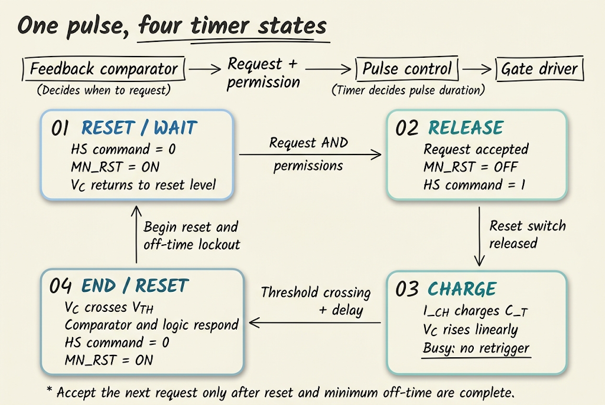
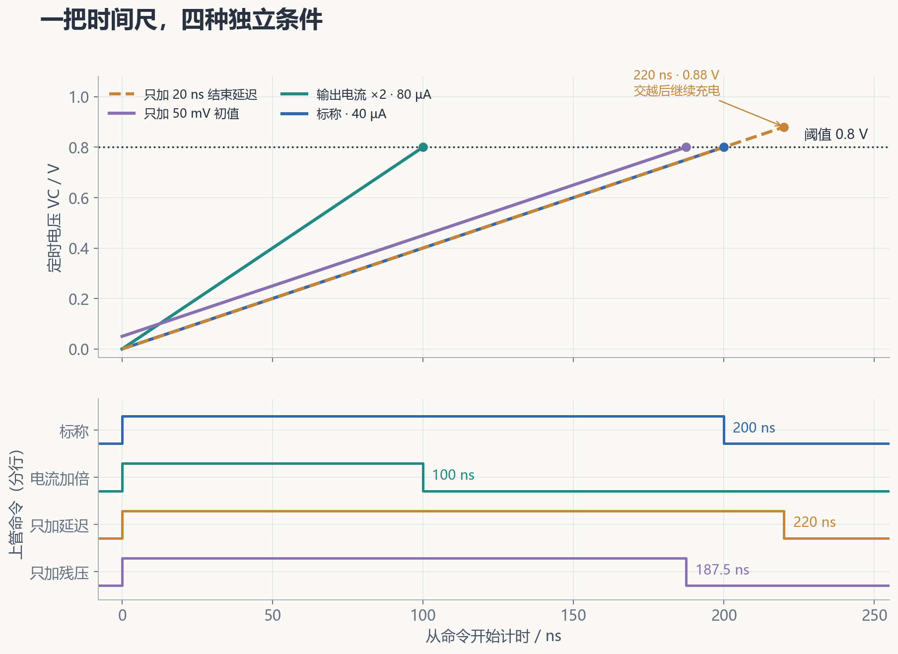
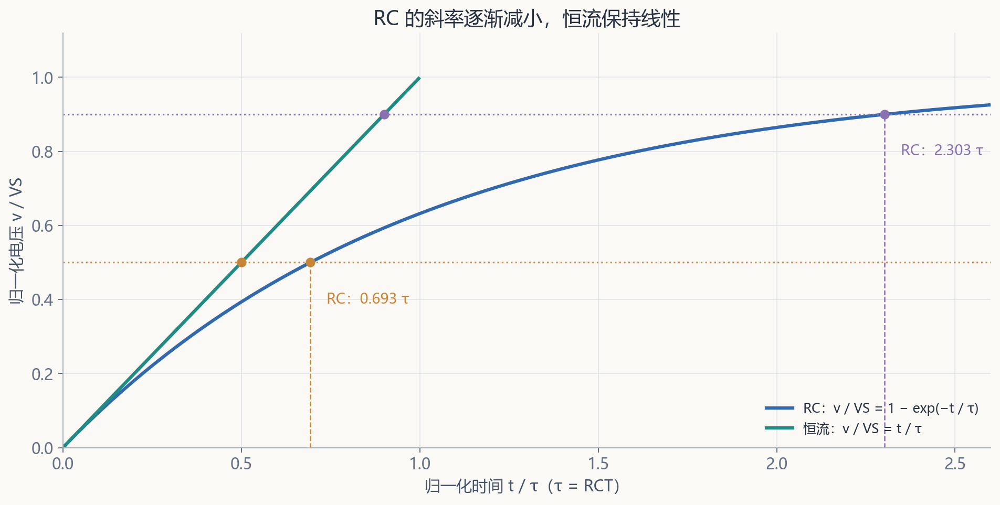
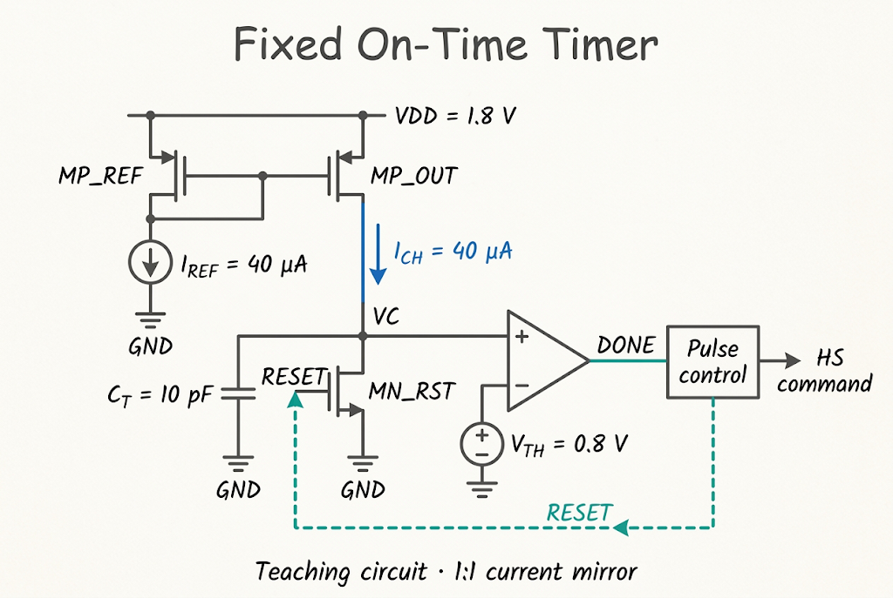
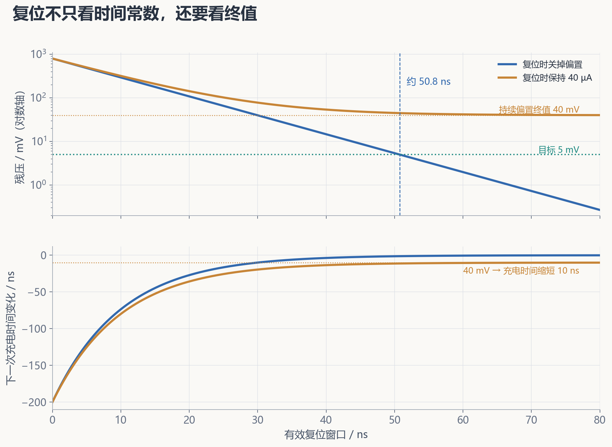
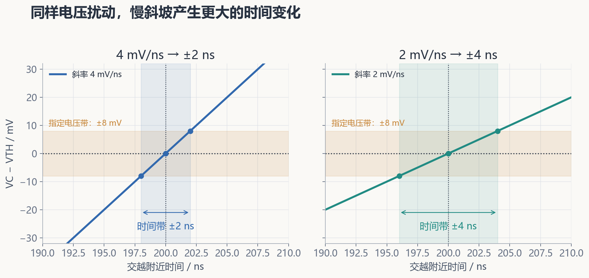

在 [COT 完整控制周期](/zh/notes/buck-cot-cycle/)里，一旦许可逻辑批准开通上管，就必须由一颗 **One-shot（单稳态）导通定时器** 掐表数出精准的 $T_{on}$ 后果断关断。

芯片内部怎么做一把纳秒级的时间尺？答案就四句话：**用恒流源往电容里灌电荷 $\to$ 电容电压线性往上爬 $\to$ 爬到阈值让比较器翻转关上管 $\to$ 关断期把电容放空回零等下次。**

> **全篇核心公式**
> $$T_{charge} = \frac{C_T (V_{TH} - V_0)}{I_{CH}}.$$
> 一切定时器设计、PVT 漂移、复位残压、抖动以及 AOT 自适应改造，全都在围绕这四个变量（$C_T$、$V_{TH}$、$V_0$、$I_{CH}$）和比较器延迟做文章。

前置知识：[Buck 功率级](/zh/notes/buck-day-01/) · [COT 完整周期](/zh/notes/buck-cot-cycle/) · [下一篇：AOT 近似恒频](/zh/notes/buck-aot-frequency/)

---

## 1. 为什么必须做成“非重触发 + 完整复位”？

| 阶段 | 复位管 `MN_RST` | 定时电容 $v_C$ | 控制器动作 |
| --- | --- | --- | --- |
| **1. 复位/等待** | 导通 | 放电回初值 $V_0$ | 上管关断，检查最小关断时间与许可 |
| **2. 释放启动** | 关断 | 解除钳位，准备积分 | 启动本次上管导通脉冲 |
| **3. 恒流充电** | 关断 | 以斜率 $I_{CH}/C_T$ 线性上升 | 维持上管导通（忽略新的请求） |
| **4. 交越关断** | 延迟后导通 | 越过 $V_{TH}$ 后触发 `DONE` | 结束脉冲，进入关断窗口与下轮复位 |

---

## 2. 恒流斜坡时间尺与 200 ns 标称算例

把斜坡起算点设为 $t=0$、电容初值 $V_0$、比较阈值 $V_{TH}$，由于 $i_C=C_T\,dv_C/dt$，到达阈值所需时间为：

$$\boxed{T_{charge}=\frac{C_T(V_{TH}-V_0)}{I_{CH}},\qquad S_C=\frac{I_{CH}}{C_T}.}$$

取一组常见片内量级：$C_T=10\text{ pF}$、$V_0=0$、$V_{TH}=0.8\text{ V}$、$I_{CH}=40\,\mu\text{A}$，立即得出：
- **斜坡爬升速率**：$S_C = \dfrac{40\,\mu\text{A}}{10\text{ pF}} = \mathbf{4\text{ mV/ns}}$；
- **标称充电时间**：$T_{charge} = \dfrac{8\text{ pC}}{40\,\mu\text{A}} = \mathbf{200\text{ ns}}$。

有这把 `4 mV/ns` 的尺子在手，后面所有误差一眼就能口算：比如 $50\text{ mV}$ 的复位残压等于少了 $12.5\text{ ns}$；$8\text{ mV}$ 的比较器输入噪声等于 $\pm 2\text{ ns}$ 的时间抖动。

---

## 3. 为什么用“恒流源充电”，而不用简单的 RC 充电？

如果只用电阻 $R$ 接电源 $V_S$ 给电容充电，电压按 $V_S(1-e^{-t/RC_T})$ 爬升，交越阈值的灵敏度会随目标升高急剧恶化：

$$\frac{\partial T_{RC}}{\partial V_{TH}} = \frac{RC_T}{V_S - V_{TH}}.$$

换成恒流源充电后，整个爬坡过程斜率恒定为 $I_{CH}/C_T$：
1. 抗噪和线性度远好于接近供电轨时的 RC 曲线；
2. 电流与阈值可以各自独立调控——这正是后面把 $I_{CH}\propto V_{in}$、$V_{TH}\propto V_o$ 改造成 AOT 的结构基础。

---

## 4. 用 PMOS 电流镜搭出充电电路：最容易忽视余量

设输出管与参考管的宽长比为 $m=(W/L)_{OUT}/(W/L)_{REF}$，则 $I_{CH}\approx m I_{REF}$。

**最关键的设计陷阱在于 PMOS 的饱和区余量**：随着电容电压 $v_C$ 一路升高，输出管的漏源压降 $V_{SD}=V_{DD}-v_C$ 会越来越小。为保证充电电流全程不掉队，最高斜坡电压（要算上比较器延迟期间的过冲！）必须留足饱和余量：

$$V_{DD,\min} - v_{C,\max} > V_{SD,sat} + V_{margin}.$$

一旦 $V_{DD}$ 偏低或阈值设得太高，斜坡顶端就会因为输出 PMOS 掉进线性区而开始往下弯曲。如果电路追求极高精度，应把单管电流镜升级为 Cascode（共源共栅）结构。

---

## 5. 比较器延迟与真实功率管边沿

电压刚刚摸到 $V_{TH}$ 不代表上管立刻关断——信号还要穿过**比较器响应时间 + 数字逻辑延迟 + 驱动级边沿**。定义：
- $t_s$：发出开通命令到定时电容真正开始充电的延迟；
- $t_{end}$：电容交越 $V_{TH}$ 到命令拉低的延迟；
- $t_{g,on}, t_{g,off}$：命令边沿到功率管真正导通/关断的驱动延迟。

则逻辑命令脉宽与功率管真正导通时长为：

$$T_{cmd}=t_s+T_{charge}+t_{end},\qquad T_{on,power}=T_{cmd}+t_{g,off}-t_{g,on}.$$

比如 $T_{charge}=200\text{ ns}$、比较器延迟 $t_{end}=20\text{ ns}$，电容在交越后还会继续多充 $4\text{ mV/ns}\times 20\text{ ns}=80\text{ mV}$（达到 $0.88\text{ V}$）。如果需要固定 $T_{cmd}=200\text{ ns}$，可以通过把充电电流从 $40\,\mu\text{A}$ 微调高到 $44.44\,\mu\text{A}$（提前到 $180\text{ ns}$ 交越）来预先抵消标称 $20\text{ ns}$ 延迟。

> **小心数据手册的延迟坑**：比较器手册标的往往是大过驱动阶跃输入（如 $100\text{ mV}$ 阶跃）的延迟；而 Timer 遇到的是缓慢爬升的斜坡（刚过阈值时过驱动几乎为零），实际延迟会比标称值长不少。

---

## 6. 复位残压：如果充电源没关掉会发生什么？

复位管 `MN_RST` 导通等效为电阻 $R_{RST}$，时间常数 $\tau_R=R_{RST}C_T$：
1. **如果复位期间切断了充电电流**：电容按 $V_{pk}e^{-t/\tau_R}$ 放电，放完 $1\,\tau_R$ 还剩 $36.8\%$，放到 $5\text{ mV}$ 以下至少需要约 $5\,\tau_R$（本例约 $50.8\text{ ns}$）；
2. **如果电流镜一直在灌流（如图 4 简版）**：复位管必须边放电容边把 $40\,\mu\text{A}$ 旁路到地，最终会卡在稳态残压 $V_{eq}=I_{CH}R_{RST}=40\text{ mV}$ 下不去——**延长关断时间也没用**，要么加大复位管降阻，要么在复位期关断/分流充电源。

---

## 7. 把 PVT 漂移和随机噪声抖动分开算

### 7.1 静态灵敏度与 PVT 极值

令总阈值差 $\Delta V = V_{TH}+V_{OS,eff}-V_0$，各参数微小变动对脉宽的百分比影响为：

$$\frac{\delta T_{charge}}{T_{charge}}\approx\frac{\delta C_T}{C_T}+\frac{\delta V_{trip}-\delta V_0}{\Delta V}-\frac{\delta I_{CH}}{I_{CH}}.$$

注意温度升高时，电流不一定单调变大或变小——迁移率下降会减小电流，但 $|V_{TP}|$ 下降和偏置电路的 PTAT/CTAT 特性可能把电流往反方向拉，必须整条偏置链一起仿真工艺角。

### 7.2 比较器噪声造成的随机抖动

比较器输入等效噪声标准差 $\sigma_{v,eq}$ 引起的逐周期交越时间抖动为：

$$\boxed{\sigma_{t,cross}\approx\frac{\sigma_{v,eq}}{|S_C|}=\frac{C_T\sigma_{v,eq}}{I_{CH}}.}$$

> **如何降低抖动？** 注意**单纯把 $I_{CH}$ 和 $C_T$ 同比例放大 2 倍没用**——因为斜率 $S_C=I_{CH}/C_T$ 根本没变！真正能降低交越抖动的只有两招：**拉大阈值摆幅 $\Delta V$（在同样 $T_{charge}$ 下逼高斜率）**，或**压低比较器与基准自身的输入噪声**。

---

## 8. 一步跨进 AOT：让 $T_{on}$ 随电压或负载自适应

由理想稳态频率关系 $f_s \approx \dfrac{V_o}{V_{in}T_{on}}$，若想让频率稳稳钉在目标 $f_0$，只要在 Timer 公式里让充电电流跟踪输入、阈值跟踪输出：

$$I_{CH}=k_I V_{in},\qquad \Delta V=k_V V_o \implies \boxed{T_{charge}=\frac{C_T k_V}{k_I}\frac{V_o}{V_{in}}=\frac{1}{f_0}\frac{V_o}{V_{in}}.}$$

另一种工程里常见的扩展（如 Liu & Kuo 论文 Fig. 8(a)）是在充电节点再并入一条自适应下拉支路 $I_2$，用净电流 $(I_1 - I_2)$ 充电：

$$T_{charge}\approx\frac{C_1\Delta V}{I_1-I_2}.$$

随着负载变重、功率管压降变大，适当增加下拉电流 $I_2$ 拉长 $T_{on}$，就能把重载下因损耗导致的频率漂移补回来（关于电压前馈 AOT 的完整推导与六行算例，见下一篇 [AOT Buck 入门](/zh/notes/buck-aot-frequency/)）。

---

## 9. Timer 设计与流片前检查表

| 检查项 | 核心公式 / 指标 | 最容易疏忽的坑 |
| --- | --- | --- |
| **标称脉宽** | $C_T\Delta V/I_{CH}+t_{end}$ | 忘了扣掉比较器固定延迟，导致高频下脉宽整体偏宽 |
| **电流镜余量** | $V_{DD,\min}-V_{TH}-\Delta v_{over}>V_{SD,sat}$ | 交越后的过冲电压把电流镜顶出饱和区 |
| **复位充分性** | $t_{reset}\gtrsim 5 R_{RST}C_T$ | 复位期没关充电支路，留下 $I_{CH}R_{RST}$ 固定残压 |
| **最短脉冲与频率** | 最短 $T_{on}$ 时延迟占比 | 高压输入时脉宽缩得很短，延迟波动占主导 |
| **逻辑防重触发** | 充电中锁闭新请求，复位期屏蔽 `DONE` | 阈值附近抖动多次触发复位 |

---

## 参考资料

1. Pang-Jung Liu & Mao-Hui Kuo, [Adaptive On-Time Buck Converter with Wave Tracking Reference Control](https://www.mdpi.com/1996-1073/14/13/3809), *Energies*, 14(13), 3809, 2021（§3.3 与 Fig. 8(a) 负载修正 Timer 接口）。
2. Analog Devices, [Parameters that Affect Comparator Propagation Delay Measurements](https://www.analog.com/en/resources/technical-articles/parameters-that-affect-comparator-propagation-delay-measurements.html)（过驱动、斜率与共模对比较器延迟的影响）。
3. Texas Instruments, [TPS51125 Datasheet](https://www.ti.com/lit/ds/symlink/tps51125.pdf)（§7.3.1–7.3.2，输入输出前馈 AOT 实例）。
