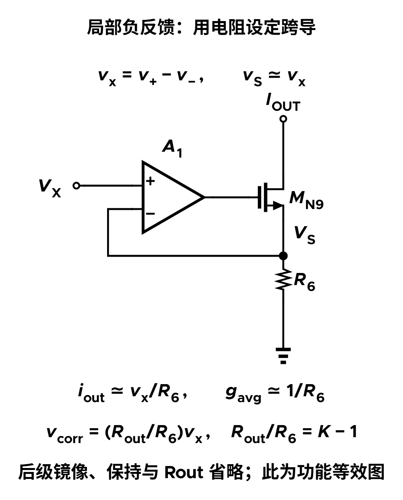

大电流 Buck 希望电感绕组电阻尽量小，因为绕组铜损近似随电流平方增加。但如果控制器正是利用绕组电阻检测电流，电阻越小，检测信号也越小：功率级省下了损耗，检测端却更容易受到失调和开关噪声干扰。

以一相平均电流 40 A、绕组直流电阻 0.2 mΩ 为例，直流铜损是 0.32 W，而可供检测的平均电压只有 8 mV。如果把实际绕组电阻增加到 1 mΩ，检测电压虽然变成 40 mV，直流铜损也会增至 1.6 W。更有吸引力的目标是：**保留低电阻的功率路径，在信号路径中得到相当于 1 mΩ 的检测增益。**

要理解怎样做到这一点，可以从普通 RC 检测出发，依次解决三个问题：怎样放大快速纹波，怎样补回平均电流，以及多相系统怎样共享精密放大器。本篇从电感和 RC 网络开始推导，不要求预先了解某种控制器。

[电感 DCR 基础](/zh/notes/buck-dcr/) · [学习地图：电感 DCR 与电流检测](/zh/learn/#buck-inductor-dcr) · [多控制器同步打嗝保护](/zh/notes/buck-synchronized-hiccup/)

## 1. 电感端口电压里，为什么藏着电流信息？

### 1.1 外部能测到的是电感电压与电阻压降之和

把实际电感看成理想电感 $L$ 与绕组电阻 $r$ 串联，$r$ 就是 DCR。电感接在开关节点 SW 与输出节点之间，电流 $i_L$ 从 SW 流向输出。绕组外部两端的电压为：

$$v_w=v_{SW}-v_o=L\frac{di_L}{dt}+ri_L.$$

其中，$v_{SW}$、$v_o$ 分别是 SW 和输出端相对地的电压。我们希望知道 $ri_L$，但外部端口中还混有 $L\,di_L/dt$。不能把检测线直接跨在整个电感上，就把测到的电压当成纯电阻压降。

不过，两项之间有确定关系：**电阻项跟随电流本身，电感项跟随电流变化率。** 利用这个关系，RC 网络可以把混合信号重新变成与电流成比例的信号。

### 1.2 普通 RC 检测怎样重建电流？

在整个绕组两端并接一条很小的检测支路：从 SW 经电阻 $R_s$ 到检测节点，再经电容 $C_s$ 接到输出端。测量的是电容两端电压 $v_s$，即“检测节点相对输出端”的电压，并非检测节点对地电压。

暂把检测支路对功率级的加载、后级输入电流和寄生忽略。支路电流给电容充电，同时在电阻上产生压降；两者相加等于绕组端口电压：

$$v_w=v_s+R_sC_s\frac{dv_s}{dt}.$$

如果希望 $v_s=ri_L$，右边就变成 $ri_L+R_sC_s r\,di_L/dt$。与上一节的绕组关系比较，只要 $R_sC_s r=L$，电流本身与电流变化率这两项就能同时对应起来。这直接给出 $R_sC_s=L/r$ 的匹配条件。

再用频域写出同一个关系：RC 低通的传递函数是 $1/(1+sR_sC_s)$，而绕组电压与电流的关系是 $r+sL$。因此：

$$\frac{V_s(s)}{I_L(s)}=\frac{r+sL}{1+sR_sC_s}=r\frac{1+s\tau_L}{1+s\tau_s},\qquad \tau_L=\frac{L}{r},\quad\tau_s=R_sC_s.$$

这里 $s$ 是拉普拉斯变量，大写 $V_s(s)$、$I_L(s)$ 表示对应信号在变换域中的量；这类传递函数描述零初始条件下的线性响应。取 $\tau_s=\tau_L$ 后，分子、分母中的动态项相消：

$$\boxed{v_s=ri_L.}$$

这就是时间常数匹配的意义：电感端口中与变化率有关的部分，经 RC 网络后恰好补偿电容本身的滞后，从而恢复电流波形。初始电容电压造成的误差还需要经过建立过程，不能由传递函数相消就认为上电瞬间已经正确。

### 1.3 低 DCR 的困难在信号幅度

若检测增益只有 0.2 mΩ，1 A 电流变化只对应 0.2 mV。假设后级比较器有 0.5 mV 等效失调，仅这一项折算回电流就是：

$$\Delta I_{os}=\frac{V_{os}}{r}=\frac{0.5\,\mathrm{mV}}{0.2\,\mathrm{m\Omega}}=2.5\,\mathrm A.$$

这个教学算例说明，检测波形即使在理想模型中形状正确，也可能因为幅度太小而难以准确使用。目标因而变为：在不增加实际 DCR 的情况下，把电流到检测电压的比例提高 $K$ 倍，得到 $v_{sense}=Kr i_L$。

## 2. 先让 RC 跟得更快，纹波会发生什么？

Buck 电感电流包含平均值与开关纹波。平均值变化相对慢，纹波则需要被及时送到逐周期电流判决端。如果把匹配 RC 的时间常数缩短，电容在一个开关周期内就会变化得更多，检测纹波因而增大。

将这条通路的电阻、电容记为 $R_{ac},C_{ac}$，选择：

$$\tau_1=R_{ac}C_{ac}=\frac{\tau_L}{K},\qquad K>1.$$

沿用上一节的无加载模型，快通路电压 $v_{fast}$ 与电感电流的关系为：

$$H_{fast}(s)\equiv\frac{V_{fast}(s)}{I_L(s)}=r\frac{1+s\tau_L}{1+s\tau_L/K}.$$

先看两个容易理解的极限：

- 长期恒定电流对应低频极限 $s\to0$，增益仍然是 $r$。电容稳态不再充放电，缩短时间常数没有把直流增益提高。
- 频率远高于两个拐点、且一阶模型仍适用时，$s$ 项占主导，增益趋近 $Kr$。快速纹波被放大。

这条通路已经适合传递更大的快速变化，却还不能单独代表完整电流：**同一个波形的平均值按 $r$ 换算，纹波却接近按 $Kr$ 换算。** 如果直接拿它做完整电流读数，就会把均值与峰谷之间的比例弄错。

例如平均电流 40 A、纹波 10 App，表示电流在约 35–45 A 之间变化。取 $r=0.2$ mΩ、$K=5$：普通匹配检测是 $8\pm1$ mV；缩短 RC 后，高频近似下得到 $8\pm5$ mV。它的纹波有了目标幅度，但整个波形仍停在 8 mV 平均值附近，而目标 $Kr i_L$ 应是 $40\pm5$ mV。

问题由此变得具体：需要给快通路补上缺少的低频部分，同时照顾两个频段之间的过渡。

## 3. 慢通路怎样补回均值，还能把过渡频段补平？

### 3.1 从快通路中取出慢变化

将 $v_{fast}$ 再送入一个低通，电阻、电容记为 $R_{avg},C_{avg}$，输出记为 $v_{slow}$。慢信号经过 $K-1$ 倍放大，形成补偿量 $v_{corr}$，最后与原来的快信号相加：

$$V_{slow}(s)=\frac{V_{fast}(s)}{1+s\tau_2},\qquad V_{corr}(s)=(K-1)V_{slow}(s),\qquad \tau_2=R_{avg}C_{avg}.$$

这里先把两级网络看成互不加载，放大、相加均为理想线性操作。实际电路如果直接用无缓冲的被动网络连接，两级会互相影响，必须用实际阻抗重新计算，不能只把两个独立低通相乘。

长期恒定电流下，$v_{slow}\approx ri_L$。于是补偿量提供缺少的 $(K-1)ri_L$，加上快通路原有的 $ri_L$，平均值就达到 $Kr i_L$。

### 3.2 关键是匹配动态，而非只对齐两个端点

直流正确与高频正确，并不自动保证中间频率正确。为了使两条通路在交接处互补，选择：

$$\boxed{\tau_2=\tau_L=K\tau_1.}$$

代入快通路传递函数，得到从电感电流到慢信号的完整关系：

$$H_{slow}(s)=r\frac{1+s\tau_L}{(1+s\tau_L/K)(1+s\tau_L)}=\frac{r}{1+s\tau_L/K}.$$

因此，补偿通路为：

$$H_{corr}(s)=\frac{(K-1)r}{1+s\tau_L/K}.$$

将快通路和补偿通路相加：

$$\begin{aligned}
H_{sum}(s)&=H_{fast}(s)+H_{corr}(s)\\
&=r\frac{1+s\tau_L+K-1}{1+s\tau_L/K}\\
&=r\frac{K(1+s\tau_L/K)}{1+s\tau_L/K}=Kr.
\end{aligned}$$

这个结果把“快慢互补”说清楚了：快通路低频缺少的增益，由慢通路补上；快通路从低频向高频增加的部分，与慢通路逐渐衰减的部分恰好配合。在所声明的理想模型中，合成后幅度与相位都能重建电流。

读图时可以先看左端：蓝线贡献 1，黑线贡献 4；再看右端：蓝线贡献 5，黑线趋近零。中间频段不能把两条曲线的 dB 数直接相加，必须像上面的推导一样，对包含相位的传递函数求和。

### 3.3 用同一组电流把数字连起来

沿用 40 A、10 App、$r=0.2$ mΩ、$K=5$ 的例子，并取 $L=180$ nH：

$$\tau_L=\frac{180\,\mathrm{nH}}{0.2\,\mathrm{m\Omega}}=0.9\,\mathrm{ms},\qquad \tau_1=0.18\,\mathrm{ms},\quad\tau_2=0.9\,\mathrm{ms}.$$

在开关频率足够高的稳态近似下，各部分的作用是：

| 信号 | 平均值 | 纹波峰峰值 | 在重建中的任务 |
| --- | --- | --- | --- |
| 普通匹配 RC 检测 | 8 mV | 2 mV | 作为原始增益的对照 |
| 快通路 $v_{fast}$ | 8 mV | 约 10 mV | 保留并增大快速变化 |
| 补偿量 $v_{corr}$ | 32 mV | 高频近似下很小 | 补足低频增益 |
| 合成输出 $v_{sense}$ | 40 mV | 10 mV | 按 1 mΩ 等效增益表示完整电流 |

图中的补偿量近似画成常数，是因为观察的时间窗口只有几个开关周期。负载平均电流发生变化时，慢通路也必须跟着变化。匹配后，整个 $I_L\to V_{slow}$ 通路的理想极点是 $K/\tau_L$；“慢”指相对于开关纹波的变化，不能理解成只保存一个固定直流数。

## 4. 多相系统为什么想共享慢放大器？

多相 Buck 中，每相都有自己的电感电流。控制器需要知道各相承担了多少电流，才能避免某一相过热、另一相闲置。若每相各有一个精密慢放大器，它们的失调和增益差异就会表现为不同的读数：即使真实电流相等，控制器也可能认为不相等，进而调出真实的不均流。

既然快速纹波已经由各相独立的快通路承担，就不必让每相都配一套相同的精密慢放大器。可以用输入开关依次选中各相的 $v_{slow}$，送给同一个放大器。

共享的收益来自两个方面：减少重复模拟电路；把原本独立的放大器误差变为所服务各相的共同误差。但输入共模、信号大小和采样时刻不同，误差仍可能不同；各相的记忆单元与后级也仍有失配。共享有助于减小相对差异，并不保证绝对读数准确。

此时出现了一个新问题：**放大器切去处理下一相后，上一相的低频补偿从哪里来？** 答案是在各相留下一个保持单元，保存上一次的结果。下面先建立“慢电压怎样变成可保存的电流”，再看怎样保存。

## 5. 用反馈和电阻，把慢电压变成准确电流

### 5.1 跨导在这里指一个完整模块的比例

电压转电流模块的等效跨导记为 $g_{avg}$，即输入每增加 1 V，输出电流增加多少安培。若慢电压产生电流 $i_{avg}=g_{avg}v_{slow}$，后级再通过输出电阻 $R_{out}$ 转回补偿电压，就有：

$$v_{corr}=g_{avg}R_{out}v_{slow}.$$

为了实现前面所需的 $K-1$ 倍补偿，只需满足：

$$\boxed{g_{avg}R_{out}=K-1.}$$

这里的比例包含所用电流镜的增益与正确的相加极性；电流从哪个方向流过输出电阻，要由具体镜像和相加电路实现。

### 5.2 为什么让电阻来设定跨导？

MOS 管本身可以把栅压变化转成漏电流变化，但其本征跨导随偏置、工艺和温度改变。若希望补偿比例主要由易于配比的电阻决定，可以使用局部负反馈。

先把检测输入的两路电压之差提取出来，记为 $v_x=v_{INP}-v_{INN}=v_{slow}$。等电阻比的差分放大器是一种实现；下面只画出取得 $v_x$ 之后的电压转电流部分。

运放 A1 的正端接 $v_x$，负端检测电阻 $R_6$ 上端电压 $v_S$，输出驱动 NMOS 管 MN9 的栅极。MN9 的源极接 $R_6$，电阻下端接地，漏极接后级输出支路。

当 $v_S$ 偏低时，运放抬高栅压，使电流增大，$R_6$ 上的电压随之升高；当 $v_S$ 偏高时则反向调整。只要反馈稳定、增益和电压余量足够，就有：

$$v_S\approx v_x,\qquad i_{out}\approx\frac{v_x}{R_6},\qquad g_{avg}\approx\frac{1}{R_6}.$$

在单位镜像比例的近似下，最终补偿增益由电阻比决定：

$$\frac{R_{out}}{R_6}=K-1.$$

例如 $R_6=20$ kΩ、$R_{out}=80$ kΩ，对应 $K=5$。前面例子的慢信号均值为 8 mV，电压转电流后为 0.4 µA，再经输出电阻得到 32 mV。这个算例把电阻比、跨导与前面的低频补偿连到了一起，并不是已完成验证的器件选值。

单电源 NMOS 结构还要求输入极性、输出电压和源端余量合适；输入失调、电阻误差、有限环路增益和电流镜误差都需要计入。这里的 $g_{avg}$ 是整个闭环模块的等效跨导，与 MN9 或保持管自身的 $g_m$ 是不同的量。

## 6. 放大器离开以后，怎样保留这一相的电流？

### 6.1 保存栅压，就能近似保存电流

MOS 栅极在理想情况下不吸收直流电流，栅节点上的电容可以暂时保存电压。因此，一种电流记忆单元可以先把输入电流变成栅压，再把该栅压留给另一只管使用。

先暂时忽略图中的 MN4，沿着一次写入过程看其余器件：

1. **建立电流对应的栅压。** 输入电流 $I_{AVG}$ 流入漏栅短接的 MN0，节点电压会变化，直到 MN0 能承载这股电流。漏栅短接称为二极管连接，不是额外串入一个二极管。
2. **把栅压写给本相。** 采样开关 MN3 导通时，保持节点 $V_H$ 与 MN0 栅极相连。匹配的 MN1 得到近似相同的栅源电压，因而在适当漏端电压下复制电流。
3. **断开输入，留下栅压。** MN3 关断后，$C_H$ 上的电荷暂时保留 $V_H$。共享放大器可以切去处理下一相，MN1 仍继续提供本相上次写入的电流。

图中 MN1 提供的是下拉电流，后级还需用正确极性和比例的镜像，把它变成 §3 所需的正向补偿量。$C_H$ 包括栅电容与相关寄生，图中画出它是为了解释保持机理，不表示必须增加一个外接电容。

### 6.2 被保持的是近似值，还需要定期刷新

漏电会逐渐改变 $V_H$；保持管漏端电压变化也会通过有限输出电阻影响电流。若保持节点有净漏电流 $I_{leak}$，在间隔 $T$ 内的漂移量可粗估为：

$$|\Delta V_H|\approx\frac{|I_{leak}|T}{C_H},\qquad |\Delta I_{hold}|\approx g_{m,hold}|\Delta V_H|.$$

$g_{m,hold}$ 是保持管在当前偏置下的本征跨导。这个局部小信号估算说明：增加保持电容、缩短刷新间隔能减小漏电漂移，但大电容又会增加写入负担。面积、建立时间和保持误差需要一起权衡。

## 7. 为什么刚关断采样开关，保持值就会跳一下？

保持节点除了缓慢漏电，还会在开关切换瞬间受到扰动。图 4 的 MN4 正是用于缓解这类误差的 dummy 管。它不是另一条信号通道：源、漏均接在保持节点，栅极接与主开关相反的时钟。

### 7.1 电荷注入：开关消失的沟道电荷去了哪里？

主开关 MN3 导通时，栅下存在反型沟道。关断时沟道消失，部分沟道电荷流入保持节点，改变电容电压。用长沟道的一阶模型估计电荷量的绝对值：

$$|Q_{ch}|\approx W\ell_{ch}C_{ox}(V_{GS}-V_T),\qquad |\Delta V_H|\approx\frac{\alpha|Q_{ch}|}{C_H}.$$

这里 $W,\ell_{ch}$ 分别是采样开关的沟道宽、长，$C_{ox}$ 是单位面积栅氧电容，$V_{GS}-V_T$ 是其过驱动电压。$\alpha$ 表示流入保持端的比例，取决于两侧阻抗和切换边沿，不能普遍设为 1/2。

MN3 关断时，反相驱动使 MN4 同时导通，MN4 形成沟道需要从保持节点获取相应电荷。两者对保持节点的扰动方向相反，于是可以抵消一部分注入。下一次进入采样时，MN4 关断仍会注入电荷，但此时 MN3 重新导通，节点可以通过前级重新建立；采样窗口必须留出这段恢复时间。

### 7.2 时钟馈通：栅极边沿也会通过电容耦合

即使不考虑沟道电荷，时钟还会经栅源、栅漏重叠电容耦合到 $V_H$。反相 dummy 提供方向相反的耦合，一阶近似可写成：

$$\Delta V_{ft}\approx\frac{C_{ov,main}\Delta V_\phi+C_{ov,dummy}\Delta V_{\bar\phi}}{C_{H,total}}.$$

$\phi$、$\bar\phi$ 是互为反相的驱动；两个 $C_{ov}$ 是主开关与 dummy 到保持节点的等效耦合电容，dummy 的贡献要包含其源漏短接后两端的耦合；$C_{H,total}$ 是总保持电容。只有耦合量和边沿足够匹配时，才有较好的抵消。

### 7.3 为什么“半尺寸”只是一个起点？

若约一半主开关沟道电荷进入保持端，且两管沟道条件相近、长度相同，常见初值是 $W_{dummy}\approx W_{main}/2$。但电荷分配、时钟边沿、器件失配和非线性电容都会改变最佳尺寸；不能把这个比例当成固定设计规则，也不能由图中符号推知器件确切尺寸。

还有一种不同现象是电荷分享：两个已带不同电压的电容接通后，电荷重新分配，理想结果为 $V_f=(C_aV_a+C_bV_b)/(C_a+C_b)$，其中 $C_a,C_b$ 是两电容，$V_a,V_b$ 是接通前电压。dummy 主要缓解电荷注入和时钟馈通，并不能消除任意节点间的电荷分享。

## 8. 多相轮流写入，时序要满足什么条件？

把每一相都配上上述记忆单元后，共享放大器可以轮流工作。但“选中了输入”不代表“结果已经正确”：输入开关切换后，前级与放大器需要建立，保持电容也需要充电。

因此一次写入应依次经历：选中本相输入 → 等待建立 → 打开本相写入开关 → 在信号稳定期间完成写入 → 关闭写入 → 再切到下一相。顺序反过来，就可能把上一相的残值或下一相的信号留在本相。

图中快通路始终各相独立，并未轮流采样完整的高频电感电流。只有慢补偿量被依次刷新。把电流比较器的判决安排在保持期间，还能减少刚切换时的扰动进入判决端。

每相结果在两次更新之间近似不变，这相当于零阶保持。令 $T$ 为**同一相相邻两次刷新之间的时间**，归一化保持因子为：

$$H_{hold}(s)=\frac{1-e^{-sT}}{sT}.$$

低频下它接近 1，频率升高后会引入幅度变化和延迟。因此 §3 的理想互补推导，还要求每相刷新速度远高于慢补偿通路的有效带宽，并检查采样混叠与实际建立时间。相数增加既延长刷新间隔，也可能压缩单相窗口；“只处理低频”并不意味着可以无限复用。

## 9. 回到目标：哪些误差变小了，哪些仍需处理？

最终等效增益若达到 $Kr=1$ mΩ，§1 中同样的后级 0.5 mV 失调折算为 0.5 A，比原来的 2.5 A 小。这改善的是固定后级电压误差所对应的电流误差，并没有改变真实电感电流或铜损。

对电流斜坡交越阈值的判决，局部时间抖动近似满足：

$$\sigma_t\approx\frac{\sigma_v}{|dv_{sense}/dt|}.$$

$\sigma_v$ 为判决端等效电压噪声，$\sigma_t$ 为相应的交越时间标准差。若这个位置的噪声幅度保持不变，检测斜率增大可减小时间抖动；若噪声来自前级并随信号一起放大，就不能直接宣称改善 $K$ 倍。放宽快通路带宽还可能带入更多开关尖峰。

因此，整条链应连起来看：RC 匹配决定波形能否重建，互补增益决定后级能看到多大的信号，电阻比决定慢补偿比例，记忆与时序决定共享后是否仍能保持比例。DCR 温漂、电感随偏置变化、输入共模范围、网络加载、放大器失调、保持误差和布局耦合，则需要分别计入实际设计。

继续阅读 [DCR 基础笔记](/zh/notes/buck-dcr/)可以追踪时间常数失配与温漂；[COT 纹波反馈](/zh/notes/buck-cot-ripple/)可帮助理解“信号斜率如何影响判决”。当多相扩展到多个并联控制器后，还会出现另一类共享问题：大家是否能一起进入保护，见[同步打嗝保护](/zh/notes/buck-synchronized-hiccup/)。

## 参考资料与模型说明

本文的快慢互补、共享低频放大器与电流记忆实现参考 Yingyi Yan、Eric Gu，JSSC 2021，[DOI: 10.1109/JSSC.2021.3071728](https://doi.org/10.1109/JSSC.2021.3071728)，重点为第二章。正文将这些方法按“检测目标—RC 重建—互补—共享—保持误差”的顺序重新推导；局部电路采用功能等效表示，未复现完整逐管实现。

交流与直流检测分路径处理已有前作，例如 Jindong Zhang 的 [US8823352B2：Switching power supply having separate AC and DC current sensing paths](https://patents.google.com/patent/US8823352B2/en)。不能把分路径这一总体思路视为 2021 年工作的首次提出。

dummy 开关的一般补偿机理也可参见 [EP2795624A1：Sample-and-hold circuit arrangement](https://patents.google.com/patent/EP2795624A1/en) 的采样开关补偿说明。半尺寸是附带电荷分配假设的经验初值，不代表上述 Buck 实现已公布的器件尺寸或完全抵消的保证。

图 1–2、图 5 均为教学频响或时序，非测量数据；图 3–4 仅核对局部连接关系，未做电路性能仿真。40 A、0.2 mΩ、180 nH、电阻比及失调数值用于贯穿计算；其中的铜损比较只计算直流分量，未计入纹波、交流绕组和磁芯损耗。
