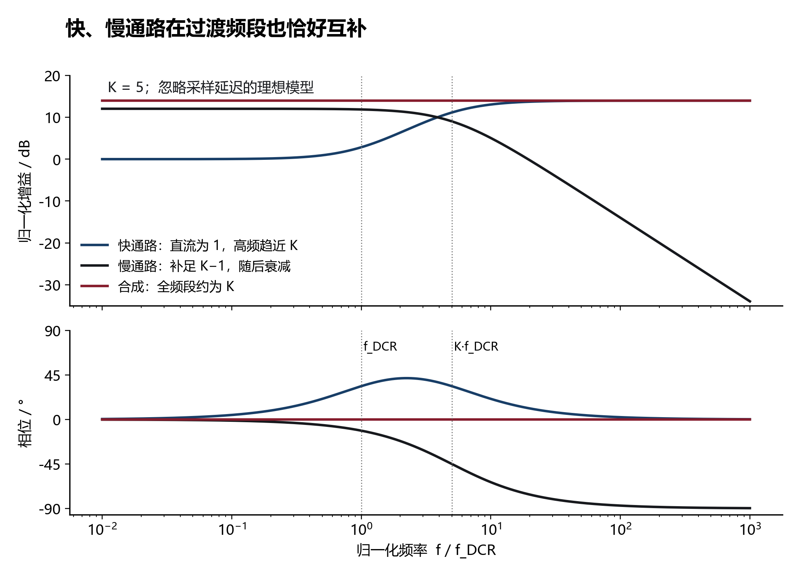
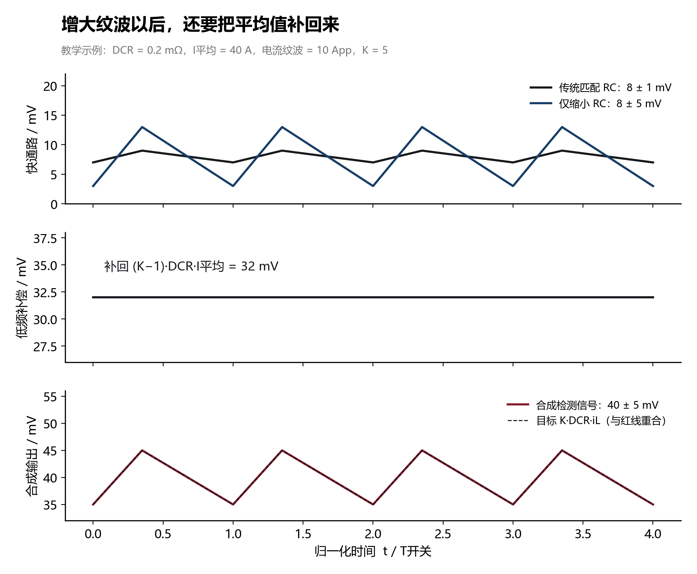
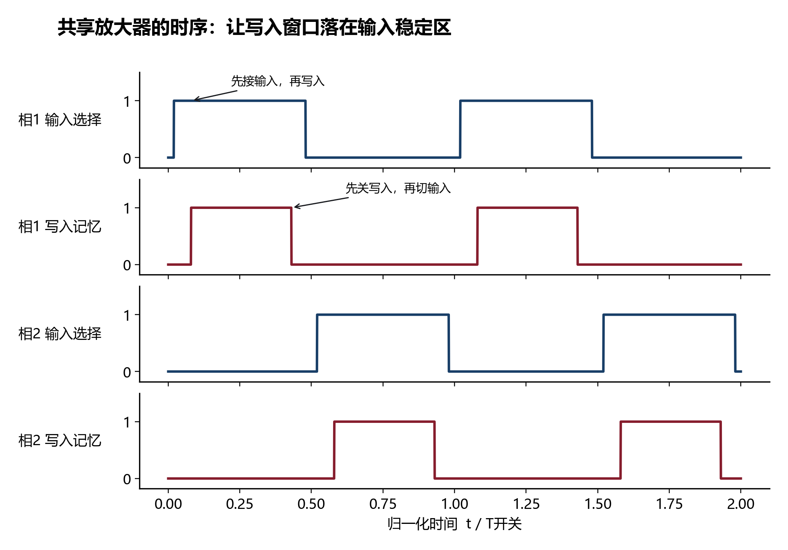
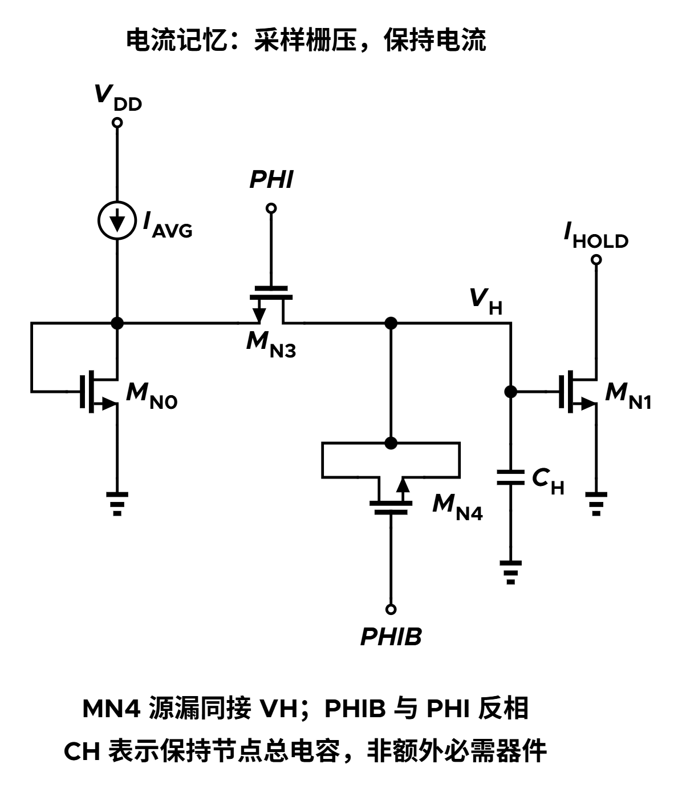

[Buck DCR 基础](/zh/notes/buck-dcr/) · [学习地图：电感 DCR 与电流检测](/zh/learn/#buck-inductor-dcr) · [配套：同步打嗝保护](/zh/notes/buck-synchronized-hiccup/)

> **阅读目标：** 理解如何把很小的 DCR 变成“更大的等效检测增益”，再理解怎样用一个慢放大器服务多相。这里只保留方法与局部实现，不展开整套 Buck 控制器架构。公式来自论文第二章；另行推导及示意参数会明确标注。

**配图与模型范围：** 频响、波形和时序均为教学示意，非测量数据。局部电气图仅核对连接关系，未做性能仿真；器件符号不代表论文的具体工艺或尺寸。

## 1. 先明确：增加 K 倍的是什么？

电感绕组的直流电阻记为 $r$，即 DCR。电感电流为 $i_L$。传统匹配 RC 检测希望得到：

$$v_{sense}=r\,i_L.$$

当 $r$ 很小时，同样的电流只产生很小的检测电压，比较器失调、开关噪声就更容易影响均流和 PWM 边沿。

论文的方法让最终输出近似成为：

$$v_{sense}\approx K r\,i_L,\qquad K>1.$$

**增加的是电流到电压的检测增益，不是实际电感电流，也不是实际 DCR。** 因而不需要通过增加绕组电阻来换取更大的信号。

单纯把一个已经受噪声污染的微小检测波形接到宽带放大器，通常会把其中的噪声一起放大。这里把快、慢部分交给不同通路，避免要求一个精密放大器同时处理全部开关纹波。[原文 II-A、II-D，PDF 第 3、5 页]

## 2. 快通路：缩短 RC 时间常数，只先把纹波做大

定义电感自身时间常数 $\tau_L=L/r$。传统 DCR 检测使 RC 时间常数匹配 $\tau_L$，以抵消电感阻抗中的零点。

现在故意选：

$$\tau_1=R_{ac}C_{ac}=\frac{\tau_L}{K}.$$

为了避免原文不同子图重复使用 R1 造成混淆，本文把片外第一级 RC 写成 $R_{ac},C_{ac}$，它们对应原文图 2 的 R1、C1。

在论文采用的理想化模型下，快通路传递函数为：

$$H_{fast}(s)=\frac{v_{fast}}{i_L}=r\frac{1+s\tau_L}{1+s\tau_L/K}.$$

低频时增益仍为 $r$，高频时趋近 $Kr$。所以，**只缩短 RC 会把纹波提高，却不会把平均值一起提高**；它还会在过渡频段产生增益变化和相位超前。不能直接把这个信号当作全频段同比例放大的电流。

高频纹波放大 K 倍的表述成立于开关频率远高于相关拐点的条件；不是任意频率下都精确放大 K 倍。[原文式 (1)、(3)–(5)]

## 3. 慢通路：补足 K−1，并在过渡频段一起补平

在快通路之后再取一个低通后的慢信号，经过 K−1 倍放大，再与快通路相加：

$$v_{slow}=\frac{v_{fast}}{1+s\tau_2},\qquad v_{corr}=(K-1)v_{slow}.$$

关键匹配条件是：

$$\tau_2=R_{avg}C_{avg}=\tau_L=K\tau_1.$$

这里 $R_{avg},C_{avg}$ 对应原文图 2 的 R2、C2。以下是依据原文式 (3)–(9) 展开的推导，暂忽略采样保持和实际加载效应：

$$H_{slow}(s)=\frac{r}{1+s\tau_L/K},\qquad H_{corr}(s)=\frac{(K-1)r}{1+s\tau_L/K}.$$

于是：

$$H_{sum}(s)=r\frac{1+s\tau_L+K-1}{1+s\tau_L/K}=Kr.$$

这就是整个方法最有思想的地方：**快通路负责高频，慢通路补足低频，而且两个频段之间也能通过时间常数匹配形成互补。** 不是把“直流乘 K、交流乘 K”简单拼起来就结束了。

虽然叫“平均值通路”，$v_{slow}$ 并不是一个永远不变的直流量。动态变化时它仍随输入变化，只是带宽受到限制。匹配后的整个慢信号通路，其理想极点是 $K/\tau_L$；不能只根据第二个 RC 的拐点判断整个通路带宽。

同一示例的时间常数为 $\tau_L=0.9\,ms$、$\tau_1=0.18\,ms$，最终等效检测增益为 1 mΩ。这些是教学计算；不作为某个最终产品的器件选值。

## 4. 图 7(a)：用“电流记忆”共享一个慢放大器

各相的慢信号轮流接到同一个跨导放大器，放大器输出的电流再分别写入各相记忆单元。快通路保持各相独立，因此**没有轮流采样各相的完整高频电流波形**。

原文图 7(a) 可以压缩成四步：

1. **电压转电流。** 共享跨导放大器产生 $i_{avg}=g_{avg}v_{slow}$；二极管连接的 MN0 把该电流转换为相应栅压。
2. **写入。** 第一相的主开关 MN3 导通时，MN1 栅极连接到 MN0 的栅漏节点，MN1 复制相应电流。
3. **保持。** MN3 关断后，MN1 的栅电容保存栅压；在漏电、寄生和输出阻抗允许的精度内继续提供该电流。
4. **电流转电压。** 经电流镜和输出电阻得到低频补偿电压，再与本相快通路相加。第二相是 MN5、MN2 对应的同样过程，MN4、MN6 则是补偿开关。

输出电阻记为 $R_{out}$，对应原文图 7(a) 的 R1；它与片外 RC 网络的 R1 是不同元件。

$$v_{corr}=g_{avg}R_{out}v_{slow},\qquad g_{avg}R_{out}=K-1.$$

 的内部反馈级，突出“让 R6 上的电压跟随输入，再由电阻设定电流”；前级等电阻差分放大器及后级镜像/保持未展开。连接关系已核对，不能将它当作论文逐管实现。")

共享同一个放大器有两层收益：减少各相重复使用的模拟电路；把原本独立的放大器失调与增益误差变成各相共同误差，从而减小它们对**同一共享放大器所服务各相**的相对均流影响。共同误差仍会影响绝对电流读数与限流阈值；跨芯片若各自有放大器，也不能自动认为失调完全相同。

后级各相电流比较器本身的失调差异仍在，但折算成电流误差时，分母由 DCR 变成了 K·DCR。因此，增大检测增益与共享慢放大器分别从不同环节改善均流。

共享还要求写入窗口安排正确：先选中输入，等待放大器建立，再打开对应记忆单元；切换到下一相以前先关闭写入，避免把下一相信号写到上一相。论文还把电流比较器的动作安排在保持期间，减小切换扰动。[原文 II-B，图 5–7，PDF 第 3–4 页]

采样保持不是没有代价。论文使用零阶保持因子：

$$H_{hold}(s)=\frac{1-e^{-sT}}{sT}.$$

当每相更新频率远高于慢通路有效带宽时，这个因子在慢通路工作频段内才近似为 1。相数增加时，每个窗口还必须容纳实际建立时间；不能仅凭“只有低频”就无限增加复用相数。[原文式 (7)–(9)]

## 5. 图 7(b)：用局部反馈，让跨导主要由电阻决定

值得提炼的是“先做差，再用电阻精确设定电流”的方法。

图 7(b) 左侧 R2、R3、R4、R5 相等。在理想运放条件下，正端为 INP/2，负端跟随正端，由电阻反馈得到运放输出：

$$v_x=v_{INP}-v_{INN}=v_{slow}.$$

中间 MP1/MP2 与 MN7/MN8 构成的局部反馈级驱动 MN9。在器件匹配、环路增益和电压余量足够时，它使 R6 上的电压近似跟随 $v_x$；随后 MP3/MP4 将电流镜像到输出。因此：

$$i_{out}\approx\frac{v_x}{R_6},\qquad g_{avg}\approx\frac{1}{R_6},\qquad \frac{R_{out}}{R_6}=K-1.$$

这里的 $g_{avg}$ 是整个闭环电压—电流模块的等效跨导，不是某一只 MOS 管的本征 $g_m$。学习时抓住“反馈把电压压在电阻上，电阻决定电流”即可；具体实现可以换成适合最终供电、输入共模和输出摆幅的 V–I 电路。[原文图 7(b)、式 (2)，PDF 第 4 页；中间反馈作用的描述为据图解释]

## 6. MN4/MN6：为什么 dummy 管能改善误差？

### 6.1 先区分电荷注入和电荷分享

原文准确用词是 **charge injection（电荷注入）** 和 **clock feedthrough（时钟馈通）**。

主 NMOS 开关导通时存在反型沟道电荷。关断时沟道消失，其中一部分电荷流向保持节点，使栅压产生台阶。以电荷量的绝对值估算：

$$|Q_{ch}|\approx WLC_{ox}(V_{GS}-V_T),\qquad |\Delta V_H|\approx\frac{\alpha|Q_{ch}|}{C_H}.$$

$\alpha$ 是流向保持端的比例，受两侧阻抗和边沿等因素影响，不能普遍当成 1/2。

通常所说的“电荷分享”，则是两个原本处于不同电压的电容节点连接后重新分配电荷，例如：

$$V_f=\frac{C_aV_a+C_bV_b}{C_a+C_b}.$$

dummy 补偿针对开关关断引起的注入与馈通，**不能保证消除任意节点间的电荷分享**。本电路确实涉及沟道电荷向不同端分配，但把全部问题叫电荷分享会掩盖主要误差来源。

### 6.2 为什么要反相驱动，而且源漏短接？

MN3 用正常相位驱动，MN4 用反相时钟驱动，MN4 的源、漏连接在同一保持节点。

- 采样转保持时，MN3 关断并释放沟道电荷；MN4 同时导通，需要形成自己的沟道，从保持节点吸收相应电子。两者对保持节点的扰动方向相反。
- MN4 源漏短接，所以它不是另一条信号传输通路；它主要提供受反相时钟控制的沟道与寄生电容。
- 下一次进入采样时，dummy 关断也会释放电荷，但主开关重新导通，节点可通过前级重新建立。仍需给足建立时间，不能假定这次扰动天然不存在。

### 6.3 时钟馈通怎样抵消？

主开关栅端的时钟边沿会通过栅漏/栅源重叠电容耦合到保持节点。dummy 接收相反边沿，提供方向相反的耦合。一阶模型可写为：

$$\Delta V_{ft}\approx\frac{C_{ov,main}\Delta V_\phi+C_{ov,dummy}\Delta V_{\bar\phi}}{C_{H,total}}.$$

这里 dummy 的等效耦合电容包含其两端短接后的贡献，$C_{H,total}$ 包含节点相关寄生。若两项幅度匹配、边沿互为反相，就能近似抵消。

### 6.4 “半尺寸 dummy”是条件结论

若主开关约一半沟道电荷进入保持端、沟道条件相近、沟道长度相同，则常用初值为 $W_{dummy}\approx W_{main}/2$。这是一般开关电路的一阶经验，**本文没有给出 MN4/MN6 的确切宽长比**，不能把半尺寸写成这篇论文的实现事实。该补偿原则也见 [EP2795624A1 的图 5 说明](https://patents.google.com/patent/EP2795624A1/en)。

实际仍有电荷分配不对称、器件失配、边沿不一致和非线性电容。主开关过大会增加注入；过小又会增大导通电阻、延长建立时间。原文建议减小器件尺寸以改善精度，最终尺寸仍须结合采样窗口和误差要求权衡。

## 7. 迁移到自己的架构时，记住这四点

1. **先分配频段，再做互补。** 快通路保留即时纹波；慢通路追求准确，且必须检查过渡频段。
2. **共享的是慢而精密的部分。** 各相的快速 PWM 信息不必全部进入一个复用放大器。
3. **共享消除的是相对差异的一部分。** 绝对失调、DCR 温漂和每相记忆单元误差依然存在。
4. **采样时序、注入补偿和建立时间一起设计。** 加一个 dummy 不等于采样保持已经理想。

输入范围、RC 网络加载、开关噪声的注入位置、输出余量及采样延迟，都会影响实际效果。原文 $T_J\propto1/K$ 的抖动关系假设比较器端的噪声幅度相同；不能解读成所有来源的噪声都自动改善 K 倍。

## 8. 方法来源与原文定位

“交流与直流分开处理”的思路已有前作。论文在引言明确引用 [28]：J. Zhang, *Switching power supply having separate AC and DC current sensing paths*, US 8,823,352, 2014。该专利原文可见 [US8823352B2](https://patents.google.com/patent/US8823352B2/en)。因此不把分路径处理整体归为这篇论文首次提出；本文值得学习的推进是多相低频信号共享放大、各相电流记忆和相应互补设计。

| 内容 | 原文定位 |
|---|---|
| 缩小 RC、K 倍纹波 | II-A，图 2–3，式 (1)，PDF 第 3 页 / 印刷页 2750 |
| 共享放大与电流记忆 | II-B，图 4–7，式 (2)，PDF 第 3–4 页 / 2750–2751 |
| 互补传递函数与保持效应 | II-C，图 8，式 (3)–(9)，PDF 第 4–5 页 / 2751–2752 |
| 抖动、精度与设计边界 | II-D–F，图 9–10，PDF 第 5–6 页 / 2752–2753 |
| 早期分路径方法 | 引言及参考文献 [28]，PDF 第 2、12 页 |

论文：[Yan & Gu, JSSC 2021](https://doi.org/10.1109/JSSC.2021.3071728)

配套笔记：[多控制器同步打嗝保护](/zh/notes/buck-synchronized-hiccup/)。所有波形均为教学示意，具体实现应按最终架构重新设计。
