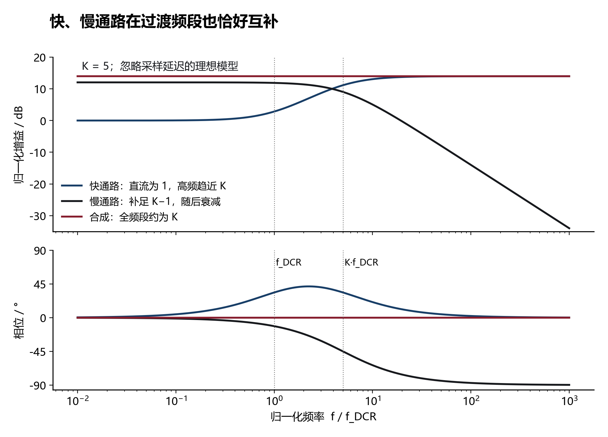
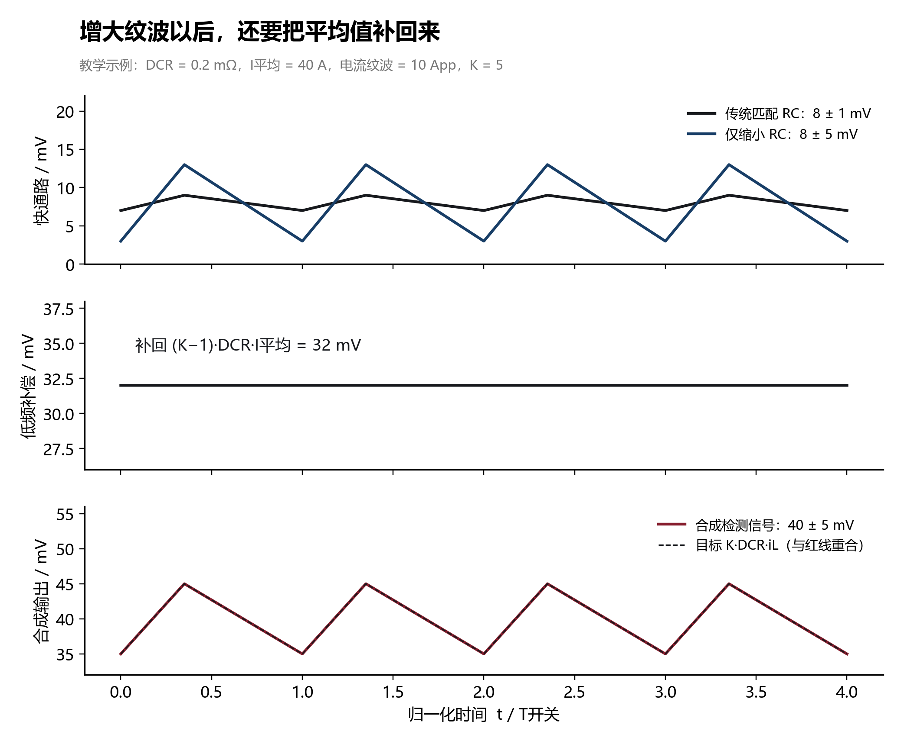
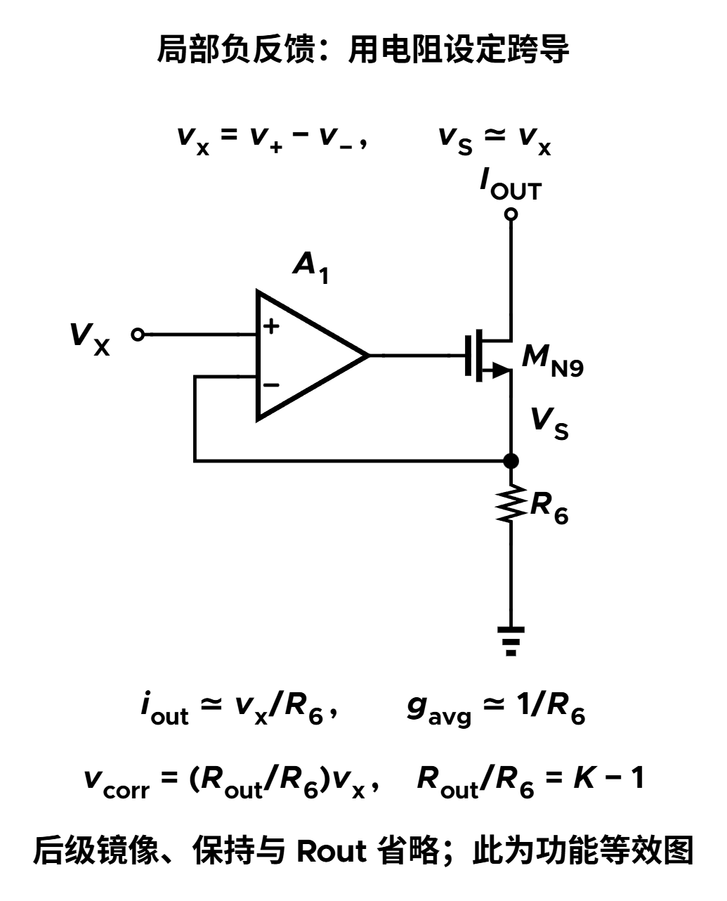
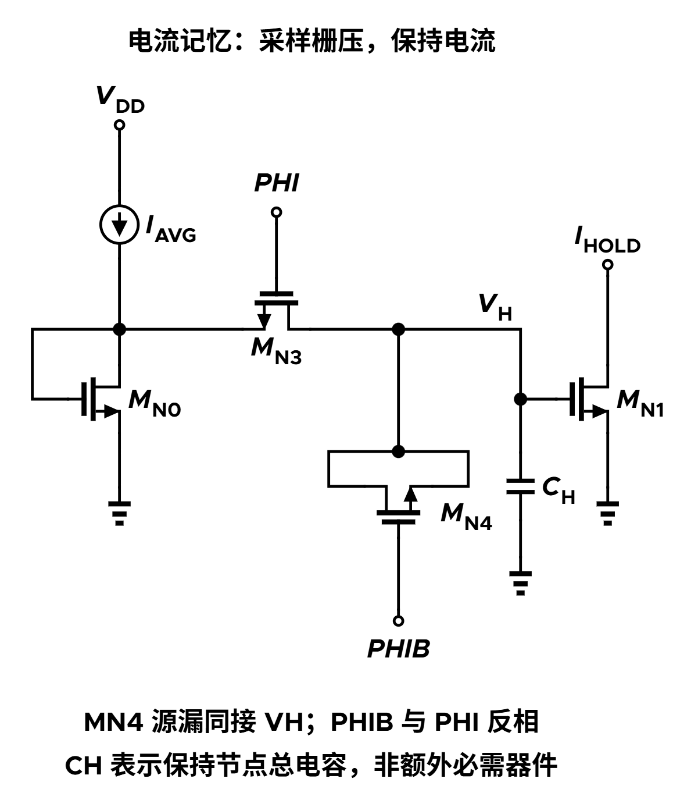
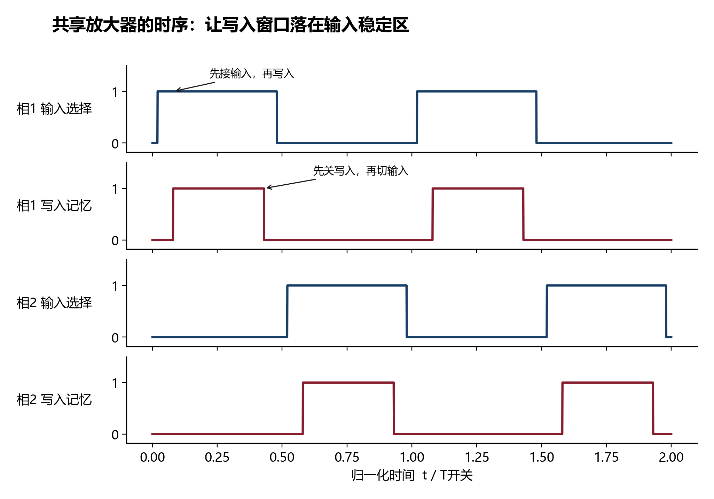

大电流 Buck 希望电感绕组电阻（DCR）越小越好，因为铜损 $I^2 r$ 随电流平方增长。但对于用 DCR 测电流的控制器来说，这是一对死矛盾：**电感省下了功耗，送进芯片的检测电压却缩水到只剩几毫伏，很容易被运放失调和开关噪声淹没。**

看一组直观对比（单相平均电流 $40\text{ A}$）：
- 若 $r=0.2\text{ m}\Omega$：直流铜损仅 $0.32\text{ W}$，但检测平均电压只有 **$8\text{ mV}$**（只要后级有 $0.5\text{ mV}$ 失调，折算误差就高达 **$2.5\text{ A}$**）；
- 若硬把电感 $r$ 换成 $1\text{ m}\Omega$：信号升到了 $40\text{ mV}$，铜损却暴涨到 $1.6\text{ W}$。

最理想的目标是：**功率级继续用 $0.2\text{ m}\Omega$ 的超低 DCR 省电，但在信号处理链里把等效检测增益放大 $K$ 倍（如 $K=5$，等效成 $1\text{ m}\Omega$）**。

> **全篇三步解法**
> 1. **快通路放大纹波**：缩短 RC 时间常数 $\tau_1=\tau_L/K$，先把高频纹波放大 $K$ 倍；
> 2. **慢通路补平直流与中频**：再用第二个时间常数 $\tau_2=\tau_L$ 取出慢信号放大 $(K-1)$ 倍并相加，实现全频段精确重建；
> 3. **多相共享慢放大器 + 电流记忆**：避免每相放大器失调不一致调偏均流，用时分复用配合电流记忆单元和 dummy 开关保存低频补偿量。

前置基础：[电感 DCR 基础](/zh/notes/buck-dcr/) · [学习地图：电感 DCR 与电流检测](/zh/learn/#buck-inductor-dcr) · [多控制器同步打嗝保护](/zh/notes/buck-synchronized-hiccup/)

---

## 1. 回顾普通 RC 检测：为什么能从电压里还原电流？

将实际电感建模为理想电感 $L$ 串联 DCR $r$，绕组两端电压为：

$$v_w=v_{SW}-v_o=L\frac{di_L}{dt}+ri_L.$$

在电感两端并联由电阻 $R_s$、电容 $C_s$ 串联的检测网络，量取**电容两端**（检测节点相对 $v_o$）的电压 $v_s$。其传递函数为：

$$\frac{V_s(s)}{I_L(s)}=\frac{r+sL}{1+sR_sC_s}=r\frac{1+s\tau_L}{1+s\tau_s},\qquad \tau_L=\frac{L}{r},\quad \tau_s=R_sC_s.$$

只要令时间常数精准匹配 $\tau_s = \tau_L$（即 $R_s C_s = L/r$），分子分母的动态项恰好约掉：

$$\boxed{v_s(t) = r\,i_L(t).}$$

但它的瓶颈也很死板：无论电阻电容怎么配，**等效检测增益永远锁死在 $r$**（$0.2\text{ m}\Omega$ 只能换回 $0.2\text{ mV/A}$）。想放大 $K$ 倍，必须在电路拓扑上动刀。

---

## 2. 快通路：缩短 RC 时间常数，先放大开关纹波

把普通匹配网络中的电阻电容记为 $R_{ac}, C_{ac}$，故意把它的时间常数**缩短为原来的 $1/K$**：

$$\tau_1=R_{ac}C_{ac}=\frac{\tau_L}{K}\qquad (K>1).$$

此时这段快通路的传递函数变为：

$$H_{fast}(s)\equiv\frac{V_{fast}(s)}{I_L(s)}=r\frac{1+s\tau_L}{1+s\tau_L/K}.$$

用两个频率极限看它的性格：
- **直流与极低频（$s\to 0$）**：电容开路，增益依然只有 **$r$**（缩短时间常数抬不动直流）；
- **高频开关纹波区（$\omega \gg K/\tau_L$）**：分子分母同时由 $s$ 主导，增益拉高到 **$Kr$**。

也就是说，**快通路把交流纹波放大了 $K$ 倍，但直流平均值还停在 1 倍**。

> **算例直观对比**（$40\text{ A}$ 直流 + $10\text{ A}_{pp}$ 纹波，$r=0.2\text{ m}\Omega, K=5$）：
> - 普通匹配 RC 检测：$8\text{ mV} \pm 1\text{ mV}$（均值和纹波都按 $0.2\text{ m}\Omega$ 算）；
> - 快通路 $v_{fast}$：$8\text{ mV} \pm 5\text{ mV}$（纹波已经达标，但直流中心低了 4 倍）；
> - 我们的终极目标：$40\text{ mV} \pm 5\text{ mV}$（整条波形按 $1\text{ m}\Omega$ 比例放大）。

缺口一目了然：**只差把缺失的那 $(K-1)$ 倍低频/直流分量补回来，同时把中频过渡区填平。**

---

## 3. 慢通路互补：为什么 $\tau_2=\tau_L$ 就能全频段零畸变？

### 3.1 级联低通 + $K-1$ 倍放大叠加

把快通路输出 $v_{fast}$ 再接一级低通滤波（$R_{avg}, C_{avg}$，时间常数 $\tau_2$）取出慢信号 $v_{slow}$，放大 $(K-1)$ 倍生成补偿量 $v_{corr}$，最后与快信号直接相加：

$$V_{slow}(s)=\frac{V_{fast}(s)}{1+s\tau_2},\qquad V_{corr}(s)=(K-1)V_{slow}(s).$$

*注：如果两级被动 RC 直接硬连，后级会加载前级，设计时需留够阻抗隔离（如 $R_{avg} \gg R_{ac}$）或按联合传递函数重新校准极点。*

### 3.2 关键极零点对消：选定 $\tau_2 = \tau_L = K\tau_1$

如果只满足直流和极高频正确，中间过渡频段可能会凹陷或鼓包。一旦选定 **$\tau_2 = \tau_L$**，奇迹就发生了——慢通路的极点 $(1+s\tau_L)$ 恰好消掉快通路原有的零点 $(1+s\tau_L)$：

$$H_{slow}(s)=r\frac{1+s\tau_L}{(1+s\tau_L/K)(1+s\tau_L)}=\frac{r}{1+s\tau_L/K}.$$

于是补偿通路与快通路相加的总传递函数为：

$$\begin{aligned}
H_{sum}(s)&=H_{fast}(s)+H_{corr}(s)\\
&=r\frac{1+s\tau_L}{1+s\tau_L/K}+r\frac{K-1}{1+s\tau_L/K}\\
&=r\frac{K(1+s\tau_L/K)}{1+s\tau_L/K}\equiv\boxed{K r.}
\end{aligned}$$

**在所有频率上幅度恒为 $Kr$，相移严格为零！** 快通路在低频跌掉的增益，分毫不差地被慢通路的衰减斜率补平。

### 3.3 贯通同一组参数验证

沿用前面的 $L=180\text{ nH}$、$r=0.2\text{ m}\Omega$、$K=5$，电感时间常数 $\tau_L=0.9\text{ ms}$，对应取 $\tau_1=0.18\text{ ms}$、$\tau_2=0.9\text{ ms}$。对 $40\text{ A}$ 直流 + $10\text{ A}_{pp}$ 纹波信号，各点波形一目了然：

| 信号节点 | 直流平均值 | 纹波峰峰值 | 在系统中的角色 |
| --- | --- | --- | --- |
| 普通匹配 RC 检测 | $8\text{ mV}$ | $2\text{ mV}$ | 原始 $1\times r$ 基准 |
| 快通路 $v_{fast}$ | $8\text{ mV}$ | $\approx 10\text{ mV}$ | 各相独立保留放大后的快速纹波 |
| 补偿量 $v_{corr}$ | $32\text{ mV}$ | 极小（被滤平） | 补齐缺少的 $(K-1)$ 倍慢变化 |
| **合成输出 $v_{sense}$** | **$40\text{ mV}$** | **$10\text{ mV}$** | **完整按 $Kr=1\text{ m}\Omega$ 还原真实电感电流** |

> **留意“慢通路”其实并不只测静态直流**：匹配完成后，$I_L \to V_{slow}$ 通路的极点是 $K/\tau_L$（本例带宽约 $1/(2\pi\times 0.18\text{ ms})\approx 884\text{ Hz}$），它只是相对开关频率很慢，负载阶跃时仍要能及时跟上平均电流的变化。

---

## 4. 为什么要让多相共享同一个慢放大器？

在多相 Buck 里，每相都必须有一条独立的快通路传纹波；但**慢通路放大 $(K-1)$ 倍需要用到高精度的精密放大器**，如果给 4 相各配一颗独立放大器：
- 每颗放大器的随机失调 $V_{os}$ 方向不同（比如 A 相 $+0.5\text{ mV}$、B 相 $-0.5\text{ mV}$），在 $0.2\text{ m}\Omega$ 的极小 DCR 下会直接制造出高达 $5\text{ A}$ 的假电流差，均流环会忠实地按这个假读数把各相电流调偏！

**解决方案：各相独立用无源 RC 取 $v_{slow}$，再用多路开关轮流接给同一颗高精度慢放大器。**
- 既省掉了多套精密运放（和斩波）的面积与功耗；
- 更重要的是把放大器自身的失调变成了**所有相共同的共模偏移**，各相之间的相对误差被大幅压低。

但共享马上引出下一个问题：**放大器切去服务第 2 相以后，第 1 相那 $32\text{ mV}$ 的慢补偿量谁来继续维持？**

---

## 5. 电阻设定跨导 + 电流记忆单元：写一次，留一轮

### 5.1 先用负反馈把慢电压变成精密电流

如果直接靠 MOS 管的本征 $g_m$ 把电压变成电流，比例会随工艺和温度乱漂。这里依然采用经典的**运放 + 采样电阻负反馈**：

输入差分慢电压 $v_x = v_{slow}$ 送入运放 A1 同相端，A1 驱动 MN9 强迫电阻 $R_6$ 上端电压 $v_S$ 跟随 $v_x$，再镜像输出到后级电阻 $R_{out}$ 还原为补偿电压：

$$i_{out}\approx\frac{v_x}{R_6}\implies g_{avg}\approx\frac{1}{R_6},\qquad v_{corr}=g_{avg}R_{out}v_{slow}\implies \frac{R_{out}}{R_6}=K-1.$$

比如取 $R_6=20\text{ k}\Omega$、$R_{out}=80\text{ k}\Omega$，恰好实现 $K-1=4$（即 $K=5$）：$8\text{ mV}$ 的慢电压稳定转成 $0.4\,\mu\text{A}$ 电流，再在输出电阻上产生精确的 $32\text{ mV}$ 补偿。

### 5.2 再用各相私有的“电流记忆单元”锁住电流

放大器算出本相电流 $I_{AVG}$ 后，通过各相独有的保持单元存下来：

写入与保持只需三步：
1. **电流转栅压**：输入电流 $I_{AVG}$ 注入二极管连接（漏栅短接）的 MN0，自动建立对应的栅源电压；
2. **开关采样写入**：本相采样开关 MN3 导通，把该栅压充进本相的保持电容 $C_H$（含 MN1 栅寄生电容）；
3. **断开保持**：MN3 关断，共享放大器立刻切走处理下一相；$C_H$ 上的电压 $V_H$ 让匹配的 MN1 **继续源源不断地输出刚刚写入的电流**（再经合适极性的电流镜送往加法节点）。

### 5.3 保持误差来自哪里？如何压住它？

保持电压 $V_H$ 面临两类误差：**缓慢漏电漂移**与**开关关断瞬间的跳变**。

1. **漏电漂移**：在两次刷新间隔 $T$ 内，节点漏电流 $I_{leak}$ 造成的电流漂移为：
   $$|\Delta V_H|\approx\frac{|I_{leak}|T}{C_H},\qquad |\Delta I_{hold}|\approx g_{m,hold}|\Delta V_H|.$$
   *对策*：适当加大 $C_H$ 或缩短轮询刷新周期 $T$（但 $C_H$ 太大又会让写入建立变慢）。

2. **关断跳变（电荷注入 + 时钟馈通）**：
   - **电荷注入**：MN3 导通时沟道里蓄满电荷 $|Q_{ch}|\approx W\ell_{ch}C_{ox}(V_{GS}-V_T)$；关断瞬间沟道瓦解，一部分电荷（比例 $\alpha$）涌入保持节点 $C_H$ 顶歪 $V_H$。
   - **时钟馈通**：关断时栅极控制沿通过栅漏重叠电容 $C_{ov}$ 耦合进 $V_H$。

   **图 4 中的 MN4 就是专门来擦屁股的反相 dummy 开关**：它的源漏短接在一起连到保持节点 $V_H$，栅极接与主开关完全反相的时钟 $\bar\phi$。MN3 关断往外吐电荷、下拉时钟边沿时，MN4 恰好同时导通、从保持节点吸电荷并上拉时钟边沿，两股扰动相互抵消。

   > **工程经验值**：若假设沟道电荷刚好一半流向 $C_H$（$\alpha\approx 0.5$），dummy 管常取 **$W_{dummy}\approx W_{main}/2$**（同沟道长度）作为设计起点，之后再根据实际开关边沿速度和两侧阻抗在仿真中微调。另外注意，dummy 只能抵消电荷注入与时钟馈通，消除不了前后端电容压差引起的电荷分享，因此采样窗口必须留足建立时间。

---

## 6. 轮流刷新的时序铁律与全链路收敛

多相轮流写入时，一条硬规矩绝不能违反：**先选通输入 → 等运放建立 → 再打开写入开关 → 先关写入开关 → 最后切走输入**（即“先通后写、先断后切”）。

一旦顺序写反，就会把上一相的残余电压或下一相的瞬态信号锁进本相的 $C_H$ 里。同时，尽量把 PWM 电流比较的动作安排在**保持阶段**（写入开关已关断），能有效避开切换瞬间毛刺。

最后把零阶保持的刷新延迟也纳入考量：设同一相两次刷新的间隔为 $T$，保持环节在频域相当于乘了因子：

$$H_{hold}(s)=\frac{1-e^{-sT}}{sT}.$$

只要单相刷新频率远高于慢通路带宽（$1/T \gg K/(2\pi\tau_L)$），第 3 节推导的“全频段平坦 $Kr$”就能在多相共享下依然成立；一旦相数太多导致单相刷新间隔 $T$ 拉得太长，相位滞后和采样混叠就会破坏中频段互补。

---

## 7. 回到目标：这套架构到底省下了什么，又需要注意什么？

| 指标 / 维度 | 普通 0.2 mΩ RC 检测 | 快慢互补 + 共享放大器（$K=5$） |
| --- | --- | --- |
| 功率级直流铜损（40 A） | $0.32\text{ W}$ | **$0.32\text{ W}$（零增加）** |
| 等效信号增益 | $0.2\text{ mV/A}$ | **$1.0\text{ mV/A}$（放大 5 倍）** |
| 后级比较器 $0.5\text{ mV}$ 失调折算误差 | $2.5\text{ A}$ | **$0.5\text{ A}$（缩小 5 倍）** |
| 相间放大器失调对均流影响 | 每相独立，直接调偏电流 | **变成共同偏移，相间一致性大幅改善** |

> **最后的工程提醒**
> 1. 增大检测斜率能减小**后级比较器自身噪声**引起的时间抖动（$\sigma_t\approx \sigma_v/|dv_{sense}/dt|$），但如果噪声本身来自电感前沿且被快通路一起放大了 $K$ 倍，信噪比并没有凭空提高；
> 2. 电感 DCR 仍会随温度按铜的电阻温度系数（约 $+0.39\%/^\circ\text{C}$）漂移，高精度应用仍需搭配温度补偿。

---

## 参考资料

- **相关阅读**：[电感 DCR 基础](/zh/notes/buck-dcr/) · [COT 纹波反馈](/zh/notes/buck-cot-ripple/) · [多控制器同步打嗝保护](/zh/notes/buck-synchronized-hiccup/)
- **原始文献**：Yingyi Yan, Eric Gu, *IEEE Journal of Solid-State Circuits*, 2021, [DOI: 10.1109/JSSC.2021.3071728](https://doi.org/10.1109/JSSC.2021.3071728)（第 II 章，快慢互补小 DCR 电流检测与共享跨导保持电路）。
- **延伸专利背景**：交流/直流分路径互补思想可参考 Jindong Zhang 专利 [US8823352B2](https://patents.google.com/patent/US8823352B2/en)；采样开关 dummy 补偿结构可参考 [EP2795624A1](https://patents.google.com/patent/EP2795624A1/en)。
