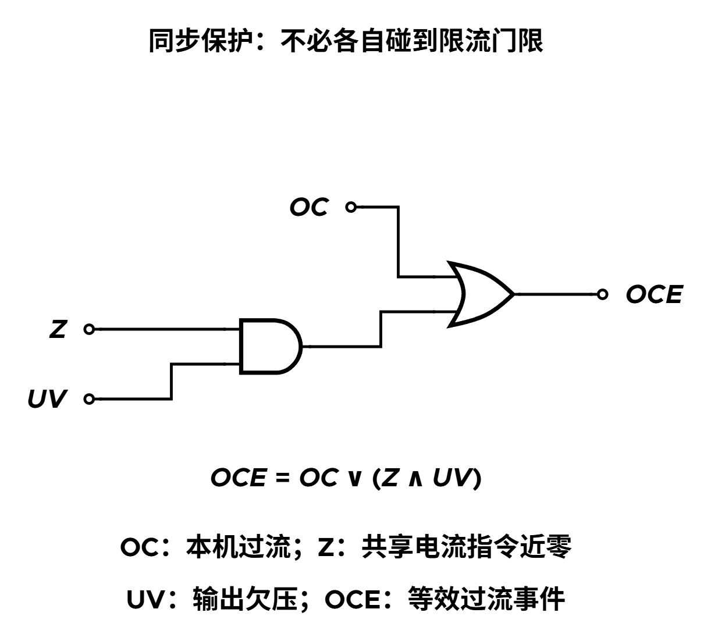
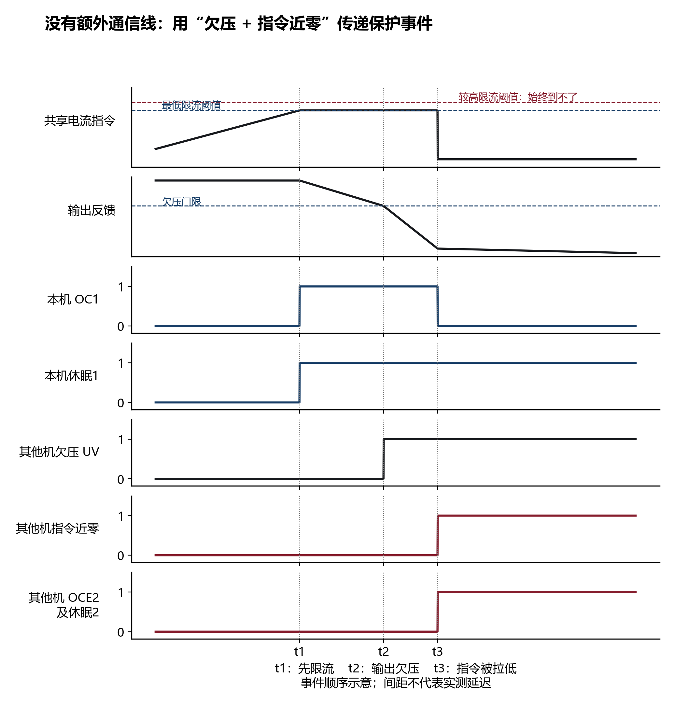
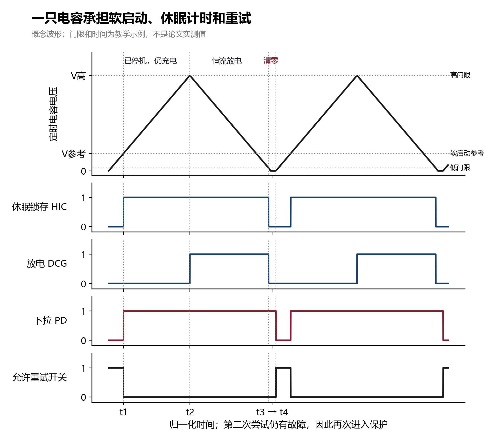
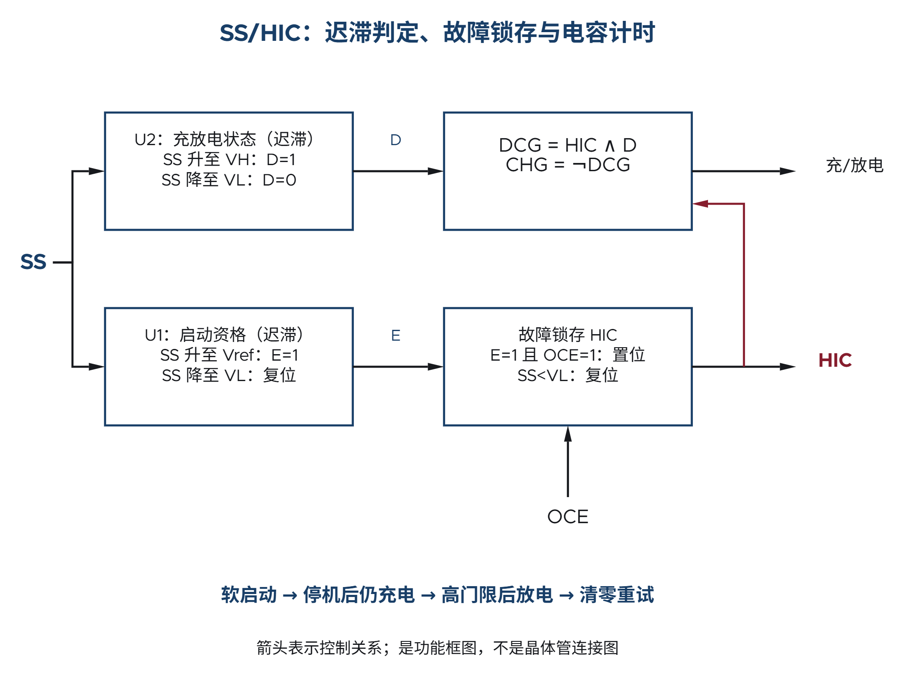
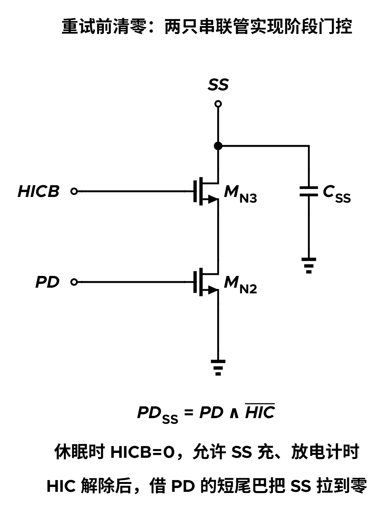

Buck 输出短路时，输出电压很低，稳压环路却仍在要求增加供流。如果控制器只把每个开关周期的峰值电流限制住，功率管和电感仍可能长时间承受较大的电流。限住峰值解决了“这一周期不能继续增流”的问题，却没有充分减少持续故障下的平均发热。

一种办法是：**允许短暂尝试供电，故障持续就停机较长时间，然后从低电压重新软启动；若仍有故障，再重复这一过程。** 这种反复尝试的保护方式称为打嗝保护，英文为 hiccup。

单个控制器可以自己安排停机与重试；多个控制器并联为同一输出供电时，还要解决“大家是否一起停、一起等、一起重试”。本篇先建立单机保护过程，再逐步引入共享信号、故障锁存与电容计时，不要求读者预先了解任何特定芯片。

[Buck 功率级](/zh/notes/buck-day-01/) · [恒流电容定时基础](/zh/notes/buck-on-time-timer/) · [学习地图：多相保护](/zh/learn/#multi-phase-protection) · [小 DCR 电流检测](/zh/notes/buck-small-dcr-shared-amplifier/)

## 1. 先把单机保护的一轮过程走通

### 1.1 限流与打嗝分工不同

逐周期限流在电流达到门限时限制或终止当前功率脉冲。打嗝保护则进一步改变较长时间内的工作安排：停止正常供能，等待一段时间，再给负载一次启动机会。停机不能让电感电流瞬间归零，实际功率级还需妥善安排续流和同步整流。重试期间仍需要快速限流，不能用“稍后会停机”代替当前周期的电流约束。

为了直观理解停机的用途，假设每次尝试持续 1 ms，随后停机 12 ms，只有约 $1/13$ 的时间在尝试供能。若尝试时损耗相近、停机损耗很小，平均损耗会明显下降。但真实发热仍与电流波形、启动能量和停机损耗有关，不能只凭这个时间比例确定温升。

### 1.2 为什么不能“过流标志一消失就重新开机”？

一旦停机，电感电流会下降，本地过流标志很可能随之消失。如果仅由这个瞬时标志决定是否开机，控制器就可能很快重新启动，无法形成预定的长等待。

因此，需要把两种东西分开：**故障检测标志表示现在看到了什么，故障状态记录接下来必须完成什么。** 一次有效故障把停机状态置位；即使检测标志后来消失，也必须等定时过程结束才允许退出。承担这种“记住一次事件”的电路就是锁存器。

### 1.3 重试为什么要从软启动开始？

输出电容的电荷满足 $i_C=C_o\,dv_o/dt$。这里 $C_o$ 是输出电容，$v_o$ 是输出电压。若重试时立即要求输出达到最终目标，给输出电容补电的需求可能很大，尚未恢复的系统又会立刻触发限流。

软启动通过逐渐提高调节参考或允许供流，使输出有机会受控建立。常见做法是给一个接地的软启动电容 $C_{SS}$ 充电，用它的电压 $v_{SS}$ 生成逐渐上升的启动参考。SS 是 soft-start 的缩写，与 Buck 的开关节点 SW 是不同节点。

这样，单机的一轮过程就有了四个必要动作：确认故障并锁存停机 → 等待 → 清除启动状态 → 软启动重试。下面要解决的是：多个控制器能否完成同一轮过程。

## 2. 多个控制器并联后，共享了什么？

设想两个控制器各自驱动若干相电感，但所有相连接到同一输出。它们都能看到输出电压，并且共享两类慢信号：

| 共享量 | 物理含义 | 为什么共享 |
| --- | --- | --- |
| 电流指令 $v_{cmd}$ | 用电压表达的供流目标，具体电压到电流的比例由检测链决定 | 使各控制器依据同一供流要求工作 |
| 软启动电容电压 $v_{SS}$ | 决定启动进度，也可用作保护计时 | 使启动参考和重试进度一致 |

电流指令是控制信号，不是负载电流本身，也不是承载大电流的导线。正常稳压时，输出不足会促使环路提高供流要求；控制器再把指令与检测到的电流比较，决定实际功率脉冲。

共享信号并不意味着本地判断完全一致。各控制器仍有自己的比较器和保护门限。器件偏差可能使一台先认为“电流要求已经过大”，另一台还认为“尚未到我的门限”。

本篇讨论的正是这种共享模拟控制节点、各自保留本地保护判断的并联系统。若所有相本来就由一个集中保护模块管理，同样的同步困境未必存在。

## 3. 为什么每台都有过流保护，系统仍可能停不下来？

### 3.1 最先触发的控制器可能挡住其他控制器

用一个教学例子看门限偏差。假设控制器 1 在电流指令达到 1.00 V 时进入本地限流，控制器 2 的对应门限为 1.05 V。负载过重使共享指令持续升高；控制器 1 先达到门限，并把共享节点钳在约 1.00 V。

此时控制器 2 的门限虽然只高了 50 mV，却再也等不到自己的触发条件。于是可能出现“一台已经进入保护，另一台还在运行”的分裂状态。这个例子只说明门限与钳位的关系，数值不代表实际器件参数。

### 3.2 同一个电容，可能被两种动作同时拉扯

若进入保护的控制器开始给共享 SS 电容放电，仍在正常状态的控制器却继续充电，电容的运动由总电流决定：

$$C_{SS}\frac{dv_{SS}}{dt}=\sum I_{charge}-\sum I_{discharge}.$$

这里的充、放电电流均按正的幅值计。例如仍在运行的一台提供 10 µA 充电，已进入保护的一台只能下拉 5 µA，则净电流仍为 +5 µA，电容反而继续上升。保护控制器等不到低门限，其他控制器也没有跟随停机，预定的打嗝周期就走不完。

困难并不在于“少了一只更准的比较器”，而在于：**本地过流门限依赖的共享变量被钳住后，其他控制器失去了触发自身保护的机会。** 必须让先发现故障的一台，把“应进入保护”变成大家都能识别的事件。

## 4. 怎样利用现有共享信号传播故障？

### 4.1 主动制造一个能区分故障的状态组合

一种方法是让先停机的控制器主动把共享电流指令拉到接近地电位。其他控制器虽然没达到自己的限流门限，却能检测到指令被强制拉低；再结合输出已经欠压，就知道系统正处于保护过程。

先定义三个逻辑条件，值为 1 表示条件成立：

| 条件 | 如何得到 | 表示什么 |
| --- | --- | --- |
| OC | 本地限流检测 | 本机已经达到过流判据 |
| Z | $v_{cmd}$ 低于专门的近零门限 | 共享指令被拉到保护用的低电平区域 |
| UV | 输出反馈低于欠压门限 | 输出已经明显低于正常目标 |

用这些条件构造统一的保护请求 OCE，称为等效过流事件：

$$\boxed{OCE=OC\lor(Z\land UV).}$$

$\lor$ 表示“或”，$\land$ 表示“与”。也就是说，本机真正过流可以发出请求；即使本机未过流，只要同时看见“指令被拉低”和“输出欠压”，也可以进入同一保护流程。

### 4.2 为什么不能只检测指令低，或只检测欠压？

轻载时电流目标本来就会降低，负载阶跃时输出也可能短暂下跌。若只用其中一个条件，就容易把正常过程误认为持续故障。

两个条件组合仍需要电平设计。例如可把正常零电流对应的指令设为带偏置的正电压 $V_0$，而把保护时的指令强制拉到接近 0 V。近零检测门限应处在两者之间，留出偏差与噪声余量。这样 Z 表示的是“进入了保护电平区域”，不是泛指“当前负载很轻”。

这要求实际系统的所有正常模式都能与该组合区分。如果正常模式也会同时出现 Z 与 UV，就需要重新设计判据或使能条件。特别是刚开始软启动时，输出天然偏低、指令也可能很小，不能无条件接受这类保护请求。

### 4.3 沿一次故障看状态如何传播

假设系统此前已完成启动，各控制器都具有进入保护的资格：

1. **t1：控制器 1 先达到限流门限。** 本机 OC 使 OCE 成立，锁存停机；之后开始主动拉低共享电流指令。
2. **t2：输出低于欠压门限。** 负载需求无法满足，各控制器都能看见 UV。
3. **t3：共享指令进入近零区域。** 控制器 2 看见 Z 与 UV 同时成立，即使它的 OC 始终为 0，也会接受 OCE，跟随进入保护。

图中的 t1、t2、t3 帮助分开看各个因果环节，并不表示要增加三只定时器。实际欠压与指令拉低的先后、传播时间取决于输出放电、环路和检测路径。所谓同步保护，是各控制器进入一致的保护与重试流程，不能解释成所有器件在同一物理瞬间动作。

## 5. 停机已经记住了，等待时间从哪里来？

### 5.1 让软启动电容兼任计时器

停机阶段不再需要 SS 控制输出上升，可以让它继续运动，为保护计时。软启动参考通常只在启动早期约束正常调节参考，可以理解为“启动参考与正常参考取较小值”；达到正常目标后，SS 继续上升不会把目标输出继续抬高。这样才能把电容上方的电压行程留给保护计时。

恒流充、放电时有：

$$\frac{dv_{SS}}{dt}=\frac{I_{ch}}{C_{SS}}\quad\text{或}\quad\frac{dv_{SS}}{dt}=-\frac{I_{dis}}{C_{SS}}.$$

$I_{ch}$、$I_{dis}$ 分别是共享电容实际得到的净充电与净放电电流幅值。注意这里用的是所有参与控制器合成后的电流，不是随意取某一台的标称电流。

把电容电压从一个门限移到另一个门限，就得到一段已知时间。为形成较长的停机等待，设置三个有序门限：

$$0<V_L<V_{ref}<V_H.$$

$V_{ref}$ 是 SS 达到正常启动进度所需的参考门限，$V_H$ 是保护计时的高门限，$V_L$ 是结束放电的低门限。这些均指 **SS 节点上的电压**，不应与输出欠压门限混为一谈。

### 5.2 一轮持续故障分成四段

**A：从零软启动，到参考门限前给输出一次建立机会。** 电容从接近零开始充电，启动参考随之上升。在 $v_{SS}$ 尚未达到 $V_{ref}$ 时，不允许锁存打嗝停机；快速限流仍工作。否则启动时天然存在的欠压和限流，可能让系统永远无法完成一次尝试。

**B：确认故障后停机，但先继续充电。** SS 越过 $V_{ref}$ 后，若保护请求仍有效，就锁存停机。此时 SS 不必马上下降，而是继续充到 $V_H$。输出已经停止供能，但电容的剩余上升行程仍在生成等待时间。

**C：到达高门限后，转为放电。** SS 从 $V_H$ 放到 $V_L$。充放电方向需要被记住，不能在电压刚低于 $V_H$ 时就立刻改回充电。

**D：低门限解除停机，再用短下拉完成清零。** 到 $V_L$ 后解除停机锁存。由于恒流下拉源接近地时会失去电压余量，再补一小段强制下拉，使电容真正回到地附近。下拉释放后，才开始下一次有效软启动。

读图时先沿 SS 曲线看电荷的去向，再对应下方状态。尤其注意：HIC 已经在 t1 变高，但放电 DCG 要等到 t2 才开始；HIC 又在 t3 变低，但有效重试还要等到 t4。**停机、放电、清零和重试是四个不同动作。**

图 3 对应的是反复重试、在参考门限附近再次确认故障的情形。若首次故障发生在正常运行很久以后，SS 可能已经处于高电位，那么“停机后继续充电”这一段会缩短或不存在，不能把图中的等待时间套给任意故障初值。

## 6. 为什么需要两个迟滞判决和一个锁存器？

### 6.1 同一个 SS 电压，可能对应不同历史

当 SS 处于 $V_L$ 与 $V_H$ 之间时，它可能正在从零向上充，也可能已经到过高门限、正在向下放。只看当前电压，不足以决定接下来该充还是该放，需要保留“是否已经到过某个门限”的信息。

迟滞比较器恰好可以做这件事：上升时到较高门限才置位，下降时到较低门限才复位，中间区间保留先前状态。它既能减少门限附近来回翻转，也能表达充放电过程中的方向记忆。

### 6.2 先命名状态，再把动作接起来

下面用高有效的功能信号描述逻辑。HIC 表示已锁存的休眠停机状态；E 表示已获得保护资格；D 表示已经进入高门限后的放电阶段。

| 单元 | 置位条件 | 清除条件 | 保留的信息 |
| --- | --- | --- | --- |
| U1：保护资格判决，输出 E | SS 上升到 $V_{ref}$ | SS 下降到 $V_L$ | 这次启动已获得完整尝试机会 |
| U2：充放电阶段判决，输出 D | SS 上升到 $V_H$ | SS 下降到 $V_L$ | 电容已到过高门限，应继续完成放电 |
| 故障锁存器，输出 HIC | E 有效且 OCE 成立 | SS 到低门限的复位条件 | 已接受一次故障，必须走完停机过程 |

在功能图中，低门限复位具有优先级；真实锁存器还应处理输入极性、竞争和禁止组合。上电初始状态也需要由启动复位逻辑保证。

放电仅在“已停机”且“已到高门限”时发生：

$$DCG=HIC\land D,\qquad CHG=\overline{DCG}.$$

DCG 为放电使能，CHG 为充电使能，上划线表示逻辑取反。这两式描述常规恒流充、放电支路的选择；末端强制清零还会覆盖正常充电动作，下一节单独讨论。

这样安排有两个关键后果。第一，停机使 OC 消失后，HIC 仍会保持，避免提前恢复。第二，放电途中即使 SS 已低于 $V_{ref}$，E 和 HIC 也不会立即清除，仍要走到 $V_L$。若把资格判决做成单一 $V_{ref}$ 比较器，反而会在放电半途过早退出保护。

正常运行时，即使 SS 曾经达到高门限、使 D=1，只要 HIC=0，就不会单凭 D 开始保护放电。两个条件相与，使“电容已经很高”和“现在应进入保护放电”保持区别。

## 7. 清零要延迟结束，为什么还要加门控？

### 7.1 恒流放到低门限，不等于初值已经是零

恒流下拉源接近地电位时，晶体管可用的漏源电压减小，电流不再恒定。若只依靠这条支路，很难既保证线性计时，又迅速消除最后一点残压。

残压会改变下一轮启动。假设启动电容原应从零充到 $V_{ref}$，实际却从 $V_{res}$ 开始，那么充电时间变为：

$$t_{start}=\frac{C_{SS}(V_{ref}-V_{res})}{I_{ch}}.$$

$V_{res}$ 是下拉释放后的残余电压。残压越大，启动时间越短，初始允许的供流也可能偏大。因此应在结束等待后，安排一小段足够强的清零动作，再释放重试。

### 7.2 下拉信号的“尾巴”怎样产生？

可用另一只小电容保存下拉控制信号：HIC 有效期间把它充高；HIC 解除后，通过小电流慢慢放掉。小电容电压未降到逻辑翻转门限前，下拉信号 PD 仍为 1。PD 因而会比 HIC 晚一点结束，留出清零时间。

但是 PD 在整个休眠期间也为 1。如果直接用它把 SS 接地，§5 所需的“继续充到高门限，再恒流放电”就完全无法进行。延迟本身没有解决这个冲突，还必须加上阶段门控。

### 7.3 两只串联管，让强下拉只在正确阶段生效

把 SS 到地的强下拉路径拆成两只串联 NMOS：MN2 由 PD 控制，MN3 由 HICB 控制，其中 HICB 是 HIC 的反相信号。因此：

$$\boxed{PD_{SS}=PD\land\overline{HIC}.}$$

沿三个阶段看这条串联路径：

- **休眠计时：** HIC=1，HICB=0。即使 PD=1，MN3 也隔断强下拉，SS 仍能按恒流支路充、放电。
- **刚到低门限：** HIC 变为 0，HICB=1；PD 暂时仍为 1。两管同时导通，SS 被强制拉到地附近。
- **清零结束：** 延迟尾巴耗尽，PD=0，MN2 关断，SS 才获得下一次自由上升的机会。

电流指令端则可在 PD 有效期间持续下拉，用于保持低供流要求和传播故障；它不需要让 SS 在整段休眠中接地。共享一个控制信号的两个执行端，因为功能不同，需要不同门控。

强下拉期间还可能有充电电流。设计时需使净下拉足以把 SS 拉到允许残压以下，或在这段时间屏蔽充电。HIC 解除只是打开了恢复条件的一部分；电流指令与 SS 下拉尚未释放时，还不能把系统当成已经开始有效软启动。

## 8. 怎样算重试周期，并判断电容复用的收益？

### 8.1 时间就是电压路程除以斜率

考虑持续故障：SS 从接近零充到 $V_{ref}$，资格打开后很快再次确认故障。忽略故障确认延迟、输出建立差异和电流变化，尝试供电的时长约为：

$$t_{try}\approx\frac{C_{SS}V_{ref}}{I_{ch}}.$$

停机后，先从 $V_{ref}$ 继续充到 $V_H$，再放到 $V_L$，最后强制清零：

$$t_{sleep}\approx\frac{C_{SS}(V_H-V_{ref})}{I_{ch}}+\frac{C_{SS}(V_H-V_L)}{I_{dis}}+t_{reset}.$$

$t_{reset}$ 表示低门限之后的清零尾巴。若故障是在 SS 的其他电压处被接受，应把第一项中的 $V_{ref}$ 换成实际停机初值，并根据 U2 当前状态判断还是否存在继续充电段。

### 8.2 一组完整的教学数字

取 $C_{SS}=10$ nF、$I_{ch}=I_{dis}=10$ µA、$V_{ref}=0.6$ V、$V_H=3.0$ V、$V_L=0.1$ V，并假设清零尾巴 $t_{reset}=0.1$ ms。各阶段的理想时间为：

| 阶段 | 电压行程 | 时间 |
| --- | --- | --- |
| 软启动尝试 | 0 → 0.6 V | 0.6 ms |
| 已停机、继续充电 | 0.6 → 3.0 V | 2.4 ms |
| 高门限后放电 | 3.0 → 0.1 V | 2.9 ms |
| 强制清零 | 0.1 V → 接近零 | 假设分配 0.1 ms |

因此 $t_{sleep}\approx5.4$ ms，一轮约 6.0 ms，尝试时间约占 10%。清零阶段不是沿用 10 µA 恒流支路，而是另一条强下拉路径；表中 0.1 ms 是为它分配的教学时间，是否足够必须由实际电路校核。

这组参数只用于计算。高门限必须处在实际电源、电容额定电压、比较器输入范围和电流源余量内，不能把 3.0 V 直接搬到任意低压芯片上。

### 8.3 为什么先上升一段，比只做极慢放电更灵活？

若只利用 0.6 V 放到 0.1 V 的 0.5 V 行程，同样的 10 nF、10 µA 只能等待 0.5 ms。为了延长等待，可以增大电容或减小放电电流；前者增加电容需求，后者使泄漏占比和时间误差更难控制，电压斜率也更浅。

借用停机后的继续充电段，再使用更大的下降行程，可以在既有电容上取得更长等待。代价是需要更高的允许电压范围、额外迟滞判决与可靠的阶段逻辑。

若充放电电流与门限都固定，前三段时间均随 $C_{SS}$ 成比例变化，改变电容主要改变绝对周期。固定清零尾巴、故障确认时间、电流源误差和各控制器偏差会使工作/休眠比例偏离这一理想缩放。比例应由实际状态过程计算，不能只看电容值。

## 9. 把检测、状态和执行重新连成一条链

一次可靠的并联保护可以沿着五个环节检查：本机先识别异常，共享节点使其他控制器识别同一事件，锁存器记住停机，电容完成等待，最后清零并释放重试。每个环节都解决前一个环节留下的问题。

OCE 解决“其他控制器怎样知道该停”；HIC 解决“故障标志消失后怎样继续等待”；迟滞解决“怎样记住已经到过高门限”；PD 的尾巴与 SS 门控解决“怎样在正确阶段把初值清干净”。只保留其中某一块，都不足以组成完整的打嗝过程。

多个控制器共享同一电容，还必须检查门限偏差、同步传播时间、净充放电方向，以及个别控制器上电、关断或失去供电时的行为。共享节点给了共同进度，但能否一致切换仍依赖检测与执行的容差设计。

与[电容定时器](/zh/notes/buck-on-time-timer/)相比，这里使用的物理关系仍是 $t=C\Delta V/I$，新增的是同一电容在不同状态下承担不同任务。与[小 DCR 电流检测](/zh/notes/buck-small-dcr-shared-amplifier/)相比，电流检测回答“每相实际供了多少电流”，本篇回答“检测到异常以后，整个并联系统应怎样共同动作”。

## 参考资料与模型说明

并联控制器的同步保护判据、SS 电容复用、迟滞与延迟下拉实现参考 Yingyi Yan、Eric Gu，JSSC 2021，[DOI: 10.1109/JSSC.2021.3071728](https://doi.org/10.1109/JSSC.2021.3071728)，重点为第三章。本文按“短路—单机打嗝—共享冲突—故障传播—计时—清零”的因果顺序组织，使用高有效功能信号解释逻辑，不依赖特定门级实现。

图 1 表示组合逻辑，图 4 表示带历史状态的功能框图；二者均不能代替包含上电复位、延迟与竞争处理的完整实现。图 5 仅核对局部电气连接，未做性能仿真。图 2–3 为教学时序，非测量数据。

1.00/1.05 V 门限、充放电冲突中的 10/5 µA，以及 §8 的电容、门限和时间均为分别说明对应问题的教学假设；不是论文样机测量值，也不构成具体芯片的设计参数。
