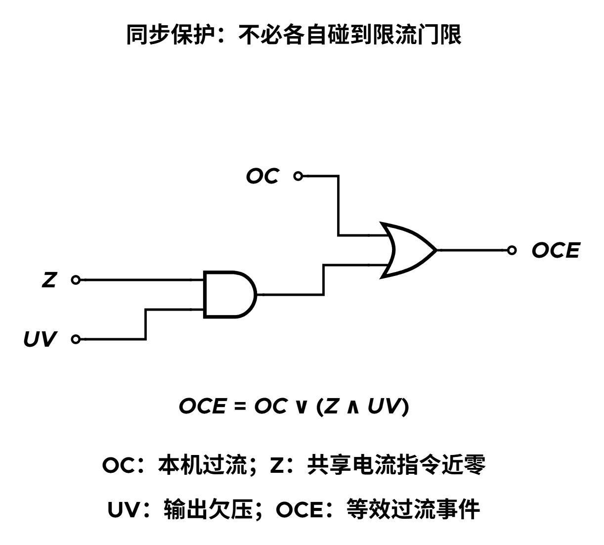
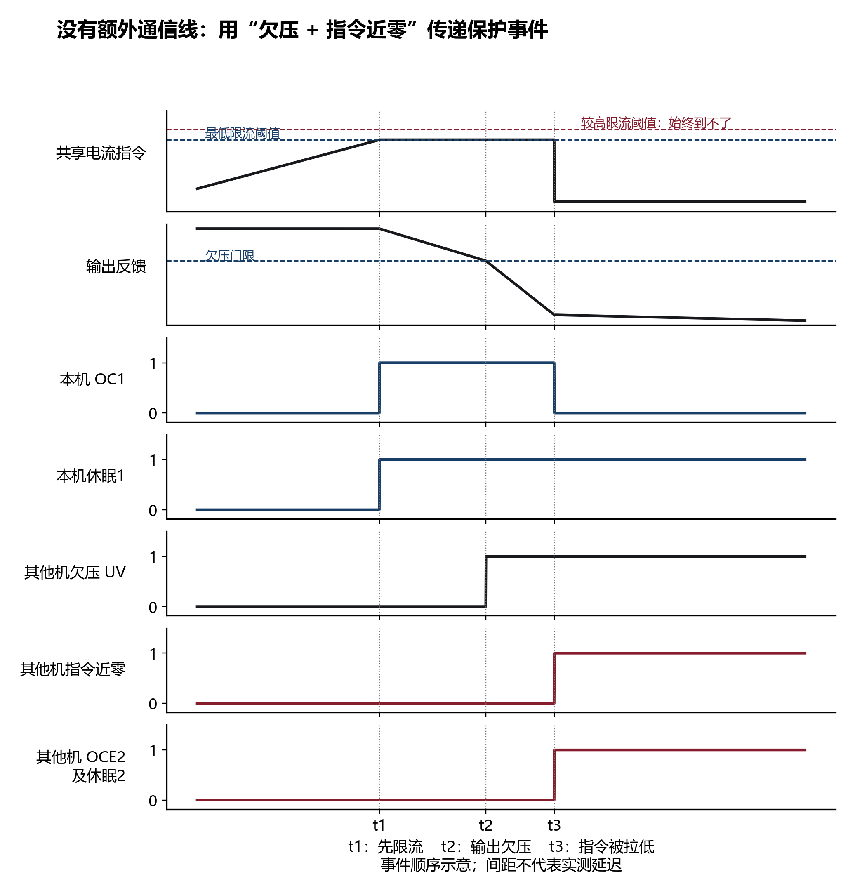
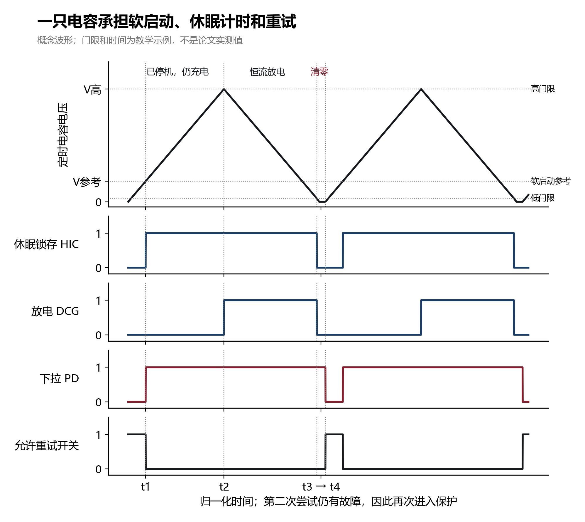
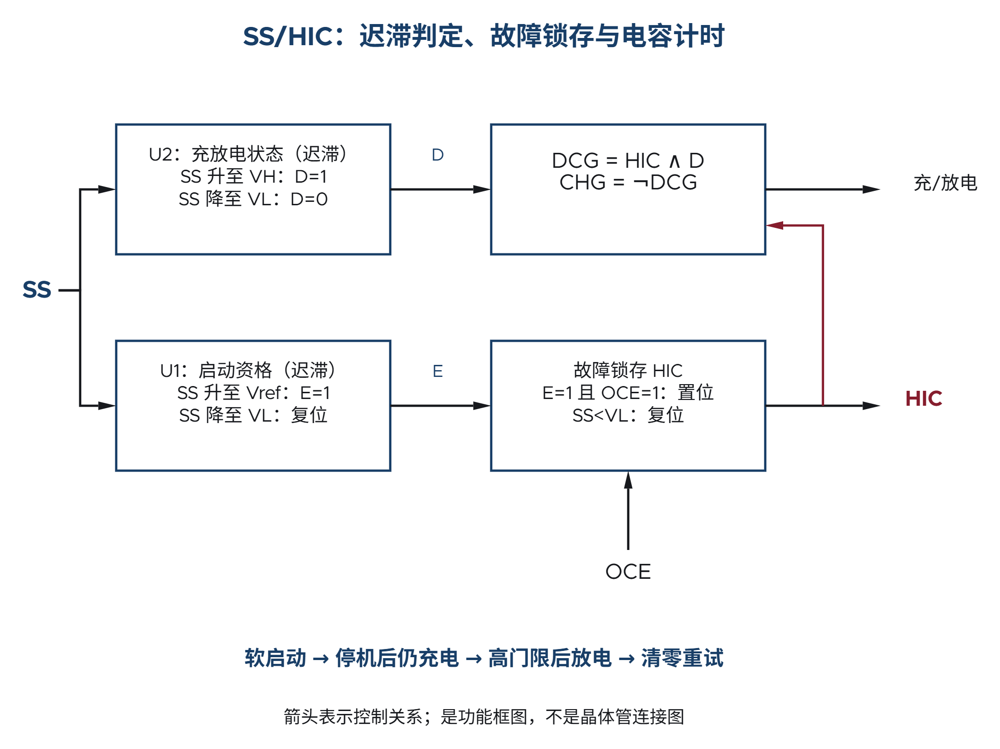
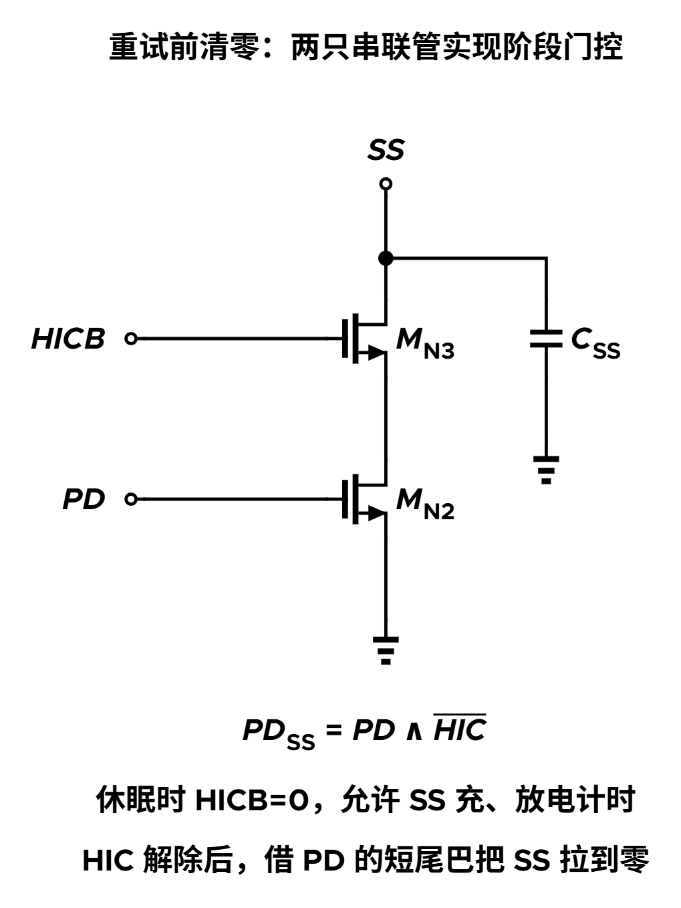

Buck 输出短路时，$V_o$ 跌到接近零，电压环会拼命把供流指令拉满。如果只靠**逐周期限流**硬扛，每个周期电感电流依然冲到峰值上限，功率管和电感在持续短路下照样会过热烧毁。

**打嗝保护**（Hiccup）的思路很直接：**短暂尝试供电 $\to$ 确认故障后彻底停机冷却 $\to$ 过一段时间重新软启动**；若短路还没撤除，就重复这套“打嗝”循环。比如每次只试 $1\text{ ms}$、停机休息 $12\text{ ms}$，平均发热就能压到原来的约 $1/13$。

单颗控制器做打嗝很简单，但**多颗多相控制器并联给同一负载供电时，麻烦来了：大家怎么做到一起停、一起等、一起重启？**

> **全篇核心线索**
> 1. 靠**共享故障信号** $OCE = OC \lor (Z \land UV)$ 解决“一台先限流、另一台永远等不到过流”的分裂困境；
> 2. 靠**软启动电容 $C_{SS}$ 复用 + 两个迟滞比较器 + 末端清零门控**，用同一颗电容依次完成“软启动尝试 → 锁存等待 → 放电 → 归零重启”。

前置知识：[Buck 功率级](/zh/notes/buck-day-01/) · [恒流电容定时基础](/zh/notes/buck-on-time-timer/) · [多相学习地图](/zh/learn/#multi-phase-protection) · [小 DCR 电流检测](/zh/notes/buck-small-dcr-shared-amplifier/)

---

## 1. 先理顺单机打嗝必须有的四个部件

在看多机同步之前，先记住单机打嗝的四个基本机制，缺一不可：

1. **逐周期限流（快速保护）**：哪怕准备进入打嗝，在确认停机的那一刻之前，也必须先把当前脉冲的峰值电流卡住。
2. **故障锁存器（记住停机状态）**：一旦停机，电感电流很快归零，本地过流标志 `OC` 也会跟着消失。必须用锁存器记住“已发生故障”，强迫走完长休眠定时，不能标志一消失就立刻开机。
3. **软启动重试（防止开机再撞墙）**：重启时输出电容电压几乎为零；如果直接全速稳压，巨大的充电涌流会瞬间再次触发限流。因此必须靠软启动电容 $C_{SS}$ 慢慢抬高参考电压。
4. **共享节点（并联前提）**：多颗并联控制器除了共用输出 $V_o$，通常还会把**电流指令 $v_{cmd}$** 和**软启动节点 $v_{SS}$** 接在一起，让所有控制器按同一份供流指令和启动进度同步工作。

---

## 2. 并联难题：为什么每台都有保护，系统却停不下来？

设想两台控制器各自管着几相电感，并联输出，并共享 $v_{cmd}$ 和 $v_{SS}$。各控制器内部有自己的过流比较器，器件难免存在一点门限偏差。

### 2.1 先触发的一台把共享指令“钳死”了

假设控制器 1 在 $v_{cmd}=1.00\text{ V}$ 时进入本地限流，而控制器 2 的门限略高一点（$1.05\text{ V}$）。负载严重过流时，共享指令 $v_{cmd}$ 一路攀升：
- 一到 $1.00\text{ V}$，**控制器 1 先进入限流停机，并把共享节点 $v_{cmd}$ 钳制在 $1.00\text{ V}$ 以下**；
- 结果控制器 2 永远等不到自己的 $1.05\text{ V}$ 门限，以为一切正常，继续往短路输出猛灌电流！

### 2.2 共享软启动电容被“一充一放”拉扯死锁

更糟的是两台还共用同一个 $C_{SS}$：
$$C_{SS}\frac{dv_{SS}}{dt}=\sum I_{charge}-\sum I_{discharge}.$$
假如进入保护的控制器 1 用 $5\,\mu\text{A}$ 给 $C_{SS}$ 放电，而仍在正常运行的控制器 2 却用 $10\,\mu\text{A}$ 继续充电，净电流仍是 $+5\,\mu\text{A}$。电容电压不仅降不到复位低门限，还可能一直卡在高位，整套打嗝状态机彻底瘫痪。

> **问题根源**：本地门限依赖的共享变量被先触发者钳住后，其余控制器失去了自主发现故障的机会。**先停机的那台必须主动发出一个“大家都能看懂的全局停机信号”。**

---

## 3. 解法一：利用现有共享信号制造“等效过流事件 OCE”

不额外增加专用通信引脚，怎么把故障传给所有并联控制器？答案是**主动把共享电流指令 $v_{cmd}$ 拉到接近地电位**。

### 3.1 构造组合判据 $OCE$

先定义三个高有效逻辑条件：

| 逻辑信号 | 触发条件 | 物理含义 |
| --- | --- | --- |
| **OC** | 本地峰值电流达限流阈值 | 本机亲自抓到了过流 |
| **Z** | $v_{cmd}$ 低于专门的近零门限 | 某台控制器正在把共享指令强拉到保护低电平 |
| **UV** | 输出电压反馈低于欠压门限 | 输出确实被拖垮了（不是正常的轻载省电） |

将它们组合成统一的**等效过流事件（OCE）**：

$$\boxed{OCE = OC \lor (Z \land UV).}$$

### 3.2 为什么必须把 `Z` 和 `UV` 做“与”逻辑？

- **不能只看 `Z`**：轻载时电流指令本身就很低；为此设计上通常把正常零负载对应的 $v_{cmd}$ 抬高到一个正偏置电平 $V_0$，把保护拉低电平压到接近 $0\text{ V}$，让 `Z` 门限落在两者之间。即便如此，单靠 `Z` 仍可能受噪声误触发。
- **不能只看 `UV`**：输出负载阶跃瞬间，$V_o$ 也可能短暂掉进欠压区，但此时环路正在拼命抬高 $v_{cmd}$ 救场，绝不该误判停机。
- **只有 `Z && UV` 同时成立**：既看到输出垮了，又看到共享指令反常地跌到保护区，说明**肯定已有同伴拉响警报并停机了**，其余控制器立刻跟随进入保护。

### 3.3 沿故障时序走一遍同步过程

1. **$t_1$ 时刻**：控制器 1 率先达到本地 `OC`，立即锁存停机，并启动强下拉把共享 $v_{cmd}$ 拖向地；
2. **$t_2$ 时刻**：失去部分供流后输出继续下跌，全员同时检测到欠压 `UV=1`；
3. **$t_3$ 时刻**：$v_{cmd}$ 跌进近零区域，`Z=1`。此时控制器 2 的本地 `OC` 始终为 0，但因 `Z && UV = 1`，触发 `OCE=1`，**成功跟随锁存停机**；
4. **随后**：两台全停，控制器 1 的 `OC` 消失，但**锁存状态已保持**，两台一起进入休眠等待。

---

## 4. 解法二：把软启动电容 $C_{SS}$ 兼职当“休眠计时器”

正常工作时，软启动参考只在 $v_{SS}$ 低于内部基准时起限幅作用；一旦软启动完成，允许 $v_{SS}$ 继续往上充，不会抬高正常稳压目标。这段**多出来的上方电压行程**，正好拿来给打嗝休眠做恒流计时：

$$\frac{dv_{SS}}{dt}=\frac{I_{ch}}{C_{SS}}\quad\text{或}\quad -\frac{I_{dis}}{C_{SS}}, \qquad 0 < V_L < V_{ref} < V_H.$$

三个门限从低到高分工明确：
- **$V_L$**：放电结束、准备清零重启的**低门限**（如 $0.1\text{ V}$）；
- **$V_{ref}$**：软启动完成的**参考门限**（如 $0.6\text{ V}$）——在此之前屏蔽打嗝锁存，防止正常开机欠压误触发停机；
- **$V_H$**：保护计时的**高门限**（如 $3.0\text{ V}$）。

### 一轮持续短路分成四个阶段

| 阶段 | 时间区间 | $v_{SS}$ 行程 | 核心动作与目的 |
| --- | --- | --- | --- |
| **A. 软启动尝试** | $0 \to t_1$ | $0 \to V_{ref}$ | 逐步放开供电尝试建立 $V_o$；**屏蔽打嗝锁存**（仅保留逐周期限流） |
| **B. 锁存并续充** | $t_1 \to t_2$ | $V_{ref} \to V_H$ | 越过 $V_{ref}$ 后确认故障未消，**锁存停机 `HIC=1`**；功率级已关断，但电容**继续往上充**来拉长等待时间 |
| **C. 恒流放电** | $t_2 \to t_3$ | $V_H \to V_L$ | 到达 $V_H$ 后切换方向恒流放电，构成主要的休眠冷却期 |
| **D. 强下拉清零** | $t_3 \to t_4$ | $V_L \to 0$ | 到达 $V_L$ 时解除 `HIC`，再用一小段**强制下拉尾巴**彻底归零电容，之后放手重试 |

> **为什么不直接从 $V_{ref}$ 放到 $V_L$，非要多此一举先充到 $V_H$？**
> 假设 $C_{SS}=10\text{ nF}$、充放电电流均为 $10\,\mu\text{A}$。如果只从 $0.6\text{ V}$ 放到 $0.1\text{ V}$，行程只有 $0.5\text{ V}$，休眠仅 $0.5\text{ ms}$——想拉长等待就得把电容做大好几倍，或者把放电电流压到容易受漏电干扰的级别。**先顺路充到 $3.0\text{ V}$ 再放到 $0.1\text{ V}$，同一颗小电容就能轻松换出 $5.3\text{ ms}$ 的长休眠**（见第 7 节算例）。

---

## 5. 状态机实现：为什么需要两个迟滞比较器 + 一个锁存器？

光看 $v_{SS}$ 当前电压（比如 $1.5\text{ V}$）无法决定下一步动作：它既可能是**正在从零往高门限充**，也可能是**已经摸过高门限、正在往回放**。因此必须用**迟滞比较器**记住“到过哪里”。

| 逻辑单元 | 输出信号 | 置位条件（变 1） | 复位条件（变 0） | 记住的状态 |
| --- | --- | --- | --- | --- |
| **迟滞比较器 U1** | **E**（保护资格） | $v_{SS}$ 升到 $V_{ref}$ | $v_{SS}$ 降到 $V_L$ | 本轮已给过完整软启动机会，允许锁存故障 |
| **迟滞比较器 U2** | **D**（放电阶段） | $v_{SS}$ 升到 $V_H$ | $v_{SS}$ 降到 $V_L$ | 电容已到过高门限，必须放完这一程 |
| **故障锁存器** | **HIC**（停机状态） | `E && OCE` 同时为 1 | $v_{SS}$ 降至 $V_L$（或上电复位） | 已确认故障并停机（低门限复位优先） |

充放电开关选择逻辑极为简练：

$$DCG = HIC \land D,\qquad CHG = \overline{DCG}.$$

请留意这两个**反直觉但非常精巧的细节**：
1. **为什么 U1（输出 `E`）必须做成迟滞比较器，复位在 $V_L$ 而不是 $V_{ref}$？**
   在阶段 C 刚从 $V_H$ 往下放时，一旦跌破 $V_{ref}$，如果 `E` 立刻清零并顺手复位锁存器，保护就会在半路上提前解除了。把 U1 复位点放到 $V_L$，才能保证 `HIC` 稳稳走到终点。
2. **为什么放电需要 `HIC && D` 相与，而不能只看 `D`？**
   在正常无故障运行时，如果系统一直工作很久，$v_{SS}$ 也会慢悠悠充到 $V_H$ 让 `D=1`。只要此时没有故障（`HIC=0`），`DCG` 依然为 0，不会误触发保护放电。

---

## 6. 末端清零：为什么需要一条“延迟尾巴”+ 两只串联管？

### 6.1 恒流下拉管到低电压会“没力气”

恒流放电电流源靠近地电位时，MOS 管的 $V_{DS}$ 余量耗尽，电流快速萎缩，很难靠它在短时间内把 $C_{SS}$ 彻底拉到 $0\text{ V}$。如果残余了电压 $V_{res}$，下一轮重启时间就会缩水：

$$t_{start}=\frac{C_{SS}(V_{ref}-V_{res})}{I_{ch}}.$$

残压越高，软启动越仓促，越容易在开机瞬间重撞限流墙。因此**在 `HIC` 解除（即刚到达 $V_L$）之后，必须接入一颗直接把 $C_{SS}$ 拧到地的强下拉 NMOS**。

### 6.2 怎么让强下拉在“恰当的几微秒”介入？

设计思路分两步：
1. **生成延迟尾巴 `PD`**：在 `HIC=1` 时给一颗内部小电容充电使 `PD=1`；当 `HIC` 跌回 0 后，让小电容用小电流慢慢放电，使 `PD` **比 `HIC` 晚几十到上百微秒才变回 0**（顺便还能在这段时间继续拉低 $v_{cmd}$）；
2. **必须加门控（两只 NMOS 串联）**：注意 `PD` 在整段 `HIC=1` 的休眠期里也是 1！如果直接用 `PD` 接管 $C_{SS}$ 下拉，电容在休眠期间就会一直被摁在地上，**前面第 4 节的充电/放电计时根本跑不起来**。

因此，在 $C_{SS}$ 到地的强下拉支路上串联两只 NMOS（MN2 接 `PD`，MN3 接 `HICB = ~HIC`）：

$$\boxed{PD_{SS}=PD\land\overline{HIC}.}$$

沿三个时刻对照这条串联支路：
- **休眠计时中**（$t_1\text{–}t_3$）：`HIC=1, HICB=0` $\implies$ MN3 断开，强下拉完全隔离，$C_{SS}$ 专心跑恒流充放电；
- **到达低门限**（$t_3\text{–}t_4$）：`HIC` 翻 0、`HICB=1`，而 `PD` 借着小电容尾巴仍保持 1 $\implies$ 两管全通，**瞬间把 $C_{SS}$ 清零**；
- **清零完成**（$t_4$ 之后）：`PD` 衰减归 0 $\implies$ MN2 断开，$C_{SS}$ 真正从 $0\text{ V}$ 开始下一轮软启动。

---

## 7. 周期公式与数值算例

从持续短路下的周期拆解，可以直接算出尝试时间与休眠时间：

$$t_{try}\approx\frac{C_{SS}V_{ref}}{I_{ch}},\qquad t_{sleep}\approx\frac{C_{SS}(V_H-V_{ref})}{I_{ch}}+\frac{C_{SS}(V_H-V_L)}{I_{dis}}+t_{reset}.$$

代入一组典型参数验算：$C_{SS}=10\text{ nF}$、$I_{ch}=I_{dis}=10\,\mu\text{A}$、$V_{ref}=0.6\text{ V}$、$V_H=3.0\text{ V}$、$V_L=0.1\text{ V}$，强下拉尾巴 $t_{reset}=0.1\text{ ms}$：

| 阶段 | 电压行程 | 计算时长 |
| --- | --- | --- |
| 软启动尝试 $t_{try}$ | $0 \to 0.6\text{ V}$ | $0.6\text{ ms}$ |
| 锁存停机后继续充电 | $0.6 \to 3.0\text{ V}$ | $2.4\text{ ms}$ |
| 高门限后恒流放电 | $3.0 \to 0.1\text{ V}$ | $2.9\text{ ms}$ |
| 末端强下拉清零 $t_{reset}$ | $0.1\text{ V} \to 0\text{ V}$ | $0.1\text{ ms}$ |

总周期 $6.0\text{ ms}$，其中真正尝试供电只占 **$0.6 / 6.0 = 10\%$**。如果想进一步拉长保护休眠比，只需按比例增大 $C_{SS}$（前三个阶段等比例放大），而 $t_{reset}$ 和 $V_H$ 的选取分别受限于清零速度和芯片电源耐压。

---

## 8. 复习速记与自检

把整套同步打嗝机制压缩成五个环环相扣的问答：
- **为什么要 `OCE = OC || (Z && UV)`？** 防止先触发保护的控制器把 $v_{cmd}$ 钳死后，门限略高的兄弟控制器永远收不到信号而继续硬顶短路。
- **为什么需要 `HIC` 锁存器？** 停机后电流归零、本地 `OC` 消失，靠锁存器撑完整个休眠计时。
- **为什么 `C_SS` 先充到 $V_H$ 再放到 $V_L$？** 用同一颗软启动电容换出几倍于 $V_{ref}$ 的电压摆幅，大幅延长休眠时间。
- **为什么两个比较器都要迟滞到 $V_L$？** 既记住电容“已经到过 $V_H$ 该往下放”（U2），又防止放电经过 $V_{ref}$ 时提前把保护资格清掉（U1）。
- **为什么强下拉要用 `PD && ~HIC` 门控？** 让 `PD` 在休眠期别干扰 $C_{SS}$ 计时，只在 `HIC` 结束后的几微秒尾巴里把电容残压彻底清零。

---

## 参考资料

- **相关阅读**：[小 DCR 电流检测与共享放大器](/zh/notes/buck-small-dcr-shared-amplifier/) · [恒流电容定时基础](/zh/notes/buck-on-time-timer/) · [多相 Buck 架构与控制](/zh/notes/multiphase-buck-architecture/)
- **原始文献**：Yingyi Yan, Eric Gu, *IEEE Journal of Solid-State Circuits*, 2021, [DOI: 10.1109/JSSC.2021.3071728](https://doi.org/10.1109/JSSC.2021.3071728)（第 III 章，并联多相控制器的同步打嗝保护与共享软启动电容复用实现；文中 $1.00/1.05\text{ V}$ 门限与 $10\text{ nF}$ 等参数为用于演示工作原理的算例）。
