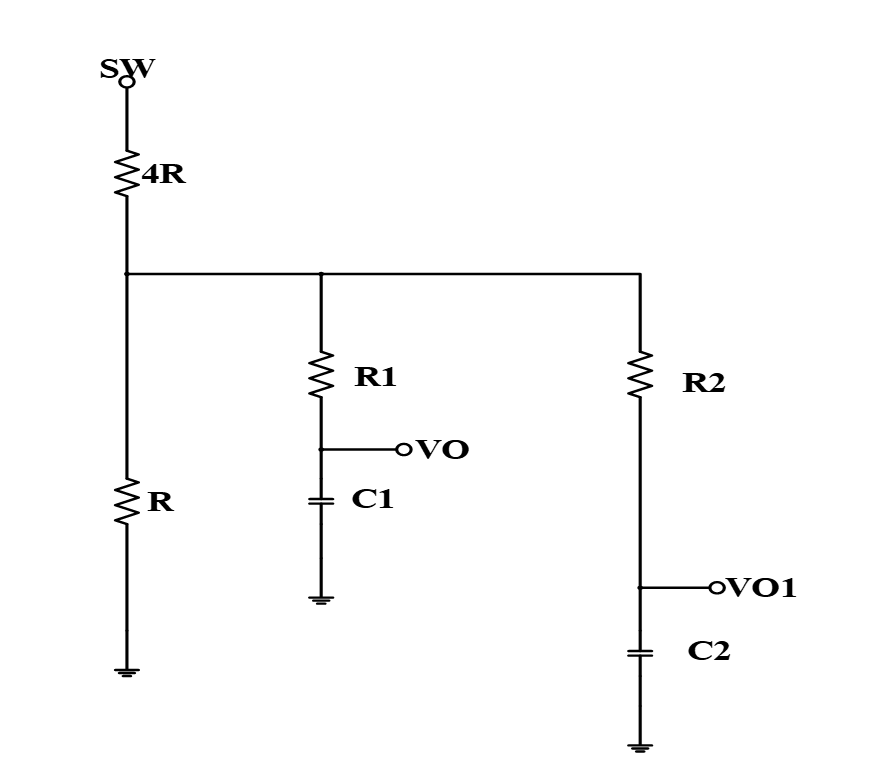
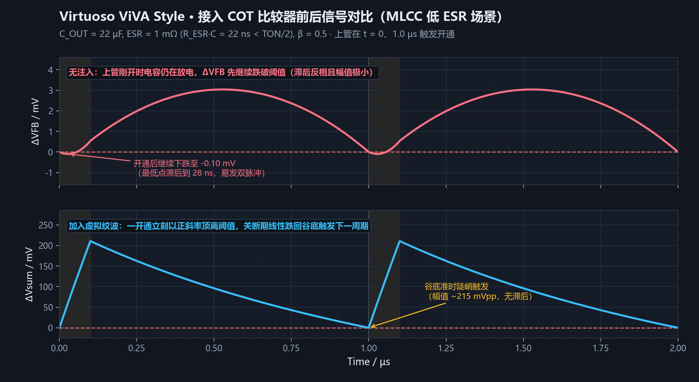

在 [COT 纹波反馈专题](/zh/notes/buck-cot-ripple/) 中我们讲过：使用低 ESR 陶瓷电容（MLCC）时，输出端自然纹波太小且滞后电感电流 $90^\circ$，容易诱发 **次谐波振荡（大小波交替）**；但要是为了稳住环路去换大 ESR 电容，输出纹波又会变脏。

**片内虚拟纹波产生器（On-Chip Virtual Ripple Generator）** 的解法非常巧妙：**既然输出电容上的电流纹波太弱，那干脆直接从开关节点 `SW` 取信号，在芯片内部用两组 RC 网络合成一条“与电感电流同相、且直流为零”的纯交流三角波，偷偷叠给比较器**——既保住了输出端的超低纹波，又让环路绝对稳定。

> **全篇核心直觉**
> 功率电感两端的压差是 $(V_{SW}-V_{OUT})$，电感电流是对这段压差的积分；所以只要在片内让一个时间常数 $\tau_1 \gg T_{ON}$ 的 RC 支路去积分 `SW` 电压，电容上自然就会长出和电感电流一模一样的三角波！再拿另一条超慢的 RC 支路把平均值单独滤出来减掉，剩下的就是纯交流虚拟纹波 $V_{ramp} = V_O - V_{O1}$。

前置知识：[Buck 功率级](/zh/notes/buck-day-01/) · [COT 完整周期](/zh/notes/buck-cot-cycle/) · [COT 纹波反馈与人工注入](/zh/notes/buck-cot-ripple/) · [学习地图：COT](/zh/learn/#cot)

---

## 1. 电路结构与符号约定

### 1.1 关键节点与支路清单

| 符号 / 节点 | 所在位置 | 核心作用 |
| --- | --- | --- |
| **`SW`** | 功率级开关节点（接电感左端） | 提供幅值 $V_{IN}$、占空比 $D$ 的高频矩形方波 |
| **`4R`、`R`** | `SW` 到 `GND` 的串联电阻 | $4:1$ 高压分压器，将 `SW` 衰减为 $\frac{1}{5}V_{SW}$，保护片内低压管 |
| **`V_div`** | `4R` 与 `R` 的中间分压节点 | 分压后的低压方波：高电平 $\frac{1}{5}V_{IN}$，低电平 $0\text{ V}$ |
| **`R1`、`C1`** | 纹波提取支路（$\tau_1 = R_1 C_1$） | 设 $\tau_1 > T_{ON}$，当成近似线性积分器，输出到 **`VO`** |
| **`VO`** | `R1` 与 `C1` 中点（输出 1） | 携带 **直流平均值 + 同相交流三角波** |
| **`R2`、`C2`** | 直流提取支路（$\tau_2 = R_2 C_2$） | 设 $\tau_2 \gg \tau_1$，彻底滤平开关纹波，输出到 **`VO1`** |
| **`VO1`** | `R2` 与 `C2` 中点（输出 2） | 稳态下稳定在纯直流基准 $\frac{1}{5}V_{OUT}$ |

### 1.2 参考电位与方向约定

- **单端 vs 差分**：$V_{SW}$、$V_{div}$、$V_O$、$V_{O1}$ 均以系统模拟地 `GND` 为参考；而最终注入比较器的有效虚拟纹波是**两输出端之差**：
  $$V_{ramp}(t) \triangleq V_O(t) - V_{O1}.$$
- **电流正方向**：分压电流由 `SW` 流向 `GND`；支路电流 $I_{R1}, I_{R2}$ 以从 `V_div` 流入电容 `C1`、`C2` 上极板（即对电容**充电**）为正。

---

## 2. 四步看懂工作原理：从方波到纯交流三角波

### 2.1 四条支路的分工

1. **高压先缩 5 倍（`4R` + `R`）**：
   只要后级电阻远大于分压戴维南内阻（$R_1, R_2 \gg 0.8R$），负载分流可以忽略，分压点电压就是：
   $$V_{div}(t) = \frac{1}{5} V_{SW}(t).$$
   在稳态连续导通（CCM）下，`SW` 的平均值恰好等于 $D V_{IN} = V_{OUT}$，因此 $V_{div}(t)$ 的直流平均值恒为 **$\frac{1}{5}V_{OUT}$**。
2. **中支路积分出三角波（`R1` + `C1` $\to$ `VO`）**：
   故意取 $\tau_1 = R_1 C_1 \gg T_{ON}$，让 `C1` 在一个周期内既充不满也放不完，始终工作在指数响应起始段的**近似线性积分区**。于是 `VO` 在 $\frac{1}{5}V_{OUT}$ 的直流偏置之上，叠出了与电感电流完全同相的三角纹波。
3. **右支路单独抠出直流均值（`R2` + `C2` $\to$ `VO1`）**：
   取 $\tau_2 = R_2 C_2 \gg \tau_1$，把开关频率交流纹波全部滤掉，得到一条平滑水平线 $V_{O1} \approx \frac{1}{5}V_{OUT}$。
4. **差分相减去掉直流偏移（`VO - VO1`）**：
   如果直接把 `VO` 叠进反馈端 $V_{FB}$，上面带着的 $\frac{1}{5}V_{OUT}$ 直流偏置会把输出稳压点整偏。后级用差分放大或三端比较器直接求 $V_O - V_{O1}$，共模直流部分完美抵消，只剩以 $0\text{ V}$ 为中心的纯交流三角波 $V_{ramp}(t)$。

### 2.2 一个开关周期内的充放电演进

稳态下 `C1`、`C2` 均围绕 $\frac{1}{5}V_{OUT}$ 工作：

- **阶段一：上管导通（$0 < t \le T_{ON}$，$V_{SW}=V_{IN}$）**
  此时 $V_{div} = \frac{1}{5}V_{IN} > V_O \approx \frac{1}{5}V_{OUT}$。电流经 `R1` **正向灌入 `C1` 充电**，充电电流约为 $\frac{\frac{1}{5}(V_{IN}-V_{OUT})}{R_1}$。$V_O$ 近似线性上升，而 `VO1` 纹丝不动，于是 **$V_{ramp}$ 与电感电流同步线性爬升**。
- **阶段二：上管关断（$T_{ON} < t \le T$，$V_{SW}=0\text{ V}$）**
  此时 $V_{div} = 0 < V_O \approx \frac{1}{5}V_{OUT}$。电容 `C1` 通过 `R1` 和接地分压电阻**反向放电**，放电电流幅值约为 $\frac{\frac{1}{5}V_{OUT}}{R_1}$。$V_O$ 近似线性下降，于是 **$V_{ramp}$ 与电感电流同步线性回落**。

### 2.3 接入 COT 环路后的负反馈工作链

把生成的虚拟纹波叠进反馈电压形成合成比较信号 $V_{sum} = V_{FB} + (V_O - V_{O1})$，送入谷底比较器与 $V_{REF}$ 比较：

> **闭环因果链**
> - **关断期找谷底**：上管关断 $\to$ $I_L$ 下降、`C1` 放电 $\to$ $V_{sum}$ 线性下跌 $\to$ 跌破 $V_{REF}$ 瞬间触发 One-Shot **开启上管**；
> - **开通期迅速复位**：上管一开 $\to$ $V_{SW}$ 跳上 $V_{IN}$ $\to$ `C1` 立刻转为正斜率充电 $\to$ **强行把 $V_{sum}$ 顶高到 $V_{REF}$ 以上** $\to$ 比较器干脆地撤回开通请求，彻底杜绝低 ESR 引起的双脉冲与次谐波振荡。

---

## 3. 核心公式与等效虚拟 ESR

### 3.1 精确微分方程与小纹波积分式

对 `VO` 节点写 KCL（电容电流等于流过 `R1` 的电流）：

$$C_1 \frac{dV_O(t)}{dt} = \frac{\frac{1}{5}V_{SW}(t) - V_O(t)}{R_1}.$$

令 $V_O(t) = V_{O1} + v_{ramp}(t)$，其中稳态直流偏置 $V_{O1} = \frac{1}{5}V_{OUT}$。在小纹波近似（$|v_{ramp}(t)| \ll \frac{1}{5}V_{OUT}$）下，差分输出纹波精确满足：

$$v_{ramp}(t) = V_O(t) - V_{O1} \approx \frac{1}{5 R_1 C_1} \int_0^t \big[V_{SW}(t) - V_{OUT}\big]\,dt.$$

*(注：这里括号里是 $V_{SW}-V_{OUT}$ 而不是单纯的 $V_{SW}$，正是这个 $-V_{OUT}$ 解释了为什么上管关断 $V_{SW}=0$ 时波形能往下跌。)*

### 3.2 峰峰值与等效虚拟 ESR（设计必用）

在导通区间 $[0, T_{ON}]$ 内 $V_{SW}=V_{IN}$，直接积分即得**虚拟纹波峰峰值**：

$$\boxed{\Delta V_{ramp,pp} = \frac{(V_{IN} - V_{OUT}) T_{ON}}{5 R_1 C_1} = \frac{V_{OUT}(1 - D)}{5 \tau_1 f_{sw}}.}$$

对照电感电流峰峰值 $\Delta I_{L,pp} = \dfrac{(V_{IN} - V_{OUT}) T_{ON}}{L}$，把上式除以电流纹波，就能算出它给反馈端等效注入了多大的“虚拟 ESR”：

$$\boxed{R_{ESR,virtual} = \frac{\Delta V_{ramp,pp}}{\Delta I_{L,pp}} = \frac{L}{5 R_1 C_1}.}$$

如果使用 $1\,\mu\text{H}$ 电感、$\tau_1 = 1\,\mu\text{s}$，这套电路相当于免费在控制环路里串进了一颗 **$200\text{ m}\Omega$ 的巨型虚拟 ESR**，而输出电容上真实的电阻损耗依然是零！

---

## 4. 手算算例与 Cadence ViVA 风格波形

设典型降压参数：
- **功率级**：$V_{IN} = 12\text{ V}$、$V_{OUT} = 1.2\text{ V}$、$f_{sw} = 1\text{ MHz}$（$T_s = 1\,\mu\text{s}$），$L = 1\,\mu\text{H}$、$I_{load} = 3\text{ A}$；
- **分压支路**：$R = 60\text{ k}\Omega$、$4R = 240\text{ k}\Omega$（分压比 $1/5$，内阻 $48\text{ k}\Omega$）；
- **纹波支路**：$R_1 = 500\text{ k}\Omega$、$C_1 = 2\text{ pF}$；
- **直流支路**：$R_2 = 5\text{ M}\Omega$、$C_2 = 10\text{ pF}$。

### 4.1 逐项手算

1. **占空比与导通时间**：
   $$D = \frac{1.2\text{ V}}{12\text{ V}} = 0.1,\qquad T_{ON} = 0.1 \times 1\,\mu\text{s} = \mathbf{100\text{ ns}}.$$
2. **检查时间常数层级**：
   $$\tau_1 = 500\text{ k}\Omega \times 2\text{ pF} = \mathbf{1\,\mu\text{s}} \gg T_{ON}\,(100\text{ ns}),\qquad \tau_2 = 5\text{ M}\Omega \times 10\text{ pF} = \mathbf{50\,\mu\text{s}} \gg \tau_1.$$
3. **直流工作点 $V_{O1}$**：
   $$V_{O1} = \frac{1}{5} V_{OUT} = 0.2 \times 1.2\text{ V} = \mathbf{240\text{ mV}}.$$
4. **虚拟纹波峰峰值**：
   $$\Delta V_{ramp,pp} \approx \frac{(12\text{ V} - 1.2\text{ V}) \times 0.1\,\mu\text{s}}{5 \times 1\,\mu\text{s}} = \mathbf{216\text{ mV}}.$$
   *(按一阶 RC 精确指数周期稳态求解：`VO` 在 $146.9\text{–}361.3\text{ mV}$ 之间摆动，`VO1` 仅剩 $\pm 2.2\text{ mV}$ 残余纹波，差分峰峰值为 **$210.1\text{ mV}$**，与小纹波手算误差不到 $3\%$。)*

### 4.2 稳态波形与 COT 环路改善效果

 在 240 mV 直流上叠加与 I(L) 完全同相的三角波；减去平滑基准 V(VO1) 后得到零均值的纯交流三角波 V(ramp)。")

再把这路信号接进使用纯陶瓷电容（$C_{OUT}=22\,\mu\text{F},\; R_{ESR}=1\text{ m}\Omega$）的 COT 环路对比一下：

---

## 5. 工程取舍与最容易踩的 4 个坑

### 5.1 收益与代价权衡

| 维度 | 收益 | 付出的代价与处理 |
| --- | --- | --- |
| **稳定性 vs 版图面积** | 彻底摆脱外部大 ESR 依赖，全 MLCC 输出也稳定 | $\tau_2 \gg \tau_1 > T_{ON}$ 需要数 $\text{M}\Omega$ 多晶硅电阻和数 $\text{pF}$ 电容，占用可观面积 |
| **直流精度 vs 瞬态建立** | `VO - VO1` 消除了 $\frac{1}{5}V_{OUT}$ 静态直流误差 | $\tau_2$ 很大（如 $50\,\mu\text{s}$），上电启动、DVS 动态调压或 PFM 唤醒时 `VO1` 跟随较慢，可能产生短暂过冲/下冲 |
| **抗噪抖动 vs 环路带宽** | 减小 $\tau_1$ 可放大纹波幅值，压低开关抖动 | 纹波过大相当于降低比较器等效增益，会略微拖慢负载瞬态；$\tau_1$ 太小还会使三角波明显呈指数弯曲 |
| **器件安全 vs 静态漏电** | $4:1$ 分压让后级可以用低压薄栅氧器件 | `4R+R` 跨接在 `SW` 与地之间会产生 $\frac{V_{OUT}}{5R}$ 连续直流损耗 |

### 5.2 新手最容易搞错的 4 个点

1. **算斜率忘了减去电容自身的直流偏压 $\frac{1}{5}V_{OUT}$**：
   不要硬背简化公式 $V_{ramp}\approx \frac{1}{5\tau_1}\int V_{SW}\,dt$——否则关断期 $V_{SW}=0$ 时会算不出为什么波形往下掉。真正驱动 `C1` 充放电的是 **$\frac{1}{5}(V_{SW}-V_{OUT})$**。
2. **忽略后级电阻对分压器的负载效应**：
   要让 `V_div` 真正等于 $\frac{1}{5}V_{SW}$，必须保证 **$R_1, R_2 \gg (4R \parallel R) = 0.8R$**。如果 `R` 取 $60\text{ k}\Omega$（内阻 $48\text{ k}\Omega$），而 `R1` 也只取百千欧级，分压比会直接打九折。
3. **差分极性接反**：
   注入信号必须与电感电流**同相**（上管导通时上升）。如果把 `VO` 和 `VO1` 接反成 $V_{O1}-V_O$，等于注入了反相纹波，会直接把环路推向振荡。
4. **轻载省电（Skip / PFM）休眠没隔离**：
   轻载上下管都关断（高阻态）时，`SW` 电压悬在 $V_{OUT}$，此时如果不断开 `4R+R` 支路会白白漏光输出电容电量；但如果直接切断分压支路，两个电容 `C1`、`C2` 各自漏电速度不同又会导致唤醒瞬间 $V_O \ne V_{O1}$，因此实际芯片休眠时常配合开关隔离与两节点短接/预充钳位。

---

## 参考资料

1. Texas Instruments, *Controlling Output Ripple and Achieving ESR Independence in Constant On-Time (COT) Regulator Designs*（Application Note AN-1481，低 ESR 下通过开关节点 RC 网络合成同相纹波的核心方案）。
2. Texas Instruments, [SLVA453: D-CAP Mode With All-Ceramic Output Capacitor](https://www.ti.com/lit/an/slva453/slva453.pdf)（全陶瓷电容的纹波注入设计与直流偏移分析）。
3. Texas Instruments, [SNVA874: Stability Analysis and Design of COT Type-3 Ripple Circuit](https://www.ti.com/lit/an/snva874/snva874.pdf)（Type-III 注入网络频域稳定性推导）。
4. 站内关联：[Buck COT 纹波反馈与人工注入](/zh/notes/buck-cot-ripple/) · [COT 完整控制周期](/zh/notes/buck-cot-cycle/)
