手算模拟电路尺寸时，长沟道平方律公式（$I_D = \frac{1}{2}\mu C_{ox}\frac{W}{L}V_{OV}^2$）在深亚微米和亚阈值区基本不准——于是大家常常陷入“瞎猜 $W/L$ $\to$ 跑仿真 $\to$ 反复调参”的死循环。

**$g_m/I_D$ 方法的本质，就是用仿真提前扫出来的真实器件数据表，把“手算的物理指标”直接翻译成“准确的 $W$ 和 $L$”。**

> **全篇核心公式（记住这四条就够用）**
> 1. **功耗效率坐标**：$\eta \equiv \dfrac{g_m}{I_D} \implies I_D = \dfrac{g_m}{\eta}$（单位 $\text{V}^{-1}$ 或 $\text{S/A}$，$\eta$ 越大越省电，但也更靠近亚阈值、器件更胖更慢）；
> 2. **选 $L$ 看本征增益**：$A_M = g_m r_o$（想拿高增益就选长一点的 $L$）；
> 3. **算 $W$ 靠归一化电流**：$I_{D,\text{norm}} = \dfrac{I_D}{W/L} \implies \boxed{W = \dfrac{I_D}{I_{D,\text{norm}}} L}$；
> 4. **多级设计闭环**：先用电路方程（GBW、ICMR、噪声、CMRR、补偿极点）锁死每个管子的 $\eta$ 和 $I_D$，查表算出初始 $W/L$，再对输出级做一次局部直流对齐扫描即可进全电路验证。

[全部个人笔记](/zh/notes/)

---

## 1. $g_m/I_D$ 基础四步法：脱离平方律的通用流程

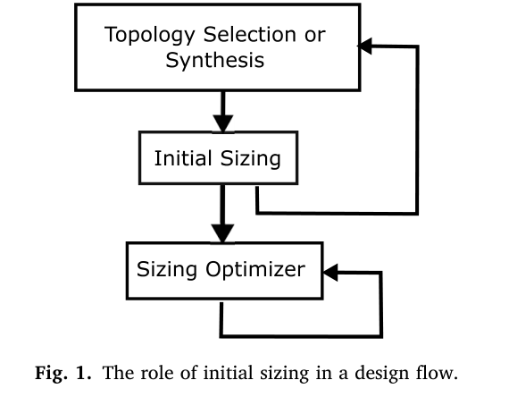

传统上只要搞清楚“要多大跨导 $g_m$”，就能用下面五步算出任何工艺下的晶体管尺寸：

1. **指标 $\to$ 跨导 $g_m$**：比如单级运放由带宽和负载电容决定 $g_m = 2\pi f_{GBW} C_L$；
2. **选跨导效率 $\eta = g_m/I_D$ $\to$ 定电流 $I_D$**：在长沟道直觉上 $\eta \approx 2/V_{OV}$——高 $\eta$（如 $15\text{–}20\text{ V}^{-1}$，近弱反型）省电流但管子很宽、寄生电容大；低 $\eta$（如 $5\text{–}10\text{ V}^{-1}$，强反型）速度快、摆幅余量大但费电；
3. **本征增益 $A_M = g_m r_o$ $\to$ 选沟长 $L$**：查曲线找满足单管增益目标的最短可用 $L$（$L$ 越短速度越快，但 $r_o$ 越低）；
4. **归一化电流 $I_{D,\text{norm}}$ $\to$ 算沟宽 $W$**：从选定 $L$ 的查表曲线上读出 $I_{D,\text{norm}}$，直接代入 $W = (I_D / I_{D,\text{norm}}) L$；
5. **整机验证与微调**：放回完整电路校验实际 $V_{DS}$ 偏置与 AC/瞬态指标。

> **最小手算示例**：需要 $g_m = 100\,\mu\text{S}$，选定 $\eta = 10\text{ V}^{-1}$，立即得 $I_D = 100/10 = 10\,\mu\text{A}$；随后根据增益要求选定 $L$ 并查出该 $\eta$ 下的 $I_{D,\text{norm}}$，一除就出 $W$。

---

## 2. 怎么建器件查表（LUT）？四张图搞定一切

在目标工艺（文中案例为 180 nm CMOS、1.8 V 供电）下，固定典型 $V_{DS}$（如 $V_{DD}/3=0.6\text{ V}$），对不同沟长 $L$ 扫一遍 $V_{GS}$，就能画出设计最核心的四组表（NMOS 与 PMOS 需分别建表）：

| 查表曲线 | 对应图号 | 设计时用它查什么？ |
| --- | --- | --- |
| **$A_M = g_m r_o$ vs. $\eta$** | Fig. 5 | 选定 $\eta$ 后，挑哪条 $L$ 曲线才够增益？ |
| **$I_{D,\text{norm}} = I_D/(W/L)$ vs. $\eta$** | Fig. 6 | 已知 $I_D$ 和 $L$，反算出准确宽度 $W$ |
| **$V_{GS}$ vs. $\eta$** | Fig. 7 | 判断输入共模范围（ICMR）与共栅偏置电压 |
| **$V_{DSAT}$ vs. $\eta$** | Fig. 8 | 核对上下管堆叠的饱和电压余量（越靠弱反型 $V_{DSAT}$ 越小） |

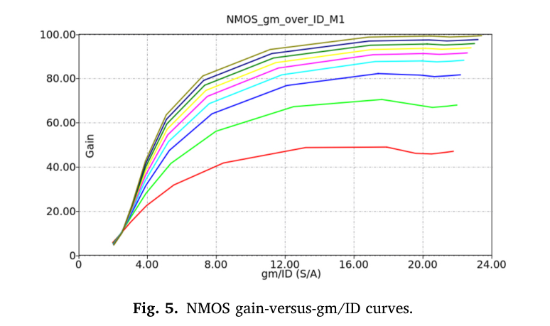

 随 η 变化（来源：Shi, 2021）。注意它自带电流单位，不是电流密度。")

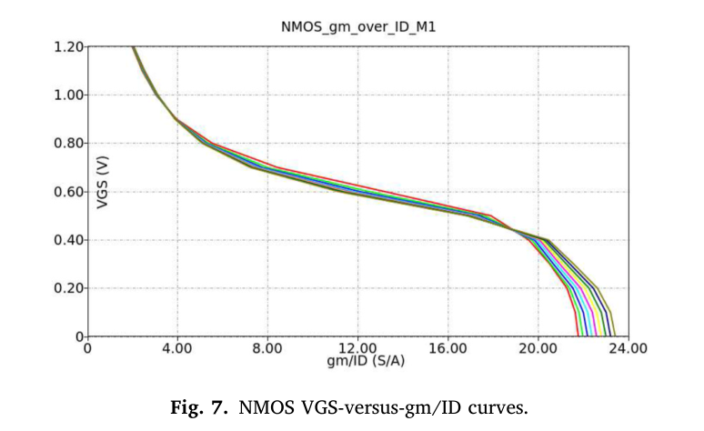

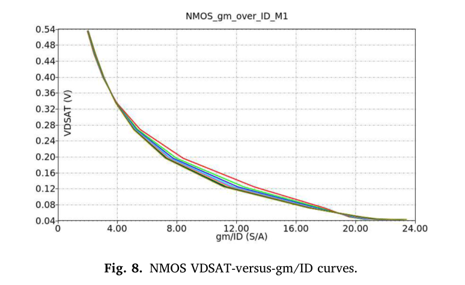

---

## 3. 多级运放的难题：怎么用电路方程把 $\eta$ 圈出来？

基础 $g_m/I_D$ 教程常让人困惑：“我怎么知道负载管和尾电流管的 $\eta$ 该随便取 8、12 还是 16？”

施国勇（Shi, 2021）这套流程的亮点，就是**直接把运放指标翻译成对负载 $\eta_{3,4}$ 和尾管 $\eta_0$ 的不等式，在二维平面上圈出一块“可行区域”**（以经典五管单级差分运放 Fig. 2 为例）：

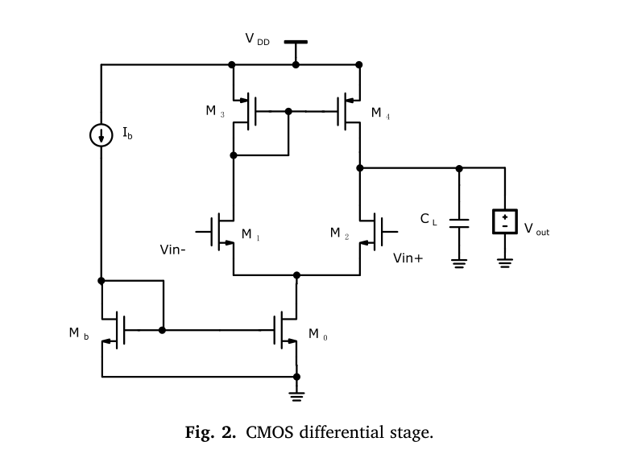

### 约束 1：输入共模范围（ICMR）划出 $\eta$ 的“下限”

- **低端共模 $ICMR_{\min}$** 限制尾管饱和压降：$V_{DSAT0,\max} = ICMR_{\min} - V_{GS1,2}$ $\implies$ 查 $V_{DSAT}$ 表得**尾管 $\eta_0$ 下限**；
- **高端共模 $ICMR_{\max}$** 限制负载管 $V_{SG3,4}$ 不能太大（否则输入对管漏极被顶低退出饱和）：$V_D \ge V_{ICM} - V_{GS} + V_{DSAT}$ $\implies$ 查 PMOS 表得**负载 $\eta_{3,4}$ 下限**。

### 约束 2：输入热噪声划出负载 $\eta_{3,4}$ 的“上限”

输入等效热噪声功率谱密度为：

$$S_n(f)=\frac{4kT}{g_{mN}}\left(\gamma_N+\gamma_P\frac{\eta_P}{\eta_N}\right).$$

直观物理非常清楚：输入管 $g_{mN}$ 越大噪声越低；而**有源负载管 $\eta_P$ 越大，它自身的噪声放大倍数就越高**。由噪声上限反解即得负载上限：

$$\eta_P\le\eta_N\frac{S_{n,\max}g_{mN}/(4kT)-\gamma_N}{\gamma_P}.$$

*(提示：表格指标常给幅值 $\sqrt{S_n}$，单位 $\text{nV}/\sqrt{\text{Hz}}$，代入公式前记得平方成 $\text{V}^2/\text{Hz}$ 并注意半电路/全电路系数一致。)*

### 约束 3：共模抑制比（CMRR）划出 $\eta_0$ 与 $\eta_{3,4}$ 的“斜边”

由于 $A_{cm}\approx \dfrac{g_{ds0}}{2 g_{m3,4}}$、尾管电流 $I_{D0}=2I_{D3,4}$，化简后得到：

$$\eta_0 \le A_{cm,\max} A_{M0}\,\eta_{3,4},$$

其中 $A_{cm,\max}=10^{(A_{d,\text{dB}}-\text{CMRR}_{\min,\text{dB}})/20}$。要高 CMRR，尾管本征增益 $A_{M0}$ 选高一点（选长沟道 $L$），斜边就会往上抬，可行区变宽。

### 三线交汇圈出梯形可行区 + 输出电阻平衡

，所有约束同时满足。")

确定 $( \eta_{3,4}, \eta_0 )$ 后，如何给互补管选各自的 $L$ 达到级增益 $A_{stg}=g_{mn}(r_{on}\parallel r_{op})$？最实用的启发式是让**信号管和负载管输出电阻近似相等（$r_{on}\approx r_{op}$）**：

$$A_{Mn}\approx 2 A_{stg}\;(\text{即多加 } 6\text{ dB}),\qquad A_{Mp} = A_{Mn}\frac{\eta_p}{\eta_n}.$$

各自拿到所需的本征增益 $A_M$ 后，回查各自工艺的 Fig. 5 / Fig. 6 就能立刻算出 $W$ 和 $L$。

---

## 4. 案例一：单级五管 OTA 完整手算实战

设计指标（180 nm CMOS，$V_{DD}=1.8\text{ V}$，$C_L=5\text{ pF}$）：增益 $32\text{ dB}$（$40\times$）、$f_{GBW}=5\text{ MHz}$、$\text{SR}=4\text{ V}/\mu\text{s}$、$\text{PM}=70^\circ$、$\text{CMRR}=70\text{ dB}$、$\text{ICMR}=[0.7, 1.6]\text{ V}$、热噪声 $17.7\text{ nV}/\sqrt{\text{Hz}}$。

1. **定电流与输入级**：由 $\text{SR}=I_{tail}/C_L$ 选尾电流 $20\,\mu\text{A}$（每边 $I_{D1,2}=10\,\mu\text{A}$）。由带宽算输入跨导（注意原论文此处排印少了 10 倍，正确按式算得）：
   $$g_{m1,2} = 2\pi(5\text{ MHz})(5\text{ pF}) = \mathbf{157.08\,\mu\text{S}} \implies \eta_{1,2}=\frac{157.08\,\mu\text{S}}{10\,\mu\text{A}} \approx \mathbf{15.7\text{ V}^{-1}}.$$
2. **选输入管尺寸**：$A_{stg}=40 \implies A_{M1,2}\approx 80$（38 dB），查表得 $M_1, M_2 = 6.6/0.8\,\mu\text{m}$；
3. **画可行区选点**：ICMR 给出 $\eta_{3,4}\ge 8.7$、$\eta_0\ge 9.05$；噪声给出 $\eta_{3,4}\le 19.3$；CMRR（$A_{M0}=100$）给出 $\eta_0\le 1.26\,\eta_{3,4}$。在梯形里取干净的整数点 **$ (\eta_{3,4}, \eta_0) = (12, 12)$**；
4. **查出负载与尾管**：$A_{M3,4}=80\times 12/15.7 \approx 61.1$，查表得 $M_3, M_4 = 6.6/0.4\,\mu\text{m}$；尾管 $M_0 = 14.3/2.0\,\mu\text{m}$（电流减半的偏置管 $M_b = 7.1/2.0\,\mu\text{m}$）。

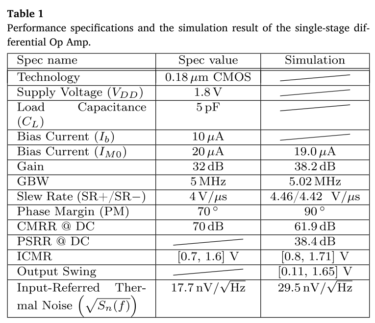
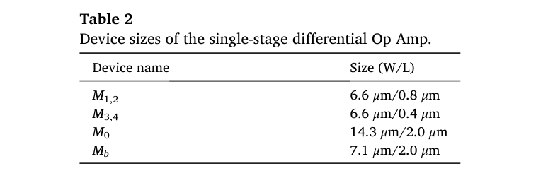
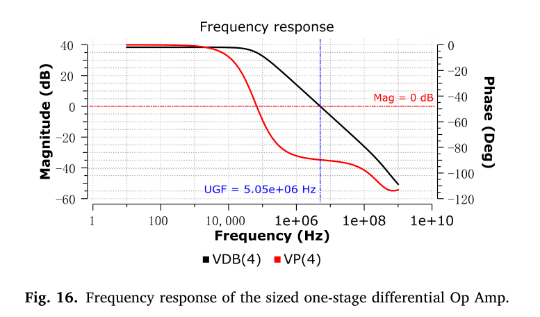

**仿真对照复盘**：不经微调直接仿真，增益（38.2 dB）、GBW（5.02 MHz）、SR（4.46 V/μs）和 PM（90°）一次达标；但 CMRR（61.9 dB）、低端 ICMR（0.8 V）和热噪声（29.5 nV/√Hz）略差——说明初始查表确实能一步搭出稳健工作点，但偏置精度和噪声分配仍需后续调优。

---

## 5. 两级 Miller 运放：补偿方程 + 局部扫描修正

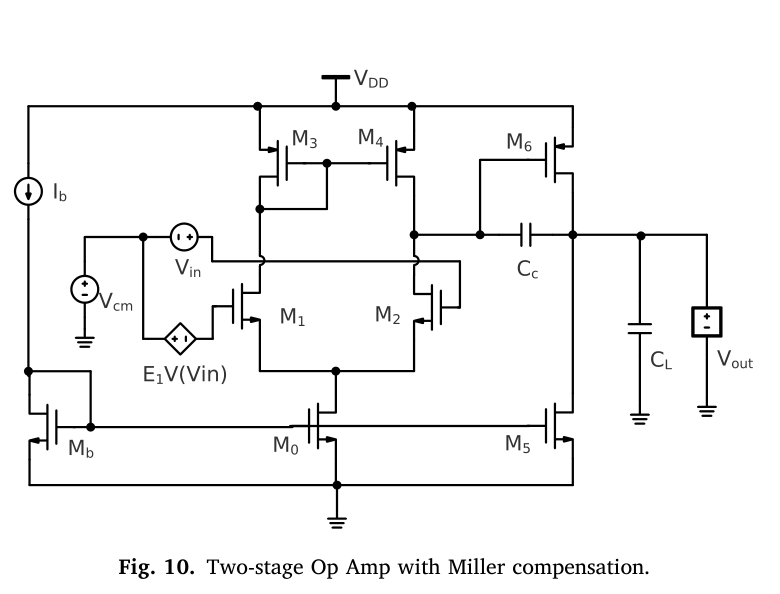
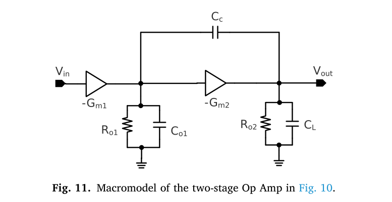
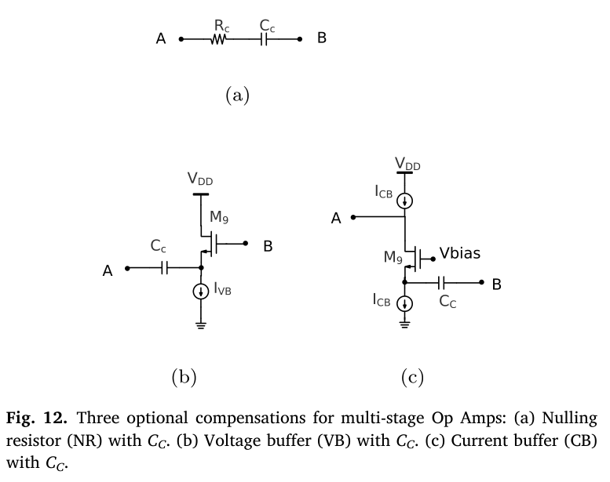

加上第二级后，带宽由密勒电容 $C_c$ 决定，次主极点 $p_2$ 由第二级跨导 $g_{m6}$ 推动（设极点分离系数 $\chi = f_{p2}/f_{GBW}$，无 RHP 零点时 $\text{PM}\approx\arctan\chi$，如 $\chi=2 \implies 63.4^\circ$）：

$$C_c=\frac{\eta_{1,2} I_{D1,2}}{2\pi f_{GBW}},\qquad g_{m6}=2\pi\chi f_{GBW} C_L \implies \eta_6=\frac{2\pi\chi f_{GBW}C_L}{I_{D6}}.$$

### 镜像偏置传播与局部共源级扫描（实用技巧！）

1. **共享 $V_{GS}$ 的管子先沿用相同 $\eta$**（如 Fig. 13）：由于 Fig. 7 显示 $V_{GS}\text{–}\eta$ 对沟长 $L$ 不敏感，同一镜像电压驱动的管子可先近似取相同的 $\eta$ 来定初始尺寸；
2. **用局部直流扫描对齐输出级工作点**（Fig. 14、15）：因为实际电路的 $V_{DS}$ 往往和当初建表用的 $0.6\text{ V}$ 不一样，直接拼起来第二级直流点会歪掉、增益骤降。**只需把第二级单独拎出来，固定输入为前级输出的静态 $V_{SG,\text{ref}}$，快速扫一遍 $W_6$ 与 $L_6$，把过渡区陡峭的高增益点精准对准 $V_{DD}/2$ 即可！**

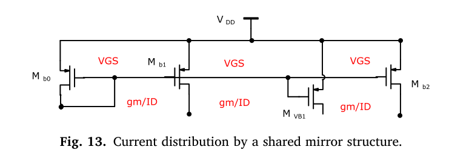
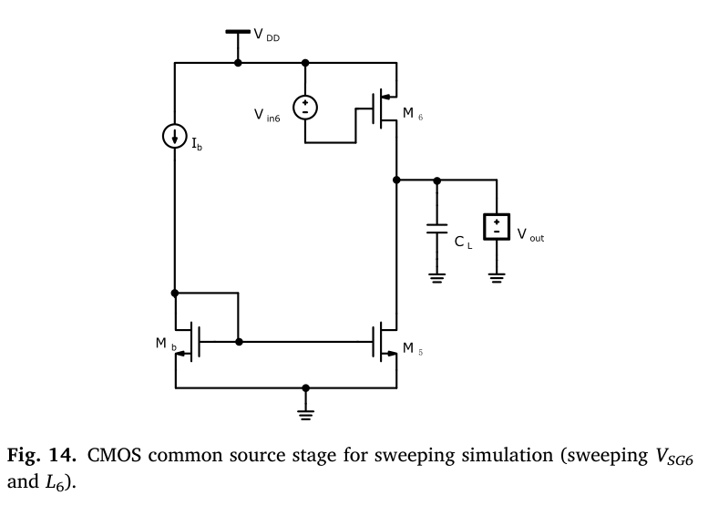
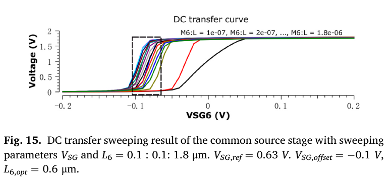

### 案例二结果（两级 SMC：$80\text{ dB},\; 10\text{ MHz},\; C_L=5\text{ pF}$）

取首级每边 $15\,\mu\text{A}$、次级 $60\,\mu\text{A}$、$C_c=2\text{ pF}$、$\chi=2$，算出初始尺寸见表 4：

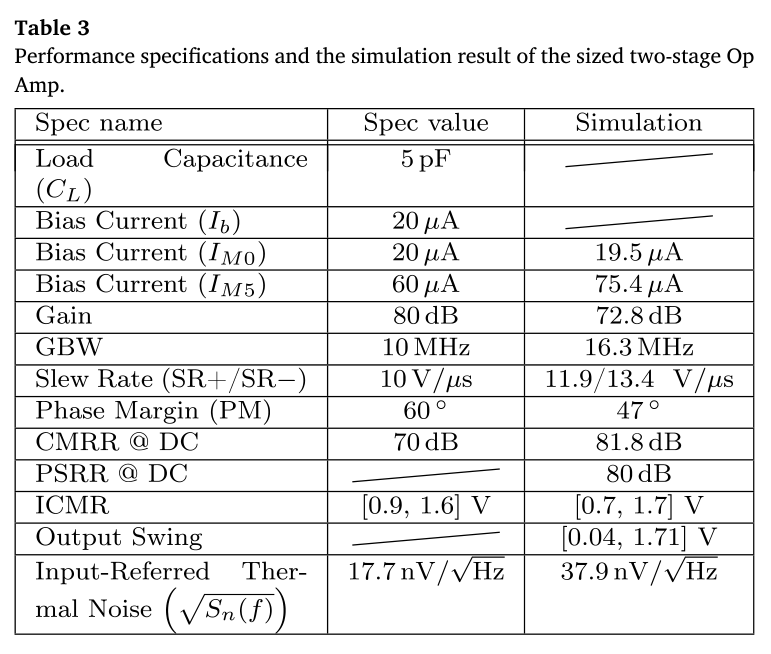
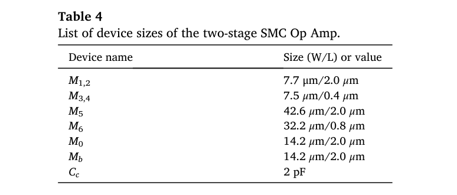
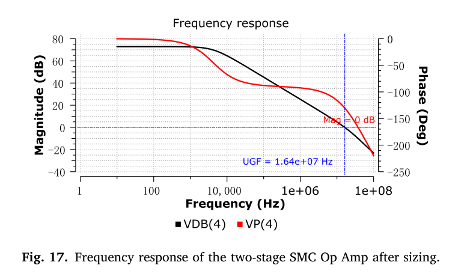

结果对比：GBW 达到 $16.3\text{ MHz}$（超出目标 $10\text{ MHz}$），SR 和 CMRR 达标；但因为简单密勒没有消掉 RHP 零点且实际 GBW 偏高拉近了极点距离，相位裕度跌到 $47^\circ$，后续加一颗调零电阻即可快速拉回 $60^\circ$ 以上。

---

## 6. 三级 RNMCVB 运放：更换拓扑专属方程即可

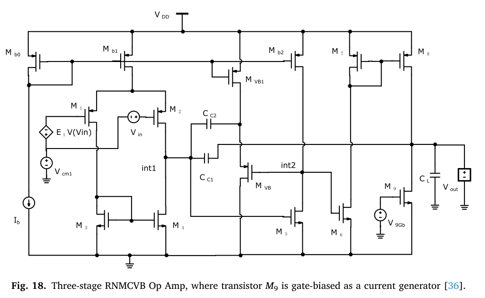

换到三级架构（反向嵌套密勒 + 电压缓冲）时，流程完全一样，只需把补偿极点方程换成该拓扑的小信号公式（令 $\rho=g_{m6}/g_{mVB}\approx 1$）：

$$f_{GBW}=\frac{g_{m1,2}}{2\pi C_{c1}},\qquad |p_2|\approx \frac{C_{c1}g_{m6}}{C_{c2}(C_L+2C_{c1})} \implies g_{m6}\approx 2\pi\chi f_{GBW}\frac{C_{c2}(C_L+2C_{c1})}{C_{c1}}.$$

*(注：原论文在期刊印刷时，第 3 极点公式与 Step 6 手算式分别出现了量纲笔误和漏印电容比的问题，实际工程设计按上述量纲自洽的 $p_2$ 公式计算得 $g_{m6}=219.9\,\mu\text{S},\; \eta_6=11.0\text{ V}^{-1}$，与原文后续取表一致。)*

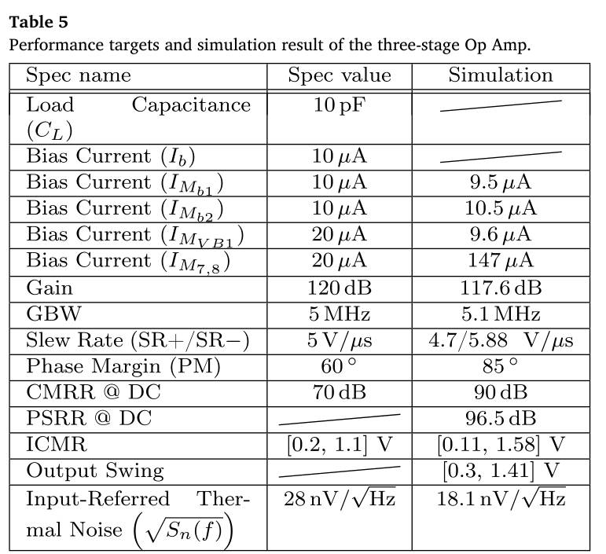
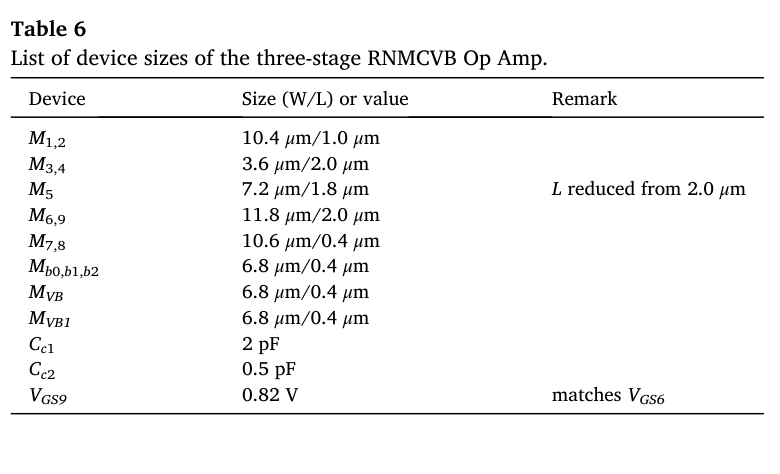
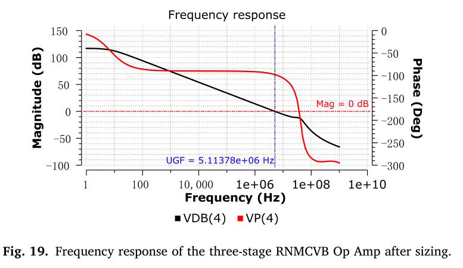

**从案例三（表 5）学到最宝贵的一课**：虽然交流增益（117.6 dB）、带宽（5.1 MHz）、相位裕度（85°）和噪声（18.1 nV/√Hz）都非常漂亮，但输出级静态电流 $I_{M7,8}$ 却飙到了 **$147\,\mu\text{A}$**（原预算只有 $20\,\mu\text{A}$）！原因是给第二级直连第三级 $V_{GS6}=0.82\text{ V}$ 时偏置电压过高，直接把输出级过驱动顶大了。这提醒我们：**多级运放手算尺寸后，务必加一条第二级输出直流电压约束去核查末级静态电流**。

---

## 7. 实战总结：什么时候适合用这套流程？

| 应用场景 | 建议做法 |
| --- | --- |
| **PMIC 误差放大器 / OTA / 电流检测放大器** | 极其契合：先把规格写成可行域与补偿方程，15 分钟即可出可收敛初始尺寸 |
| **高速纯前馈结构（寄生电容比补偿电容大）** | 必须把 $f_T\text{–}\eta$ 查表和器件寄生电容一起加进方程，不能再忽略寄生 |
| **Buck 功率开关管本身** | 不适用：功率管主要考核导通电阻 $R_{DS(on)}$、栅电荷 $Q_g$、面积与开关损耗折衷 |

---

## 参考资料

- Guoyong Shi, *Sizing of multi-stage Op Amps by combining design equations with the $g_m/I_D$ method*, Integration, 79 (2021): 48–60, [DOI: 10.1016/j.vlsi.2021.03.003](https://doi.org/10.1016/j.vlsi.2021.03.003)。
- P. Jespers & B. Murmann, *Systematic Design of Analog CMOS Circuits Using Pre-computed Lookup Tables*, 2017（[配套开源代码与 LUT 脚本](https://github.com/bmurmann/Book-on-gm-ID-design)）。
- Silveira, Flandre & Jespers, *A $g_m/I_D$ based methodology for the design of CMOS analog circuits*, JSSC 31(9):1314–1319, 1996。
