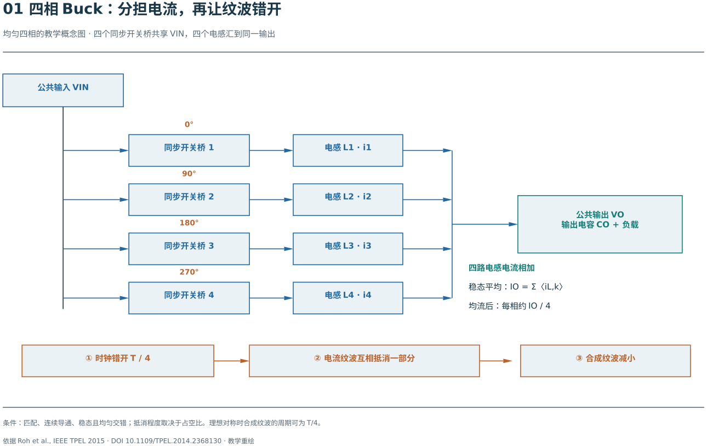
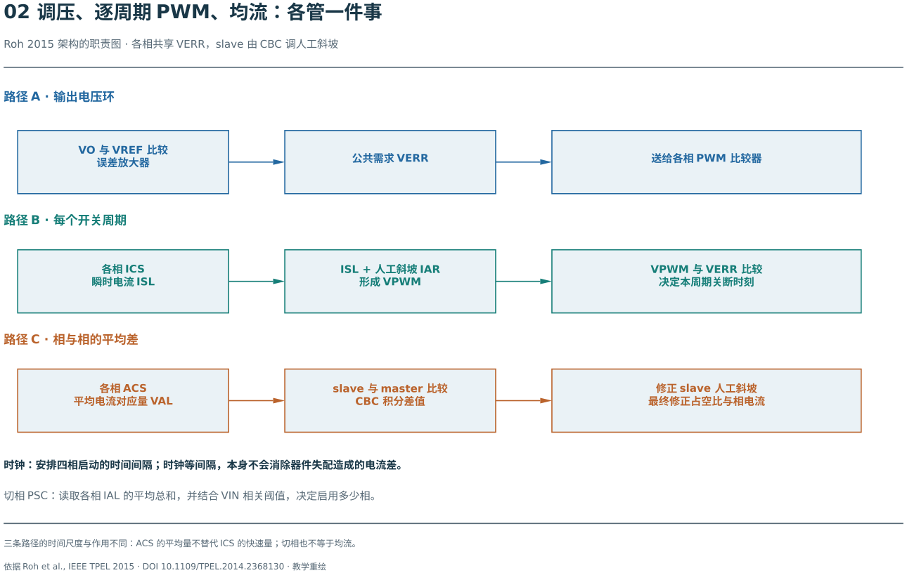
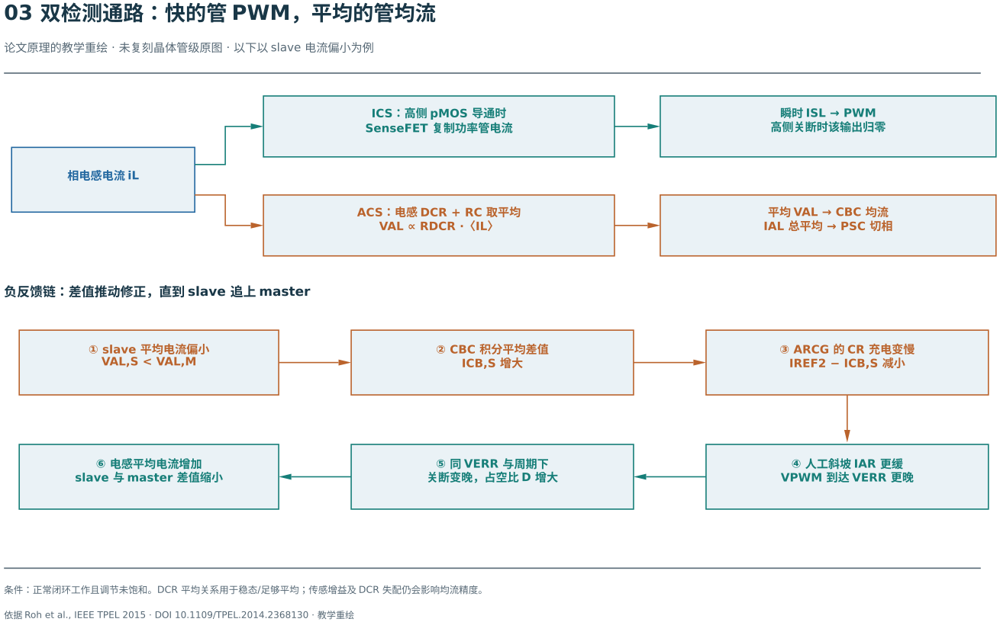
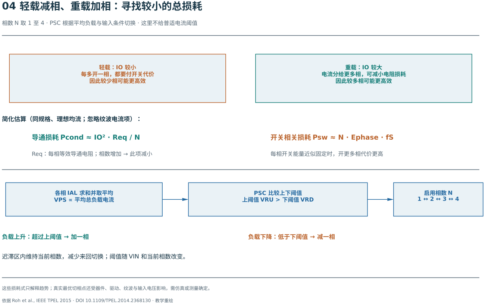

假设一个负载需要 1 V、8 A。用一相 Buck 可以供电，但这一路的电感、功率管和走线要独自承受全部电流。增加几路并联功率级，能把电流和发热分散；如果让它们错开开关，还能减轻电容承担的纹波。不过，增加三相之后，控制器也多了几件不同的工作：什么时候开通、什么时候关断、每相分多少电流，以及轻载时是否还值得让所有相开关。

这篇教程从单相电感和输出电容出发，建立这些任务之间的关系。读完应能沿着一条完整链路解释：**某从相电流偏小，控制器测到什么，改变什么，为什么最后能增加这相的电流。** 无需先读任何论文。

先修只需知道同步 Buck 的高侧开关接输入、低侧开关提供续流通路，以及电感电流不能突变。需要复习时可看 [Buck 功率级基础](/zh/notes/buck-day-01/)；想先抓住总结构，可以先读第 1–3 节，再沿第 4–7 节跟踪一次均流动作，最后用第 11 节自测。

## 1. 多相首先改变的是电流怎样到达负载

### 1.1 电容承担的，是供给与需求之间的差

每一相由一对同步开关和一个电感组成，电感输出接到同一个输出节点。设第 $k$ 相的电感电流为 $i_k$，输出电流为 $i_o$，输出电容为 $C_o$。暂时忽略电容的串联电阻与寄生，则：

$$i_C=\sum_{k=1}^{N}i_k-i_o,\qquad C_o\frac{dv_o}{dt}=i_C.$$

$N$ 是正在工作的相数，$i_C$ 是流入电容的电流，$v_o$ 是输出电压。总电感电流多于负载需求，电容充电、输出上升；少于需求，电容放电、输出下降。电容不是因为“用了多相”就轻松，而是因为**各相电流之和更接近负载所需的电流**。

负载突然增大时，即使四相平均分工，四个电感电流也不能瞬间跳高。电容仍要先补缺口；多相给控制器更多可以同时调动的功率支路，却不取消储能元件的动态约束。

### 1.2 为什么错开开关比同时开关更有用？

高侧导通时，理想电感电流以 $(V_{in}-V_o)/L$ 上升；低侧续流时，以 $-V_o/L$ 下降。若四相同时开关，四条上升段和下降段也同时出现，纹波相加。若把相邻开通时刻错开四分之一个周期，一相上升时，其他相可能正在下降，求和后就能抵消一部分纹波。这称为**交错运行**。

图中应先找共同的输出节点，再看相邻开通时刻的间距：电路的“并联”解决电流分担，时序的“错开”创造纹波抵消的机会。

[放大查看图 1（矢量图）](./assets/01-four-phase-power.svg)。图中的四路箭头表示各相向共同输出供电，下面三步说明错开时钟后怎样减小合成纹波；它没有画出电流的精确波形。每相电流仍有自己的上升、下降，只有相加后，才能看见交错的收益。对参数一致、等间隔运行的 $N$ 相，合成纹波常体现出 $Nf_s$ 的重复节奏，$f_s$ 是每相开关频率。**这不表示每只功率管以 $Nf_s$ 开关，也不表示纹波幅度在任意占空比下都固定减少 $N$ 倍。**

### 1.3 一个可以手算的四相例子

以下均为教学假设，不是某芯片实测参数：输入 $V_{in}=4$ V，输出 $V_o=1$ V，总负载 8 A；四相，每相 $L=1\,\mu$H、$f_s=500$ kHz，理想开关，电感一致，连续导通且完全均流。连续导通模式（Continuous Conduction Mode，CCM）指电感电流整个周期都未降到零。

稳态占空比 $D=V_o/V_{in}=0.25$，周期 $T_s=2\,\mu$s，高侧导通 $0.5\,\mu$s。每相电流纹波峰峰值为：

$$\Delta i_{pp}=\frac{V_{in}-V_o}{L}DT_s=\frac{3\,\mathrm V}{1\,\mu\mathrm H}\times0.5\,\mu\mathrm s=1.5\,\mathrm A.$$

每相平均电流是 2 A，即约在 1.25–2.75 A 间变化。若开通时刻相隔 $0.5\,\mu$s，每一小段恰好一相上升、三相下降，总斜率为：

$$\frac{di_\Sigma}{dt}=3-1-1-1=0\quad(\mathrm{A}/\mu\mathrm s).$$

因此在这个理想、特定占空比的例子中，总电流纹波为零。实际电感、时序、开关压降和布线都不完全一致，输入变化又会改变占空比，所以工程上应预留滤波能力，不能按“零纹波”选电容。

## 2. 交错为什么不能代替均流？

交错只规定开关时刻的相对位置，没有测量每相承担的平均电流。如果四相平均电流分别是 3、2、2、1 A，总数仍是 8 A，输出电压可以完全正常，但第一相比第四相更热，也更接近电感饱和和器件电流上限。

每相平均电流受实际占空比、导通压降、绕组电阻和检测偏差影响。用最简单的平均模型说明敏感性，记第 $k$ 相有效串联电阻为 $r_k$、实际占空比为 $D_k$，则：

$$L_k\frac{d\bar i_k}{dt}\approx D_kV_{in}-V_o-r_k\bar i_k.$$

横线表示平均量。在 $V_{in}=4$ V 时，占空比相差 0.005 就对应 20 mV 的平均驱动电压差。如果每相 $r_k=40$ mΩ，该差值在固定输出、其他条件不变的简化模型中足以对应 0.5 A 的电流差。几乎看不出来的时序差异，可能造成很明显的电流偏移。

均流的目标是让各相平均电流接近 $I_o/N$。对于相同的电阻 $r$：

$$P_{cond}\approx r\sum_k\bar i_k^2=\frac{rI_o^2}{N}+r\sum_k\left(\bar i_k-\frac{I_o}{N}\right)^2.$$

后面一项就是不均流带来的额外直流导通损耗。在上面的 3、2、2、1 A 例子中，平方和为 18 A²，均流时为 16 A²，相差 12.5%。这还未计入纹波的均方值。比较单相与多相的总效率时，还需计入器件尺寸、磁性元件和开关损耗，不能只拿这一项作结论。

有一个区分很有用：**纯粹把三角电流的直流中心移高或移低，并不必然破坏理想纹波抵消；真正的系统失配还可能同时改变电感斜率、占空比和相位，才会进一步影响合成纹波。** 均流与交错相关，但解决的是不同问题。

## 3. 把五个控制任务分开，架构就容易读了

先提出五个问题：输出电压低了该怎么办？本相这一周期什么时候关断？某相长期少出力怎么办？各相何时开始一个周期？负载很小时要开几相？

下面先看整体信号关系，再用表格把问题与动作对应起来。脉宽调制（Pulse-Width Modulation，PWM）通过改变每周期导通时间控制输出。图中的其余缩写只是这些任务的模块名：瞬时电流检测器（Instantaneous Current Sensor，ICS）、平均电流检测器（Average Current Sensor，ACS）、均流电路（Current-Balancing Circuit，CBC）和相数管理器（Phase-Shedding Controller，PSC）。

图内 VO、VREF 分别表示输出与参考电压，VERR 表示电压误差放大器给各相的共同指令；ISL 表示瞬时电流读数，IAR 是附加在控制端的人工斜坡，VPWM 是送入比较器的合成电压；VAL、IAL 是平均检测通路分别用于比较和求和的电压、电流读数。master、slave 即主相、从相。先记住各量的用途，具体实现会在后文逐步展开。

[放大查看图 2（矢量图）](./assets/02-control-paths.svg)。

读图时从输出电压反馈开始，再分别跟踪快速判决、慢速分配和相数选择。它们最终都影响功率级，但使用的信息与动作不同：

| 任务 | 观察什么 | 改变什么 | 希望纠正的量 |
| --- | --- | --- | --- |
| 电压调节 | 输出与参考电压之差 | 共同的电流/PWM 控制指令 | 总供给不足或过多 |
| 逐周期电流判决 | 本相导通期间的电流，加人工斜坡 | 本相高侧关断时刻 | 当前周期的电流爬升 |
| 平均均流 | 本相与参考相的平均电流差 | 本相 PWM 的相对修正 | 相间长期分工偏差 |
| 交错时钟 | 振荡、分频形成的周期与相位 | 各相开通基准时刻 | 开关动作的时间分布 |
| 相数管理 | 总平均电流及损耗相关条件 | 启用或停用某相 | 轻重载下的损耗折衷 |

这里采用一种具体但易复用的组织方式：一相作为**主相**，它可以独立稳压；其余为**从相**，共享电压环指令，并让平均电流跟踪主相。主相是分配参考，不代表它永远承担更多电流。若启用四相、检测准确且各相均流，电压环最终会让主相与每个从相都承担约四分之一负载。

电压环主要处理“总量”，均流环主要处理“分配”，但二者并非互不影响。给某从相增加占空比，会先增加总电流，输出电压随之变化，电压环再调共同指令。因此，均流环的速度、检测延迟和电压环带宽需要协调；不存在仅凭主从结构就能通用套用的带宽比例。

## 4. 为什么把电流检测拆成快、慢两条路？

### 4.1 平均值回答“出了多少力”，瞬时值回答“现在涨到哪里”

平均电流适合判断一相长期承担了多少负载。把开关纹波滤掉，均流就不必追逐各相因为交错而天然不同的瞬时值。但滤波也带来延迟：当高侧正在导通，电流已快速上升时，慢通路可能还没明显变化。

逐周期 PWM 需要知道当前导通段的电流，才能及时决定关断。让同一个检测器同时做到低失调、全周期准确、足够快、低功耗，并不总是划算。一个实际可行的分工是：

- 利用电感绕组直流电阻（Direct Current Resistance，DCR）得到平均电流，供均流和相数管理使用。
- 利用高侧感测晶体管（SenseFET）复制导通期间的电流，供快速 PWM 判决使用。

“快慢”是按任务划分，不是对两个输出作任意拼接。尤其不能把只在高侧导通时有效的电流，直接当成完整电感电流去求平均。

### 4.2 DCR 的平均信息为什么不要求精确时间常数匹配？

把电感看成理想 $L$ 与 DCR $r$ 串联，其端口电压为：

$$v_w=L\frac{di_L}{dt}+ri_L.$$

在绕组两端并联串联的检测电阻 $R_f$ 与检测电容 $C_f$，量取电容相对输出端的电压 $v_C$。忽略加载、后级输入电流和寄生，RC 网络满足：

$$R_fC_f\frac{dv_C}{dt}+v_C=L\frac{di_L}{dt}+ri_L.$$

在周期稳态，对完整周期取平均，电容电压与电感电流都回到周期起点，两个导数项的平均值为零，因此：

$$\boxed{\langle v_C\rangle=r\langle i_L\rangle.}$$

这个结论不要求 $R_fC_f=L/r$。如果希望**整个瞬时波形**也满足 $v_C(t)=ri_L(t)$，才需要在这一阶模型中匹配时间常数，并等待初始误差建立完成。

两者的差别在这里：平均检测只要求保住直流比例；瞬时重建还要求幅度、相位随频率都正确。负载阶跃期间两个导数项不再平均为零，不能把周期稳态等式直接用于瞬态。滤波越强，开关纹波越小，但均流和切相看到新负载也可能越晚。

### 4.3 怎样把很小的电压变成可比较的平均读数？

一种实现是用放大器反馈，让检测电压建立在一个精密电阻上，转换为电流；电流镜复制后，再经输出电阻和电容得到平滑电压。记闭环转换增益为 $G$，平均检测输出为 $v_{avg}$，则理想比例为：

$$v_{avg}=G\,r\,\bar i_L.$$

例如 $r=40$ mΩ、$\bar i_L=2$ A，原始平均压降是 80 mV；假设 $G=4$，输出就是 320 mV。控制器可以比较主相和从相的 320 mV，而不必直接拿开关节点的尖峰作均流判决。

反馈放大器要在实际输入共模下工作，并尽量减小失调。斩波（Chopping）可通过周期性翻转信号与失调的关系，把部分低频失调影响搬到较高频率，再滤除；它仍有残余纹波、开关误差与建立时间。输入范围覆盖电源轨附近，也不等于所有共模电压下性能完全相同。

增大真实 DCR 能增大检测电压，却同时增加铜损。因此应比较的是功率损耗、噪声、失调、增益、带宽和面积的整体预算。需要更低 DCR 时，可继续读 [小 DCR 检测与快慢互补](/zh/notes/buck-small-dcr-shared-amplifier/)，不能仅凭本方案采用平均检测就断言必须选大 DCR。

## 5. 高侧 SenseFET 为什么只适合这里的导通段判决？

### 5.1 复制电流，要先让两只管看到相近的电压条件

在高侧功率金属氧化物半导体晶体管（Metal-Oxide-Semiconductor，MOS）旁放一只缩小的感测管，让它们共用栅极和源极，再用反馈使感测管漏端电压跟随功率管漏端。这样两管的栅源、漏源条件接近，感测管电流才近似按尺寸比例复制功率管电流。设尺寸缩小 $M$ 倍，则导通期间约有 $i_s=i_L/M$。后面图中 pMOS 指其中的 P 沟道器件。

这里 $M$ 是感测比例，与相数 $N$ 无关。仅仅把两只管的栅极相连，却不管漏端电压，不足以保证准确镜像。实际还存在失调、器件失配、反馈建立时间和开关边沿干扰。

高侧关断后，电感电流改由低侧续流，但这只高侧感测管已没有相应电流。因此其输出会归零，电感本身的电流却没有归零。

### 5.2 为什么直接低通它会读小？

在理想 CCM 三角波、固定感测增益下，高侧导通区间电流的平均值等于全周期电感平均值，但这个区间只占周期的 $D$，所以：

$$\langle i_s\rangle\approx\frac{D}{M}\bar i_L.$$

沿用 $D=0.25$、$\bar i_L=2$ A，若 $M=1000$，导通时感测电流围绕 2 mA 变化；全周期简单平均却只有约 0.5 mA。若仍按 $1/M$ 换算，就会读成 0.5 A。这里缺的是关断段的信息。

除以 $D$ 在这一理想稳态例子里可以纠正数值，却不能直接解决占空比变化、非连续电流、最短脉冲和两路增益误差。若用开关电流检测承担全周期均流，就需明确低侧信息、采样/保持或重建方法，以及相应误差预算。另设 DCR 平均通路，是把这个困难从快速判决中分出去。

## 6. 一次 PWM 判决怎样把电流与电压环接起来？

设电压误差放大器输出共同指令 $v_{err}$；本相瞬时感测电流为 $i_s$，人工斜坡电流为 $i_a$，求和电阻为 $R_p$。比较器看到：

$$v_{pwm}=R_p(i_s+i_a).$$

在这里采用的峰值电流判决中，时钟开始本相导通段；电流和斜坡上升，当 $v_{pwm}$ 到达 $v_{err}$，高侧关断，进入低侧续流。输出电压降低时，电压环按这一比较极性提高 $v_{err}$，让交点推迟、导通时间增大。

人工斜坡不是额外注入功率电感的电流，它只加在**控制器的检测信号**上。它的一个重要用途，是抑制某些峰值电流模式工作条件下“这一周期偏长、下一周期偏短”的亚谐波振荡。比较器每次都能正常关断，并不足以保证相邻周期的扰动会衰减。

把导通段检测电压暂近似为从 $v_0$ 起、斜率为 $m_s$ 的直线，人工斜坡电压斜率为 $m_a$，并冻结这一周期的指令，则：

$$t_{on}\approx\frac{v_{err}-v_0}{m_s+m_a}.$$

在这个局部比较模型里，指令升高会延长导通，斜坡变缓也会延长导通。真实下一周期的 $v_0$、电流斜率和电压环指令会继续变化；这个式子用于判断动作方向，不能单独算出闭环最终电流。

## 7. 主从均流：从“少出力”到“占空比增大”的全过程

### 7.1 不再增加一个电压目标，而是微调本相判决

若每相各自争着调输出电压，微小参考偏差就可能让某相多出力。主从结构采用同一个 $v_{err}$，再根据平均电流差修正从相人工斜坡。这样公共稳压目标仍一致，各相又有可独立调整的执行量。

先问图中的闭环方向是否正确：假设从相电流偏小，沿箭头走一圈后，最终动作是否真的使它增加？

图中 ARCG 是人工斜坡电流发生器（Artificial Ramp Current Generator），CR 是它的充电电容，IREF2 是固定参考电流，ICB,S 是从相均流控制电流；VAL,M、VAL,S 分别是主相和从相的平均检测电压。图内沿用大写标签，下面公式采用相同物理量的小写或下标形式。

[放大查看图 3（矢量图）](./assets/03-dual-sensing-balance.svg)。上半部把一股真实电感电流送往两个不同的检测任务；下半部的六步闭环，从“从相少出力”出发，最后回到“电流增加、误差减小”。

平均检测输出分别记为 $v_{avg,M}$、$v_{avg,S}$，下标 M、S 表示主相、从相。CBC 把两者之差积分，再通过跨导级产生均流控制电流 $i_{cb}$。为表达本实现的极性，可写成未饱和区域的功能模型：

$$\frac{dv_b}{dt}=K_b(v_{avg,M}-v_{avg,S}),\qquad i_{cb}=g_bv_b+i_{bias},\qquad K_b>0,\quad g_b>0.$$

$v_b$ 是按上述极性定义的积分状态，$K_b$ 是积分系数，$g_b$ 是电压转电流的跨导，$i_{bias}$ 表示工作点偏置。这里用自然的正向误差定义状态，不要求实际内部每个节点都同向变化。**积分意味着误差会累积；$i_{cb}$ 不是当下电流差乘一个常数。**

### 7.2 用电容充电速度，控制人工斜坡

斜坡发生器的电容为 $C_R$，高侧导通时由 $I_{ref}-i_{cb}$ 充电，关断后复位。电容电压 $v_R$ 再转换为人工斜坡电流：

$$\frac{dv_R}{dt}=\frac{I_{ref}-i_{cb}}{C_R},\qquad i_a=G_Rv_R.$$

$I_{ref}$ 是固定参考电流，$G_R$ 是斜坡电压到电流的增益。因此，对从相电流偏小的情况：

1. 从相平均检测电压低于主相，正误差开始积累。
2. 积分状态推动 $i_{cb}$ 增大。
3. 电容净充电电流 $I_{ref}-i_{cb}$ 变小，人工斜坡变缓。
4. 在同一个 $v_{err}$ 下，求和波形较晚碰到阈值，高侧导通更久。
5. 电感得到更多正向伏秒，电流逐渐增加；平均误差缩小，积分状态停止继续漂移。

从相偏大时，全部方向反过来。主相不接这项均流修正，采用固定参考斜坡；各从相围绕它调整。最终需要的占空比由实际压降和电流决定，并不是所有相必须得到严格一样的占空比。

### 7.3 用交点算例检查方向

假设某周期 $v_{err}-v_0=0.30$ V，瞬时电流折算到比较器端的斜率 $m_s=0.4\,\mathrm{V}/\mu$s，人工斜坡 $m_a=0.2\,\mathrm{V}/\mu$s，则 $t_{on}=0.5\,\mu$s。均流把人工斜坡降为 $0.1\,\mathrm{V}/\mu$s，冻结其余量，得到：

$$t_{on,new}=\frac{0.30}{0.4+0.1}=0.6\,\mu\mathrm s.$$

若周期仍为 $2\,\mu$s，这一次占空比从 0.25 变为 0.30。这个独立的局部算例只验证“斜坡变缓 → 关断推迟”的方向，不是前面 4 V 功率级的完整闭环解，也不表示最终稳态需要这样大的修正。

### 7.4 为什么不能无限把斜坡放缓？

同一条斜坡还承担电流模式稳定性补偿。均流希望降低某相斜坡以增加电流，稳定性却可能要求斜坡不低于某个下限。净充电电流接近零时，斜坡几乎停止；再越界则比较波形和控制增益都可能不再符合预期。

工程上应限定均流修正范围，在输入、输出、温度和占空比变化下检查逐周期扰动；还要考虑比较器延迟、前沿消隐和最小导通时间。消隐是暂时屏蔽开通边沿干扰的时间窗口，窗口过长会丢失短脉冲中的有效信息。限幅之后若平均误差仍存在，积分器还需避免长时间饱和。这里是从控制机制推导的设计检查项，并非仅凭概念图就获得的性能保证。

## 8. 均流闭环最终调平的是“读数”，还是“真实电流”？

### 8.1 先写出检测误差，才能回答

实际第 $k$ 相的读数可简化为：

$$v_{avg,k}=G_kr_k\bar i_k+v_{os,k}.$$

$G_k$ 包含转换电阻、电流镜等增益，$r_k$ 是该相实际 DCR，$v_{os,k}$ 是等效输出失调。均流会尽量使这些电压相等。如果各相增益、DCR、失调不同，读数相等时，真实电流仍可能不同。

例如两相增益相同且无失调，但 DCR 分别为 40、44 mΩ，闭环会趋向满足：

$$40\bar i_1=44\bar i_2,\qquad\frac{\bar i_2}{\bar i_1}=\frac{40}{44}\approx0.909.$$

若两相总电流是 4 A，则约为 2.095 A 与 1.905 A，而不是各 2 A。第二相电阻更大，相同电流会产生更高读数，控制器反而会让它承担更少真实电流。误差百分比取决于采用什么参考，不能把“DCR 相差 10%”直接写成“各相都偏差 10%”。

温升也会改变 DCR；热环境不一致时，检测比例会随运行状态变化。减小放大器失调、选择匹配电感、校准增益或温度补偿，分别针对不同误差，不能互相替代。

### 8.2 相间误差与绝对误差会影响不同功能

如果所有通道都以相同倍数读大，可能仍能相互均流，却会把绝对电流阈值和切相点一起移走。若只有某一相读大，就会直接改变分流。因此“均流很好”不能单独证明总电流测得准确，更不能自动证明绝对限流阈值正确。

作为实际尺度的参考，Roh 等的四相实现报告在输入 2.8 V、不同输出电流下，相平均电流偏差为 ±10.5%，并将其归因于电感 DCR 失配。这个结果说明实现了均流控制仍需要保留误差预算；它不是所有 DCR 检测架构的统一误差。[原文来源](https://doi.org/10.1109/TPEL.2014.2368130)

## 9. 轻载为什么减相，重载为什么加相？

### 9.1 多一相，同时省下一种损耗、增加另一种损耗

重载时，把总电流分到更多相，通常有利于减小每相电流平方相关的导通损耗。轻载时，电流已经很小，仍让四套栅极驱动、功率管和控制支路持续开关，就可能得不偿失。

为了理解这个交点，暂用一个有意简化的损耗模型：

$$P_N\approx\frac{I_o^2r_{eq}}{N}+NP_0.$$

$r_{eq}$ 是一相的等效导通电阻；$P_0$ 是该工作点每启用一相产生的近似固定损耗，包含部分驱动、开关及控制开销。模型暂忽略纹波均方值、磁芯损耗、频率改变和切换瞬态，所以只用于建立选择思路。

图中 Req 对应这里的每相等效导通电阻 $r_{eq}$；Ephase 是每相每周期的近似开关能量，乘以每相频率得到开关损耗；Pcond、Psw 分别表示导通与开关相关损耗。下半部的 VPS 为总平均电流对应电压，VRU、VRD 为增相和减相门限。先看轻载与重载两个框：多相的固定开销仍在，但负载越大，分担电流的收益越明显。

[放大查看图 4（矢量图）](./assets/04-phase-shedding.svg)。图中下半部先把总平均读数送入门限比较，再决定相数；它没有给出适用于所有转换器的最优门限。

### 9.2 手算一个切相点

在上述模型中，令 $P_N=P_{N+1}$：

$$I_{cross}=\sqrt{\frac{P_0N(N+1)}{r_{eq}}}.$$

假设 $r_{eq}=40$ mΩ、$P_0=20$ mW，则 1→2、2→3、3→4 相的交点电流分别约为 1.00、1.73、2.45 A。以 0.5 A 为例，单相损耗约 30 mW，四相约 82.5 mW；以 4 A 为例，单相约 660 mW，四相约 240 mW。

数字说明了为什么不应始终选最多相，但这些交点不是芯片的通用设定值。输出纹波、瞬态储备、单相峰值电流和切换代价也会限制相数选择。

### 9.3 相数管理需要总电流，而不是某一相的瞬时值

在周期稳态，输出电容的平均电流为零，所以：

$$\bar I_o=\sum_{k=1}^{N}\bar i_k.$$

把所有平均检测通道的电流输出相加，再用电阻与电容变成平滑的管理电压 $v_{ps}$，就能得到与总平均负载电流成比例的信号。通道增益一致时，这种求和无需先假定完全均流；增益不一致则求和本身也有误差。

PSC 把 $v_{ps}$ 与当前相数对应的上下阈值比较：超过增相阈值就多开一相，低于减相阈值就停一相，到最大相数或最小相数后禁止继续越界。增相、减相采用不同门限可形成滞回，防止电流在边界附近波动时反复切换；还要给平均检测、均流和输出电压留出建立时间。

停一相之后，其原有电感电流不能直接消失，其他相也不能瞬间补齐。如何结束该相脉冲、处理剩余能量、启动新相，以及是否暂缓下一次切相，都属于完整相数管理设计。单独画出比较器和阈值，不等于已经实现无扰切换。

### 9.4 为什么切相阈值可能随输入电压变化？

输入电压变化会改变开关节点电压摆幅、充放电损耗、器件导通条件以及占空比。固定在某个输入电压下得到的损耗交点，不一定在另一输入下仍最优。因此可以先在目标工作范围内计算或测量各相数的损耗，再让阈值随输入等条件变化。

一种具体实现先生成与 $V_{in}-V_x$ 成比例的电压，再用电阻分压和当前相数选择门限。Roh 等在其器件、40 mΩ 电感 DCR 与损耗假设下，拟合的三个交点电流约为：

$$I_{12}\approx0.36\frac{\mathrm A}{\mathrm V}(V_{in}-0.74\,\mathrm V),\quad I_{23}\approx0.65\frac{\mathrm A}{\mathrm V}(V_{in}-0.74\,\mathrm V),\quad I_{34}\approx0.90\frac{\mathrm A}{\mathrm V}(V_{in}-0.74\,\mathrm V).$$

这些系数描述该实现的拟合，0.74 V 也不是 Buck 的普遍物理常数。可迁移的思想是“阈值跟随损耗交点”，迁移到新功率器件、频率和磁性元件时应重新确定交点。[实现与损耗假设来源](https://doi.org/10.1109/TPEL.2014.2368130)

## 10. 时钟与稳定性：不能用一项正确替代整个系统正确

### 10.1 时钟负责交错，不读取电流误差

四相等间隔时钟可以由 $4f_s$ 振荡器加分频逻辑产生：每隔 $T_s/4$ 给下一相开通基准，而每一相的重复周期仍是 $T_s$。例如每相 2.25 MHz，内部高频时钟约 9 MHz。

这是分频生成多相时序的一种方式。延迟锁定环（Delay-Locked Loop，DLL）则通过反馈调整延迟链，校准相位间隔，是另一类实现；不要把所有多相时钟都称为 DLL。本文所用四相实例是前一种。

切成两相、三相后，可以重新均匀排相，也可以保留某些原有时隙，但结果不同：三相若仍沿用四相网格，未必等间隔，纹波抵消也会变化。是否重排、如何避免重复脉冲，需要查实际逻辑；上述实例没有完整给出一至三相的重排策略。

### 10.2 输出电压稳定，不代表相间分配也稳定

设两相发生等量反向电流扰动 $+\delta i$、$-\delta i$，总电流不变，输出电压短时间内几乎看不到变化，但两相的分工已偏离。四相也有类似的相间差异。这是均流相关的差模；所有相共同增加或减少电流，则主要影响输出的共模总量。

在各相完全均流、参数相同的假设下，四相功率级可在总量模型中用 $L/4$、$r/4$ 的等效电感和电阻表示。这有助于分析公共电压环，但合并过程已经去掉了相间差异，不能再用这个模型证明均流差模也稳定。

因此完整检查应覆盖三个层次：

| 层次 | 需要观察的现象 | 仅有哪种结果还不够 |
| --- | --- | --- |
| 每相逐周期电流控制 | 邻周期长短交替、短脉冲与延迟、斜坡限幅 | 平均模型中的相位裕度 |
| 公共电压环与均流环 | 总电流变化及相间反向扰动是否衰减 | 只扰动输出电压 |
| 切相与模式转换 | 电流交接、输出偏移、滞回和建立过程 | 某一固定相数的稳态结果 |

Roh 等给出的约 350 kHz 交越频率、121° 相位裕度，对应输入 3.7 V、输出 0.9 V、负载 1 A，并采用四相完全均流的等效模型。它提供该模型与工况的证据，不能单独代表均流差模、全部占空比或切相过程的稳定性。[模型与工况来源](https://doi.org/10.1109/TPEL.2014.2368130)

## 11. 用这八道题检查是否能独立推演

### 题 1：四相时钟间隔准确，输出电压也正确，能否断定均流？

**答案：不能。** 时钟决定开通时刻，输出电压主要反映总供给。3、2、2、1 A 也可以供给 8 A，必须检查各相平均电流及检测误差。

### 题 2：把前面的 4 V→1 V 改为 4 V→1.2 V，四相合成纹波还必为零吗？

**答案：不必。** 理想占空比变为 0.30，四分之一周期与高侧导通时间不再相等，出现导通重叠区间。需要重新分段相加，不能沿用一升三降的整周期结论。

### 题 3：平均 DCR 检测没有匹配时间常数，为什么仍可能读准平均电流？

**答案：** 在周期稳态和理想检测网络下，电感电流与检测电容电压的导数平均为零，所以 $\langle v_C\rangle=r\langle i_L\rangle$。这没有保证负载瞬变或纹波波形正确，也没有消除实际 DCR 的误差。

### 题 4：高侧 SenseFET 输出关断时为零，是否说明电感进入断续？

**答案：不能。** 高侧关断后，电感可能仍经低侧连续续流，只是该高侧检测通路不再输出。断续导通要看真实电感电流是否降至零。

### 题 5：本相电流偏小，均流控制电流增大，为什么电感电流反而上升？

**答案：** $i_{cb}$ 从斜坡电容参考充电电流中扣除，使人工斜坡变缓；比较阈值不变时关断更晚，占空比增大，电感得到更多正向伏秒。控制电流的名字不能代替对其实际连接极性的判断。

### 题 6：两相真实电流均为 2 A，但第二相 DCR 更大，均流会怎样动作？

**答案：** 若通道增益相同，第二相读数更大，控制器会减少它的出力。闭环趋向让读数相等，而不是天然知道真实电流已经相等。

### 题 7：每相固定开销加倍，简化模型中的切相点如何变化？

**答案：** $I_{cross}$ 变为原来的 $\sqrt2$ 倍。多开一相更贵，需要更大的负载电流才能用导通损耗的收益抵偿。

### 题 8：公共电压环相位裕度足够，是否还要给某从相单独注入扰动？

**答案：需要。** 相间等量反向变化可能不改变总电流，电压环看不清它。还需检查均流差模、逐周期稳定性，以及切相和模式转换过程。

## 12. 把这些思想用于选择下一种架构

面对一种新的多相控制器，可以按“需要什么信息 → 用什么检测 → 怎样改变开关动作 → 受什么条件限制”的顺序读，而不是先记模块缩写。

| 设计问题 | 本文采用的组织方式 | 更换架构时必须重新回答 |
| --- | --- | --- |
| 怎样减小合成纹波？ | 固定频率、等间隔交错 | 占空比、启用相数与相位是否仍匹配？ |
| 怎样及时决定关断？ | 高侧瞬时检测加人工斜坡 | 短脉冲、噪声、延迟与补偿余量够不够？ |
| 怎样分配平均负载？ | 主从平均检测差，经积分调斜坡 | DCR、通道增益与失调会调出多大真实偏差？ |
| 怎样改善轻载损耗？ | 总平均电流与可变门限决定相数 | 损耗交点如何随输入变化，切换时怎样交接电流？ |
| 怎样证明系统可用？ | 将公共量、差模与切换分别检查 | 简化模型遗漏了哪些实际状态？ |

双路检测的价值，是把“快速决定当前周期”与“准确比较长期分工”分开优化；代价是增加检测电路、校准和环路协作。平均 DCR 路线节省额外串联采样电阻的功耗，却把绕组电阻及其温度变化带入读数。调斜坡能复用 PWM 判决端，却也占用稳定性补偿的调整空间。理解这些交换，才能判断它适不适合自己的目标。

继续学习：[多相学习地图](/zh/learn/#multiphase) · [DCR 检测基础](/zh/notes/buck-dcr/) · [小 DCR 与共享放大器](/zh/notes/buck-small-dcr-shared-amplifier/) · [多控制器同步打嗝保护](/zh/notes/buck-synchronized-hiccup/)。均流并不代替限流与故障保护，轻载减相也不等于已经实现零电压开关。

## 来源与延伸阅读

Yong-Seong Roh, Young-Jin Moon, Jeongpyo Park, Min-Gyu Jeong, Changsik Yoo, “A Multiphase Synchronous Buck Converter With a Fully Integrated Current Balancing Scheme,” *IEEE Transactions on Power Electronics*, 30(9), 5159–5169, 2015. [DOI 与原文入口](https://doi.org/10.1109/TPEL.2014.2368130)。

文中的教学算例、误差展开与控制职责归纳用于建立可推演的模型；实测偏差、具体切相拟合、时钟实现和等效稳定性工况来自上述原文。所有插图是概念示意，不构成器件级仿真或实测证据。

若需要对照具体电路：原文第 II-B/C 节分别是平均与瞬时检测（图 5/6），第 II-E/F 节是均流与人工斜坡（图 10/11），第 II-D 节是切相与门限（图 7–9），第 II-G/H 节是时钟与稳定性模型。论文题名中的 fully integrated 指检测与均流等电路集成，电感及输入、输出电容仍在片外；作者提到零电压开关（Zero-Voltage Switching，ZVS）作为可能手段，但明确未在该实现中采用。
