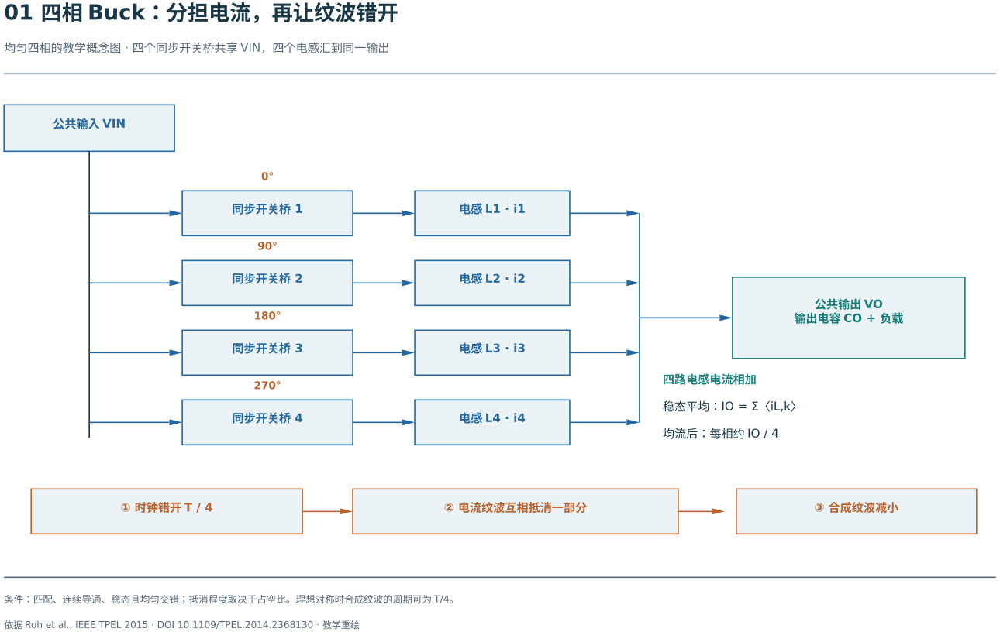
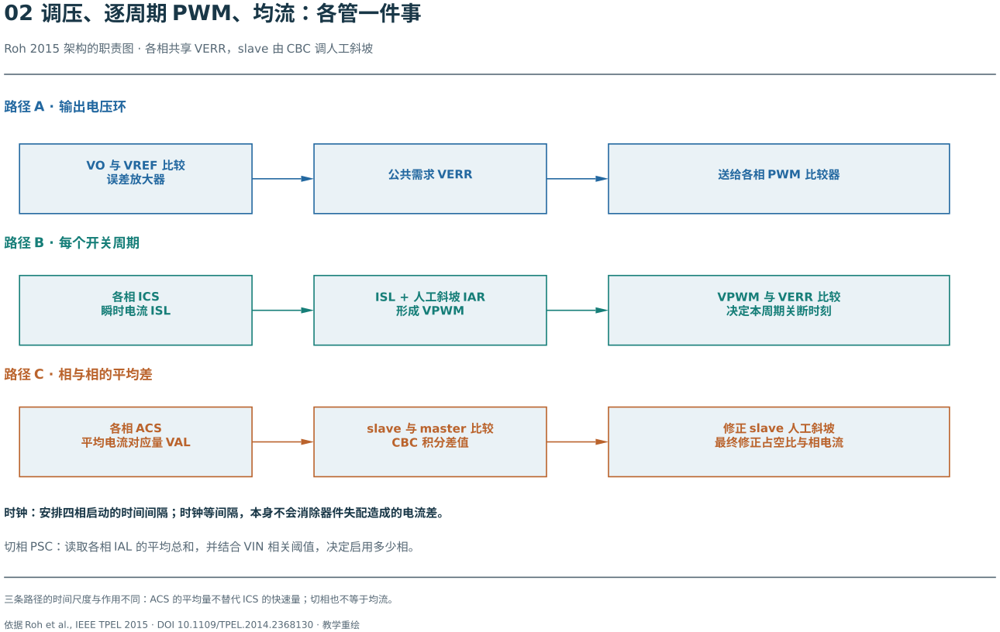
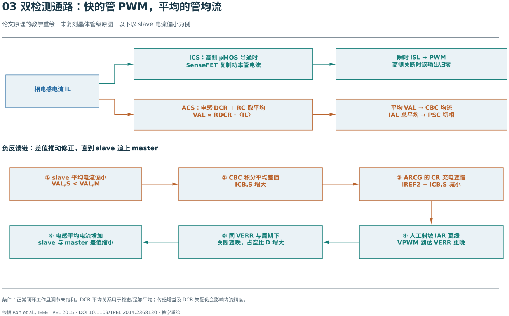
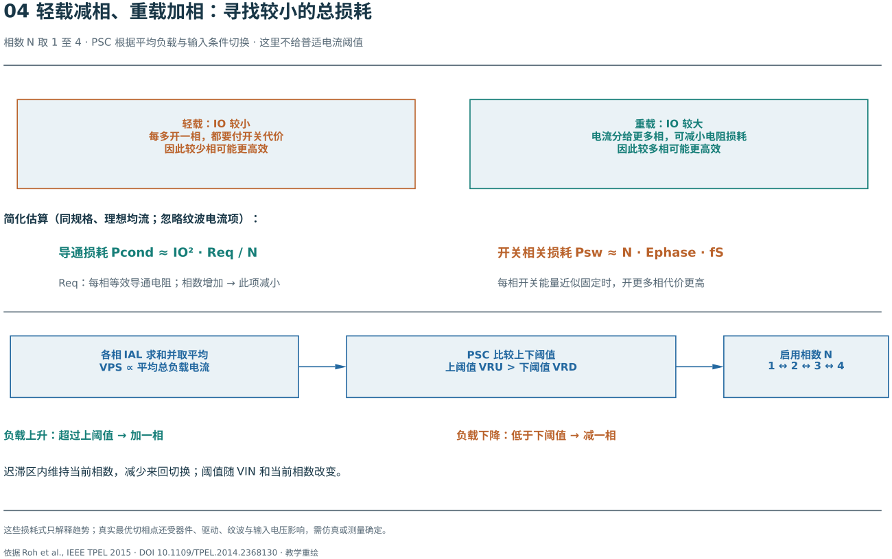

单相 Buck 应对大电流负载时，一颗电感和一对功率管要独自扛下全部电流与发热。把功率级拆成多路并联后，每相只分担一部分电流；再把各相开通时刻错开，还能让输出电容上的纹波彼此抵消。

但多相并不只是“把单相复制几份”。它马上带来四个新问题：**每周期何时关断、各相如何分担平均电流、轻载要不要关掉几相、以及怎样同时保持稳压和均流稳定**。

> **全篇核心问题**
> 读完本文，你应该能沿着同一条因果链答出这个问题：**当某一从相的平均电流偏小时，控制器测到了什么信号、改变了哪一个控制量、最后为什么能把这相的电流拉回来？**

可以先看 [Buck 功率级基础](/zh/notes/buck-day-01/) 回顾单相工作模式；如果想直接往下追踪晶体管和运放连线，可配合阅读 [多相 Buck 的局部电路](/zh/notes/multiphase-buck-circuits/)。

## 符号与模块速查

| 缩写 / 符号 | 含义 | 在文中的角色 |
| --- | --- | --- |
| $N$、$f_s$、$T_s$ | 启用相数、每相开关频率与周期 | 交错时相邻相错开 $T_s/N$ |
| $V_{in}$、$V_o$、$v_{err}$ | 输入电压、输出电压、电压误差放大器输出 | 公共稳压目标（所有相共用 $v_{err}$） |
| **ICS** / $i_s$ | 瞬时电流检测器（高侧 SenseFET） | 只测高侧导通期，负责逐周期峰值 PWM 关断 |
| **ACS** / $v_{avg}$ | 平均电流检测器（电感 DCR + RC） | 滤掉开关纹波，负责均流与相数管理 |
| **CBC** / $i_{cb}$ | 均流电路（误差积分 + 跨导输出） | 比较主相与从相 $v_{avg}$，输出均流控制电流 |
| **ARCG** / $i_a$ | 人工斜坡电流发生器 | 用 $I_{ref}-i_{cb}$ 给电容充电，调节从相斜坡斜率 |
| **PSC** / $v_{ps}$ | 相数管理器 | 汇总各相平均电流，随负载增减启用相数 |

---

## 1. 并联与交错：多相首先改变了什么

### 1.1 输出电容看到的，是“总供给与负载之差”

设正在工作的相数为 $N$，第 $k$ 相电感电流为 $i_k$，负载电流为 $i_o$，输出电容为 $C_o$：

$$i_C=\sum_{k=1}^{N}i_k-i_o,\qquad C_o\frac{dv_o}{dt}=i_C.$$

多相之所以能减小输出电压波动，不是因为“电容变强了”，而是**各相电感电流相加后，总电流本身更贴近负载需求**，电容需要吞吐的差值 $i_C$ 变小了。

不过，当负载瞬间阶跃增大时，各相电感电流依然不能突变，电容仍要在最初几个周期先顶上电流缺口；多相的优势在于后续可以由多路电感同时拉高电流，缩短恢复时间。

### 1.2 交错运行如何抵消纹波

高侧导通时，电感电流以斜率 $(V_{in}-V_o)/L$ 上升；低侧续流时，以 $-V_o/L$ 下降。

- **同相开关**：所有相同时上升、同时下降，总电流纹波直接相加。
- **交错开关**：把相邻两相的开通时刻错开 $T_s/N$。当一相正在上升时，其他相可能正在下降，上升与下降斜率相互抵消。

[放大查看图 1（矢量图）](./assets/01-four-phase-power.svg)

对参数一致的 $N$ 相系统，交错后合成纹波的重复频率提高到 $N f_s$（注意每只功率管自身仍按 $f_s$ 开关，并不是开关频率翻了 $N$ 倍）。

### 1.3 手算一个“零纹波”四相算例

设四相 Buck 参数为：$V_{in}=4\text{ V}$、$V_o=1\text{ V}$、$I_o=8\text{ A}$，每相 $L=1\,\mu\text{H}$、$f_s=500\text{ kHz}$（$T_s=2\,\mu\text{s}$）。

1. **占空比与导通时间**：稳态 $D=V_o/V_{in}=0.25$，高侧导通时间 $DT_s=0.5\,\mu\text{s}$。
2. **单相纹波**：每相平均电流 $2\text{ A}$，峰峰值纹波为：
   $$\Delta i_{pp}=\frac{V_{in}-V_o}{L}DT_s=\frac{3\text{ V}}{1\,\mu\text{H}}\times 0.5\,\mu\text{s}=1.5\text{ A},$$
   即每相电流在 $1.25\text{–}2.75\text{ A}$ 之间三角波动。
3. **四相交错叠加**：相邻开通时刻恰好也相隔 $T_s/4 = 0.5\,\mu\text{s}$。因此在任意时刻，总是**恰好一相上升、三相下降**，总电流斜率为：
   $$\frac{di_\Sigma}{dt}=\frac{3\text{ V}}{1\,\mu\text{H}}-3\times\frac{1\text{ V}}{1\,\mu\text{H}}=0\text{ A}/\mu\text{s}.$$

> **复习要点：什么时候纹波抵消最明显？**
> 理想 $N$ 相交错在 $D = k/N$（如四相对应 $D=0.25, 0.5, 0.75$）时，总电流纹波理论上可以完全抵消；当占空比偏离这些点，或各相电感、走线存在失配时，仍会留下残余纹波。

---

## 2. 为什么交错不能代替均流？

**交错管的是“时间位置”，均流管的是“平均出力”。** 即使四相时钟完美错开、输出电压稳稳维持在 $1\text{ V}$，四相的平均电流依然可能是 $3\text{ A}, 2\text{ A}, 2\text{ A}, 1\text{ A}$——总数凑够了 $8\text{ A}$，但第一相会明显过热甚至先触及电感饱和。

### 2.1 占空比的微小失配就会放大成明显的电流偏差

记第 $k$ 相的等效串联电阻（绕组 + 开关导通电阻）为 $r_k$、实际占空比为 $D_k$，其平均电感方程为：

$$L_k\frac{d\bar i_k}{dt}\approx D_k V_{in}-V_o-r_k\bar i_k.$$

在 $V_{in}=4\text{ V}$、$r_k=40\text{ m}\Omega$ 时，只要两相的有效占空比相差区区 $\Delta D = 0.005$（相当于 $2\text{ }\mu\text{s}$ 周期里差了 $10\text{ ns}$ 脉宽），驱动压差就有 $20\text{ mV}$，足以造成高达 **$0.5\text{ A}$** 的稳态电流偏移。

### 2.2 不均流带来的额外铜损

设各相电阻均为 $r$，总导通损耗可以拆成“理想均流损耗”与“不均流惩罚项”：

$$P_{cond}\approx r\sum_{k=1}^{N}\bar i_k^2=\frac{rI_o^2}{N}+r\sum_{k=1}^{N}\left(\bar i_k-\frac{I_o}{N}\right)^2.$$

以刚才的 $(3,2,2,1)\text{ A}$ 为例，$\sum \bar i_k^2 = 18\text{ A}^2$，而均流 $(2,2,2,2)\text{ A}$ 只有 $16\text{ A}^2$——仅仅因为分配不均，直流导通损耗就凭空多了 **12.5%**。

---

## 3. 五个控制任务拆解：架构一眼读懂

面对多相系统，先把控制器要做的五件事拆开看，整张架构图就不会乱：

[放大查看图 2（矢量图）](./assets/02-control-paths.svg)

| 控制任务 | 负责模块 | 观测什么 | 改变什么 | 目标 |
| --- | --- | --- | --- | --- |
| **1. 稳压** | 电压误差放大器 | $V_o$ 与 $V_{ref}$ 之差 | 共同指令 $v_{err}$ | 保证总供给匹配总负载 |
| **2. 逐周期 PWM** | **ICS** + PWM 比较器 | 本相瞬时电流 + 斜坡 $i_{ar}$ | 本相高侧关断时刻 | 及时截断本周期电流爬升 |
| **3. 相间均流** | **ACS** + **CBC** + **ARCG** | 从相与主相平均电流差 | 从相人工斜坡斜率 | 消除各相长期平均电流偏差 |
| **4. 交错时序** | 多相时钟 / 分频器 | 内部高频时钟 | 各相开通基准脉冲 | 让开关脉冲按 $T_s/N$ 错开 |
| **5. 相数管理** | **PSC** | 各相平均电流之和 $v_{ps}$ | 启用 / 关断相数 | 轻载降开关损耗，重载降导通损耗 |

### 主从均流的基本组织方式

这里采用**主从均流**（Master-Slave）结构：
- 指定其中一相作为**主相（Master）**，提供平均电流参考；
- 其余相作为**从相（Slave）**，共享同一个电压环指令 $v_{err}$，通过微调各自的人工斜坡，让平均电流紧跟主相。

> **注意环路耦合**：主相和从相共享 $v_{err}$。当均流环增大某从相占空比时，总电流先增加、$V_o$ 微升，随后公共电压环会一起下调 $v_{err}$，最终把主相拉低、从相抬高。因此**均流环带宽通常要明显低于电压环带宽**，避免两条环路互相抢着调。

---

## 4. 为什么要把电流检测拆成“快、慢两条路”？

只用一套检测器同时满足“纳秒级逐周期响应”和“毫伏级长期零失调平均”，代价极高。因此工程上常拆成两条通路各司其职：

- **慢通路（ACS）**：利用电感绕组电阻（DCR）取平均电流，专供**均流**和**相数管理**。
- **快通路（ICS）**：利用高侧 SenseFET 复制导通期电流，专供**逐周期峰值电流 PWM**。

### 4.1 为什么 DCR 测平均电流不需要匹配 $R_f C_f = L/r$？

将电感等效为理想电感 $L$ 串联直流电阻 $r$，绕组两端电压为：

$$v_w=L\frac{di_L}{dt}+ri_L.$$

在电感两端并联由 $R_f$ 和 $C_f$ 串联的 RC 网络，取电容两端电压 $v_C$，其微分方程为：

$$R_f C_f\frac{dv_C}{dt}+v_C=L\frac{di_L}{dt}+ri_L.$$

在**周期稳态**下，电感电流和电容电压在一个周期结束后都回到起点，因此两个导数项在一个周期内的平均值严格为零，直接得到：

$$\boxed{\langle v_C\rangle=r\langle i_L\rangle.}$$

> **复习要点：瞬时波形 vs 平均电流**
> - **只需平均电流**：任意满足滤波要求的 $R_f C_f$ 都能保住直流比例 $\langle v_C\rangle=r\langle i_L\rangle$（但负载阶跃瞬态时有延迟）。
> - **需要瞬时波形**：必须满足时间常数匹配 $R_f C_f = L/r$，才能把开关纹波也按比例还原出来。

### 4.2 用闭环放大器把毫伏级压降变成可比较的读数

由于电感 DCR 很小（例如 $r=40\text{ m}\Omega$、$\bar i_L=2\text{ A}$ 时仅 $80\text{ mV}$；大电流小 DCR 场景甚至只有几毫伏），直接比较容易被失调淹没。ACS 先用带斩波（Chopping）的误差放大器把小压差精准转成电流，再经电流镜与输出 RC 网络放大 $G$ 倍并平滑，得到：

$$v_{avg}=G\,r\,\bar i_L.$$

假设 $G=4$，原本 $80\text{ mV}$ 的信号就变成 $320\text{ mV}$，既适合跨相比较，又能再镜像一路电流去给 PSC 求总和。如果想进一步把 $r$ 降到 sub-mΩ 级，可以看配套的 [小 DCR 检测与共享放大器](/zh/notes/buck-small-dcr-shared-amplifier/)。

---

## 5. 高侧 SenseFET 为什么只适合快通路？

在功率 pMOS 旁边并联一只尺寸缩小 $M$ 倍的感测管（SenseFET），导通期间通过反馈让两只管子拥有**相同的源极、相同的栅压和相等的漏极电位（$V_{SW}$）**，就能按尺寸比例复制出电流：

$$i_s=\frac{i_L}{M}.$$

但高侧 SenseFET 有一个天然局限：**高侧一关断，电感电流改走低侧续流，选择开关把感测管漏端拉回 $V_{in}$，令其源漏压差归零——于是 $i_s$ 在整个关断期间强制为 0。**

如果在全周期内对 $i_s$ 直接做低通平均，得到的平均值只有：

$$\langle i_s\rangle\approx\frac{D}{M}\bar i_L.$$

沿用 $D=0.25$、$\bar i_L=2\text{ A}$、$M=1000$ 的例子：导通期间感测电流围绕 $2\text{ mA}$ 摆动，但全周期平均只剩 $0.5\text{ mA}$；若直接按 $1/M$ 换算，控制器会误以为电感只输出了 $0.5\text{ A}$。**缺少关断段信息，正是高侧 SenseFET 不直接承担均流、而交给 DCR 慢通路的原因。**

---

## 6. 逐周期 PWM：瞬时电流怎样和电压环接起来？

电压环输出的公共指令 $v_{err}$ 与每相局部信号共同决定关断时刻：

1. 多相时钟给出本相开通脉冲，高侧导通；
2. 瞬时感测电流 $i_s$ 与人工斜坡电流 $i_a$ 叠加流过电阻 $R_p$，生成比较电压：
   $$v_{pwm}=R_p(i_s+i_a);$$
3. 当 $v_{pwm}$ 上升碰到公共指令 $v_{err}$ 时，比较器翻转，立即关断高侧、进入低侧续流。

设导通段电流在比较器端的折算斜率为 $m_s$、起点为 $v_0$，人工斜坡斜率为 $m_a$，则这一周期的导通时间近似为：

$$t_{on}\approx\frac{v_{err}-v_0}{m_s+m_a}.$$

这里的**人工斜坡 $i_a$ 只加在控制器内部的检测比较端**（不会流进功率电感），核心作用有两个：一是抑制峰值电流模式在 $D>0.5$ 时容易出现的**亚谐波振荡**；二是下面马上要讲的——**成为从相微调占空比的“调节把手”**。

---

## 7. 主从均流全链路：从“少出力”到“电流追平”

为了不让各相互相抢着稳压，所有相共用同一个 $v_{err}$。均流环的办法是：**不去改公共稳压目标，而是微调每个从相的人工斜坡斜率**。

[放大查看图 3（矢量图）](./assets/03-dual-sensing-balance.svg)

### 7.1 误差积分与斜坡控制方程

1. **误差积分器（CBC）**：比较主相与从相平均检测电压 $v_{avg,M}, v_{avg,S}$，积分后由跨导级输出均流控制电流 $i_{cb}$：
   $$\frac{dv_b}{dt}=K_b(v_{avg,M}-v_{avg,S}),\qquad i_{cb}=g_b v_b+i_{bias}\quad (K_b>0,\;g_b>0).$$
   积分环节保证了只要存在微小偏差就会持续累积修正，最终把稳态平均误差压到接近零。
2. **斜坡发生器（ARCG）**：高侧导通期间，用固定参考电流减去 $i_{cb}$ 给斜坡电容 $C_R$ 充电（关断期复位），电容电压再转成人工斜坡电流：
   $$\frac{dv_R}{dt}=\frac{I_{ref}-i_{cb}}{C_R},\qquad i_a=G_R v_R.$$

### 7.2 沿闭环走通一次（假设某从相偏小）

> **因果链速记（5 步闭环）**
> 1. **从相平均电流偏小** $\implies v_{avg,S} < v_{avg,M}$，正误差 $(v_{avg,M}-v_{avg,S})$ 对积分电容充电；
> 2. **控制电流增大** $\implies i_{cb}\uparrow$；
> 3. **斜坡电容净充电电流减小** $\implies (I_{ref}-i_{cb})\downarrow$，人工斜坡变缓（$m_a\downarrow$）；
> 4. **PWM 比较器推迟触顶** $\implies$ 在同一个 $v_{err}$ 下，高侧导通时间 $t_{on}$ 拉长；
> 5. **电感正向伏秒增加** $\implies$ 从相电流逐步升高，直到 $v_{avg,S}$ 追平 $v_{avg,M}$。

### 7.3 局部算例与斜坡下限约束

沿用第 6 节的比较方程：设某周期 $v_{err}-v_0=0.30\text{ V}$，电流折算斜率 $m_s=0.4\text{ V}/\mu\text{s}$。
- 初始人工斜坡 $m_a=0.2\text{ V}/\mu\text{s}$ $\implies t_{on}=\dfrac{0.30}{0.4+0.2}=0.50\,\mu\text{s}$（$D=0.25$）；
- 均流动作把斜坡放缓到 $m_a=0.1\text{ V}/\mu\text{s}$ $\implies t_{on,new}=\dfrac{0.30}{0.4+0.1}=0.60\,\mu\text{s}$（$D=0.30$）。

**设计代价与边界**：因为同一条人工斜坡还负责抑制亚谐波振荡，所以**不能为了拼命补流而把 $m_a$ 无限降到零**。如果 $i_{cb}$ 逼近 $I_{ref}$，斜坡会失去补偿能力甚至无法触发稳态关断。工程上必须对 $i_{cb}$ 做限幅，并防止积分器在限幅后深度饱和。

---

## 8. 均流到底调平了“读数”，还是“真实电流”？

闭环控制只能看见传感器喂给它的电压。第 $k$ 相的平均检测读数为：

$$v_{avg,k}=G_k r_k \bar i_k+v_{os,k}.$$

均流闭环最终强迫各相满足 $v_{avg,1} = v_{avg,2} = \dots = v_{avg,N}$。也就是说，**均流环直接调平的是“检测电压读数”，只有在增益、DCR 和失调一致时才等价于真实电流相等**。

看一个直观例子：两相总负载 $4\text{ A}$，若放大器增益和失调完全理想，但两颗电感的 DCR 分别为 $40\text{ m}\Omega$ 和 $44\text{ m}\Omega$（相差 10%），闭环会强迫两相读数相等：

$$40\,\bar i_1 = 44\,\bar i_2 \implies \bar i_1 \approx 2.095\text{ A},\quad \bar i_2 \approx 1.905\text{ A}.$$

**DCR 更大的那一相反而被分到了更少的电流。** 在 Roh 等人的四相芯片实测中（$V_{in}=2.8\text{ V}$），虽然片内均流环正常工作，最终仍测得约 $\pm 10.5\%$ 的相电流偏差，主要正源于片外电感 DCR 的失配。

> **两个易混淆的误差概念**
> - **相间相对失配**（某相 DCR 或镜像比例偏掉）：直接破坏各相电流分配；
> - **全通道共模误差**（所有相增益同比例偏大）：相间依然能均流，但总电流读数、限流门限与切相点会整体偏移。

---

## 9. 相数管理（Phase Shedding）：轻载为什么减相？

四相全开在重载时能降低导通损耗，但在轻载时，每多开一相就要多养活一套栅极驱动、开关管充放电与控制静态功耗，反而拉低效率。

### 9.1 简化损耗折衷与最佳切相点

设每相的等效导通电阻为 $r_{eq}$，每多启用一相增加的固定开关/驱动开销为 $P_0$，则启用 $N$ 相时的总损耗近似为：

$$P_N\approx \frac{I_o^2 r_{eq}}{N}+N P_0.$$

[放大查看图 4（矢量图）](./assets/04-phase-shedding.svg)

令 $P_N = P_{N+1}$，可立即解出从 $N$ 相切到 $N+1$ 相的理想交点电流：

$$I_{cross}=\sqrt{\frac{P_0\,N(N+1)}{r_{eq}}}.$$

代入 $r_{eq}=40\text{ m}\Omega$、$P_0=20\text{ mW}$：
- **1 ↔ 2 相交点**：$1.00\text{ A}$
- **2 ↔ 3 相交点**：$1.73\text{ A}$
- **3 ↔ 4 相交点**：$2.45\text{ A}$

对比轻重载差距一目了然：负载 $0.5\text{ A}$ 时，单相损耗仅 $30\text{ mW}$，四相全开却高达 $82.5\text{ mW}$；负载升到 $4\text{ A}$ 时，单相高达 $660\text{ mW}$，四相则降到 $240\text{ mW}$。

### 9.2 PSC 怎样获取总电流并避免“来回切相”？

1. **总平均电流求和**：稳态下电容平均电流为零，所以 $\bar I_o=\sum_{k=1}^{N}\bar i_k$。把各相 ACS 的电流输出直接汇总到一个节点，经 RC 滤波得到管理电压 $v_{ps}$——只要通道增益一致，即使切换瞬间还未完全均流，总和依然准确。
2. **滞回门限（VRU / VRD）**：增相门限 $V_{RU}$ 略高于减相门限 $V_{RD}$，防止负载在交点附近小幅抖动时反复切相。
3. **切相门限随输入电压自适应**：当 $V_{in}$ 升高时，开关节点充放电损耗 $P_0$ 变大（大致随 $V_{in}$ 线性或平方增长），最优切相点也应往大电流方向移动。例如在特定器件与 $40\text{ m}\Omega$ DCR 条件下，三个切相点拟合为与 $(V_{in}-0.74\text{ V})$ 成正比的线性门限，由模拟电阻分压生成（具体实现见[局部电路篇第 5 节](/zh/notes/multiphase-buck-circuits/)）。

> **工程提醒**：切相时不仅要改门限，还要妥善处理被关断相的残余电感电流退磁，以及剩余相的相位重排（比如 4 相切 2 相需重排为 $180^\circ$ 交错，才能保住纹波抵消）。

---

## 10. 时钟与稳定性：不要只看电压环相位裕度

### 10.1 时钟如何生成

四相固定频率控制常见两种交错时钟方案：
- **高频振荡器 + 分频**：内部跑在 $4f_s$，依次分出间隔 $T_s/4$ 的四路开通脉冲（如每相 $2.25\text{ MHz}$ 时内部振荡器为 $9\text{ MHz}$）。
- **DLL（延迟锁定环）**：用反馈锁定各相脉冲的相位间隔。

切到 2 相或 3 相时，通常需要重排激活相位的时隙间距，才能尽量保持等间隔交错。

### 10.2 电压环稳，不等于均流环也稳

假设两相分别出现等量反向的电流扰动 $+\delta i$ 和 $-\delta i$，由于总电流几乎不变，输出电压 $V_o$ 纹丝不动，**共模电压环完全“看不见”这种相间振荡**。如果直接用 $L/N$、$r/N$ 把多相合并成等效单相来跑 AC 仿真，相间差模信息就已经被平均掉了。

因此，多相系统的稳定性验证必须分三层做：

| 验证层次 | 重点检查对象 | 常见盲区 |
| --- | --- | --- |
| **内环（单相逐周期）** | 亚谐波振荡、斜坡补偿余量、最小导通时间与前沿消隐 | 只看平均模型，漏掉大占空比周期抖动 |
| **共模 + 差模双环** | 输出阶跃恢复 + 对单个从相注入扰动的差模收敛速度 | 只用合并等效单相模型测电压环相位裕度 |
| **模式切换瞬态** | 加减相瞬间 $V_o$ 过冲/跌落、电流交接与时钟重排 | 只测固定相数下的稳态环路 |

---

## 11. 复习自检（6 题）

1. **为什么说“交错解决纹波，均流解决发热”？**
   > **提示**：交错决定每相何时开关，让各相斜率互消；均流决定每相平均直流中心在哪里。$(3,2,2,1)\text{ A}$ 即使完美交错，第一相仍严重过热且总铜损增加 12.5%。
2. **在 4 V 转 1 V 四相交错的理想算例中，若输出改成 1.2 V，合成纹波还能完全归零吗？**
   > **提示**：不能。$D$ 从 $0.25$ 变成 $0.30$ 后，导通时间大于 $T_s/4$，相邻相的高侧导通区间发生重叠，总斜率不再处处为零。
3. **为什么平均 DCR 检测不匹配 $R_f C_f = L/r$ 依然能测准平均电流？高侧 SenseFET 为什么不行？**
   > **提示**：周期稳态下电感电流与电容电压的导数项平均值为零，只留直流分量 $\langle v_C\rangle=r\langle i_L\rangle$；而高侧 SenseFET 在关断期被强行置零，全周期平均丢掉了 $(1-D)$ 段的续流信息，输出只有 $(D/M)\bar i_L$。
4. **某从相电流偏小，为什么均流电流 $i_{cb}$ 反而变大，最后又怎么让这相电流回升？**
   > **提示**：$i_{cb}$ 接在斜坡参考支路的扣减端。$i_{cb}\uparrow \implies$ 电容充电电流 $(I_{ref}-i_{cb})\downarrow \implies$ 斜坡变缓 $\implies$ 碰触 $v_{err}$ 变晚 $\implies t_{on}\uparrow \implies$ 电流回升。
5. **两相真实电流都是 2 A，但第二相电感 DCR 比第一相大 10%，均流环稳定后会发生什么？**
   > **提示**：均流环调平的是检测电压而不是真实电流。第二相读数偏高 10%，控制器反而会压低第二相占空比，最终稳定在约 $2.095\text{ A}$ 与 $1.905\text{ A}$。
6. **只验证公共电压环有 $60^\circ$ 以上相位裕度，足以保证四相系统稳定吗？**
   > **提示**：不够。等效单相模型屏蔽了相间差模扰动（$+\delta i, -\delta i$）和逐周期人工斜坡限幅问题，必须单独做从相扰动与大占空比时域校验。

---

## 12. 延伸阅读与参考来源

- **继续深入**：[六组局部电路与四开关换向](/zh/notes/multiphase-buck-circuits/) · [多相学习地图](/zh/learn/#multiphase) · [小 DCR 快慢互补检测](/zh/notes/buck-small-dcr-shared-amplifier/) · [多控制器同步打嗝保护](/zh/notes/buck-synchronized-hiccup/)
- **参考论文**：Yong-Seong Roh 等，*A Multiphase Synchronous Buck Converter With a Fully Integrated Current Balancing Scheme*, IEEE Transactions on Power Electronics, 30(9), 5159–5169, 2015，[DOI: 10.1109/TPEL.2014.2368130](https://doi.org/10.1109/TPEL.2014.2368130)（片内集成了检测、均流与切相控制电路，电感与输入/输出电容仍在片外；4 V/8 A 算例与开关损耗参数用于建立教学数量级直觉，实测偏差与 $V_{in}-0.74\text{ V}$ 拟合来自该文）。
