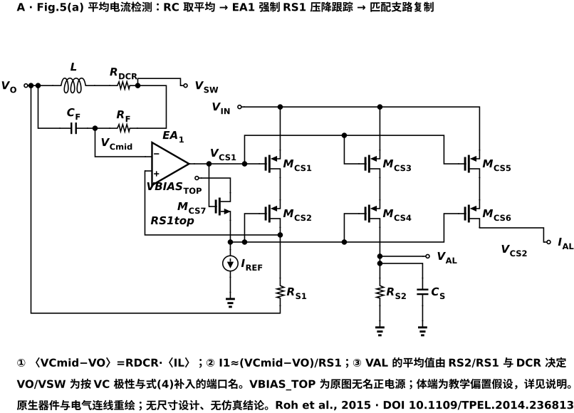
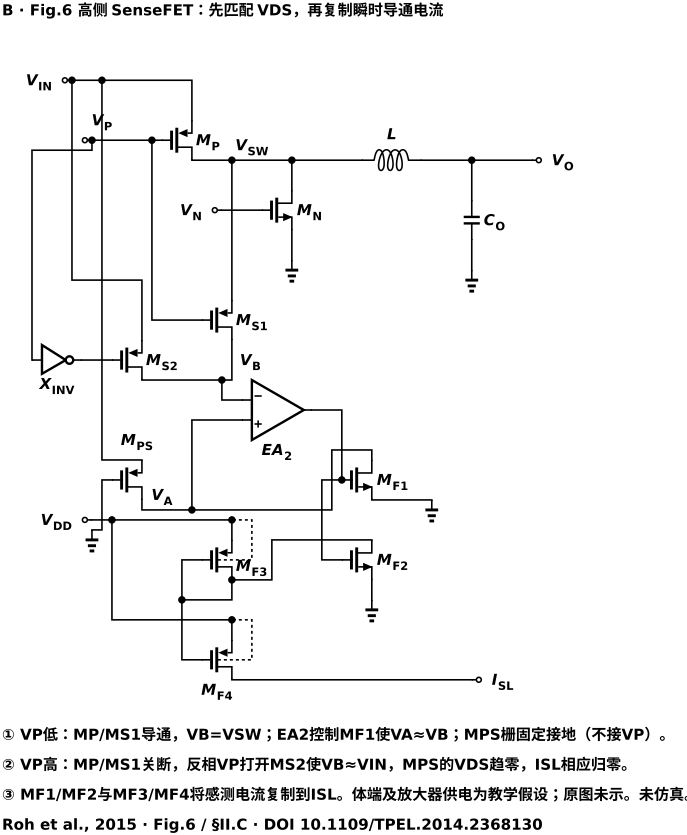
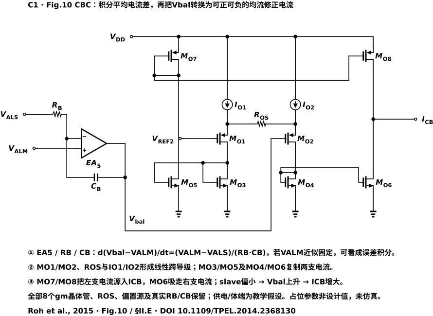
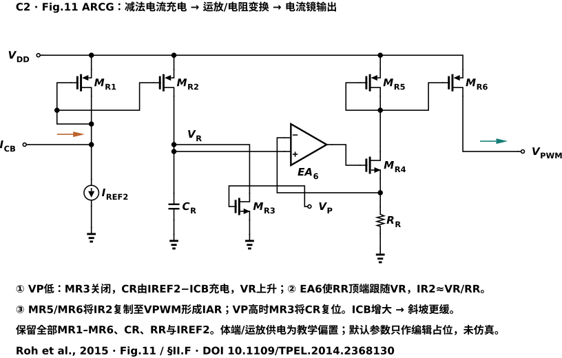
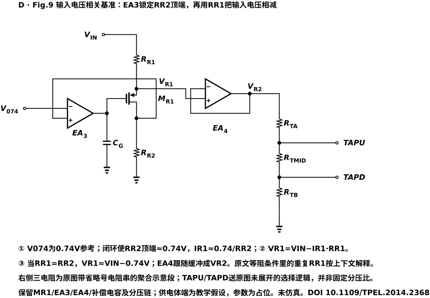
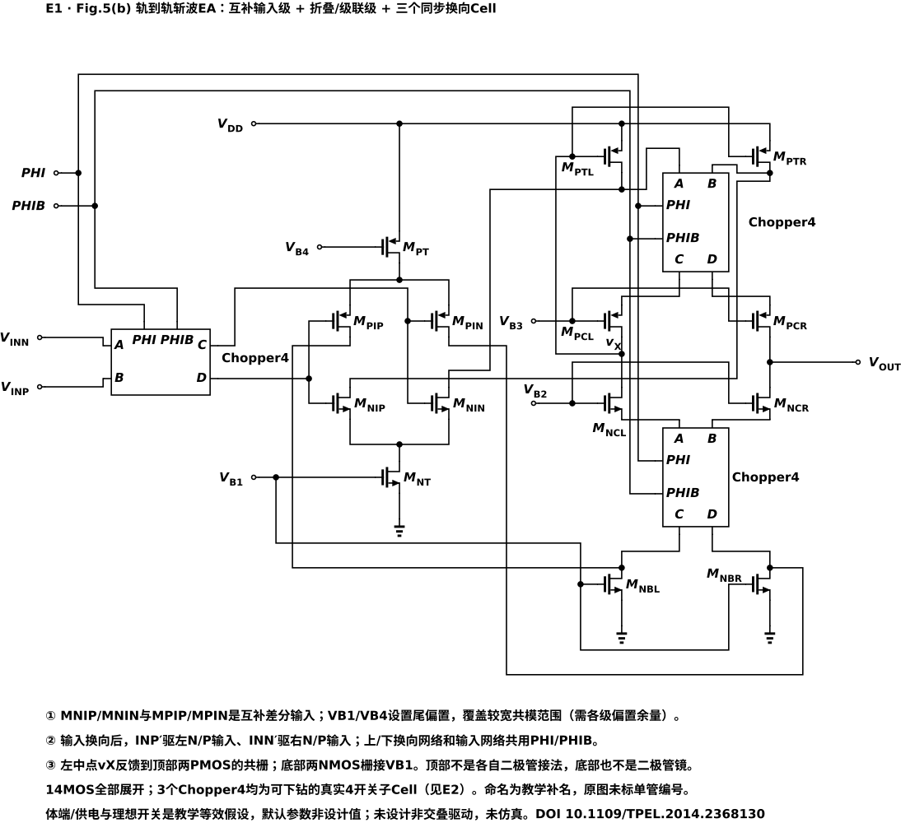
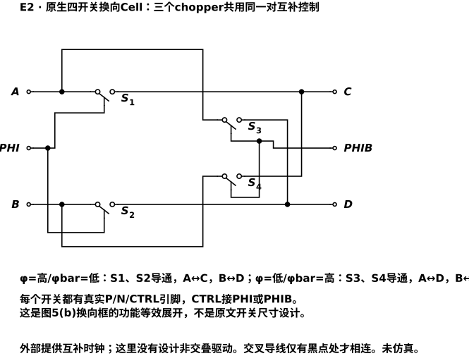

在 [多相 Buck 架构篇](/zh/notes/multiphase-buck-architecture/) 里，我们已经理清了系统的控制职责：平均检测做均流、瞬时检测做 PWM、通过放缓斜坡来抬高从相电流。

落到芯片内部晶体管级电路时，有三个最核心的工程问题需要回答：
1. **几毫伏且浮在输出共模上的 DCR 压降，怎么搬运成干净的电流？**
2. **相间电流差怎么长期记住，再反方向去拉低斜坡斜率？**
3. **误差放大器的失调比检测信号还大时，怎样靠电路结构压住？**

本文把控制器拆成**六组可复用的模拟子电路**。读每一张图时，都用同一个套路走一遍：**找参考节点 → 查负反馈方向 → 算电流/增益比例 → 看镜向与极性**。

## 六组局部电路速查

| 电路模块 | 核心任务 | 关键技巧 | 复习重点 |
| --- | --- | --- | --- |
| **1. 平均 DCR 检测（ACS）** | 提取 $r\bar i_L$ 并放大成 $v_{avg}$ | 运放虚短把差分电压搬到 $R_{S1}$ 上 | $R_{S2}/R_{S1}$ 设定增益，但放大不了信噪比 |
| **2. 高侧 SenseFET（ICS）** | 导通期内复制 $i_L/M$ | 运放强迫感测管漏端等于 $V_{SW}$ | 双极性电流镜翻转方向，关断期归零 |
| **3. 均流积分跨导（CBC）** | 累积 $v_M-v_S$ 并输出 $i_{cb}$ | 电容跨接运放反相端积分 + 源极退化电阻 $R_{OS}$ | 极性判断：从相偏小 $\implies i_{cb}$ 增大 |
| **4. 可调斜坡（ARCG）** | 生成斜率可控的人工斜坡 $i_a$ | 参考支路扣减 $i_{cb}$ 后给 $C_R$ 充电 | 复用 PWM 端，同时要限幅保稳定 |
| **5. 切相门限基准（PSC）** | 生成随 $V_{in}$ 移动的切相门限 | 下管电流镜把基准电流折算到顶部电阻 | $0.74\text{ V}$ 是基准电压与电阻比共同结果 |
| **6. 轨到轨斩波放大器** | 宽共模覆盖 + 消除低频失调 | n/pMOS 互补输入 + 四开关同步换向 | 信号反两次回基带，失调反一次搬去高频 |

---

## 1. 平均 DCR 检测：先把压差搬到电阻上，再镜像放大

电感绕组 DCR 记为 $r$。经前级 RC 网络低通滤波后，电容两端平均电压为 $\langle v_C\rangle=r\langle i_L\rangle$。但注意这个电压**浮在输出电压 $V_o$ 上面**：令电容负端接 $v_B=V_o$，正端为 $v_X=V_{Cmid}$，真正要提取的是压差 $v_C=v_X-v_B$。

[放大查看图 1](./assets/A-acs.svg)

### 1.1 负反馈怎样搬运差分压降？

把采样电阻 $R_{S1}$ 的下端也接到同一参考端 $v_B$（即 $V_o$），由放大器 EA1 驱动上方 pMOS 电流支路，让 $R_{S1}$ 上端节点 $v_Y$ 跟随 $v_X$：

$$v_Y\approx v_X \implies v_{R_{S1}}=v_Y-v_B\approx v_C \implies i_1\approx\frac{v_C}{R_{S1}}.$$

> **快速检查反馈极性**：假设 $v_Y$ 偏高 $\to$ EA1 输出升高 $\to$ pMOS 栅压升高、电流减小 $\to$ $R_{S1}$ 压降下降 $\to$ $v_Y$ 被拉回。确认是负反馈。

这样就把“带共模的毫伏级电感压降”，转换成了**与 MOS 绝对跨导无关、只由精密电阻 $R_{S1}$ 决定比例的电流 $i_1$**。

### 1.2 为什么用叠接（Cascode）支路并镜像出两份？

- **叠接结构作用**：提高电流镜输出阻抗，隔离下方 $V_o$ 或后级节点电位波动对复制电流的影响。其中下层 pMOS 栅偏置由 $M_{CS7}$ 随 EA1 输出下移约一个 $V_{GS}$ 提供，顶部 `VBIAS_TOP` 为独立高偏置轨。
- **两路镜像的分工**：
  1. 第一路流进 $R_{S2} \parallel C_S$，再次平滑纹波并放大成直流检测电压：
     $$\bar v_{avg}\approx\frac{R_{S2}}{R_{S1}}r\bar i_L;$$
  2. 第二路直接以电流形式送出，供全芯片做相数管理求和（$\sum \bar i_k$）。

注意前后两级 RC 的职责不同：电感旁的 $R_f C_f$ 决定端口电压如何取平均，后级 $R_{S2} C_S$ 决定最终给均流环的建立与纹波抑制速度。

### 1.3 算例与易错点：放大电阻救不了输入失调

设 $r=40\text{ m}\Omega$、$\bar i_L=0.5\text{ A}$，输入压差 $20\text{ mV}$。选 $R_{S1}=20\text{ k}\Omega$、$R_{S2}=80\text{ k}\Omega$（4 倍增益），则支路电流 $\bar i_1=1\,\mu\text{A}$，输出 $v_{avg}=80\text{ mV}$。

**最容易踩的坑**：如果发现输出信号不够大，单纯把 $R_{S2}/R_{S1}$ 加倍有用吗？假设 EA1 输入失调为 $V_{os}=0.5\text{ mV}$，折算回电感电流的等效误差为：

$$\Delta I_{os}=\frac{0.5\text{ mV}}{40\text{ m}\Omega}=12.5\text{ mA}.$$

加大 $R_{S2}$ 会**把真实信号和失调误差按相同比例一起放大**，并不会改善信噪比与精度——想压住 $\Delta I_{os}$，必须在放大器前端（如第 6 节的斩波）想办法。

---

## 2. 高侧 SenseFET：漏端电位拉齐，才能按尺寸比例抄电流

感测管 $M_{PS}$ 是功率管 $M_P$ 面积缩小 $M$ 倍的复制品（比如 $1:1000$）。但只有几何比例远远不够：MOS 电流同时取决于 $V_{GS}$ 和 $V_{DS}$，必须让两只管子工作在完全相同的偏置电压下。

[放大查看图 2](./assets/B-ics.svg)

### 2.1 导通期间的三端对齐

- **S 端**：$M_P$ 与 $M_{PS}$ 源极同接 $V_{in}$；
- **G 端**：**$M_{PS}$ 栅极固定接地**，$M_P$ 栅极由驱动 $V_P$ 控制；只有高侧导通（$V_P$ 拉低到接近地）时，两管才获得接近的 $V_{GS}$；
- **D 端**：选择开关把 $V_B$ 切到 $V_{SW}$，误差放大器 EA2 驱动下拉管 $M_{F1}$ 形成局部负反馈（若 $V_A$ 偏高 $\to$ 增强 $M_{F1}$ 下拉 $\to$ 拉低 $V_A$），从而强迫：
  $$V_A\approx V_B\approx V_{SW} \implies i_{PS}\approx \frac{i_L}{M}.$$

相比于直接用功率管压降除以标称导通电阻 $R_{on}$，这种用局部反馈 + 匹配器件做镜像的做法，能避开功率管 $R_{on}$ 随工艺和温度剧烈漂移的难题；代价是要考虑 EA2 的建立速度是否跟得上高侧刚开通时的开关边沿。

### 2.2 为什么还要连着镜像两次改变方向？

$M_{F1}$ 取到的电流是**下拉电流**，但后续在 PWM 比较器端，我们需要它和人工斜坡 $i_a$ **同方向相加**注入对地电阻 $R_p$：

$$v_{pwm}=R_p(i_s+i_a).$$

因此先由下方的 nMOS 电流镜复制一次，再经上方 pMOS 电流镜 $M_{F3}/M_{F4}$ 翻转成**向上注入节点的供给电流 $i_s$**。看多级电流镜电路时，养成习惯在每条支路旁标出箭头方向，就不容易把相加看成相减。

### 2.3 关断期间的清零动作

高侧一关断，选择开关立即把 $V_B$ 改接到 $V_{in}$。尽管此时 $M_{PS}$ 栅极仍然接地，EA2 还是会把它的漏端 $V_A$ 拉向 $V_{in}$——**源漏电压 $V_{SD}\to 0$，感测支路电流瞬间归零**。真实电感电流此时正经由低侧管续流，所以高侧 SenseFET 只看得到了导通期，这也是它无法直接做全周期均流的原因。

---

## 3. 均流误差积分器与跨导级（CBC）：把偏差存成控制电流

如果只用比例放大器调节均流，只要误差趋近零，输出修正量也会归零，导致稳态总要残留一点偏差。加入积分器后，即使误差归零，电容上保留的电压仍能持续维持所需的占空比补偿。

[放大查看图 3](./assets/C1-cbc.svg)

### 3.1 积分极性推演

左半边 EA5 同相端接主相平均读数 $v_M$，反相端经电阻 $R_B$ 接从相读数 $v_S$，积分电容 $C_B$ 跨在输出 $v_{bal}$ 与反相端之间。利用虚短，反相端被拉在 $v_M$：

$$\frac{dv_{bal}}{dt}=\frac{dv_M}{dt}+\frac{v_M-v_S}{R_B C_B}\approx \frac{v_M-v_S}{R_B C_B}\quad (\text{若 } v_M \text{ 缓变}).$$

**关键方向**：当从相出力偏小时，$v_M - v_S > 0$，电容左低右高被充电，输出 **$v_{bal}$ 逐渐升高**。

> **数量级直觉**：假设存在 $2\text{ mV}$ 持续偏差，$R_B=100\text{ k}\Omega$、$C_B=100\text{ pF}$，积分斜率就达到 $200\text{ V/s}$，只需 $1\text{ ms}$ 就能累积 $0.2\text{ V}$ 调整量。

### 3.2 跨导输出级如何把 $v_{bal}$ 转成有方向的 $i_{cb}$？

右半边是一个带源极退化电阻 $R_{OS}$ 的差分对，比较 $v_{bal}$ 与工作点参考电压。用 $R_{OS}$ 连接两只输入 pMOS 的源极，让线性跨导主要受电阻约束（$g_b \propto 1/R_{OS}$），比直接用 MOS 原生跨导更稳。

沿电路跟踪极性（从相偏小 $\to v_{bal}\uparrow$）：
1. 右侧输入 pMOS 栅压升高 $\to$ 源端跟着被抬高 $\to$ 电阻 $R_{OS}$ 中流向左侧的电流增大；
2. 左侧支路电流增大，经下方的 nMOS 镜 + 上方 pMOS 镜推动**输出上拉电流增大**；
3. 右侧支路电流减小，经底部 nMOS 镜推动**输出下拉电流减小**；
4. 上拉减下拉，净输出电流 $i_{cb}$ **沿图中正向显著增大**：
   $$\Delta i_{cb}\approx g_b\Delta v_{bal}\quad (g_b>0).$$

---

## 4. 可调人工斜坡（ARCG）：两次反馈接力，把电流转回斜率

均流电流 $i_{cb}$ 并没有注入功率电感，而是送进了人工斜坡发生器的参考端。

[放大查看图 4](./assets/C2-arcg.svg)

### 4.1 为什么正向 $i_{cb}$ 增大，斜坡反而变缓？

1. **参考节点相减**：找到固定下拉电流源 $I_{ref2}$ 的上端节点。正向 $i_{cb}$ **流入**该节点，帮上方参考 pMOS 分担了一部分下拉需求，因此参考 pMOS 只需提供 $I_{ref2} - i_{cb}$；
2. **电容充电斜率**：单位比例镜像到斜坡电容 $C_R$ 上，高侧导通期间（复位管 $M_{R3}$ 关断）电压斜率为：
   $$C_R\frac{dv_R}{dt}=I_{ref2}-i_{cb};$$
3. **电压转电流**：第二个局部负反馈 EA6 让电阻 $R_R$ 上端紧跟 $v_R$，再经 $M_{R5}/M_{R6}$（镜像比 $q$）送到 PWM 比较器端：
   $$i_a=q\frac{v_R}{R_R},\qquad \frac{di_a}{dt}=\frac{q(I_{ref2}-i_{cb})}{R_R C_R}.$$

### 4.2 复位管的时序配合与算例

高侧驱动 $V_P$ 为低（高侧导通）时，复位 nMOS $M_{R3}$ 关断，斜坡从零开始爬升；$V_P$ 变高（高侧关断）时，$M_{R3}$ 导通，把 $C_R$ 彻底放空。

**数值验证**：取 $I_{ref2}=10\,\mu\text{A}$、$C_R=10\text{ pF}$、$R_R=20\text{ k}\Omega$、$q=1$。
- 若 $i_{cb}=2\,\mu\text{A}$ $\implies$ 充电电流 $8\,\mu\text{A}$ $\implies$ $dv_R/dt=0.8\text{ V}/\mu\text{s}$ $\implies$ $di_a/dt=40\,\mu\text{A}/\mu\text{s}$；
- 若均流把 $i_{cb}$ 推高到 $4\,\mu\text{A}$ $\implies$ 充电电流降为 $6\,\mu\text{A}$ $\implies$ 斜坡放缓到 $30\,\mu\text{A}/\mu\text{s}$。

> **串联整条因果链（复习必背）**
> **从相偏小 $\to v_M-v_S>0 \to v_{bal}\uparrow \to i_{cb}\uparrow \to (I_{ref2}-i_{cb})\downarrow \to$ 人工斜坡变缓 $\to$ PWM 比较器更晚触及 $v_{err} \to$ 导通时间拉长 $\to$ 从相电流追平！**

**工程边界**：因为斜坡还肩负抑制亚谐波振荡的重任，$i_{cb}$ 必须设上限（不能逼近 $I_{ref2}$ 把斜坡压平）；同时复位管必须足够强，能在最短关断时间内把 $C_R$ 放电干净，否则残余起点电压会直接扰乱下一周期脉宽。

---

## 5. 输入自适应切相门限（PSC）：用两个电阻做一次减法

如架构篇所述，输入电压 $V_{in}$ 升高会抬高开关与驱动损耗，最优切相电流点也随之右移。如何用极简电路生成随 $V_{in}$ 线性移动的参考电压？

[放大查看图 5](./assets/D-psc-reference.svg)

沿支路走一遍就会发现原理异常简洁：
1. **设定支路电流**：EA3 调节中间 pMOS，使下方电阻 $R_{R2}$ 上端电压 $v_X$ 锁定在固定基准 $V_x$（该论文取 $0.74\text{ V}$）。因此流过整条串的电流被固定为：
   $$i_R\approx\frac{V_x}{R_{R2}};$$
2. **输入端减法**：同一股电流流过上方接 $V_{in}$ 的电阻 $R_{R1}$，自然在 $v_{R1}$ 处减掉一段固定压降：
   $$v_{R1}=V_{in}-i_R R_{R1}=V_{in}-\frac{R_{R1}}{R_{R2}}V_x.$$
3. **缓冲与分压抽头**：单位增益跟随器 EA4 隔离后级分压串负载，分压串上的 `TAPU`（升相门限）和 `TAPD`（降相门限）根据当前工作相数切出带滞回的阈值，与总平均电流电压 $v_{ps}$ 比较。

可见，“$V_{in}-0.74\text{ V}$”并不是什么物理魔法——**$0.74\text{ V}$ 来自基准源 $V_x$，前面乘的斜率系数则是 $R_{R1}/R_{R2}$（图中取等阻值 $1:1$）**。如果 $V_{in}$ 降得过低使放大器或 MOS 失去电压余量，这条线性平移关系就会失效。

---

## 6. 轨到轨斩波误差放大器：扩大共模范围，再把失调搬走

在平均 DCR 检测中，输入信号可能只有几毫伏，而输入共模随着输出电压 $V_o$ 变化，普通运放既容易超出输入共模范围，又会被自身 $1\text{–}5\text{ mV}$ 的输入失调毁掉均流精度。这颗误差放大器同时用两招解决它们：

[放大查看图 6](./assets/E1-chopper-ea.svg)

### 6.1 互补输入对：高低共模各有人顶上

- **pMOS 输入对**：在低共模（接近地）时拥有充足余量；
- **nMOS 输入对**：在高共模（接近电源轨）时正常工作；
- 两对管的差分输出电流在折叠式共源共栅（Folded-Cascode）负载支路中汇合，并在高阻输出端转成驱动电压。

> **识图注意**：图 6 中顶部两只 pMOS 栅极同接左侧折叠节点 $v_X$，底部两只 nMOS 栅极同接偏置 $V_{B1}$，它们构成折叠负载电流源，**并不是**常规的二极管自偏置电流镜。另外，中间共模区两对管同时导通，总 $g_m$ 会翻倍，做环路补偿时要留意这段跨导变化。

### 6.2 斩波（Chopping）怎么把信号留下、把失调踢出去？

主图中的换向模块可展开成四个理想开关（`PHI` 与反相 `PHIB` 互补驱动）：

[放大查看图 7](./assets/E2-chopper.svg)

把周期交替的斩波调制符号记为 $m(t)\in\{+1,-1\}$：
1. **输入端先乘一次 $m(t)$**：把微弱的直流信号 $v_{in}$ 调制成频率为 $f_{chop}$ 的高频方波；
2. **经过核心放大级**：放大级自身的输入等效直流失调 $v_{os}$ 混了进来，得到 $A[m(t)v_{in}+v_{os}]$；
3. **输出/求和级再乘一次 $m(t)$**：因为 $m^2(t)\equiv 1$，信号与失调彻底分家：
   $$v_{out}=m(t)\cdot A\big[m(t)v_{in}+v_{os}\big]=A v_{in}+A\,m(t)\,v_{os}.$$

- **有用信号 $A v_{in}$**：经历了两次反转，正负抵消，**回到直流基带**；
- **放大器失调 $A m(t) v_{os}$**：只经历了后一次反转，被**搬移到高频开关频率上**，随后交给图 1 后级的 $R_{S2}C_S$ 低通滤波器轻松滤掉。

> **斩波不是万能药**：它能把运放自身的随机直流失调压低一个数量级以上，但**消不掉开关电荷注入残余纹波**，也**救不了片外电感 DCR 自身和电流镜电阻比值的失配**。

---

## 7. 六段电路中，最值得带走的通用模拟设计套路

| 设计难题 | 这颗芯片的解法 | 下次读电路先看什么 |
| --- | --- | --- |
| 浮地小压降难以直接放大 | **运放虚短搬移到同参考电阻上**（图 1） | 电阻下端跟输入负端是否同接一个参考点 |
| 功率管 $R_{on}$ 漂移大 | **SenseFET + 漏端跟随反馈**（图 2） | 导通窗口内 S/G/D 三端是否真正对齐 |
| 需要记住微小的长期误差 | **反相积分器 + 源极退化跨导**（图 3） | 电容跨接关系 + 退化电阻如何线性化跨导 |
| 电流指令控制时间脉宽 | **充电参考扣减 + 斜坡复位**（图 4） | 流入还是流出节点 + 关断期谁负责放电 |
| 从电源电压减去固定基准 | **下管设流、上管造压降**（图 5） | 上下两只电阻的比例关系与缓冲隔离 |
| 毫伏级放大怕失调 | **互补输入 + 两次同步换向**（图 6、7） | 失调引入在两次换向之间，还是在换向之外 |

---

## 8. 复习自检（7 题）

1. **平均检测输出太小，把图 1 的 $R_{S2}$ 翻倍能减小均流时的电感电流误差吗？**
   > 不能。真实压降和前端失调 $V_{os}$ 会同比例放大，折算回电感的误差依然是 $V_{os}/r$。
2. **图 2 中只要把 $V_A$ 钳位到完全等于 $V_{SW}$，SenseFET 就一定按 $1:M$ 精确复制电流吗？**
   > 还要看 $V_{GS}$ 是否匹配（即功率管确实处于完全低电平导通窗口）、放大器带宽是否已建立完毕，以及器件本身失配。
3. **高侧关断后，感测管 $M_{PS}$ 的栅极依然接地，为什么电流立刻归零了？**
   > 选择开关把参考端 $V_B$ 切回 $V_{in}$，EA2 把漏端 $V_A$ 拉向 $V_{in}$，使 $V_{SD}\approx 0$，感测管自然关断流零。
4. **从相平均电流偏低时，均流控制电流 $i_{cb}$ 增大，为什么没有直接增大电感电流而是靠变缓斜坡起作用？**
   > $i_{cb}$ 从斜坡充电参考 $I_{ref2}$ 中扣除了部分电流，使斜坡充电变慢；在相同 $v_{err}$ 下更晚触发关断，从而拉长导通时间、增加电感伏秒。
5. **图 4 关断期间，如果复位管 $M_{R3}$ 没把 $C_R$ 放电回零，下一周期会怎样？**
   > 残余起始电压直接抬高下一周期的 $v_{pwm}$，导致比较器提前翻转、占空比异常缩短。
6. **若图 5 中上方电阻 $R_{R1}$ 改为下方 $R_{R2}$ 的两倍，输出随输入怎么变？**
   > 支路电流仍为 $V_x/R_{R2}$，上方压降翻倍，故 $v_{R1}=V_{in}-2V_x=V_{in}-1.48\text{ V}$（在余量充足前提下）。
7. **用了轨到轨 + 斩波放大器，是否意味着多相均流误差可以做到零？**
   > 不能。斩波主要抑制运放输入失调，最终精度仍受电流镜比例、$R_{S1}/R_{S2}$ 匹配以及片外电感 DCR 偏差限制。

---

## 参考资料

- **架构衔接**：[多相 Buck 架构与控制教程](/zh/notes/multiphase-buck-architecture/) · [小 DCR 快慢互补与共享放大器](/zh/notes/buck-small-dcr-shared-amplifier/) · [多相学习地图](/zh/learn/#multiphase)
- **原始文献**：Yong-Seong Roh 等，*A Multiphase Synchronous Buck Converter With a Fully Integrated Current Balancing Scheme*, IEEE Transactions on Power Electronics, 30(9), 5159–5169, 2015，[DOI: 10.1109/TPEL.2014.2368130](https://doi.org/10.1109/TPEL.2014.2368130)（文中电路为围绕原文原理重绘的局部等效分析图，器件具体尺寸、噪声与补偿网络参数未在文献中逐一公开）。
