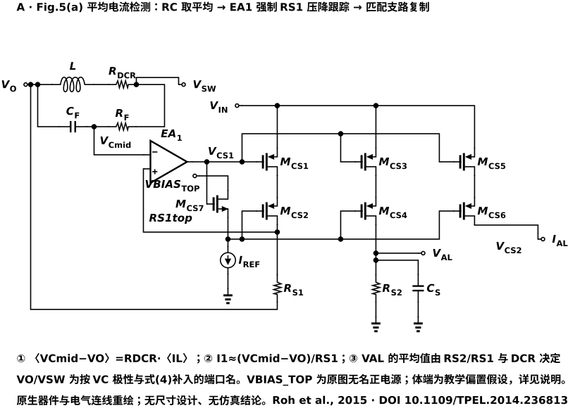
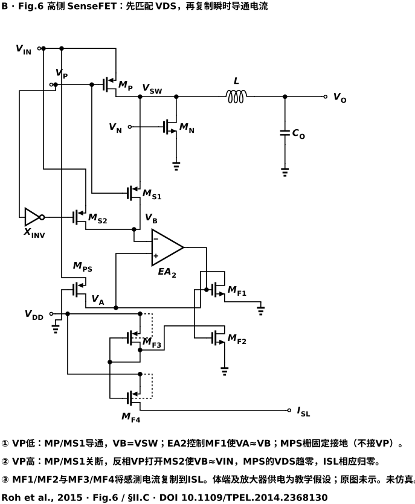
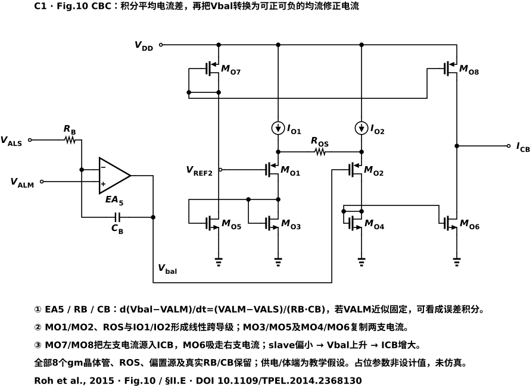
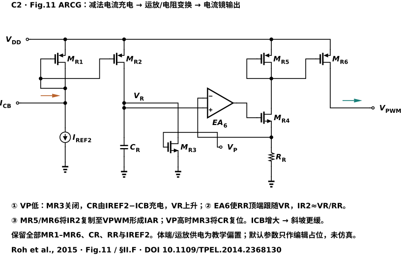
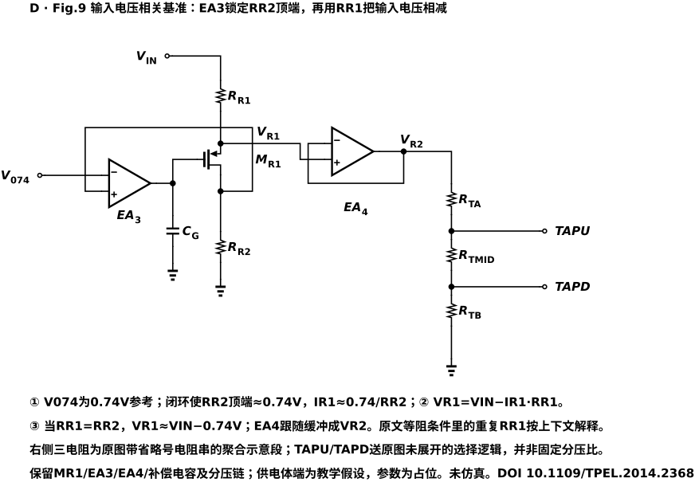
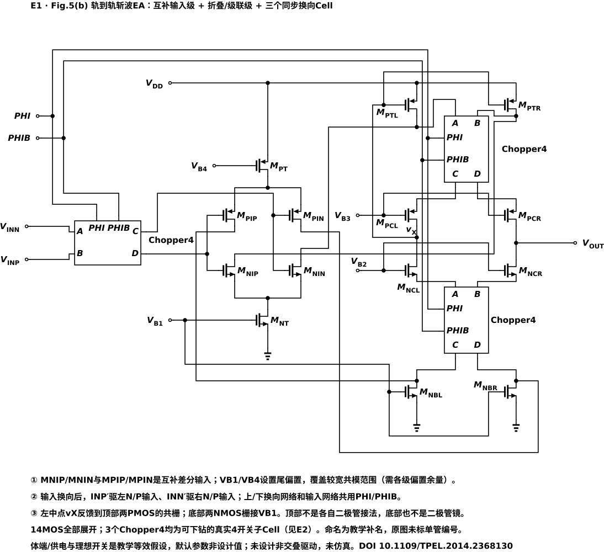
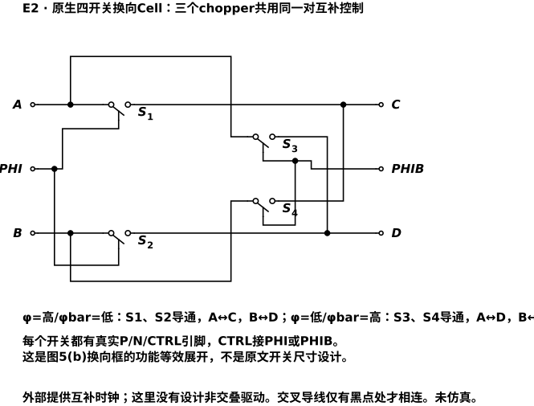

架构框图可以告诉我们“比较平均电流，再调整斜坡”，但还留下三个具体问题：小小的电感压降怎样变成可复制的电流？相电流偏差怎样保存下来，而不是下一刻就消失？一股均流控制电流，又怎样真正改变 PWM 的关断时间？

这篇直接从局部电路回答。每次只沿一条反馈回路或电流路径走，先判断节点被建立到什么电压，再计算电流，最后检查镜像方向。全系统职责与交错算例见 [多相 Buck 架构教程](/zh/notes/multiphase-buck-architecture/)，这里集中学习可复用的模拟电路连接。

文中 MOS 指金属氧化物半导体晶体管（Metal-Oxide-Semiconductor transistor），pMOS、nMOS 分别为 P、N 沟道器件；EA 表示误差放大器（Error Amplifier）。电压名称以其相对参考节点为准，电流正方向以箭头为准；交叉导线应按结点标记判断，不能把每一个交叉都当成相连。“两节点近似相等”均以反馈稳定、增益和电压余量足够为前提。以下是电路连接与手算分析，不是器件尺寸、噪声或稳定性已经通过仿真的设计。

## 1. 平均 DCR 检测：先复制压降，再复制电流

### 1.1 真正需要被保住的是两点之差

电感绕组直流电阻（Direct Current Resistance，DCR）记为 $r$。理想电感与 DCR 串联后，端口电压同时包含 $L\,di_L/dt$ 与 $ri_L$。电阻、电容组成的 RC 检测支路把它变成电容电压 $v_C$；在周期稳态，它的平均值满足：

$$\langle v_C\rangle=r\langle i_L\rangle.$$

若只需要平均量，这个关系不要求精确匹配 $R_fC_f=L/r$；若要重建整个瞬时波形，则需要重新检查时间常数和加载。这里先把 RC 网络提供的差分电压视为输入：负端电位记为 $v_B$，正端为 $v_X$，所以 $v_C=v_X-v_B$。

电压 $v_B$ 不是自动等于地。直接把 $v_X$ 当成检测电压，会混进它的共模电位。在下面重绘中，$v_B$ 对应输出端 VO，$v_X$ 对应检测电容另一端的 VCmid；检测电阻 $R_{S1}$ 下端也接 VO。原图未印出 RC 两端的功率端口名称，这里的 VO、VSW 补名依据电容极性、正向平均检测关系及功率级连接推定，便于读者检查参考方向。电路怎样把真正的差值复制出来？

[放大查看图 1](./assets/A-acs.svg)。先找检测电阻 $R_{S1}$ 的下端与电容负端的共同参考，再找接到放大器输入的两个上端；这两处关系决定了测到的是压差还是对地电压。

### 1.2 负反馈把输入压差搬到电阻上

放大器 EA1 调节上方 pMOS 支路，让 $R_{S1}$ 上端的检测节点 $v_Y$ 跟随 $v_X$。$R_{S1}$ 下端接同一个 $v_B$，因此：

$$v_Y\approx v_X,\qquad v_{R_{S1}}=v_Y-v_B\approx v_C,\qquad i_1\approx\frac{v_C}{R_{S1}}.$$

可以用一次扰动检查反馈方向：若 $v_Y$ 偏高，图中的放大器驱动会使供给该节点的 pMOS 电流减小，电阻上的压降随之减小，$v_Y$ 被拉回。若更换器件类型或放大器正负端，必须重新做这次检查，不能只看见“三角形和电阻”就认定是负反馈。

这样做的价值是，把一个带共模的差分小电压，变成由电阻设定比例的电流。精确增益不再单靠某只 MOS 的本征跨导。

### 1.3 为什么用叠接支路，还要再镜像两份？

图中的两层 pMOS 支路共用相应栅极偏置，第一路产生 $i_1$，其他路按器件比例复制它。叠接有助于隔离下方输出电压变化对镜像电流的影响，但需要更多电压余量；不能把“用了两只管”直接等同于无限输出电阻或零镜像误差。

两层栅极不直接短接：偏置 nMOS $M_{CS7}$ 的栅极跟随放大器输出，源极提供下移一个栅源电压量级的偏置，供下层 pMOS 使用，参考电流建立其工作点。该偏置管漏端接原图未命名的正偏置电源，重绘保留为 VBIAS_TOP；不能仅因它画在上方，就把它认成与其他支路相同的输入电源。

一份复制电流流入 $R_{S2}$ 与 $C_S$ 的并联网络。电阻把电流变回电压，电容抑制开关纹波，得到供均流比较的平均检测电压 $v_{avg}$；另一份电流输出可送到各相求和节点，供相数管理使用。单位镜像比例下：

$$\bar v_{avg}\approx\frac{R_{S2}}{R_{S1}}r\bar i_L.$$

这里第一级 RC 决定电感端口信息怎样进入检测，后级 $R_{S2}C_S$ 决定平均输出怎样建立。两个电容不承担同一任务，不能因为都叫滤波，就把它们合并成一个任意时间常数。

### 1.4 一个小信号算例

假设 $r=40$ mΩ、平均电流 0.5 A，则平均检测压差为 20 mV。若 $R_{S1}=20$ kΩ、$R_{S2}=80$ kΩ，则 $\bar i_1=1\,\mu$A，平均检测输出约 80 mV。这里的电阻与增益只是教学选值。

若输入等效失调为 0.5 mV，仅这一项就相当于：

$$\Delta I_{os}\approx\frac{0.5\,\mathrm{mV}}{40\,\mathrm{m\Omega}}=12.5\,\mathrm{mA}.$$

把后级电阻比加倍，真实信号和这一输入失调的贡献都会一起放大，因此不能只靠增加后级增益改善输入端的信号与失调之比。还要检查 DCR、镜像比例和电阻比的相间误差。

上述电流转换采用正常单向工作区的近似。实际还要检查电容压差的极性、纹波峰谷、输入共模和每层管子的压差；若轻载或瞬态让支路离开线性工作区，就不能继续按理想增益求平均。这里是各相独立的平均检测电路，不是多相共享一个精密放大器的时分复用方案。

## 2. 高侧 SenseFET：让两个漏端相等，才有可用的复制比例

### 2.1 为什么缩小一只管还不够？

感测晶体管（SenseFET）是功率管的缩比副本。希望用小电流反映大功率管电流，必须让它们处在相近的栅源与漏源电压条件下；尺寸比只解决几何比例，不自动解决电压条件。

本例的功率 pMOS $M_P$ 与感测 pMOS $M_{PS}$ 源极均接 $V_{in}$。功率管栅极由 $V_P$ 驱动；**感测管栅极固定接地，两栅并没有物理短接。** 只有高侧导通、$V_P$ 处于接近地的低电平时，两管才获得相近的栅源电压。接下来还要使感测漏端 $V_A$ 跟随开关节点 $V_{SW}$。

[放大查看图 2](./assets/B-ics.svg)。先分清功率路径与小电流感测路径，再找 $V_A$、$V_B$ 两点。它们由反馈拉近，而不是靠一根导线短接；功率开关节点的电流没有直接流入误差放大器。

### 2.2 导通时：先选对比较电位，再建立漏端跟随

高侧导通时，输入选择开关把 $V_B$ 接到 $V_{SW}$。EA2 检测 $V_A$ 与 $V_B$，驱动 nMOS 下拉管 $M_{F1}$。若 $V_A$ 偏高，放大器增强下拉，感测漏端被拉低；若偏低，则减少下拉，让 pMOS 支路把它抬回。因此正常工作时：

$$V_A\approx V_B\approx V_{SW}.$$

两只 pMOS 的源极相同、漏极接近，导通窗口内栅电平也接近，感测电流才可按尺寸比例换算。定义功率管与感测管尺寸比为 $M:1$，则近似 $i_{PS}=i_L/M$。$M$ 与多相系统的相数无关。

这是一个局部模拟反馈回路。电流读数能否及时建立，取决于放大器带宽、开关节点边沿、感测节点电容和下拉管工作余量；不能把理想的 $V_A=V_B$ 当成开通瞬间也已无误差。

与直接把功率管导通压降除以一个固定导通电阻相比，这里利用匹配的感测器件和局部反馈建立复制关系，避免把全部精度押在一个绝对导通电阻模型上；代价是感测支路功耗、放大器和建立时间。两只器件之间的失配也没有被反馈自动消除。

### 2.3 为什么还要把下拉电流变成上拉电流？

$M_{F1}$ 的感测电流经 nMOS 镜像形成下拉支路。如果直接接到 PWM 求和电阻，它的极性可能与人工斜坡不一致。pMOS 镜像 $M_{F3}/M_{F4}$ 再转换一次方向，得到向比较节点供给的电流。

于是瞬时检测电流 $i_s$ 和人工斜坡 $i_a$ 可以共同流过对地电阻 $R_p$，形成：

$$v_{pwm}=R_p(i_s+i_a).$$

“电流镜复制”不只意味着数值大小，还包含电流是流入节点还是从节点流出。看见多个镜像级时，应逐级标方向，避免把本来相加的信号解释为相减。

### 2.4 关断时：感测流归零，电感电流仍可继续

高侧关断后，另一选择开关把 $V_B$ 接到 $V_{in}$。反馈再把 $V_A$ 拉向 $V_{in}$，感测 pMOS 的源漏电压趋近零，感测电流随之归零。其栅极依然接地，这次关断感测依靠的是漏源电压条件变化。

真实电感电流此时可经低侧续流，因此这只高侧检测器没有观察整个周期。若导通占空比为 $D$，在理想连续三角电流和固定比例下，全周期简单平均约为 $D\bar i_L/M$，而不是 $\bar i_L/M$。这也是另设平均 DCR 路径的原因。

## 3. 均流误差怎样存下来：积分器与电流差输出

### 3.1 为什么不能只给一个瞬时比例修正？

假设某从相一直少出 50 mA。一个只有有限比例增益的修正器，需要保留一定误差，才能维持非零调整量。积分器则把持续误差积累成状态；即使最后误差接近零，也能保留用来抵消器件差异的修正量。

主相、从相平均检测电压分别记为 $v_M$、$v_S$，积分电阻与电容为 $R_B$、$C_B$，输出为 $v_{bal}$。下面先看电容怎样保存误差，再看输出如何变成均流控制电流 $i_{cb}$。

[放大查看图 3](./assets/C1-cbc.svg)。左半部的关键不是“有一个电容”，而是电容跨在输出与反相输入之间；右半部的关键是两条支路先产生电流差，再通过镜像在输出节点相减。

### 3.2 用反相输入节点的电流守恒推方向

EA5 的同相端接 $v_M$，反相端经 $R_B$ 接 $v_S$，反馈电容从输出接回反相端。理想闭环下反相端也接近 $v_M$。若主相读数在所考察窗口内近似不变，则：

$$\frac{dv_{bal}}{dt}\approx\frac{v_M-v_S}{R_BC_B}.$$

从相读数偏低，$v_M-v_S>0$，输出逐渐升高。若主相读数也快速变化，精确的理想节点关系还包含跟随项：

$$\frac{dv_{bal}}{dt}=\frac{dv_M}{dt}+\frac{v_M-v_S}{R_BC_B}.$$

因此“积分平均差”是该支路的核心功能，但动态分析仍要保留参考端也会变化这一事实。积分结果不可能永远上升，放大器输出摆幅与后级电流范围会限制它。

### 3.3 跨导单元怎样把电压差变成有方向的电流？

后级比较 $v_{bal}$ 与一个工作点参考。两只输入管的源端之间接电阻 $R_{OS}$，其源端电位随各自栅压移动，电阻因此把一部分输入电压差转成支路电流的重新分配。该电阻提供局部退化，使比例更多受电阻约束，而不只依赖 MOS 本征跨导。

下面的 nMOS 镜像读取两条支路的电流；其中一路再经 pMOS 镜像变成上拉，另一路作为下拉。二者在输出节点相减，得到 $i_{cb}$。沿图示方向，$v_{bal}$ 升高会让右侧输入 pMOS 的源端电位随之升高，$R_{OS}$ 中流向左支路的电流增加；左侧镜像推动输出上拉增加，右侧输出下拉减小，净输出电流因而增大。在正常小信号范围内，可用等效跨导 $g_b$ 描述：

$$\Delta i_{cb}\approx g_b\Delta v_{bal},\qquad g_b>0.$$

这里 $g_b$ 包含源端电阻、有限器件跨导与镜像比例，不能仅凭图就确定数值。从相平均读数偏低时，积分输出推动 $i_{cb}$ 向图示正方向增加；下一节会看到，正向电流增大反而使斜坡发生器充电变慢。

例如持续 2 mV 的检测差、$R_B=100$ kΩ、$C_B=100$ pF，冻结主相读数，则积分斜率约为 200 V/s，即 1 ms 积累 0.2 V。实际闭环中从相电流会随修正变化，误差不会必然维持 2 mV。该算例只说明“微小持续差值可以形成明显状态变化”。

## 4. 从控制电流到斜坡：两次反馈和一次复位

### 4.1 先看参考支路，为什么是相减？

人工斜坡电流发生器（Artificial Ramp Current Generator，ARCG）需要在每次高侧导通时，产生一条可调的上升电流。均流器并不直接驱动功率管，而是向斜坡发生器参考支路送入 $i_{cb}$。

[放大查看图 4](./assets/C2-arcg.svg)。先找固定下拉电流 $I_{ref2}$ 的上端节点。正向 $i_{cb}$ 流入该节点，就替上方参考 pMOS 承担了一部分供电需求，所以参考 pMOS 所需电流为 $I_{ref2}-i_{cb}$，而不是二者之和。

参考支路经 pMOS 电流镜复制到充电支路。单位镜像比例、复位管关断时，电容 $C_R$ 上的电压 $v_R$ 满足：

$$C_R\frac{dv_R}{dt}\approx I_{ref2}-i_{cb}.$$

这一步把一股近似慢变化的均流控制电流，转成每周期斜坡的斜率。它不是把均流电流加到功率电感上。

### 4.2 第二个反馈把电容电压搬到电阻上

EA6 的同相端读 $v_R$，反相端读 nMOS $M_{R4}$ 源端、即 $R_R$ 上端。放大器调节栅极，让电阻上端跟随 $v_R$，得到：

$$i_{R2}\approx\frac{v_R}{R_R}.$$

上方 pMOS 镜像 $M_{R5}/M_{R6}$ 再复制这股电流，向 PWM 节点提供 $i_a$。设镜像比例为 $q$，则：

$$i_a\approx q\frac{v_R}{R_R},\qquad \frac{di_a}{dt}\approx\frac{q(I_{ref2}-i_{cb})}{R_RC_R}.$$

两个反馈任务不同：前面的电流镜规定电容充电量，后面的运放反馈规定电压到电流的比例。把它们串起来，才知道 $i_{cb}$ 增大为什么会令人工斜坡变缓。

### 4.3 复位管为什么由功率管驱动信号控制？

本例高侧是 pMOS，驱动 $V_P$ 低时高侧导通，复位 nMOS $M_{R3}$ 关断，电容开始充电；$V_P$ 高时高侧关断，$M_{R3}$ 导通，把电容放电，准备下一周期。

如果只充不放，下一个周期会从越来越高的斜坡起点开始，PWM 交点就不再只取决于本周期的电流。复位不充分也会留下相似误差。实际要检查放电时间、复位管导通电阻、电荷注入和最短关断时间。

例如假设 $I_{ref2}=10\,\mu$A、$i_{cb}=2\,\mu$A、$C_R=10$ pF，电容斜率为 $0.8\,\mathrm{V}/\mu$s；若 $i_{cb}$ 增为 $4\,\mu$A，则斜率降为 $0.6\,\mathrm{V}/\mu$s。再假设 $R_R=20$ kΩ、$q=1$，人工电流斜率从 40 降至 $30\,\mu\mathrm A/\mu\mathrm s$。

当该电流与瞬时检测电流相加、共同碰到固定比较阈值时，较缓斜坡通常使交点推迟、导通延长。完整链路是：**从相少出力 → 平均读数偏低 → 积分输出变化 → 正向均流控制电流增大 → 参考支路与电容充电电流减小 → 斜坡变缓 → PWM 关断更晚 → 从相电流增加。**

也可以在其他架构里给从相比较阈值加偏移，或直接调整脉冲时刻；这些方式都要有自己的误差注入端与动态模型。本例选择调斜坡，能复用已有电流判决端，但也把均流执行量与斜坡补偿绑到了一起。

### 4.4 复用斜坡，付出的代价是什么？

人工斜坡同时承担峰值电流控制的亚谐波补偿。均流想把斜坡调缓，补偿要求却可能限制最低斜率；当 $i_{cb}$ 接近 $I_{ref2}$ 时，正常上升斜坡甚至会消失。因此要给均流修正限幅，并检查全部目标占空比、比较延迟和短脉冲条件。电压环模型的相位裕度不能代替这些逐周期检查。

## 5. 输入相关切相门限：建立的是电阻压降，不是神奇常数

### 5.1 如何从输入电压中“减去”一个基准？

轻载时让过多相持续开关，驱动与控制开销可能占主导；重载时增加相数，又能减少电流平方相关的导通损耗。实际损耗交点会随输入电压变化，所以相数管理器（Phase-Shedding Controller，PSC）的门限可能需要随 $V_{in}$ 变化。

下面这段电路提供一种模拟实现：先用反馈建立一个固定电流，让它流过输入侧电阻；输入电压减去该电阻压降，就得到随输入移动的参考，再缓冲、分压、选择门限。

[放大查看图 5](./assets/D-psc-reference.svg)。不要先记住输出必须是“输入减 0.74 V”，先看两个电阻中流过的电流为什么相同，以及放大器究竟检测哪一个节点。

### 5.2 沿反馈走一次，再写公式

设下方电阻 $R_{R2}$ 上端为 $v_X$，固定基准为 $V_x$，本例为 0.74 V。EA3 控制中间 pMOS，使 $v_X$ 接近 $V_x$。若 $v_X$ 偏低，按图中的输入极性，放大器降低 pMOS 栅电位、增强通路，把 $v_X$ 抬回。

忽略放大器输入电流与支路漏电，两只串联电阻电流近似相同：

$$i_R\approx\frac{V_x}{R_{R2}},\qquad v_{R1}=V_{in}-i_RR_{R1}\approx V_{in}-\frac{R_{R1}}{R_{R2}}V_x.$$

若两电阻相等，才得到 $v_{R1}\approx V_{in}-V_x$。EA4 接成电压跟随器，把它缓冲到 $v_{R2}$，防止后面的分压串明显加载前一支路。若分压比例为 $\alpha$，选出的一个参考约为 $\alpha v_{R2}$。

重绘中的三段电阻是分压串的聚合表示，TAPU、TAPD 是供选择门限的抽头端口；实际选择逻辑没有展开，不能由这三个符号读出固定的门限比例。EA3 输出端到地的电容 $C_G$ 也被保留，它参与局部反馈动态；缺少器件与补偿参数时，不能仅凭画出了这个电容就判断环路稳定。

因此 0.74 V 在这里来自所用基准，减去多少还取决于电阻比；它不是多相 Buck 的自然常数。输入太低或器件余量不足时，上面的闭环等式也不再能任意成立。

### 5.3 门限怎样变成“开几相”？

各相平均检测电流求和，形成与总平均负载电流成比例的管理电压。控制逻辑依据当前相数，从分压串选择增相与减相门限：负载读数超过上限，多开一相；低于下限，停一相。不同方向采用分离的门限可形成滞回，减少在边界附近来回切换。

要移植的是“先找到损耗交点，再实现对应门限”的过程，不是照搬某一套分压比例。输出纹波、单相电流上限、负载瞬态和相间交接也会限制可选相数。门限电路本身没有说明停相剩余电流如何释放，也没有自动解决一至三相的时钟重排。

## 6. 轨到轨斩波放大器：输入覆盖范围与直流误差分别处理

### 6.1 为什么平均检测特别在意小失调？

如果真实 DCR 压差只有几毫伏，放大器自身的直流失调就可能被均流环误认为相电流差。另一方面，检测输入还带着共模电压，单一输入对不一定能覆盖整个目标范围。因此这里的误差放大器同时处理两件不同的事：用互补输入支路扩展共模范围，用斩波处理部分低频误差。

[放大查看图 6](./assets/E1-chopper-ea.svg)。先把图分成输入对、偏置/电流传递支路和输出节点，再找换向开关。不要试图一眼从全部管子中读出“斩波消除一切误差”。

### 6.2 两种输入对为什么互补？

nMOS 输入对需要足够的栅源电压和尾电流源余量；共模接近下电源时容易失去工作空间。pMOS 输入对在低共模端更有机会工作，却在接近上电源时面临相应限制。将两种输入对配合使用，可以扩展整体输入范围。

输入对产生的差分电流经后续偏置、折叠和叠接支路传到输出节点。输出上拉、下拉电流的小差值在高阻节点上形成电压变化，获得增益。图中偏置电压的作用，是让相关电流源与叠接管在预期区域工作，不能当作多路输入信号。

还要注意两处实际接线：顶部两只 pMOS 的栅极共同接左侧中间节点 $v_X$，不是各自漏栅短接；底部两只 nMOS 的栅极接偏置 $V_{B1}$，也不是常见的二极管连接参考支路。工作点由偏置与整条反馈关系共同建立，不能把上下支路直接套成两个普通电流镜。重绘中的输入管与支路名称用于定位，原文没有逐管提供这些编号。

中间共模区间里，两组输入对可能同时贡献跨导；靠近两端时，可能主要由其中一组承担。所以轨到轨输入不等于恒定跨导，也不保证整个范围内的增益、噪声和失调完全相同。还需检查输出摆幅与所驱动 pMOS 支路的栅压范围。

### 6.3 四个开关怎样构成一次换向？

主图中的换向单元可以继续拆开看。两路输入与两路输出之间，安排两条直通支路和两条交叉支路；一个时相只接通直通路径，另一个时相只接通交叉路径。这样同一个差分量在后端看到的符号就周期性交替。

[放大查看图 7](./assets/E2-chopper.svg)。A、B 是两路输入，C、D 是两路输出，PHI、PHIB 为互补控制。PHI 高时，S1/S2 接通 A–C、B–D，输出差分等于输入差分；PHI 低时，S3/S4 接通 A–D、B–C，输出差分反号。沿每个时相分别追两路信号，不要把四只开关都当成同时导通。实际还需设计避免冲突导通的驱动与建立窗口；这里的理想开关连接只解释换向功能。

### 6.4 两次换向怎样把信号留下、把失调搬走？

把理想斩波符号记为 $m(t)=+1$ 或 $-1$。输入先乘 $m(t)$，经过增益 $A$，输出侧再同步换向一次。若核心放大器在两次换向之间产生输入等效失调 $v_{os}$，则简化模型给出：

$$v_{out}=m(t)A[m(t)v_{in}+v_{os}]=Av_{in}+Am(t)v_{os}.$$

目标信号经历两次反转，回到原来的基带极性；中间产生的失调只经历后一次反转，成为随斩波时钟交替的分量，后级平均处理可抑制它。晶体管电路中，后一次换向可以通过内部差分电流支路完成，不必表现为“在最终输出线上再串一个开关”。

这一模型要求换向同步，并假设增益与建立过程足够理想。实际开关电荷注入、时钟馈通、不对称建立和残余纹波都会留下误差。斩波也不消除电感 DCR、检测电阻比和电流镜比例的不匹配。原文没有给出斩波频率、残余失调或全共模跨导曲线，不能从示意图补出这些性能指标。

## 7. 六段电路中，哪些设计动作可以带走？

| 可复用动作 | 本文实例 | 移植时最先检查什么 |
| --- | --- | --- |
| 用反馈把差分电压搬到电阻上 | 平均检测、斜坡电压转电流 | 两端参考是否一致、反馈极性与电压余量 |
| 用反馈匹配器件电压条件 | SenseFET 漏端跟随 | 有效导通窗口、建立时间和镜像比例 |
| 用电容保存持续误差 | 均流积分器 | 参考变化、输出饱和、限幅后的恢复 |
| 用源端电阻约束跨导 | 均流电压转电流 | 有限器件跨导、偏置与线性范围 |
| 用电流守恒设置充电速度 | 可调斜坡 | 电流方向、复位、最低补偿斜率 |
| 用同一电流产生可预测压降 | 输入相关基准 | 电阻比、加载、输入与器件余量 |
| 用同步换向分离信号与低频误差 | 斩波放大器 | 时钟、注入、建立与后级滤波 |

下一次读类似电路，可以先遮住器件编号，只保留输入、输出、供电、地与几个关键节点。先找闭环，再按“节点电压 → 支路电流 → 镜像方向 → 后级动作”推一次。编号用于定位，电气连接才决定功能。

## 8. 自测：把图中的一个条件改变，会怎样？

**1. 平均检测输出不够大，只把后级电阻加倍，能否消除输入失调对应的电流误差？** 不能。真实输入和输入等效失调被一起放大，折算回电感电流的失调仍约为 $V_{os}/r$。

**2. SenseFET 的两个漏端完全相等，但栅源条件不一样，尺寸比还能保证准确复制吗？** 不能。还需匹配有效窗口内的栅源条件，并考虑失配、温度与建立误差；本例只在高侧低电平导通窗口建立这种近似。

**3. 高侧关断后，感测管栅极仍接地，为什么读数可以归零？** 选择开关与反馈把感测漏端拉向输入，使其源漏电压趋近零；这不表示真实电感电流已经归零。

**4. 从相平均电流偏低，为什么增大的均流控制电流没有直接“推”电感？** 它先分担参考支路的下拉需求，使镜像到斜坡电容的充电电流减少；再通过较缓斜坡推迟 PWM 关断，间接增加电感正向伏秒。

**5. 关断期复位管没来得及充分放电，会影响下一周期吗？** 会。斜坡残余起点进入下一周期的比较，可能改变关断时间。只验证平均斜率还不够。

**6. 基准电路的上方电阻变成下方的两倍，是否仍是输入减 0.74 V？** 不是。在线性闭环与余量足够的模型里，应变为输入减 $2\times0.74$ V；随后还要考虑缓冲与分压比例。

**7. 轨到轨输入加上斩波，是否就能得到零均流误差？** 不能。共模范围、放大器残余失调、电流镜增益、检测电阻与电感 DCR 是不同误差来源。相等的读数不自动等于相等的真实电流。

## 来源与适用范围

这六组局部电路依据 Yong-Seong Roh 等，*A Multiphase Synchronous Buck Converter With a Fully Integrated Current Balancing Scheme*, IEEE Transactions on Power Electronics, 30(9), 5159–5169, 2015，[DOI](https://doi.org/10.1109/TPEL.2014.2368130)。具体对应原文平均检测与放大器、瞬时检测、均流、斜坡及门限电路；器件编号仅用来核对连接，不承担教学前提。

图为局部电路教学重绘，正文中的等效模型、扰动判断与算例用于解释工作过程；未给出的尺寸、偏置电流、带宽、噪声、温度范围与稳定性，不由重绘本身补齐。四相集成实例仍使用片外电感与输入、输出电容。

继续阅读：[架构、交错与切相](/zh/notes/multiphase-buck-architecture/) · [小 DCR 快慢互补与电流记忆](/zh/notes/buck-small-dcr-shared-amplifier/) · [多相学习地图](/zh/learn/#multiphase)。
