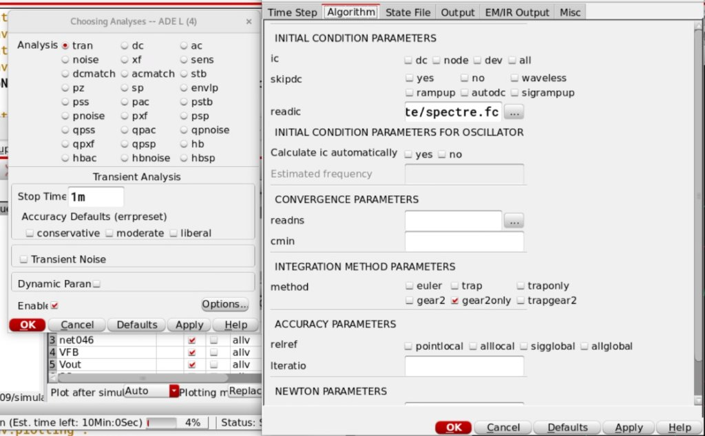
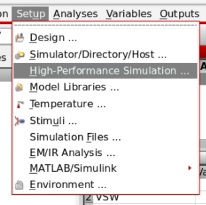
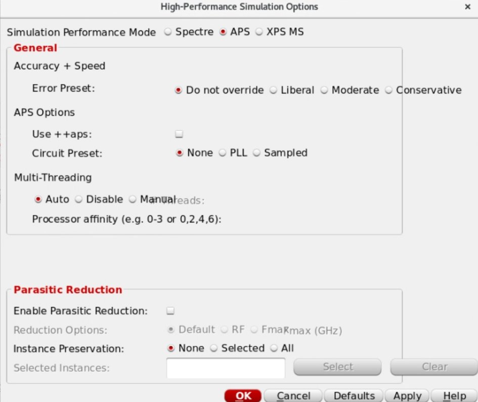
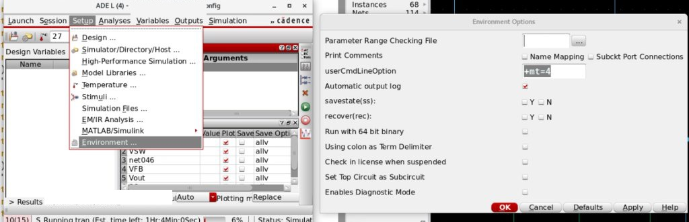
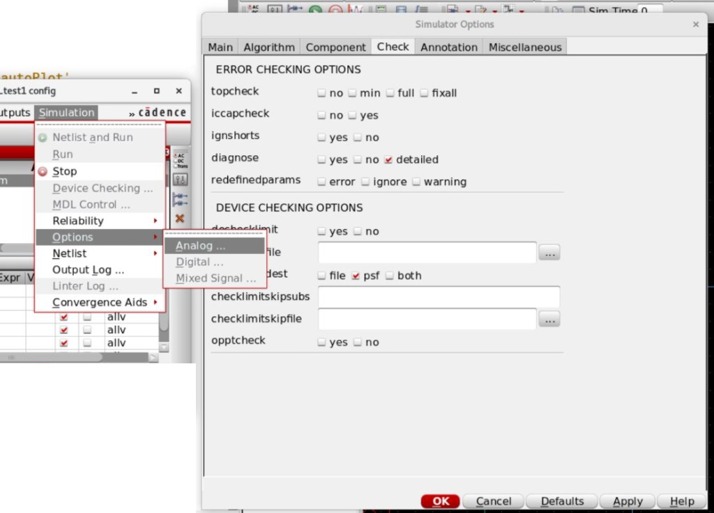
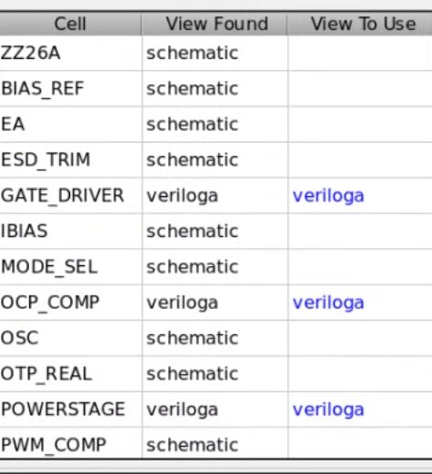

在 Cadence Virtuoso / Spectre 中做芯片级瞬态仿真时——无论是模拟电路的启动与环路建立、射频锁相环（PLL）/收发机的大信号瞬态，还是开关电源（Buck/PMIC）的稳态与负载跳变——都很容易遇到同一个工程瓶颈：**单次 `tran` 仿真动辄跑上几个小时，甚至在几十微秒处原地卡死**。参数还没调几轮，时间全耗在等待仿真器步进上。

解决这类问题不能靠盲目放宽精度（比如随意把 `errpreset` 降成 `liberal`），否则高频振铃、相位误差、死区直通或小信号纹波都会失真。真正通用的加速方法，是先看清 Spectre 把时间花在哪里，再按**“稳态初值直达 → 并行求解器与线程调优 → 详细诊断定位元凶 → 局部行为级替换 → 基线波形对齐”**五步逐层推进。

> **核心提速链路**
> 1. **跳过漫长启动与建立过程**：在 `tran` 分析的 `Options... -> Algorithm` 中用 `readic` 加载 `spectre.fc`，直接从稳态或锁定态起跑；
> 2. **开 `APS` 并用命令行指定线程**：在 `High-Performance Simulation` 里保持 `Multi-Threading: Auto`（避开 UI 重叠无法输入的问题），再去 `Environment` 填 `+mt=4`（或 `+mt=8`）；
> 3. **抓出卡步长的元凶**：在 `Simulation -> Options -> Analog... -> Check` 中把 `diagnose` 设为 `detailed`，在日志中锁定触发不收敛与飞秒步长的子模块；
> 4. **同库同名新建 `veriloga` + `config` 无损替换**：从原模块提取端口与电气特性写成收敛友好的 Verilog-A，再用 Hierarchy Editor 按需切换视图；
> 5. **基线波形与指标对齐**：提速后与全晶体管基线跑一段短瞬态核对核心指标，确认行为替换没有走偏。

前置参考：[AI × IC 工作流](/zh/ai-ic/) · [gm/ID 尺寸设计与初始工作点](/zh/notes/gmid-sizing/) · [Buck 功率级基础](/zh/notes/buck-day-01/)

---

## 1. 仿真为什么会慢：三类典型时间开销

无论是模拟、射频还是电源芯片，在 Spectre 中跑全晶体管级瞬态慢，根因几乎都落在以下三件事上：

1. **无效的启动或锁定时间太长**：电源芯片从 $0\text{ V}$ 软启动、PLL 环路从失锁到锁定、带大滤波/退耦电容的偏置网络建立，动辄需要数百微秒到数毫秒；而平时调环路稳定性、纹波或小信号扰动，真正关心的只是稳态附近的几十到几百微秒。每次微调参数都从头重跑，大量算力都浪费在重复建立稳态上。
2. **局部强非线性与高频/陡峭边沿卡死步长**：射频大信号开关、鉴频鉴相器（PFD）/比较器的高速翻转、高压功率管与体二极管的瞬间反偏导通、浮地驱动节点的陡峭跳变，会在纳秒甚至皮秒级沿口产生极大的 $dv/dt$ 与 $di/dt$。只要其中一两个子模块触发 Newton 迭代拒步（rejected steps），Spectre 就会把**全局仿真步长**压到 $10^{-12}\text{ s}$ 甚至飞秒级，拖慢整颗芯片。
3. **求解器模式或核数配置失配**：纯原理图与 Verilog-A 混仿误留在 `ams` 模式下会有额外的数字内核调度开销；而在中等规模电路上盲目拉满 16 核线程，反而会让核间同步通信开销超过矩阵求解收益。

---

## 2. 第一步：在 `tran` 选项里用 `readic` 跳过启动/建立过程

当你已经跑通过一次完整建立过程、得到了稳态或锁定工作点，后续调试就可以直接从该状态出发。

### 2.1 如何找到并提取 `spectre.fc` / `spectre.ic` 初值文件

只要之前成功跑过一次完整仿真（例如跑通到稳态或锁定态），Spectre 通常已经在仿真结果目录中保存了状态文件，无需重跑也能直接提取复用：

- **去哪里找现成文件**：在仿真工作根目录下的 `simulation/` 文件夹中，按当前测试平台层级进入对应子目录（常见路径为 `simulation/<顶层Cell>/spectre/<视图名>/psf/` 或 `analogArtist/` 目录），即可看到 **`spectre.fc`**（Final Condition，仿真结束时刻的稳态节点电压与电感/支路状态）和 **`spectre.ic`**（Initial Condition，`t=0` 时刻的初始条件文件）。要跳过启动直接从稳态开跑，**优先取稳态跑完后生成的 `spectre.fc`**。
- **如果目录里没有怎么办**：在 `tran` 分析的 **`Options... -> Output`** 标签页中，将 `writefinal` 设为 `spectre.fc`（或将 `write` 设为 `spectre.ic`），跑完一次完整稳态即可生成保存。

### 2.2 正确的加载路径与配置步骤

1. **把使能与供电激励改为 $t=0$ 即到位的直流源**：
   检查原理图中的 `VDD`/`VIN`、`EN`/`RST` 等上电或复位激励。如果原先用的是从 $0\text{ V}$ 延迟爬升的 `vpulse` 或 `vpwl`，必须改成 $t=0$ 就处于目标工作电平的 `vdc`（或把脉冲延迟设为 $0$、初始值直接设为目标电压）。否则在 $t=0$ 求解初始工作点时，外部使能和供电还是 $0\text{ V}$，会把芯片内部逻辑与偏置强行关断，导致稳态初值失效。
2. **从 `tran` 分析右键打开 `Options...`（不要从 `Simulation` 菜单找）**：
   - 在 ADE L 的 `Analyses` 列表中选中 `tran`，**右键编辑（或双击）**打开 **`Choosing Analyses`** 窗口；
   - 点击窗口右下角的 **`Options...`**（注意：`Simulation -> Options -> Analog...` 打开的是全局 `Simulator Options`，界面不同，应从 `Choosing Analyses` 的 `tran` 里点 `Options...`）；
   - 切换到 **`Algorithm`** 标签页，里面能看到 **`readic`** 和 **`readns`** 两个输入框：**将找到的 `spectre.fc`（或 `spectre.ic`）完整路径填入 `readic` 栏**（也可直接点右侧 `...` 按钮到 `simulation/.../psf/` 目录里选中该文件）。
3. **缩短瞬态时间**：
   把 `Choosing Analyses` 里的 `Stop Time` 从毫秒级缩短到够覆盖稳态观测窗的长度（例如 `100u ~ 300u`，射频电路按周期数设为几个微秒甚至更短）。对于带强开关/阻尼振荡的环路，积分方法可按需选用 `gear2only` 以抑制梯形积分导致的数值伪振铃（注意：若做极低损耗谐振腔或高精度 LC 振荡器相位噪声/Q 值评估，应留意 `gear2only` 带来的数值阻尼，优先用 `trap` / `traponly` 对比确认）。



### 2.3 `readic` 与 `readns` 该选哪一个

| 选项 | 数值含义 | 适用场景与注意边界 |
|---|---|---|
| **`readic`**（推荐） | Initial Condition，在 $t=0$ 时刻将节点电压与储能支路状态**强制设定**为 `spectre.fc` 中的值，再从该状态继续瞬态积分 | 最适合直接跳过大电容、电感、PLL 环路滤波器或软启动的漫长建立过程，稳定且起跑快 |
| **`readns`** | Node Set，仅作为 $t=0$ 直流工作点牛顿迭代的**初值猜测**，随后求解器仍会把它拉回当前原理图的真实直流平衡点 | 适合电路有较大改动、`readic` 强行赋初值反而导致 $t=0$ 电流尖峰或不收敛时使用；但注意对电容/电感等储能元件不会跳过直流求解后的充放电暂态 |

> **边界提示**：只要大改了供电电压、参考基准、分频比或反馈拓扑，旧的 `spectre.fc` 对应的稳态就不再成立，需要先重新跑出一次新稳态并更新 `spectre.fc`。

---

## 3. 第二步：开启 `APS` 并用 `+mt=4` 指定线程数

在拆模块之前，先把仿真器本身的并行效率调对。这里有一个非常容易踩的 **ADE L 界面坑**：在 `High-Performance Simulation` 里直接点 `Manual` 常常选不到输入框，必须搭配 `Environment` 里的命令行参数来实现多核提速。

### 3.1 开启 `APS`（`Multi-Threading` 保持 `Auto`）

1. 在 ADE L 菜单确认 **`Setup -> Simulator/Directory/Host...`** 中的 `Simulator` 是原生 **`spectre`**（全原理图 + Verilog-A 不必留在 `ams`）。
2. 点击菜单 **`Setup -> High-Performance Simulation...`** 打开性能设置窗口：
   - `Simulation Performance Mode` 选中 **`APS`**（如有需要也可进一步测试勾选 `Use ++aps`）；
   - `Error Preset` 保持 **`Do not override`**，避免盲目放宽精度；
   - **`Multi-Threading` 一栏保持选择 `Auto`，不要点 `Manual`**（在很多 Linux 显示环境下，`Manual` 选项与后面的 `Number of threads:` 文字会发生界面重叠导致无法输入数字）。





### 3.2 在 `Environment` 中用 `+mt=4` 指定真实线程数

1. 点击 ADE L 菜单 **`Setup -> Environment...`**，打开 **`Environment Options`** 窗口；
2. 在 **`userCmdLineOption`** 输入框中填入：
   ```text
   +mt=4
   ```
   （根据服务器核数与电路规模，通常填 `+mt=4` 或 `+mt=8`）。



### 为什么不是线程越多越快

很多人习惯直接开到 `+mt=16` 甚至更高，但在前仿（或规模中等的混合信号/电源/模拟模块）实测中：当电路峰值内存只有几百 MB（例如约 `300 MB` 左右）时，矩阵规模本身并不算庞大。把线程开到 `16` 核，**核间同步与通信阻塞**会迅速吞噬计算时间，在日志审计里经常能看到 CPU 利用率（`util.`）掉到 `250%` 左右——核开得越多，反而跑得更慢。对于中等规模电路，**`+mt=4` 或 `+mt=8` 通常是性价比最高的甜点区**；只有面对带海量 RC 寄生的后仿网表（内存达数 GB 以上）时，才值得往上增加核数并对比日志里的 `util.`。

---

## 4. 第三步：打开 `diagnose = detailed` 揪出慢模块

如果跳过启动并开启 APS 后仿真依然卡顿，不要凭感觉乱改模块，先用 Spectre 自带的详细诊断功能找出真正的步长瓶颈。

1. **在 `Simulation` 菜单开启详细诊断**：
   - 点击 ADE L 菜单 **`Simulation -> Options -> Analog...`**；
   - 在弹出的 **`Simulator Options`** 窗口切换到 **`Check`** 标签页；
   - 在 `ERROR CHECKING OPTIONS` 下找到 **`diagnose`**，勾选 **`detailed`**，点击 OK。



2. **跑一段短瞬态**：
   启动仿真后不用等它全部结束，只要跑到进度条明显卡顿的时刻，直接点 `Stop` 停掉即可。
3. **打开 **`Simulation -> Output Log...`** 重点看三处信息**：
   - **看刷屏的不收敛路径**：搜索 `convergence failure at solution` 或 `limiting signal`。哪一条器件实例路径（例如 `I_TOP.I_SUB.M1...`）反复刷屏出现，就说明那个子模块内部的非线性跳变或偏置节点正在拖死步长。
   - **看步长分布与拒步统计（`Diagnosis Summary`）**：检查 `1e-11 ~ 1e-10 s` 甚至飞秒（`fs`）级别的小步长占比是否极高，以及 `Number of Newton rejected steps` 是否已经达到数千次以上。
   - **看结尾审计（`Aggregate audit`）**：看 `Peak memory used` 与 `util.`。如果内存不大但步长全被压缩在飞秒区反复试探，就明确说明需要把对应的瓶颈模块或外围非核心模块替换为 Verilog-A 行为模型。

---

## 5. 第四步：把瓶颈或外围模块做成 Verilog-A 并用 `config` 切换

定位出拖慢仿真的子电路后，**千万不要直接改动原版 `schematic`**。正确做法是在同一个 Library、同一个 Cell 下新建平行的 `veriloga` 视图，再通过 `config` 视图无损切换。这样既能让非核心模块跑得飞快，又随时能把任意模块切回晶体管级做精度复核。

### 5.1 哪些模块最适合先替换成 Verilog-A

在不同类型的 IC 仿真中，适合优先做行为级替换的模块虽然名字不同，但共同特征是**“并非当前重点验证对象，但晶体管级开关/高频翻转极大拖累步长”**：

- **模拟 / 混合信号 IC**：高速比较器、数字状态机/校准逻辑、上电复位（POR）与启动辅助电路、带大规模开关阵列的辅助模块；
- **射频 IC（PLL / 收发机）**：只关注环路动态或锁定过程时的**高速分频器（Divider）、PFD、电荷泵（CP）**，或者验证后端/前端局部性能时，把另一半链路（如纯数字控制、偏置基准、已验证的混频/基带缓冲级）用行为级代替；
- **电源管理芯片（PMIC / Buck，如图 6 实操示例）**：高压功率开关与体二极管（`POWERSTAGE`）、浮地自举驱动与互锁（`GATE_DRIVER`）、过流/过零比较器（`OCP_COMP`）、自举高压充电通路（`BOOTSTRAP_REG`）。

### 5.2 新建 `veriloga` 与 `config` 视图的核心原则：同库同名

在 Virtuoso **CIW**（或 Library Manager）里选择 **`File -> New -> Cell View...`**：

- **新建 `veriloga` 视图时**：`Library` 和 `Cell` 名字**必须填得和原模块（原 `schematic` / `symbol`）一模一样**，只把 `View` 改为 **`veriloga`**、`Type` 选为 **`VerilogA`**。
- **新建 `config` 视图时**：同理，`Library` 和 `Cell` 名字必须和顶层测试平台一模一样，只把 `View` 改为 **`config`**、`Type` 选为 **`config`**（Hierarchy Editor）。

> **为什么一定要同库同名**：在 Virtuoso 的层次管理机制下，同一个 `Library + Cell` 下的 `schematic`、`symbol`、`veriloga`、`config` 才属于同一个模块的不同视图。只要 `Library` 或 `Cell` 名字差了一个字符，新建出来的就是一个完全独立的新模块，在 `config` 里无法用来替换原原理图。

### 5.3 从晶体管电路到 Verilog-A 的实现过程

把一个晶体管子电路替换成高速、能收敛且行为对齐的 Verilog-A 模型，通常分三步走：

#### 1) 先定端口与方向（对齐 `symbol`）

打开该模块原有的 **`symbol`**（或原理图接口），抄出全部对外引脚名与方向定义：

- 哪些是**供电与参考地**（如 `VDD`、`VSS`/`GND`、浮地电源或衬底参考端）；
- 哪些是**数字/逻辑控制脚**（如使能 `EN`、时钟/PWM/分频输入、标志位输出）；
- 哪些是**模拟信号或电流偏置脚**（如输出节点、采样反馈端、或前级传入的直流偏置脚 `IBIAS`）。

**铁律 1（端口必须与 `symbol` 一字不差）**：`symbol` 里是 `input` 就必须写 `input`，`output` 就写 `output`，`inputOutput` 就写 `inout`。Virtuoso 保存提取（`TE-4308`）时会逐一校验，漏一个或方向不一致都会报错无法生成视图。

#### 2) 再从原电路和基线仿真波形提取外部关键参数

不需要在 Verilog-A 里复刻内部几十颗管子的细节，只需从原版原理图参数和一次基线仿真波形中提取端口等效特征：

- **模拟/比较/逻辑接口类（如比较器、PFD、Buffer）**：提取输入逻辑翻转阈值 $V_{IH}/V_{IL}$、迟滞宽度、传输延时 $t_{pd}$、上升/下降沿时间 $t_r/t_f$ 与输出摆幅；
- **射频频率/增益类（如分频器、VCO、放大器行为块）**：提取分频比、压控增益 $K_{VCO}$ 与中心频率 $f_0$、有限增益/带宽主极点与压摆率（Slew Rate）限制、端口输入输出等效阻抗；
- **功率开关与驱动类（以 Buck 模块为例）**：提取 `POWERSTAGE` 的导通电阻 $R_{DS(\text{on})}$、体二极管正向压降 $V_F$ 与输出寄生电容；提取 `GATE_DRIVER` 的死区防直通延时及相对参考地/浮地 `SW` 的驱动幅值；提取 `BOOTSTRAP_REG` 的稳压目标压差与限流值；
- **偏置接口**：确认前级偏置基准（如 `BIAS_REF`）是否向该模块偏置脚注入恒定直流电流，以及正常工作时该脚的钳位电压范围。

#### 3) 编写数值友好的行为代码并 `Check and Save`

把提取出来的阈值、延时、增益或导通电阻写成端口电气方程时，必须守住两条收敛底线：

- **铁律 2（严禁无界 `exp()`，严禁对连续信号写 `transition(tanh(...))`）**：
  - 未限幅的 `exp()` 在直流初值试探时会算出上千安培的电流，触发 `ASL-6245` 警告并导致不收敛；二极管、软限幅或开关导通特性应使用**光滑限幅的 `tanh()`** 或**分段二次-线性曲线**。
  - `transition()` **只能**包在纯离散逻辑变量（`0.0 / 1.0`）外面，用来让仿真器在状态切换时插入断点；绝对不能写成 `transition(tanh(...))`，否则连续电压上的微伏级抖动会疯狂生成飞秒级断点，彻底卡死步长。
- **铁律 3（保留电流偏置脚的钳位通路）**：
  如果外部 `BIAS_REF` 给某模块偏置脚拉了一个恒流偏置，Verilog-A 里不能把该脚当成理想开路悬空，必须保留一条等效直流钳位支路（例如等效电阻或二极管钳位到内部参考轨），防止外部恒流源没有泄放通路而把偏置网拉死到 $0\text{ V}$ 或电源轨。

```verilog
// ✅ 推荐：连续限幅/二极管/开关导电特性使用光滑有界函数，不套 transition()
I(a, c) <+ i_sat * (0.5 * (1.0 + tanh((V(a, c) - v_on) / v_smooth))) * (V(a, c) - v_on) / r_on;

// ✅ 推荐：transition() 只用于离散布尔/状态变量
@(cross(V(in) - v_th, 0)) logic_state = (V(in) > v_th) ? 1.0 : 0.0;
V(out) <+ v_low + (v_high - v_low) * transition(logic_state, 0.0, t_rise, t_fall);

// ❌ 禁止：连续模拟波形外层套 transition()，会制造大量飞秒级断点
// V(out) <+ transition(tanh((V(in) - v_th) / 1e-3), 0.0, 1n, 1n);
```

写完后点击编辑器的 **`Check and Save`**，检查 **CIW 主窗口** 显示 `Extract completed` 且 **`0 errors`**（若因在 `input` 偏置脚写电流钳位语句出现少数 Warning，只要确认 `0 errors` 且偏置工作点正常即可忽略）。

### 5.4 在 `config` 中切换 `veriloga` 并确保 ADE L 正确加载

1. **打开 `config`**：在 Library Manager 找到顶层测试平台的 `config` 视图双击打开（弹窗提示 `Open Configuration` 和 `Open Top Cell View` 均选 **`Yes`**）。
2. **修改 `View To Use`**：在中间 `Table View` 表格里找到准备替换的模块，点击/右键其 **`View To Use`** 格子，填入或选择 **`veriloga`**（生效后文字会变成蓝色；保留全晶体管仿真的模块保持空或 `schematic`）。
   - *无损回退*：以后想把某个模块改回全晶体管精仿对比，只需把对应行的 `View To Use` 清空或改回 `schematic` 即可，原原理图毫发无损。
3. **Update 并保存**：如果左上角工具栏 **`Update`** 按钮亮起，先点一次刷新；然后**务必点击左上角 Save（软盘图标）或 `File -> Save`**。
4. **【关键防呆】确认 ADE L 跑的是 `config` 而不是 `schematic`**：
   - 最稳做法：直接从 `config` 窗口右上方的 **`ADE L`** 按钮启动仿真器；
   - 如果 ADE L 早已打开：点菜单 **`Setup -> Design...`**，检查 **`View Name`** 是否是 **`config`**（如果写着 `schematic`，必须改成 `config` 点 OK）。



> 每次觉得“我明明改了 Verilog-A 怎么还是这么慢”，90% 都是忘了在 `config` 窗口点 **Save**，或者 ADE L 的 `Design` 视图还停留在 `schematic`。

---

## 6. 第五步：提速后必做的基线波形对齐检查

行为级模型提速的目的是让后续环路调参、Corner 扫描或系统级联跑得更快，但前提是不能把电路物理行为“加速偏了”。因此**提速完成后必须先跑一段短瞬态，与原版全晶体管基线逐项对齐核心指标**，再放开后续批量仿真：

- **通用核对维度（模拟 / 射频 / 混合信号）**：
  - 关键偏置网电压与静态功耗是否一致（检查偏置脚未悬空、未拉偏）；
  - 核心信号频率、周期、相位关系、建立/锁存延时与环路稳态纹波/抖动是否在容差内；
  - 对外接口瞬态毛刺与开关边沿斜率是否与晶体管级基线吻合。
- **开关电源案例核对清单（以同步 Buck 跑 `100 µs` 为例）**：
  - **输出电压 `Vout`**：直流稳压均值与峰峰值纹波（稳态偏差应在毫伏级以内）；
  - **开关节点 `SW`**：开关频率、占空比及开关沿单调性；
  - **上下管栅极驱动与死区**：上管相对 `SW` 的浮地驱动压差（典型约 $4.5\text{ V} \sim 5\text{ V}$）、下管驱动幅值及死区时间（确认无直通）；
  - **自举电容与电感电流**：自举电容压差 `BST - SW` 补电稳态平台与电感电流 `IL` 均值/纹波斜率。
